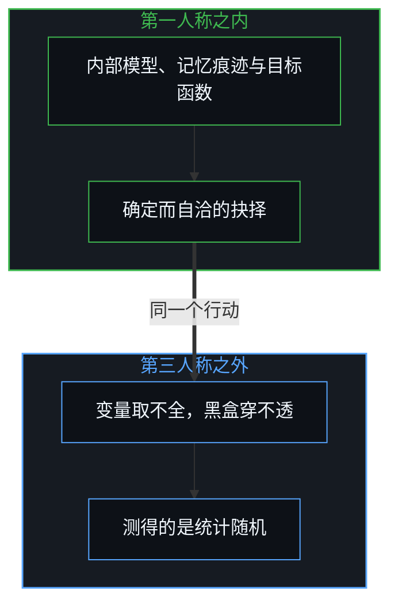
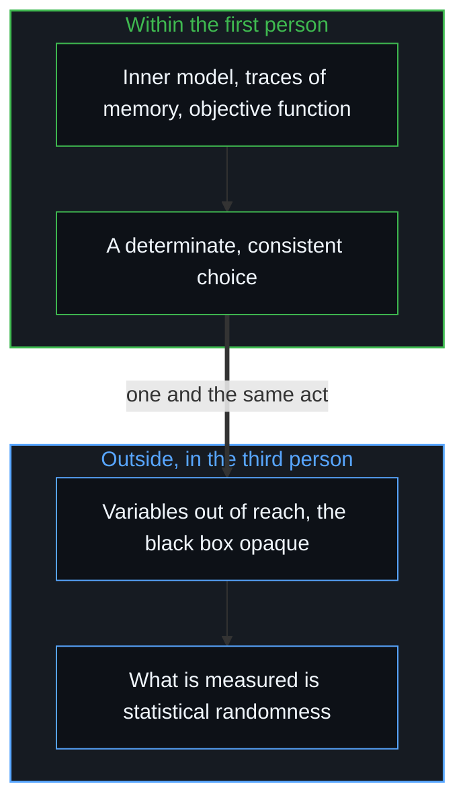

# 自由的测不准 / The Uncertainty of Freedom

*外部观察到的统计随机，是内部决策主权的投影，宏观规律是离散选择在时间里的沉淀 / Randomness seen from outside projects decision sovereignty within; macro laws are the sediment of discrete choices.*

长久以来，关于自由意志、个人成败与社会演进的讨论，在两种看似不可调和的极端之间摇摆：一端是机械决定论，认为宏观的统计规律支配一切，个人的意志与选择只是微不足道的幻觉；另一端是虚无主义，把世间的一切差距归于不可捉摸的运气、随机或天命。这两种表面对立的立场，共享同一个认知盲区：它们都在宏观现象之间寻找原生的因果，把统计聚合之后的投影表象误认为支配系统的动力源头。

For a long time, discussion of free will, individual success and failure, and social change has swung between two seemingly irreconcilable extremes: on one side mechanical determinism, which holds that macro statistical laws govern everything and that individual will and choice are a negligible illusion; on the other nihilism, which puts every gap in the world down to elusive luck, randomness or fate. The two positions, opposed on the surface, share one cognitive blind spot: both look for original causes among macro phenomena, taking the projected appearance of statistical aggregation for the source of power that drives the system.

要穿过这层迷雾，要回到讨论任何理论、理解世界时都离不开的两个必要前提：现实运行的逻辑因果，以及第一人称视角下的微观自由选择。

Getting through this fog means returning to the two necessary premises that no discussion of any theory or understanding of the world can leave: the logical causality by which reality runs, and micro free choice from the first-person view.

## 一、 必要前提：因果与第一人称 / 1. Necessary Premises: Causality and the First Person

探讨任何理论、构建任何模型或想要理解这个世界，都天然地受两个必要前提约束；这两个前提不可或缺，是因为人的一切理性思考与经验反思的展开，都离不开逻辑与第一人称视角本身：

Discussing any theory, building any model or trying to understand the world is by nature bound by two necessary premises; they cannot be done without, because all human reasoning and reflection on experience unfolds within logic and the first-person view itself:

1. 现实遵循严格的因果与逻辑。[因果贯穿始终](../causality-all-the-way/)确立了这个机制：因果不是客体之间神秘的拉扯，而是活着的心智在离散的行动中，对自身历史痕迹单向塑造的确认；在讨论中抽掉逻辑因果，一切建立模型、提炼经验、做出决策与推演规律的行为都失去根基。
2. 一切认知终究来自第一人称视角。任何理论的提出者或行动主体，在任何时空截面上的观察、判断与抉择，都离不开自己心智系统的内部映射、先验假设与当下的认知边界；[表征的闭环](../the-closed-loop-of-representation/)揭示了这种封闭的经济：不存在脱离主体认知模型的纯客观上帝视角，每一个心智中心只能基于自己的内部表征做出判断。

1. Reality follows strict causality and logic. [Causality All the Way](../causality-all-the-way/) establishes the mechanism: causality is not a mysterious pull between objects but the living Mind's confirmation, in discrete acts, of the one-way shaping of its own historical traces; remove logical causality from the discussion and every act of building models, distilling experience, making decisions and deriving regularities loses its ground.
2. All understanding comes in the end from the first-person view. Any proposer of a theory or acting subject, at any cross-section of time and space, observes, judges and chooses through the inner mapping, prior assumptions and present cognitive boundary of their own Mind; [The Closed Loop of Representation](../the-closed-loop-of-representation/) reveals this closed economy: there is no purely objective God's-eye view detached from a subject's cognitive model, and each centre of Mind can judge only from its own inner representation.

在这两个前提的约束下，在微观决策主体之内，每一次选择都是确定而自洽的因果闭环。统计的权威标签同样背书不了真理，[从形式迷思到逻辑闭环](../cong-xing-shi-mi-si-dao-luo-ji-bi-huan/)对此有所论述。在严格的第一人称视角下，世界上并不存在真正意义上的“非理性”；外部观察者眼中的“愚蠢”“冲动”或“不可理喻”，只来自外部观察者与内部决策者之间的坐标系错位、评价标准的分歧，以及信息维度的严重截断。

Under these two premises, within the micro deciding subject, each choice is a determinate and consistent causal loop. The authority of a statistical label cannot vouch for truth either, as [From the Myth of Form to the Closed Loop of Logic](../cong-xing-shi-mi-si-dao-luo-ji-bi-huan/) discusses. From a strict first-person view there is no real "irrationality" in the world; the "foolishness", "impulsiveness" or "unreasonableness" in an outside observer's eyes comes only from the misalignment of coordinate systems between the outside observer and the inner decider, from differences in standards of evaluation, and from a severe truncation of informational dimensions.

## 二、 自由意志的测不准 / 2. The Uncertainty of Free Will

决定论者最常引用的论据是：对海量人群的行为做宏观统计时，个人的数据常呈现出类似布朗运动或独立随机游走的特征，据此断言个人所谓的自由意志并不存在，一切只是概率的掷骰。这个推论犯了一个逻辑倒错：它把“第三人称观测信息的缺失”，等同于“第一人称因果的缺位”。

Determinists most often cite this argument: when the behaviour of vast populations is measured statistically at the macro level, individual data often look like Brownian motion or an independent random walk, and from this they declare that so-called individual free will does not exist and all is a throw of the probabilistic dice. The inference makes a logical inversion: it equates "the absence of third-person observational information" with "the absence of first-person causation".

- 第一人称的确定：当一个人有完整的控制权、做出不受外部强行操控的自主选择时，这个决定由其独特的内部估值模型、历史记忆的痕迹与当下的目标函数严格推出；在微观的内部，这个过程有十足的因果必然。
- 第三人称的最大信息熵：外部观察者永远无法获取这个主体脑海里全部的微观变量、隐性偏好、情绪权重与历史上下文，这个求解过程对外部是一个穿不透的黑盒；外部系统无法建立从“外部环境输入”到“个人行为输出”的机械确定的函数映射，所以在外部的统计观测上，这个自主的决策必然呈现出与纯随机过程，最大信息熵，一致的数学特征。

- First-person determinacy: when a person has full control and makes an autonomous choice not forcibly manipulated from outside, the decision follows strictly from their unique inner model of valuation, the traces of historical memory and the present objective function; within the micro interior, the process has full causal necessity.
- Third-person maximal information entropy: an outside observer can never obtain all the micro variables, hidden preferences, emotional weights and historical context in this subject's head, so the solving process is an impenetrable black box to the outside; no outside system can build a mechanically determinate function from "outside environmental input" to "individual behavioural output", so in outside statistical observation this autonomous decision necessarily shows mathematical features identical to a purely random process, maximal information entropy.

外部表现为随机，正是微观自由意志存在的数学证明。如果一个人的行为在外部可以被公式十足精确地预测，恰恰证明其决策机制已被外部的环境变量焊死，成了没有自主心智的机械齿轮；只有当一个人拥有不可剥夺的微观主权、由自己的内部模型驱动决策时，外部系统才只能以“统计随机”的形式在宏观上度量它。[翻袋球与魔术戏法](../the-bank-shot-and-the-magic-trick/)用台球桌上的库边反弹与魔术戏法揭示了这道断层：外部学者统计成千上万次业余击球、画出正态的钟形曲线时，断言进球纯属随机运气；而真正站在球台前推演反射几何、经过千百小时第一人称训练的球手清楚，高难度的反弹进球，是内在精准的模型与身体刻意练习的确定因果。在外是随机，在内是抉择，[主权抉择的双面性与观察的客体化](../the-two-sided-nature-of-sovereign-choice-and-the-objectification-of-observation/)说明了这两面怎样属于同一个行动。

Appearing random from outside is precisely the mathematical proof that micro free will exists. If a person's behaviour could be predicted from outside by formula with full precision, that would prove their decision mechanism had been welded shut by outside environmental variables, a mechanical gear without an autonomous Mind; only when a person holds inalienable micro sovereignty, with decisions driven by their own inner model, can an outside system measure them at the macro level only in the form of "statistical randomness". [The Bank Shot and the Magic Trick](../the-bank-shot-and-the-magic-trick/) reveals this fault line with the cushion rebounds of the billiard table and the magician's trick: when outside scholars tally thousands of amateur strokes and draw a normal bell curve, they declare pocketing a ball pure chance; yet the player who really stands at the table working out the geometry of reflection, after thousands of hours of first-person practice, knows that a difficult bank shot is the determinate causality of a precise inner model and deliberate bodily practice. Random outside, choice inside, and [The Two-Sided Nature of Sovereign Choice and the Objectification of Observation](../the-two-sided-nature-of-sovereign-choice-and-the-objectification-of-observation/) shows how both faces belong to one act.

这就是自由的测不准：内部主权的确定越高，外部测量的表观熵值越大。

This is the uncertainty of freedom: the higher the determinacy of inner sovereignty, the greater the apparent entropy of outside measurement.

## 三、 统计演进的几何 / 3. The Geometry of Statistical Evolution

宏观的社会系统本身没有原生的施力能力，它只是海量微观个人决策在统计层面的聚合投影。这个投影遵循一条清晰、优雅的数学演进路径。

The macro social system has no original power of its own to exert force; it is only the aggregated projection, at the statistical level, of vast numbers of micro individual decisions. The projection follows a clear and elegant mathematical path.

### 1. 微观的二元选择 / 1. Micro Binary Choice

在每一个具体的行动截面上，决策的底层结构是 0 与 1 的离散选择。[信息是什么](../what-information-is/)确立了信息与决策的最小单位，“是这个，不是那个”。在认知层面，这个二元选择表现为：要么向内校准模型、修正假设，1；要么维持既有路径、向外推卸归因，0。单次的微观 0/1 选择本身在因果上无所谓难易，它是主体在既定前提下的自然输出。

At each concrete cross-section of action, the underlying structure of decision is a discrete choice of 0 or 1. [What Information Is](../what-information-is/) establishes the smallest unit of information and decision, "this, not that". At the cognitive level the binary choice shows itself as either calibrating the model inward and revising assumptions, 1, or keeping the existing path and shifting attribution outward, 0. A single micro 0/1 choice is in itself neither hard nor easy causally; it is the subject's natural output under given premises.

### 2. 正态分布的涌现 / 2. The Emergence of the Normal Distribution

依二项分布的极限性质与中心极限定理，大量带着不同前提假设、各自在微观之内保持自洽的个人，做出相互独立的二元选择时，这些选择在大样本空间里被线性地叠加与平均；宏观上，系统收敛为以均值为中心的对称钟形曲线，即正态分布。这并不意味着个人在盲目地抛硬币，而是海量各异却互不相关的微观自洽模型，在统计聚合下的均值涌现。

By the limiting properties of the binomial distribution and the central limit theorem, when large numbers of people, each carrying different premises and each consistent within the micro interior, make mutually independent binary choices, these choices are summed and averaged linearly in a large sample space; at the macro level the system converges to a symmetric bell curve centred on the mean, the normal distribution. This does not mean people are blindly tossing coins; it is the emergence of a mean from vast numbers of different but uncorrelated micro-consistent models under statistical aggregation.

### 3. 幂律分布的跃迁 / 3. The Leap to the Power Law

真实的生活与商业决策，不是单次独立的抛硬币，而是跨轮次的动态演进。个人的决策自相关，从来不是在封闭真空里的单机运算，而是借与外部物质世界真实的反馈回路维持的：行动者运行自己的内在逻辑，把动作输出到现实世界，接收现实因果的反馈，再据此向内校准内在逻辑。把抉择客体化为“大 Ego”，是对微观主权的另一种遮蔽，[自尊的刚性外壳与隐性外部归因](../zi-zun-de-gang-xing-wai-ke-yu-yin-xing-wai-bu-gui-yin/)对此有所剖析。

Real decisions in life and business are not single independent coin tosses but dynamic evolution across rounds. An individual's autocorrelation of decisions is never a standalone computation in a closed vacuum but is sustained through real feedback loops with the outside material world: the actor runs their own inner logic, outputs action into the world, receives reality's causal feedback, and calibrates their inner logic inward by it. Objectifying choice into a "big Ego" is another way of covering micro sovereignty, dissected in [The Rigid Shell of Self-Esteem and Hidden External Attribution](../zi-zun-de-gang-xing-wai-ke-yu-yin-xing-wai-bu-gui-yin/).

更要紧的是，在多主体交互的场域里，持续自我校准的主体，比如在环境里造出高效工具与机器的行动者，沉淀下来的物质痕迹与制度脚手架，会被那些自纠能力不强的主体直接复用；校准的主体与未校准的主体，借共享的环境痕迹形成互补而稳定的外部回路。随着轮次增加，对称的正态分布被不对称的乘性复利打破，系统在长周期的统计里演变成带着极端长尾的幂律分布。[来自个体差异的层级](../hierarchy-from-individual-difference/)与[封闭的假设把复利挤成 S 曲线](../closed-assumptions-squeeze-compounding-into-s-curves/)推导了这一几何形态，[印迹与行动](../the-mark-and-the-act/)进一步把这个机制延伸到多智能体与物质实在：处在长尾极端的巨大成效与沉淀下来的自动化结构，常被外部的旁观者神话为“涌现的群体智能”或“集体的文明主体”；从底层的因果看，这只是微观的 0/1 决策在外部反馈回路与环境留痕中，借自相关与跨主体的复用，在数学上自然收敛出的几何结果。微观主权不从统计中涌现，[主体性不曾涌现](../agency-does-not-arise/)说明了能动性只能是先验的。

More important, in a field of many interacting subjects, the material traces and institutional scaffolding left by subjects who keep calibrating themselves, such as actors who build efficient tools and machines in the environment, are reused directly by subjects with weaker self-correction; calibrating and uncalibrated subjects form a complementary, stable outside loop through shared environmental traces. As rounds accumulate, the symmetric normal distribution is broken by asymmetric multiplicative compounding, and over long statistical periods the system evolves into a power-law distribution with an extreme long tail. [Hierarchy from Individual Difference](../hierarchy-from-individual-difference/) and [Closed Assumptions Squeeze Compounding into S-Curves](../closed-assumptions-squeeze-compounding-into-s-curves/) derive this geometric form, and [The Mark and the Act](../the-mark-and-the-act/) extends the mechanism to multi-agent systems and the material world: the enormous results at the extreme of the long tail and the automated structures left behind are often mythologised by outside onlookers as "emergent swarm intelligence" or "a collective civilisational subject"; seen from the underlying causality, they are only the geometric result to which micro 0/1 decisions naturally converge, mathematically, through autocorrelation and cross-subject reuse in outside feedback loops and environmental traces. Micro sovereignty does not emerge from statistics; [Agency Does Not Arise](../agency-does-not-arise/) shows that agency can only be prior.

## 四、 用阴影解释阴影 / 4. Explaining Shadows by Shadows

现实社会里，许多对经济、阶层与历史现象的解释，陷在统计演进链条中某一个特定截面的断层里。传统的实证研究常截取正态分布的中间均值，或截取幂律分布的极端长尾，想建立“现象 A 导致现象 B”的因果假说，例如“高学历导致高收入”“某套管理模式带来商业成功”。这种研究，是在二维的投影面上用阴影解释阴影：宏观截面之间的统计相关，并不包含原生的因果施力；[遗忘的脚手架](../the-scaffolding-we-forget/)揭示了这种遗忘，一旦微观个人底层的选择参数变动，建立在宏观截面上的所谓“铁律”就会立刻失效。[个人选择](../ge-ren-xuan-ze-she-hui-hua-yu-zuo-zi-ji-de-zhen-zheng-zuo-biao/)同样指出了这种滞后：社会规范与制度架构，只是无数过往选择互补交互沉淀下来的地形，而不是决定未来的原因。

In society, many explanations of economic, class and historical phenomena are caught in the fault line of one particular cross-section of the chain of statistical evolution. Conventional empirical research often takes the middle of a normal distribution or the extreme tail of a power law and tries to build causal hypotheses of the form "phenomenon A causes phenomenon B", such as "higher education causes higher income" or "a certain management model brings commercial success". Such research explains shadows by shadows on a two-dimensional plane of projection: statistical correlation between macro cross-sections contains no original causal force; [The Scaffolding We Forget](../the-scaffolding-we-forget/) reveals this forgetting, and once the underlying choice parameters of micro individuals shift, the so-called "iron laws" built on macro cross-sections fail at once. [Individual Choice](../ge-ren-xuan-ze-she-hui-hua-yu-zuo-zi-ji-de-zhen-zheng-zuo-biao/) likewise points to this lag: social norms and institutional architecture are only the terrain settled from countless past choices interacting complementarily, not the cause that decides the future.

## 五、 归因与微观主权的回归 / 5. Attribution and the Return of Micro Sovereignty

现实世界充满模糊的反馈与延迟的信号，这正是心智模型需要主动提高校准精度的触发条件，而不是放弃向内审视的借口。

The world is full of blurred feedback and delayed signals, which is exactly what triggers the mental model to raise the precision of its calibration, not an excuse to stop looking inward.

- 向外归因的退化：把意外与失败归于外部环境、体制阻碍或运气不济，虽然最省力地维护了已有心智模型的封闭自洽，却在数学的机制上主动切断了跨轮次决策正向的自相关；放弃了乘性复利，就重新退化为孤立的随机游走者，最终跌回均值回归的中段。
- 向内校准的进化：承认既有模型有单比特的溢出，在第一人称的决策循环里，借每一次具体的试错主动拓宽认知的比特位宽，完成系统的升维与重塑。

- The decline of outward attribution: putting surprises and failures down to the outside environment, institutional obstacles or bad luck preserves the existing model's closed consistency with the least effort, yet by the mathematical mechanism actively cuts the positive autocorrelation of decisions across rounds; giving up multiplicative compounding, one slips back into an isolated random walker and in the end falls back into the middle band of regression to the mean.
- The evolution of inward calibration: admitting that the existing model has a single-bit overflow, and within the first-person loop of decision actively widening the bit-width of understanding through each concrete trial and error, completing a raising of dimension and a reshaping of the system.

[从“目的性”的评判，看认知系统的缺省状态与动态跃迁](../cong-mu-di-xing-de-ping-pan-kan-ren-zhi-que-sheng/)与[自我价值感与所有权](../ownership-and-self-worthiness/)守住了这道主权的防线：只有认领全部的解释权与因果责任，个人的认知进化才有真实的支点。

[Judging by Purpose: The Default State and Dynamic Leaps of Cognition](../cong-mu-di-xing-de-ping-pan-kan-ren-zhi-que-sheng/) and [Ownership and Self-Worthiness](../ownership-and-self-worthiness/) hold this line of sovereignty: only by claiming the whole right of interpretation and causal responsibility does a person's cognitive evolution have a real fulcrum.

## 六、 结论 / 6. Conclusion

人类社会并没有脱离个人、自我驱动的“宏观客观规律”；宏观层面的正态分布与幂律长尾，都是底层微观自由选择在时间维度里的统计波纹。[个体抉择是唯一的因果杠杆](../individual-choices-as-the-only-causal-levers/)确立了清楚的认知坐标：逻辑因果是理解世界离不开的必要约束，第一人称视角下的微观二元选择，是整个复杂巨系统中唯一的独立自变量。

Human society has no self-driven "objective macro law" detached from individuals; the normal distributions and power-law tails at the macro level are all statistical ripples of underlying micro free choices over time. [Individual Choices as the Only Causal Levers](../individual-choices-as-the-only-causal-levers/) establishes a clear cognitive coordinate: logical causality is a necessary constraint no understanding of the world can leave, and micro binary choice from the first-person view is the one independent variable in the whole complex giant system.

[自由即地基](../freedom-as-ground/)确认了自由是什么：自由不需要等待外部的准许，它就是当下这一刻做出选择的初始地基。穿过宏观统计断层的表象，收回对外部虚假因果的投射，回到第一人称当下每一次 0 与 1 的向内校准，个人的认知跃迁与命运演进才有真实的因果杠杆。否定自由意志的雄辩，本身就是自由在区分，[自由意志的自否自由](../the-freedom-of-will-to-deny-itself/)说明了这一点。

[Freedom as Ground](../freedom-as-ground/) confirms what freedom is: freedom need not wait for outside permission; it is the initial ground on which a choice is made at this moment. Seeing through the surface of the macro statistical fault line, taking back the projection of false outside causes, and returning to each inward calibration of 0 and 1 in the first-person present, individual cognitive leaps and the course of a life have a real causal lever. The eloquence that denies free will is itself freedom distinguishing, as [The Freedom of Will to Deny Itself](../the-freedom-of-will-to-deny-itself/) shows.
