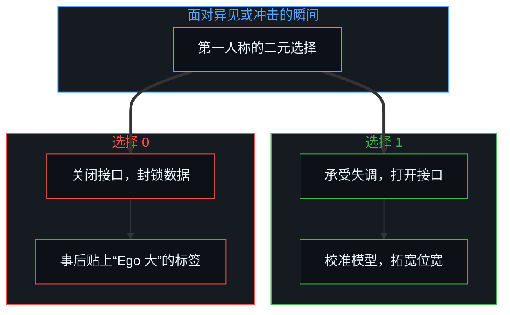
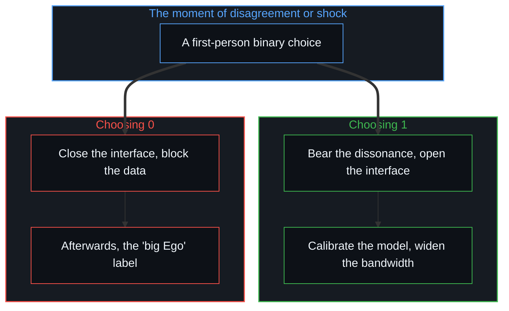

# 自尊的刚性外壳与隐性外部归因 / The Rigid Shell of Self-Esteem and Hidden External Attribution

*把决策客体化为“大 Ego”，是为停滞造一块免责挡板，刚性的防御是位宽不足的封锁 / Calling live decisions a "big Ego" shields stagnation; rigid defence is a lock from too little bandwidth.*

在日常的反思与人际沟通里，“我这个人 Ego 太大（自尊心太强）”常被当作一种很诚恳的自我剖析。很多人以为，只要公开承认自己有一个“大 Ego”，就等于完成了向内审视的关键第一步。

In everyday reflection and conversation, "I have too big an Ego" (too strong a sense of self-esteem) is often offered as a sincere piece of self-analysis. Many believe that openly admitting to a "big Ego" amounts to completing the key first step of looking inward.

可若穿过语言与概念的修辞表象，顺着因果链向底层推演，就会发现这种说法多半藏着一种很隐蔽的认知陷阱：它以向内反省的样子，在微观层面上完成了一次悄无声息的“隐性外部归因”，把当下拒绝改变说成某种固有性格实体在作祟，在得到道德上的自我安慰的同时，轻巧地免去了自己在当下这一刻做出调整的因果责任。

Yet looking through the rhetorical surface of language and concept and reasoning down the causal chain, the saying mostly hides a subtle cognitive trap: in the guise of inward reflection, it completes at the micro level a silent "hidden external attribution", presenting a present refusal to change as the doing of some fixed entity of character, and, while gaining moral self-comfort, lightly lifting from oneself the causal responsibility of adjusting at this very moment.

## 一、 伪反省的机制 / 1. The Mechanism of Pseudo-Reflection

当一个人说“因为我 Ego 太大，所以道理没想通我就不愿妥协改变”时，他在思维深处完成了一次关键的主客体剥离：他把过往经历在心智里沉淀下来的抽象概念，“Ego”或“强自尊”，塑造成一个独立于当下意愿之外的实体客体；内在真实的潜台词其实是：“并不是此时此刻的‘我’主动拒绝了认知迭代，而是那个叫作‘Ego’的固有性格属性绑架了我。”

When someone says "because my Ego is too big, I won't compromise or change until I've thought it through", they complete deep in their thinking a key separation of subject and object: they shape an abstract concept settled in the Mind from past experience, "Ego" or "strong self-esteem", into an entity standing apart from present will; the real inner subtext is: "it is not the 'I' of this moment that actively refused to update; it is the fixed character trait called 'Ego' that took me hostage."

这正是典型的隐性外部归因，它给当下的停滞、逃避与防御披上了一件合理的心理学外衣。[持续生长的脚手架](../the-scaffolding-that-keeps-growing/)追溯这件外衣所取的姿态：退后一步去俯瞰一个被持守为完成的框架，看起来像反省，却冻结了它声称要相对化的框架，而脚下的结构早已变了形状。被免去摩擦的心智容易长出脆弱的傲慢，[未历摩擦的心智与借来的全能](../the-unfrictioned-mind-and-borrowed-omnipotence/)描述的正是这层硬壳的来历。

This is typical hidden external attribution, dressing present stagnation, avoidance and defence in a reasonable psychological coat. [The Scaffolding That Keeps Growing](../the-scaffolding-that-keeps-growing/) traces the stance this coat takes: stepping back to survey a frame held as finished looks like reflection, yet it freezes the frame it claims to relativize, while the structure underfoot has already changed shape. A Mind spared friction easily grows a brittle arrogance, and [The Unfrictioned Mind and Borrowed Omnipotence](../the-unfrictioned-mind-and-borrowed-omnipotence/) describes exactly where this hard shell comes from.

在微观的世界里，并没有一个叫作“Ego”的独立幽灵在替人掌舵。[信息是什么](../what-information-is/)与[自由的测不准](../zi-you-de-ce-bu-zhun/)确立了决策的事实：在面对异见、外部冲击或未知信息的每一个具体瞬间，系统内部发生的只有第一人称的二元选择，0 或 1。选择 1，主动承受认知失调的不适，打开接口去校准当下的心智模型；选择 0，主动关闭接口、封锁数据，以维持既有心智模型的封闭自洽。“Ego 大”不是阻碍改变的原因，它只是一个人在当下屡屡选择 0 之后，事后给自己贴上的免责标签。

In the micro world there is no independent ghost called "Ego" steering for anyone. [What Information Is](../what-information-is/) and [The Uncertainty of Freedom](../zi-you-de-ce-bu-zhun/) establish the fact of decision: at each concrete moment of facing disagreement, outside shock or unknown information, all that happens inside the system is a first-person binary choice, 0 or 1. Choosing 1 is actively bearing the discomfort of cognitive dissonance and opening the interface to calibrate the present mental model; choosing 0 is actively closing the interface and blocking the data to keep the existing model closed and consistent. A "big Ego" is not what blocks change; it is only a label of exemption a person sticks on afterward, having chosen 0 again and again in the present.

## 二、 刚性自尊的物理学 / 2. The Physics of Rigid Self-Esteem

日常经验里有一个很普遍的悖论：那些极力表现出“自尊心极强、不轻易低头”的人，在直觉深处多半很缺乏真正的内在自信。这个现象符合信息系统处理外部扰动时的物理特征，用不着神秘的解释。

Everyday experience holds a very common paradox: those who most strenuously show "very strong self-esteem, never bowing easily" mostly lack, deep in their intuition, real inner confidence. The phenomenon fits the physical features of an information system handling outside disturbance and needs no mystical explanation.

一种是高容错系统的开放，也就是真自信：一个人底层的心智模型有足够的计算位宽与结构韧性时，面对外部的否定、冲击或没料到的变量，不需要立刻拉响全面防御的警报，他有富余的带宽把这些异质的信息作为输入参数纳入推演；即使推演的结果证明自己原先的前提错了，系统也只需完成一次局部的参数更新，而不会让整个精神内核塌掉。另一种是低容错系统的刚性外壳，也就是“大 Ego”：一个心智模型的有效位宽很窄、内核很脆弱时，任何超出既定预设的外部扰动，都可能引起系统的单比特溢出，甚至死机与崩溃；为了保护这个摇摇欲坠的内核，系统就在最外层砌起一堵很高、很硬的刚性防火墙，用“强自尊”的姿态，把一切可能动摇底层假设的信息提前挡在外面。

One is the openness of a high-tolerance system, which is real confidence: when a person's underlying mental model has enough computational bandwidth and structural resilience, facing outside negation, shock or an unforeseen variable needs no full alarm of defence at once, and there is spare bandwidth to take the foreign information in as input parameters for reasoning; even if the reasoning shows one's earlier premise was wrong, the system only needs one local update of parameters, and the whole inner core does not collapse. The other is the rigid shell of a low-tolerance system, which is the "big Ego": when a mental model's effective bandwidth is very narrow and its core very fragile, any outside disturbance beyond the set presumptions can cause a single-bit overflow in the system, even a freeze or crash; to protect this tottering core, the system builds a very high, very hard rigid firewall at its outermost layer, using the posture of "strong self-esteem" to keep out in advance all information that might shake its underlying assumptions.

[自我形象仿佛从无处发声](../self-image-speaks-as-if-from-nowhere/)与[超越的定相](../the-fixed-image-of-transcendence/)揭示了这种防御守的是什么：拼命捍卫的，从来不是真实的自我，而是一张用来遮住内部带宽匮乏的“冻结的自我画像”。在投资里，刚性的自尊会拒绝为误差买单，[投资决策的因果闭环](../tou-zi-jue-ce-de-yin-guo-yu-zhen-zi-fu-ying-kui/)说明了真正的自负盈亏。这种刚性的自尊从来不是力量的体现，恰恰是认知位宽严重不足时，系统本能采取的硬性封锁。

[Self-Image Speaks as if from Nowhere](../self-image-speaks-as-if-from-nowhere/) and [The Fixed Image of Transcendence](../the-fixed-image-of-transcendence/) reveal what this defence guards: what is so fiercely defended is never the real self but a "frozen self-portrait" covering a shortage of inner bandwidth. In investing, rigid self-esteem refuses to pay for errors, and [The Causal Loop of Investment Decisions](../tou-zi-jue-ce-de-yin-guo-yu-zhen-zi-fu-ying-kui/) shows what bearing one's own profit and loss really is. Such rigid self-esteem is never an expression of strength; it is precisely the hard lock a system instinctively applies when its cognitive bandwidth falls badly short.

## 三、 学科范式的遮蔽 / 3. How Disciplinary Paradigms Obscure

讨论这一现象时，人们容易滑进现成的学术范式，借心理学的防御机制理论，或搬出形式逻辑的无矛盾原则；这些人为构建的学科框架，常成了新的认知遮蔽。心理学范式的局限在于：传统心理学热衷在人类行为的表象之间找统计关联，用“依恋类型”“防御机制”“大五人格”这些静态名词对人做客体化的切片，这种分类恰恰抹掉了第一人称在当下的即时选择权。[好奇没有最终的形态](../curiosity-has-no-final-form/)指出，一旦套用这些学术的容器，人就容易退化成自己行为的局外观察者，把“我是某某型人格”当作拒绝进化的科学借口。

Discussing this phenomenon, people easily slide into ready-made academic paradigms, borrowing psychology's theory of defence mechanisms or bringing out formal logic's principle of non-contradiction; these man-made disciplinary frames often become a new cognitive cover. The limit of the psychological paradigm is this: traditional psychology is keen to find statistical associations among the surfaces of human behaviour and to slice people into objects with static nouns such as "attachment style", "defence mechanism" and "the Big Five", and such classification erases exactly the first person's immediate power of choice in the present. [Curiosity Has No Final Form](../curiosity-has-no-final-form/) points out that once these academic containers are applied, a person easily degrades into an outside observer of their own behaviour, taking "I am such-and-such a personality type" as a scientific excuse for refusing to evolve.

形式逻辑学的边界在于：为了维持局部的符号纯洁，它把“形式上不自相矛盾”设为最高戒律；可现实的动态演进常伴随旧框架的破裂与新信息的涌入。把形式逻辑的静态无冲突当成教条，人就会为了维持既有命题表面上的不矛盾，固执地拒绝吸纳更高维度的事实，把自己困在狭隘的信息断层里。

The boundary of formal logic is this: to keep local symbolic purity, it sets "no formal self-contradiction" as its highest rule; yet reality's dynamic unfolding often comes with old frames breaking and new information flooding in. Taking formal logic's static freedom from conflict as dogma, a person will stubbornly refuse higher-dimensional facts in order to keep existing propositions free of apparent contradiction, trapping themselves in a narrow gap of information.

要依循的，既不是心理学的分类标签，也不是形式逻辑的教条条文，而是[因果贯穿始终](../causality-all-the-way/)所确立的现实的因果链。因果的机制不依赖学科的命名而运转：心智输入了什么假设、做出了什么选择，在既定的约束下就推出什么后果；无论一个人怎样用高深的概念包装自己，真实的反馈都会如实落下。持续的行动来自第一人称面对摩擦的收益差，而不是自尊的硬壳，[观察的因果僭越与第一人称的收益差](../the-causal-overstep-of-observation-and-the-first-person-surplus/)说明了这一点。

What is to be followed is neither psychology's labels of classification nor formal logic's dogmatic articles but the causal chain of reality established in [Causality All the Way](../causality-all-the-way/). The mechanism of causality runs without depending on any discipline's naming: whatever assumption the Mind takes in and whatever choice it makes, the consequence that follows under the given constraints is what it gets; however a person wraps themselves in lofty concepts, real feedback lands as it is. Sustained action comes from the first person's surplus in meeting friction, not from the hard shell of self-esteem, as [The Causal Overstep of Observation and the First-Person Surplus](../the-causal-overstep-of-observation-and-the-first-person-surplus/) shows.

## 四、 回到第一人称的微观选择 / 4. Returning to First-Person Micro Choice

看清了“Ego”这个概念背后的虚幻，认知进化的路径就变得清楚而直接。用不着苦思怎样“放下 Ego”或“提升自尊”，这些努力都是在与自己虚构出来的概念影子搏斗。[自我价值感与所有权](../ownership-and-self-worthiness/)与[从“目的性”的评判，看认知系统的缺省状态与动态跃迁](../cong-mu-di-xing-de-ping-pan-kan-ren-zhi-que-sheng/)锁定了有效的解法：收回向外的推卸，回到每一个第一人称当下的截面。

With the illusion behind the concept of "Ego" seen clearly, the path of cognitive evolution becomes clear and direct. There is no need to agonise over how to "let go of the Ego" or "raise self-esteem"; these efforts are struggles with a conceptual shadow one invented oneself. [Ownership and Self-Worthiness](../ownership-and-self-worthiness/) and [Judging by Purpose: The Default State and Dynamic Leaps of Cognition](../cong-mu-di-xing-de-ping-pan-kan-ren-zhi-que-sheng/) fix on the solution that works: taking back the outward shifting of responsibility and returning to each first-person cross-section of the present.

先是放下性格宿命论：承认并不存在任何外在于当下的“大 Ego”实体或性格宿命，那只是自己为逃避改变而发明出来的掩护。再是正视边界的张力：承认沟通中的卡壳、面对异见时的愤怒与抗拒，都是当下的心智系统碰到认知边界时真实的张力；[破除概念的僭越](../po-chu-gai-nian-de-jian-yue/)进一步把这种张力还原为控制论意义上的损失函数：负面情绪是一阶系统发出的高信噪比的脱节警报，若用二阶的理性对它施加道德审判，只会形成高压的堰塞湖，导致精神动力学的极端坍缩。最后是认领微观的选择权：直面那次不可剥夺的 0 与 1 的微观抉择，在感到被冒犯或不适的那一刻，主动放弃退回坚硬的外壳，也就是 0，选择向内校准参数、拓宽系统的位宽，也就是 1。

First, setting down fatalism about character: acknowledging that there is no "big Ego" entity or destiny of character outside the present, only a cover invented to avoid change. Next, facing the tension at the boundary: acknowledging that getting stuck in conversation, and anger and resistance in the face of disagreement, are the real tension of the present mental system touching the boundary of its understanding; [Breaking the Overreach of Concepts](../po-chu-gai-nian-de-jian-yue/) further reduces this tension to a loss function in the cybernetic sense: negative emotion is a high signal-to-noise alarm of disconnection sent by the first-order system, and passing moral judgment on it with second-order reason only forms a high-pressure barrier lake and leads to an extreme collapse of psychic dynamics. Last, claiming the micro power of choice: facing the inalienable micro choice of 0 and 1, and in the moment of feeling offended or uncomfortable, actively declining to retreat into the hard shell, which is 0, and choosing to calibrate inward and widen the system's bandwidth, which is 1.

[个体抉择是唯一的因果杠杆](../individual-choices-as-the-only-causal-levers/)确立了行动的杠杆：剥掉一切概念的外衣，让心智直接与现实的因果反馈碰撞。只有在真实的试错与参数重塑中不断扩展认知的带宽，那堵僵硬的防御之墙才会自然瓦解，生出从容而坚固的内在自洽。心理学的标签也是一种权威的形式，[从形式迷思到逻辑闭环](../cong-xing-shi-mi-si-dao-luo-ji-bi-huan/)说明了怎样剥离它，回到逻辑的闭环。

[Individual Choices as the Only Causal Levers](../individual-choices-as-the-only-causal-levers/) establishes the lever of action: strip away every conceptual coat and let the Mind collide directly with reality's causal feedback. Only by continually widening the bandwidth of understanding through real trial, error and reshaping of parameters does that stiff wall of defence fall away of itself, giving rise to an inner consistency that is composed and firm. Psychological labels are also a form of authority, and [From the Myth of Form to the Closed Loop of Logic](../cong-xing-shi-mi-si-dao-luo-ji-bi-huan/) shows how to strip them away and return to the closed loop of logic.
