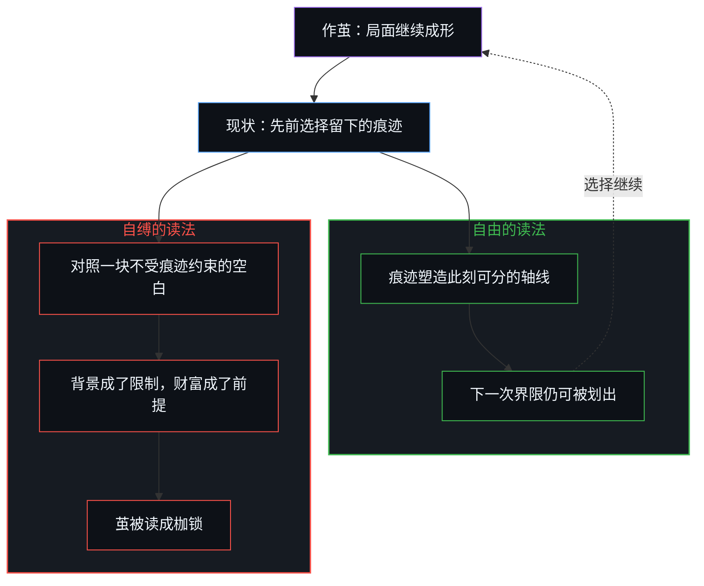
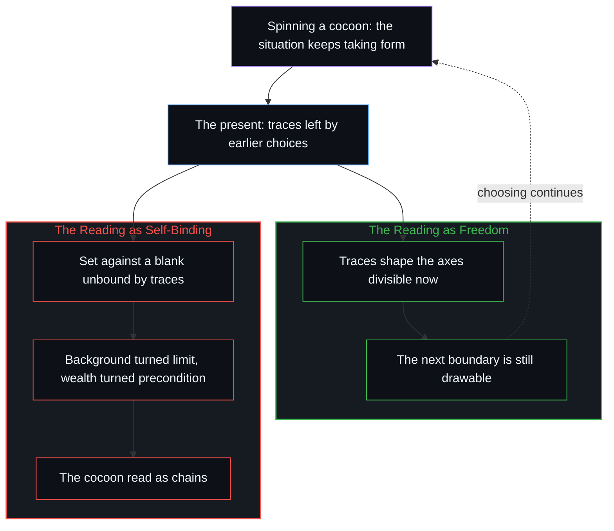

# 作茧不是自缚 / Spinning a Cocoon Is Not Binding Oneself

*自由从未失去，枷锁来自对成形的解读 / Freedom is never lost; the chains come from how the forming is read.*

必须面对的现实背景被当成限制，财富之类再被加成自由本身的前提，成形中的茧就被读成枷锁。自由不是先于条件的空白，而是还能做出区分：选择不是另有一个站在现状旁边的我，而是这个局面里，下一次界限仍可被划出。卢梭式的「无往不在枷锁之中」，是有限位置上轴线挤在一起时的读法；现实一直没有被封上。亲历的和公认的，都还在心智里发生——不是有一个盒子装着万物，谈论正在进行的这个位置，就是心智。

The background one must face is taken as a limit; wealth and the like are then added as preconditions of freedom itself, and the cocoon still forming is read as chains. Freedom is not a blank prior to conditions. It is the capacity to keep making distinctions: choosing is not a separate I standing beside the present situation, but the next boundary in this situation still being drawable. Rousseau's "everywhere in chains" is how the axes read when they crowd together at a finite position. Reality has never been sealed. What is lived and what is agreed on both still happen in the Mind: no box holds everything, and the place where the talking is happening is the Mind.

## 一、 作茧是看见的成形 / 1. The Cocoon Is the Forming That Is Seen

作茧是看得见的——局面继续成形。自缚不是另一件事，而是对这同一现象的解读。自由必须面对的现实背景被当成限制；财富之类再被加成自由本身的前提，茧就被读成枷锁。化蝶不是挣脱茧之后去到一块空白，茧就是这个局面继续成形。

Spinning a cocoon is what can be seen—the situation keeps taking form. Binding oneself is not a second event; it is a reading of this same phenomenon. The background of reality that freedom has to face is taken as a limit; wealth and the like are then added as preconditions of freedom itself, and the cocoon is read as chains. Becoming a butterfly is not breaking out of the cocoon into a blank; the cocoon is this situation continuing to take form.

## 二、 自由是下一次界限仍可被划出 / 2. Freedom Is the Next Boundary Still Drawable

自由不是一块先于任何条件的空白。所谓自由，就是还能做出区分，也就是一般所说的选择。选择不是另有一个站在现状旁边的我，再对现状下手，而是这个局面里，下一次界限仍可以被划出。现状是先前一次次选择留下的痕迹。它塑造此刻能够分开的轴线，却不取消下一次选择。无论眼前是什么样，选择并不因此停住。自由从未失去。[个体抉择是唯一的因果杠杆](../individual-choices-as-the-only-causal-levers/)讲的是同一种归位：条件是场，不是替下一步提供原因的第二个作者。[读《中文哲学简史》有感](../du-zhongwen-zhexue-jianshi-you-gan/)讲的是另一面：「没有选择」本身仍是一次选择。

Freedom is not a blank prior to any condition. Freedom is the capacity to keep making distinctions—what is generally called choice. Choosing is not a separate I standing beside the present situation and then acting on it; it is the next boundary in this situation still being drawable. The present situation is the trace left by earlier choices, one after another. It shapes the axes along which this moment can be divided, but it does not cancel the next choice. Whatever lies in front, choosing does not stop there. Freedom has never been lost. [Individual Choices as the Only Causal Levers](../individual-choices-as-the-only-causal-levers/) returns cause to the same place: conditions are the field, not a second author supplying the cause of the next step. [Reflections on A Short History of Chinese Philosophy](../du-zhongwen-zhexue-jianshi-you-gan/) shows the other face: "having no choice" is itself still a choice.

## 三、 枷锁是拿现状对照一块不受痕迹约束的自由 / 3. Chains Compare the Present with a Freedom Unbound by Traces

枷锁来自这次解读，不是来自作茧。把现状强调成限制，就像卢梭说的：无往不在枷锁之中。那是拿此刻正在经过的配置，去对照一个「本应不受痕迹约束」的自由。有限的位置上，轴线挤在一起，自由和限制就显得彼此对立。对立不是两个东西各自的性质，只是有限条件下的表现。界限本身既是这一次区分得以成立的边，也是下一次仍可再划的边；挤在一起时，同一条边被读成了自由的对面。现实也不是先封闭、再开放，它一直没有被封上，没有一个外面可以把场关掉。[一步一步绘制出的路径](../the-path-drawn-one-step-at-a-time/)讲的是同一种冻结：现状被冻成未经选择的前提，就戴上了一顶帽子，公理、定律、正道、第一原理、地基。[开放即一致](../openness-is-consistency/)讲的是同一种不封闭：有限的结构被强迫去为只会继续的东西奠基。

The chains come from this reading, not from the cocoon. Stressing the present situation as a limit is what Rousseau said: everywhere in chains. That sets the configuration passing through this moment against a freedom that "ought to be unbound by traces". At a finite position the axes crowd together, and freedom and limit seem opposed. The opposition is not a property each of two things has; it is how things show under finite conditions. A boundary is at once the edge on which this distinction stands and the edge on which the next can still be drawn; when the axes crowd, the same edge is read as freedom's opposite. Nor is reality first closed and then open; it has never been sealed, and there is no outside from which the field could be shut. [The Path Drawn One Step at a Time](../the-path-drawn-one-step-at-a-time/) traces the same freeze: the present, frozen as an unchosen premise, puts on a hat, whether axiom, law, right path, first principle or ground. [Openness Is Consistency](../openness-is-consistency/) traces the same non-closure: a finite structure forced to ground what only continues.

## 四、 谈论正在进行的这个位置，就是心智 / 4. The Place Where the Talking Happens Is the Mind

所谈论的现实，不论是自己体验到的，还是大家公认的，都还在心智里发生。公认并不是另一种悬空的世界，它仍然要经过某个人的体验才能被谈论。[共享意识是个体性的交集](../shared-consciousness-is-intersecting-individualities/)讲的是同样的公认：交叠在登记它的那个位置上发生，并没有另一个公共的内在。[有无之边](../you-wu-zhi-bian/)讲的是同一道界：内心之外的世界，无从在活动之外核对有无。所谓一切停留在心智里，不是说有一个盒子把万物装进去，而是没有一步能先走出心智，再回头解释它。谈论正在进行的这个位置，就是所谓的心智。

The reality being talked about, whether lived oneself or agreed on by everyone, still happens in the Mind. What is agreed on is not another world hanging in the air; it still has to pass through someone's experience to be talked about. [Shared Consciousness Is Intersecting Individualities](../shared-consciousness-is-intersecting-individualities/) traces the same agreement: the overlap happens at the place that registers it, and there is no second, public interior. [The Edge of Being and Non-Being](../you-wu-zhi-bian/) traces the same edge: a world outside the inner one cannot be checked for being or non-being outside the activity. Saying that everything stays in the Mind does not mean a box holds all things; it means no step can first walk out of the Mind and then turn back to explain it. The place where the talking is happening is what is called the Mind.
