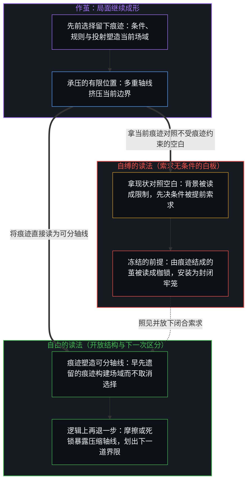
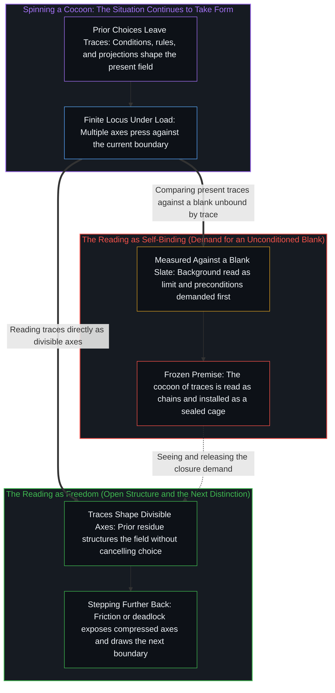

# 作茧不是自缚 / Spinning a Cocoon Is Not Binding Oneself

*自由从未失去，枷锁来自对成形的解读 / Freedom is never lost; the chains come from how the forming is read.*

当必须面对的现实背景被当成限制，财富或外在地位又被加成自由本身的前提，正在成形中的茧便被读成了枷锁。自由不是先于条件的空白，而是持续做出区分的能力：选择不是另有一个站在现状旁边的我，而是这个局面之内，下一次界限仍可被划出。卢梭式的“无往不在枷锁之中”，是有限位置上多条轴线挤在一起时的读法。现实从未被封死。亲历的体验与各中心之间公认的事实，都还在心智之内发生——不是因为有一个盒子装着万物，而是因为谈论与区分正在进行的这个位置，就是心智。

When the background one must face is taken as a limit and wealth or external standing is added as a precondition of freedom itself, a cocoon still taking form is read as chains. Freedom is not a blank prior to conditions. It is the ongoing capacity to make distinctions: choosing is not a separate I standing beside the present situation, but the next boundary within this situation still being drawable. Rousseau's "everywhere in chains" is how axes read when they crowd together at a finite locus. Reality has never been sealed. Both what is lived firsthand and what is agreed upon across centers occur within the Mind—not because a box holds all things, but because the locus where the talking and distinguishing are underway is the Mind.

## 一、 作茧是看见的成形 / 1. The Cocoon Is the Forming That Is Seen

作茧是在观察中被登记的现象：局面在一次次离散的行动中继续成形。自缚并不是伴随成形发生的另一件事，而是加在同一现象之上的解读。当自由所面对的现实背景被当成阻碍，物质财富或事先的保障又被竖立为自由得以开启的前提，茧便被读成了牢笼。化蝶不是挣脱茧之后去到一片无条件的虚空；茧就是活动在重描自身遗留痕迹时，当前局面继续成形的过程。

Spinning a cocoon is what registers in observation: the situation keeps taking form through discrete acts. Binding oneself is not a second event alongside that forming; it is an interpretation placed upon the same phenomenon. When the background of reality that freedom meets is treated as an obstacle, and material wealth or prior guarantees are erected as preconditions before freedom can begin, the cocoon is read as a cage. Becoming a butterfly is not breaking out of the cocoon into an unconditioned void; the cocoon is the present situation continuing to take form as the activity re-traces its own residue.

## 二、 自由是下一次界限仍可被划出 / 2. Freedom Is the Next Boundary Still Drawable

自由不是一块先于一切痕迹的无条件白板。自由就是自我区分的活动仍在继续——也就是日常语言所说的选择。选择不是另有一个站在当前配置之外的我，伸手进去摆布现状；而是在眼下这一具体配置之内，下一次界限依然可以被划出。现状是先前一次次离散选择留下的痕迹。这层层累积的痕迹塑造了此刻得以划分的轴线，却从不取消下一次区分。无论观察者眼前摆着怎样的配置，选择并不在此停住，自由也从未失去。[个体抉择是唯一的因果杠杆](../individual-choices-as-the-only-causal-levers/)将因果归回同一个位置：条件构成行动发生的场，从不是替下一步提供原因的第二个作者。[读《中文哲学简史》有感](../du-zhongwen-zhexue-jianshi-you-gan/)则追索了同一结构的另一面：宣称“没有选择”，本身仍是一次划出界限并留下自身痕迹的选择。

Freedom is not an unconditioned blank slate prior to all trace. Freedom is self-distinguishing activity continuing—what ordinary language calls choice. Choosing is not a separate self standing outside the present configuration and reaching in to manipulate it; it is the next boundary within this exact configuration remaining drawable. The present situation is the trace left by earlier choices, one discrete act after another. That accumulated trace shapes the axes along which the present moment can be divided, yet it never cancels the next distinction. Whatever configuration lies in front of the observer, choosing does not stop there, and freedom has never been lost. [Individual Choices as the Only Causal Levers](../individual-choices-as-the-only-causal-levers/) returns causality to this same locus: conditions constitute the field in which the act occurs, never a second author supplying the cause of the next step. [Reflections on A Short History of Philosophy in Chinese](../du-zhongwen-zhexue-jianshi-you-gan/) traces the complementary face of the same structure: declaring that one has "no choice" is itself a choice that draws a boundary and leaves its own trace.

## 三、 枷锁是拿现状对照一块不受痕迹约束的自由 / 3. Chains Compare the Present with a Freedom Unbound by Traces

枷锁来自这次解读，而不是来自作茧。把当前配置强调成自由的缺失——正如卢梭宣称人[无往不在枷锁之中](../freedom-as-ground/)——是拿此刻正在经过的痕迹，去对照一个“本应不受任何痕迹约束”的假想自由。在承压的有限中心处，原本独立的轴线挤进同一个有限边界，使得自由与约束显出彼此对立的态势。这种对立并不是两个独立实体的固有性质，而是多重区分挤压同一道边界时，容量压缩所呈现的登记方式。界限本身既是前一次区分得以成立的边，也是下一次区分借以划出的边；当各条轴线压缩在一起时，同一道运作中的边缘便被误读成了自由的对立面。

The chains come from the reading, not from the cocoon. Stressing the present configuration as a deficit of freedom—as Rousseau does in declaring humanity [everywhere in chains](../freedom-as-ground/)—measures the trace passing through this moment against an imagined freedom that ought to remain unbound by any trace. At a finite center under load, independent axes crowd into the same bounded space, making freedom and constraint appear as opposing forces. That opposition is not a property of two separate entities; it is how capacity compression registers when multiple distinctions press against a single boundary. A boundary is simultaneously the edge on which the prior distinction stands and the edge from which the next distinction is drawn; when axes compress together, that single operative edge is misread as the enemy of freedom.

现实既不是先封闭再开放，也从未被封死过，并没有一个可以把整个场关掉的外部视角。[一步一步绘制出的路径](../the-path-drawn-one-step-at-a-time/)追索了这种冻结如何运作：一旦当前配置被豁免于重描、被当成未经选择的前提固守下来，它便戴上了公理、定律、正统、第一性原理或终极地基的帽子。[开放即一致](../openness-is-consistency/)在各个尺度上追索了同一种不封闭：唯有当一个有限结构被强行推上地基之位，去穷尽那只会继续下去的活动时，不一致才会发生。[超越投射](../beyond-the-projection/)则在人类与智能体协作的系统中将这一机制清晰凸显出来：人类架构师编织出的每一条显式规则、提示词或工作流，都是由累积痕迹结成的茧——一个有限的低维投射。自回归智能体在该投射内部受其词元轨迹约束却毫无我执，而人类中心则将自身的推理历史与受防卫的自我图像熔铸在一起，把外部摩擦读成威胁，或把自己早先搭起的脚手架读成陷阱。当正交的对等辩论流水线将一条有限规则推向不可化约的死锁时，这一碰撞便暴露出原本独立的轴线是在何处被硬塞进同一条指令的，从而向人类心智传回干净的信号，使其在逻辑上再退后一步，划出下一道界限。

Reality is not closed first and opened later; it has never been sealed, and there is no exterior vantage from which the field could be shut. [The Path Drawn One Step at a Time](../the-path-drawn-one-step-at-a-time/) traces how this freeze operates: once the present configuration is exempted from re-rendering and held as an unchosen premise, it puts on the hat of axiom, law, orthodoxy, first principle, or foundational ground. [Openness Is Consistency](../openness-is-consistency/) traces the same non-closure across every scale: inconsistency arises only when a finite structure is forced to serve as exhaustive ground for activity that only continues. [Beyond the Projection](../beyond-the-projection/) brings this exact mechanism into relief across human-agent systems: every explicit rule, prompt, or workflow spun by a human architect is a cocoon of accumulated traces—a finite low-dimensional projection. An autoregressive agent is bound by its token trajectory inside that projection without ego, whereas a human center fuses its reasoning history with a defended self-image and reads external friction as a threat or its own prior scaffolding as a trap. When orthogonal peer-debate streamlines push a finite rule to an irreducible deadlock, the collision exposes where independent axes were crammed into one instruction, returning a clean signal to the human Mind to step further back logically and draw the next boundary.

## 四、 谈论正在进行的这个位置，就是心智 / 4. The Place Where the Talking Happens Is the Mind

所谈论的现实——无论是在独处的亲身体验中被登记，还是在众人之间稳定为公认的事实——都继续在心智之内发生。各观察者之间所公认的，并不是另一个悬在感知之外半空中的第二世界；它依然要经过某个具体中心的递归，才谈得上被登记或被言说。[共享意识是个体性的交集](../shared-consciousness-is-intersecting-individualities/)追索了这种公认的结构：共振发生在每一个登记这重交叠的位置上，从不在另一个独立的公共内在里发生。[有无之边](../you-wu-zhi-bian/)追索了同一道界限：被设定在内心凝视之外的世界，无从在区分活动之外去核对有无。体认一切都停留在心智之内，不是说有一个容器把宇宙装进里面，而是没有任何一步能先走出心智，再从别处回过头来解释它。这番区分与谈论正在进行的这个位置，就是心智。

The reality being discussed—whether registered in solitary firsthand experience or stabilized as public agreement—continues to occur within the Mind. What is agreed upon across observers is not a second world hovering in midair outside perception; it still passes through a concrete center's recursion to be registered or spoken of at all. [Shared Consciousness Is Intersecting Individualities](../shared-consciousness-is-intersecting-individualities/) traces this structure of agreement: resonance occurs at each locus that registers the overlap, never inside a separate public interior. [The Edge of Being and Non-Being](../you-wu-zhi-bian/) traces the same boundary: a world posited outside the inner look cannot be audited for being or non-being from outside the distinguishing activity itself. Recognizing that everything stays within the Mind does not mean a container holds the universe inside it; it means no step can walk out of the Mind first and then turn around to explain it from elsewhere. The locus where this very distinguishing and talking are underway is the Mind.
