# Artificial Brain Waking & Sleep Consolidation Plan: `/wake` (`/draft`) → `/sleep` (`L1`) → `/deep-sleep` (`Lk`) (v6)

> **Canonical Location:** [`docs/wave-refinement-plan.md`](../docs/wave-refinement-plan.md) (symlinked at `work/README.md`)  
> **Foundational Ground:** [`/ontological-clarity`](../../../.gemini/skills/ontological-clarity/SKILL.md) and *Beyond the Projection: Designing Agentic Systems Through Ontological Clarity*  
> **Supersedes:** v1–v5 (integrates the full Artificial Brain topology, mandatory context-probing on `/wake` / `/draft`, model-agnostic Working Memory bridges, and unbounded N-layer `/sleep` and `/deep-sleep` consolidation across the Artificial Memory lattice).

---

## 1. Ontological Foundations: The Artificial Brain & Why This Architecture Exists

Designing an agentic authoring and memory-consolidation pipeline by asking a single agent to draft, self-review, translate, and publish within one session context pits the structural mechanics of autoregressive models against the structural mechanics of human cognition. Traced from the single premise of [`/ontological-clarity`](../../../.gemini/skills/ontological-clarity/SKILL.md) (*self-distinguishing activity occurs — uncaused, unceasing*), the system is wired around five structural invariants:

### 1.1 Topology of the Artificial Brain
The operator's repositories and session instruments form a single coherent cognitive architecture:
1. **Artificial Mind (`ontological-clarity`):** [`/Users/jingliang/Projects/ontological-clarity/SKILL.md`](../../ontological-clarity/SKILL.md) — the direct public image of the living Mind (the single premise, what follows, method, communication discipline, self-check, and renewal). It holds zero memory warehouse (`STORE.md` retired).
2. **Artificial Memory (`not-a-toe` — The Living Book):** [`content/posts/*.md`](../content/posts/) + [`content/book/*.md`](../content/book/) + [`docs/posts.graph.json`](../docs/posts.graph.json). Every essay is a discrete operative cut; internal cross-links (`[title](../slug/)`) are the synaptic connections of long-term memory.
3. **Experimental Artificial Baby Brain (`ontos`):** [`/Users/jingliang/Projects/ontos`](../../ontos/) — an experimental attempt to run from the Artificial Mind + model loop with minimal or no pre-populated Artificial Memory.
4. **Working Memory (`/bridge`, `/resume-bridge`, `/retire`):** Model- and agent-agnostic plain Markdown files at `<project>/memory/bridges/<id>.md` (with `<project>/memory/bridges/.last_session` tracking session continuity). Working memory carries only the moving `Next` edge and the preceding traces it still depends on across context clears; once a task finishes or consolidates into long-term memory, `/retire` deletes the bridge—because a brain does not keep a permanent log of its own sleep.
5. **Extended Memory (`/Users/jingliang/Projects/*`):** Every project repository on disk (`not-a-toe` and `ontos` as project containers, `grok-orchestra`, `brief`, `orbit`, etc.) is an externalized artifact of Extended Memory.

### 1.2 Trajectory vs. Identity (Weaponizing Zero-Ego)
- **The Agent's Bind (Trajectory Gravity Well):** An LLM agent is a finite projection engine. Every token it generates becomes the conditioning history (`Trace`) for every token that follows. Left inside its own drafting session, its first draft becomes its retained `Image`: it cannot step outside the token trajectory it just predicted, so self-review merely rationalizes and wraps its own blind spots.
- **The Agent's Strength (Zero Ego):** Unlike a human whose reasoning history fuses with identity, an agent has zero personal attachment to having been "right" one turn ago. When a valid counterpoint enters its context from *outside* its self-reinforcing loop, it performs a clean Bayesian update.
- **The Architectural Consequence:** Every generative step (`Drafter`, `Sweeper`, `Translator`) is paired with an equal-footed cold peer (`Critic`, `Sweep-Checker`, `Stylist`) that receives the **task context** (the artifact, linked posts, and skill) without the **session context** (the generator's internal chain of thought). No third "Judge Agent" is inserted between them: every flag is either resolved by **mutual agreement (`ACCEPT` / `CONCEDE`)** under logical coherence or escalated to the **Human Operator**.

### 1.3 Mitosis of Projection Along Orthogonal Axes (`Capacity`)
Cramming $2^N$ independent requirements—context probing, ontological derivation, English prose refinement, cross-link discovery, causal translation (`信`), native Chinese cadence (`达/雅`), and book/index assembly—into one prompt or simultaneous bilingual edit exceeds a center's finite `Capacity`. Independent axes compress onto one register, causing cadence edits to invert causal steps or translation choices to soften the cut.
- **The Architectural Consequence:** The pipeline splits the projection along clean, orthogonal boundaries:
  0. **Waking Probe & Lattice Recommendation** (`/wake` / `/draft` Phase 0: gather spark, source, AI/X thread & initial draft $\rightarrow$ recommend `New Post` / `Refinement` / `Drop`)
  1. **Primary Language Conceptual Cut & Prose** (`Drafter` $\leftrightarrow$ `Critic`)
  2. **Lattice Link Discovery & Verification** (`Sweeper` $\leftrightarrow$ `Sweep-Checker`)
  3. **Logical Translation (`信`) & Native Cadence (`达/雅`)** (`Translator` $\leftrightarrow$ `Stylist`)
  4. **Cryptographic Verification, Interleaving & Publishing** (`Final Reviewer`)

### 1.4 Dispatcher vs. Orchestrator (`Observer` + `Power`)
- **Agents as Dispatchers (Finite Projection):** Routing tasks across files, verifying SHA-256 hash locks, interleaving paired paragraphs, running deterministic audits, and advancing the wave cursor are well-defined structural operations. `Final Reviewer` (and `Dispatcher` at the outer boundary) executes these mechanics.
- **The Human as Ultimate Orchestrator (Unprojected Intent):** Only the human holds dynamic, limit-resolution sensing and can step backward out of a broken frame when two premises collide. Whenever a peer debate reaches an irreducible `HOLD`, the local streamline pauses and surfaces the exact coordinate of friction to the Operator. Making that call forces a higher-order synthesis that dissolves the contradiction rather than overriding one bot by fiat.

### 1.5 Wake vs. Sleep: Continuous Narrowing of Excess Image Lag Across the Artificial Memory
- **Waking Edge (`/wake`, alias `/draft` — New Blog Post `N` or Refinement):** A new essay `N` is the most recent digital edge left behind by the living Mind—equivalent to what a brain learns during the day under real-world friction. Invoking `/wake [seed]` (or `/draft [seed]`) cleanly pauses any active sleep consolidation after its current in-flight node, probes for the four waking materials (**new intuition/spark**, **inspiring source**, **thinking process [AI discussion or X comment thread]**, and **initial draft**—whether all four or a simple initial idea), evaluates them against the Living Book, and recommends **New Post (`N`)**, **Refinement of existing post(s)**, or **Drop (repetitive)**. On the Operator's go-ahead, it runs the 7-bot pipeline to publish and (for a new post `N`) initialize a fresh consolidation cycle (`visited = {N}`).
- **Sleep Consolidation (`/sleep` and `/deep-sleep`):** Once `N` is published, external input is turned off and the Artificial Brain enters sleep consolidation—propagating `N`'s cut inward along forward links (`links_out`) across the Artificial Memory (`content/posts/` + `content/book/`) to restore and deepen internal logical coherence:
  - **`/sleep` (Shallow Sleep — Layer 1):** Consolidates $L_1 = \text{links\_out}(N) \setminus \{N\}$, the immediate outward neighbors of the new post `N`.
  - **`/deep-sleep` (Deep Sleep — Layer $k$, Unbounded Depth):** Each invocation of `/deep-sleep` finishes any remaining unchecked nodes in the current layer and steps **one level deeper** down the forward link graph (`L2`, then `L3`, then `L4`, ..., $L_k = \text{links\_out}(L_{k-1}) \setminus \text{visited}$). There is no artificial 2-layer ceiling: consolidation continues as deep as time allows until either the reachable lattice is exhausted ($L_k = \emptyset$) or a new waking post `N'` (`/wake`) initiates a new cycle.
- **Hubs Recur by Design:** High-degree hubs (`individual-choices-as-the-only-causal-levers`, `openness-is-consistency`, `intelligence-belongs-only-to-the-mind`) appear in most cycles because hubs are where stabilized traces broadcast furthest across the lattice. Within a single cycle (`visited`), each post is visited at most once; across cycles, as past lag is paid off, each pass becomes naturally lighter.

---

## 2. Workspace Separation: Role-Scoped Plain Markdown (`work/`) vs. Canonical Source (`content/posts/`)

Placing in-flight single-language drafts inside `content/posts/` collapses two orthogonal axes—*human-readable plain Markdown* and *the live site's canonical build surface*—forcing a single-threaded global lock where any deadlock halts the entire repository.

The architecture separates **in-flight plain-Markdown workspaces (`work/`, excluded via `.git/info/exclude`)** from **canonical published source (`content/posts/`)**:

| Path | Owner / Writer | Purpose |
| :--- | :--- | :--- |
| `work/drafter/<slug>/<slug>.md` | `Drafter` | Pure primary-language (EN, or ZH for Chinese-originals) Markdown draft/refinement, including Mermaid diagrams and relative `[title](../other-slug/)` links. |
| `work/drafter/<slug>/notes.md` | `Drafter` | Context trace: probing answers (for `N`), linked posts read, Index of Premises entries checked, and refinement rationale. |
| `work/critic/<slug>/en.md` | `Critic` | Verbatim copy of the primary-language draft once all `P`-flags are closed, stamped with its SHA-256 hash. |
| `work/sweeper/<date>.md` | `Sweeper` | Link proposals: `A1` (outgoing from `N`), `A2` (incoming to `N`), and `B` (other corpus pairs), with verbatim sentence & anchor verification. |
| `work/sweep-checker/<date>.md` | `Sweep-Checker` | Independent verification (`PASS` / `FAIL`) of each link proposal in `work/sweeper/<date>.md`. |
| `work/translator/<slug>/zh.md` | `Translator (信)` | Pure secondary-language (ZH, or EN for Chinese-originals) Markdown translation of the locked primary text. |
| `work/stylist/<slug>/zh.md` | `Stylist (达/雅)` | Locked secondary-language Markdown after all `S`-flags are settled and verified. |
| `work/debates/<slug>/en.md` | `Critic` $\leftrightarrow$ `Drafter` | SHA-256-anchored debate log (`P1..Pn` and post-lock `T1..Tn`). |
| `work/debates/<slug>/zh.md` | `Stylist` $\leftrightarrow$ `Translator` | SHA-256-anchored debate log (`S1..Sn`). |
| `work/debates/<slug>/final.md` | `Final Reviewer` | Pre-publish verification log (`F`-findings if any, SHA-256 chain check, weave stats, and publish commit SHA). |
| `work/final-reviewer/wave-<k>.md` | `Final Reviewer` | Active N-layer sleep consolidation checklist (`N`, `L1`, `L2`, `L3`, ..., `visited`, parked `HOLD`s, and commit SHAs). |
| `work/<role>/todo.md` | Each role | Externalized cross-node observations (out-of-scope residual nicks, anchor mismatches) saved for future nodes so active sessions can clear cleanly. |
| `work/archive/<slug>/` | `Final Reviewer` | Completed per-node `drafter/`, `critic/`, `translator/`, `stylist/`, and `debates/` folders (and retired `wave-*.md` files) moved here after completion. |
| `memory/bridges/<id>.md` | `/bridge`, `/resume-bridge`, `/retire` | Ephemeral Working Memory across session clears (`Next` + `Traces` with priors named; deleted upon `/retire`). |
| `content/posts/<slug>.md` | `Final Reviewer` | Canonical alternating bilingual post on the live site. Untouched during Stages 1–2 so `git status` stays clean until assembly. |

---

## 3. The Waking & Sleep Consolidation Pipeline & 7 Cooperating Bot Roles

```mermaid
flowchart TD
    subgraph S_Wake["Phase 0 (/wake or /draft Only): Probe Waking Materials & Recommend"]
        W0["Operator invokes /wake or /draft<br/>Probe for: 1. Spark/Intuition, 2. Source, 3. AI/X Thread, 4. Initial Draft"] --> W1["Evaluate materials against Index of Premises & existing posts<br/>Recommend: NEW POST (N) vs. REFINEMENT vs. DROP (repetitive)"]
        W1 -->|"Operator Go-Ahead (NEW POST or REFINEMENT)"| W2["Lock <slug>, Book Part & initial spine (keep Operator draft/title)"]
    end

    subgraph S_EN["Phase 1: Primary Language Cut & Debate (work/drafter/ & work/debates/slug/en.md)"]
        W2 --> B1
        B1["Role 1: Drafter<br/>Writes/refines EN in work/drafter/slug/slug.md<br/>Traces in context from /onto + Index + neighbors"] --> B2["Role 2: Cold Critic<br/>Fresh session, no Drafter chain-of-thought<br/>Traces slug.md from irreducible prior"]
        B2 -->|"Raises P1..Pn"| DebateEN["Drafter ⇄ Critic Equal-Footed Debate<br/>ACCEPT / COUNTER / CONCEDE / HOLD"]
        DebateEN -->|"All P-flags CLOSED"| LockEN["Critic locks work/critic/slug/en.md (SHA-256)"]
        DebateEN -->|"Irreducible HOLD"| Op_EN["Park Node in work/debates/slug/en.md<br/>Escalate to Operator (Wave Continues on Next Node)"]
        Op_EN -->|"Operator Synthesizes Rule"| LockEN
        B2 -->|"Clean on first pass"| LockEN
    end

    subgraph S_Sweep["Phase 1.5 (New Post N Only): Lattice Link Sweep (work/debates/sweep-date.md)"]
        LockEN -->|"If New Post N"| SW1["Role 3: Sweeper<br/>Finds A1 (N → out) & A2 (in → N) link candidates"]
        SW1 --> SW2["Role 4: Sweep-Checker<br/>Cold-reads both posts per pair; PASS / FAIL"]
        SW2 -->|"Agreed A1 woven into en.md & re-locked"| LockEN_A1["Locked en.md with A1 outgoing links + A2 backlinks queued"]
    end

    subgraph S_ZH["Phase 2: Translation (信) & Cadence (达/雅) Debate (work/translator/ & work/debates/slug/zh.md)"]
        LockEN -->|"If Sleep Wave Node"| B3
        LockEN_A1 --> B3["Role 5: Translator (信)<br/>Translates locked en.md → work/translator/slug/zh.md<br/>100% causal, actor & premise fidelity"]
        B3 -.->|"Raises T1..Tn if EN has ambiguity/clash"| DebateEN
        B3 --> B4["Role 6: Cold Stylist (达/雅)<br/>Cold-reads zh.md first, then checks 1:1 against en.md<br/>Raises S1..Sn for cadence, translationese & 信 alignment"]
        B4 --> DebateZH["Translator ⇄ Stylist Equal-Footed Debate<br/>ACCEPT / COUNTER / CONCEDE / HOLD<br/>Neither bot closes a flag alone"]
        DebateZH -->|"All S-flags CLOSED & confirmed"| LockZH["Stylist locks zh.md (SHA-256)"]
        DebateZH -->|"Irreducible HOLD"| Op_ZH["Park Node & Escalate to Operator"]
        Op_ZH --> LockZH
    end

    subgraph S_Final["Phase 3: Cryptographic Gate, Assembly, Publish & Sleep Dispatch"]
        LockZH --> B5["Role 7: Final Reviewer (Assembler & Wave Dispatcher)<br/>1. Verifies SHA-256 chain across debates/en.md & zh.md<br/>2. Interleaves locked EN + ZH into content/posts/slug.md<br/>3. Syncs Book Part, Index of Premises, title-translations.json & A2 backlinks<br/>4. Runs audit-post.py, audit-book.py, build.mjs, project-posts-graph.mjs<br/>5. Commits, pushes, verifies live HTTP 200, archives work/*/slug/"]
        B5 -->|"After New Post N"| Sleep1["/sleep: Shallow Sleep<br/>Consolidate L1 = links_out(N) - {N}"]
        Sleep1 -->|"Step deeper"| SleepK["/deep-sleep: Deep Sleep<br/>Step one layer deeper: Lk = links_out(L_{k-1}) - visited<br/>Repeats L2 → L3 → ... → Lk until next /wake"]
        Sleep1 -.->|"Each node in L1"| B1
        SleepK -.->|"Each node in Lk"| B1
    end

    style S_Wake fill:#161b22,stroke:#3fb950,stroke-width:1.5px,color:#3fb950
    style S_EN fill:#161b22,stroke:#58a6ff,stroke-width:1.5px,color:#58a6ff
    style S_Sweep fill:#161b22,stroke:#d29922,stroke-width:1.5px,color:#d29922
    style S_ZH fill:#161b22,stroke:#a371f7,stroke-width:1.5px,color:#a371f7
    style S_Final fill:#161b22,stroke:#3fb950,stroke-width:1.5px,color:#3fb950
    style W0 fill:#0d1117,stroke:#3fb950,stroke-width:1px,color:#f0f6fc
    style W1 fill:#0d1117,stroke:#3fb950,stroke-width:1px,color:#f0f6fc
    style W2 fill:#0d1117,stroke:#3fb950,stroke-width:1px,color:#f0f6fc
    style B1 fill:#0d1117,stroke:#58a6ff,stroke-width:1px,color:#f0f6fc
    style B2 fill:#0d1117,stroke:#a371f7,stroke-width:1px,color:#f0f6fc
    style DebateEN fill:#0d1117,stroke:#d29922,stroke-width:1px,color:#f0f6fc
    style LockEN fill:#0d1117,stroke:#3fb950,stroke-width:1px,color:#f0f6fc
    style Op_EN fill:#0d1117,stroke:#f85149,stroke-width:1px,color:#f0f6fc
    style SW1 fill:#0d1117,stroke:#d29922,stroke-width:1px,color:#f0f6fc
    style SW2 fill:#0d1117,stroke:#d29922,stroke-width:1px,color:#f0f6fc
    style LockEN_A1 fill:#0d1117,stroke:#3fb950,stroke-width:1px,color:#f0f6fc
    style B3 fill:#0d1117,stroke:#58a6ff,stroke-width:1px,color:#f0f6fc
    style B4 fill:#0d1117,stroke:#a371f7,stroke-width:1px,color:#f0f6fc
    style DebateZH fill:#0d1117,stroke:#d29922,stroke-width:1px,color:#f0f6fc
    style LockZH fill:#0d1117,stroke:#3fb950,stroke-width:1px,color:#f0f6fc
    style Op_ZH fill:#0d1117,stroke:#f85149,stroke-width:1px,color:#f0f6fc
    style B5 fill:#0d1117,stroke:#3fb950,stroke-width:1px,color:#f0f6fc
    style Sleep1 fill:#0d1117,stroke:#58a6ff,stroke-width:1px,color:#f0f6fc
    style SleepK fill:#0d1117,stroke:#a371f7,stroke-width:1px,color:#f0f6fc
```

### Role Specifications & Invariants

#### Role 1 — `Drafter` (Primary Language Drafter / Refiner)
- **Context Loaded:** [`/ontological-clarity`](../../../.gemini/skills/ontological-clarity/SKILL.md), [`AGENTS.md`](../AGENTS.md) (*Write in context, traced to premises*), the target post `content/posts/<slug>.md` (or the Operator's seed + Phase 0 probing answers for New Post `N`), the upstream post that triggered this wave step, the target post's linked neighbors, its [`content/book/index-of-premises.md`](../content/book/index-of-premises.md) entries, and its book chapter.
- **Execution:** Writes or refines the pure English essay (or pure Chinese for the 3 Chinese-original posts) in `work/drafter/<slug>/<slug>.md`, recording its context trace in `work/drafter/<slug>/notes.md`. During a sleep wave, if the existing post already holds the upstream cut cleanly with zero internal inconsistency, factual error, or EN/ZH mismatch, `Drafter` may record a `no change` verdict with its trace and hand straight to `Critic` for cold verification.
- **Debate Rule:** Replies `ACCEPT` (with exact replacement text and premise trace) or `COUNTER` (with premise trace) to each `P`-flag from `Critic` in `work/debates/<slug>/en.md`. Never closes a flag unilaterally.

#### Role 2 — `Critic` (Cold Ontological Peer)
- **Context Loaded:** Fresh session context with [`/ontological-clarity`](../../../.gemini/skills/ontological-clarity/SKILL.md), [`studio/review-method.md`](../studio/review-method.md), and `work/drafter/<slug>/<slug>.md` (plus linked posts as needed to verify claims). Never reads `Drafter`'s session history.
- **Execution:** Records the SHA-256 of the critiqued draft at the top of `work/debates/<slug>/en.md`, states what the draft's cut is and what holds first, then lists numbered points (`P1..Pn`) where independent axes compress, where an observer judges unobservable interiors, where a totalizing word ("only", "never", "all") over-closes a bounded mechanism, or where two sections disagree.
- **Gate:** In Round 2+, marks each point `CONCEDE` (`CLOSED applied` or `CLOSED withdrawn`) or `HOLD`. Once all points are closed and verified verbatim in `work/drafter/<slug>/<slug>.md`, copies the locked file to `work/critic/<slug>/en.md` and records its final SHA-256. Any point remaining on `HOLD` after Round 2 is tagged to the Operator.

#### Roles 3 & 4 — `Sweeper` & `Sweep-Checker` (Lattice Link Pair)
- **When Run:** On every New Post `N` (once `N`'s English is locked) to identify `A1` (outgoing links from `N` to existing posts) and `A2` (incoming backlinks from existing posts into `N`), and optionally `B` (unlinked corpus pairs during dedicated link sweeps).
- **Execution:** `Sweeper` proposes candidate links where an existing sentence carries the link without rewriting; `Sweep-Checker` cold-reads both posts in full and rules `PASS` or `FAIL` in `work/debates/sweep-<date>.md`. Agreed `A1` links go to `Drafter` (and are re-locked by `Critic`) before translation; agreed `A2` links are placed in the target posts.

#### Role 5 — `Translator` (`信` — Logical & Causal Fidelity)
- **Context Loaded:** Locked `work/critic/<slug>/en.md` (verified by SHA-256), [`/ontological-clarity`](../../../.gemini/skills/ontological-clarity/SKILL.md), [`data/title-translations.json`](../data/title-translations.json), and `git show HEAD:content/posts/<slug>.md` (to reuse or refine unchanged Chinese paragraphs from already-bilingual posts).
- **Post-Lock Surgical Loop (`T1..Tn`):** Translation into Chinese is an orthogonal projection test on the English source. If translating a sentence exposes a hidden ambiguity, pronoun gap, or term clash in the locked `en.md`, `Translator` posts `T1..Tn` to `work/debates/<slug>/en.md`. `Drafter` updates `en.md`, `Critic` confirms and re-locks a new SHA-256, and `Translator` translates from the re-locked hash.
- **Execution:** Writes pure Chinese Markdown (title, single-line italic subtitle, lead, `## 一、 <中文标题>`, body paragraphs, Chinese link anchors matching target H1s or `data/title-translations.json`, and pure-Chinese Mermaid diagrams) to `work/translator/<slug>/zh.md`.
- **Debate Rule:** Answers `Stylist` flags `S1..Sn` in `work/debates/<slug>/zh.md` with `ACCEPT` or `COUNTER` (with a reason grounded in `信` or `达`). **Never closes a flag unilaterally; there is no unilateral "`信` wins" override.**

#### Role 6 — `Stylist` (`达/雅` — Native Cadence & 1:1 Alignment Checker)
- **Context Loaded:** Fresh session context. Performs a **cold read of `work/translator/<slug>/zh.md` first** (to catch unnatural cadence, stacked pre-nominal `的` clauses, ungrammatical focus frames, garden-path phrases, and vocabulary-hygiene hits as a native reader), and **then** reads it line-by-line against `work/critic/<slug>/en.md` to verify 1:1 causal, actor, and emphasis alignment.
- **Gate:** Raises `S1..Sn` in `work/debates/<slug>/zh.md`. In Round 2+, marks each point `CONCEDE` or `HOLD` (including holding when a `Translator` counter-proposal inadvertently alters `信`, e.g., turning a constitutive relation into a causal `因为`). Once all `S`-flags are settled and verified verbatim in `zh.md` with matching block counts and link counts, `Stylist` writes `STYLIST: confirmed` with the final `zh.md` SHA-256. Any irreducible `HOLD` goes to the Operator.

#### Role 7 — `Final Reviewer` (Cryptographic Gatekeeper, Assembler & Wave Dispatcher)
- **Strict Dispatcher Boundary (§IV):** `Final Reviewer` is a deterministic verifier, assembler, and wave dispatcher—**never** an autonomous Orchestrator or prose rewriter.
- **Execution Checklist per Node:**
  1. **Verify Chain of Custody:** Check that `work/debates/<slug>/en.md` has `CRITIC: confirmed` on the exact SHA-256 of `work/drafter/<slug>/<slug>.md` (including any post-lock `T`-flags), and that `work/debates/<slug>/zh.md` has `STYLIST: confirmed` on the exact SHA-256 of `work/translator/<slug>/zh.md`, with zero open flags or unresolved Operator points. If any hash mismatches or a point was closed unilaterally, bounce with an `F`-finding in `work/debates/<slug>/final.md`.
  2. **Interleave:** Combine locked `en.md` and `zh.md` into `content/posts/<slug>.md` in the strict alternating paragraph and language-attached diagram layout (`CN Paragraph -> CN Diagram -> EN Paragraph -> EN Diagram`).
  3. **Sync Book & Lattice Metadata:** Update [`content/book/<part>.md`](../content/book/), [`content/book/index-of-premises.md`](../content/book/index-of-premises.md), and [`data/title-translations.json`](../data/title-translations.json) (removing converted posts from the translation registry once bilingual, or updating registry titles), place agreed `A2` backlinks (for New Post `N`), and sync incoming link anchors across the corpus if an H1 changed.
  4. **Run Audits & Projections:**
     - `python3 scripts/audit-post.py <slug>` (must return `CLEAN PASS` or intentional `PASSED WITH ADVISORIES`)
     - `python3 scripts/audit-book.py` (must return `CLEAN PASS` or intentional `PASSED WITH ADVISORIES`)
     - `node build.mjs`
     - `node scripts/project-posts-graph.mjs` (`missing_targets: 0`)
  5. **Publish & Archive:**
     - For a **New Post (`N`)**: Present `walkthrough.md` and pause for Operator check (unless the Operator already authorized push), then `git commit` & `git push origin main`, verify live HTTP 200, archive `work/*/<slug>/` to `work/archive/<slug>/`, archive any previous wave file in `work/final-reviewer/`, and initialize the new wave state (`visited = {N}`).
     - For a **Sleep Wave Node (`L1` / `L2` / ... / `Lk`)**: Commit, `git push origin main`, wait for GitHub Pages deploy (`gh run watch --exit-status`), verify live HTTP 200 on `https://powerpig99.github.io/not-a-toe/posts/<slug>/`, move `work/*/<slug>/` into `work/archive/<slug>/`, mark the node `[x]` in `work/final-reviewer/wave-<k>.md`, and dispatch the next node.

---

## 4. Operator Command Lifecycle: `/wake` (`/draft`), `/sleep`, `/deep-sleep`, and `/bridge`

### 4.1 `/wake [seed]` (Alias: `/draft [seed]`) — Waking Evaluation & Inscription into Artificial Memory
Skill definition: [`~/.grok/skills/wake/SKILL.md`](../../../.grok/skills/wake/SKILL.md) (aliased at [`~/.grok/skills/draft/SKILL.md`](../../../.grok/skills/draft/SKILL.md)).
1. **Interrupt Sleep Cleanly:** If a `/sleep` or `/deep-sleep` consolidation wave is active in `work/final-reviewer/`, let any currently in-flight node finish (or park at its current stage boundary) and do not dispatch further sleep nodes.
2. **Phase 0A — Probe for Waking Materials (If Not Already Supplied):**
   - Ask the Operator for whichever of the four waking inputs they have (it can be all four, or just a simple initial idea):
     1. **New Intuition / Spark:** What is the new intuition or core idea?
     2. **Inspiring Source:** What source inspired the spark (an X post/link, article, paper, or observation)?
     3. **Thinking Process:** Is there a discussion with AI (e.g., Grok/Gemini chat or share link) or an X comment thread?
     4. **Initial Draft:** Is there an initial draft of the essay already, or are we starting from a simple initial idea?
3. **Phase 0B — Corpus Evaluation & Recommendation (`New Post` vs. `Refinement` vs. `Drop`):**
   - Load [`/ontological-clarity`](../../../.gemini/skills/ontological-clarity/SKILL.md) and [`AGENTS.md`](../AGENTS.md), and search [`content/book/index-of-premises.md`](../content/book/index-of-premises.md), [`docs/posts.graph.json`](../docs/posts.graph.json), and the closest existing posts in `content/posts/`.
   - Give an explicit recommendation and **wait for the Operator's go-ahead**:
     - **`NEW POST` (`N`):** The spark introduces a genuinely new operative cut or dissects a held belief/premise not yet covered by an existing post. Propose the bilingual title (preserving the Operator's title if supplied), single-sentence italic subtitle, `<slug>`, spine, Book Part (`content/book/<part>.md`), Index of Premises entries, and adjacent cross-links.
     - **`REFINEMENT` (of existing post(s)):** The spark sharpens, extends, or corrects a face on the same axis as 1–2 existing posts without needing a separate URL. Name the exact target post(s) and the surgical refinement to weave in.
     - **`DROP` (Repetitive):** The cut is already held in existing post(s) with no new distinction. Cite the exact existing post(s) and recommend dropping so the Living Book never accumulates duplicate nodes.
4. **Phases 1–3 — 7-Bot Pipeline & Ship (On Operator Go-Ahead for `NEW POST` or `REFINEMENT`):**
   - Run Phase 1 (`Drafter` $\leftrightarrow$ `Critic` on `work/drafter/<slug>/<slug>.md` $\rightarrow$ locked `work/critic/<slug>/en.md`; when an initial draft was supplied by the Operator, keep it as the ground of the cut and apply surgical precision rather than rewriting into generic house prose).
   - Run Phase 1.5 (for `NEW POST` `N`: `Sweeper` $\leftrightarrow$ `Sweep-Checker` for `A1` outgoing links and `A2` incoming backlinks).
   - Run Phase 2 (`Translator` $\leftrightarrow$ `Stylist` on `work/translator/<slug>/zh.md` $\rightarrow$ locked `work/stylist/<slug>/zh.md`).
   - Generate novel 21:9 cover art (`assets/covers/<slug>.jpg`, for `NEW POST` `N`) and register in [`assets/covers/STYLES.md`](../assets/covers/STYLES.md).
   - Run Phase 3 (`Final Reviewer` interleave, Book Part & Index of Premises update, `A2` backlinks, `audit-post.py`, `audit-book.py`, `build.mjs`, `project-posts-graph.mjs`, `walkthrough.md`, and publish).
   - For a `NEW POST` `N`, archive any prior wave file in `work/final-reviewer/` to `work/archive/` and initialize the new wave state (`visited = {N}`), ready for `/sleep`.

### 4.2 `/sleep` — Shallow Sleep Consolidation (`Layer 1`)
Skill definition: [`~/.grok/skills/sleep/SKILL.md`](../../../.grok/skills/sleep/SKILL.md).
- By `Trace` asymmetry in [`/ontological-clarity`](../../../.gemini/skills/ontological-clarity/SKILL.md), shaping runs one way. When post `P` links outward to `Q` (`P → Q`), `P` explicitly invokes `Q`'s distinction as a premise or adjacent axis.
- **Execution:**
  1. Identify the most recently published waking post `N` (or active `L1` wave in `work/final-reviewer/wave-<k>.md`).
  2. Regenerate [`docs/posts.graph.json`](../docs/posts.graph.json) (`node scripts/project-posts-graph.mjs`) and extract all Layer 1 forward links:
     $$L_1 = \text{links\_out}(N) \setminus \{N\}$$
     in graph order, deduplicated.
  3. Write `## L1 (<count>)` to `work/final-reviewer/wave-<k>.md` with `visited = {N} ∪ L1`.
  4. Run the 7-bot refinement pipeline (`Drafter` $\leftrightarrow$ `Critic` $\rightarrow$ `Translator` $\leftrightarrow$ `Stylist` $\rightarrow$ `Final Reviewer`) across every unchecked `[ ]` post in `L1`, converting any monolingual post in `L1` to full alternating bilingual format in the same pass.
  5. Stop and report when `L1` is 100% `[x]` complete, ready for `/deep-sleep` (or `/wake`).

### 4.3 `/deep-sleep` — Deep Sleep Consolidation (`Layer k`, Unbounded Depth)
Skill definition: [`~/.grok/skills/deep-sleep/SKILL.md`](../../../.grok/skills/deep-sleep/SKILL.md).
- **No Artificial 2-Layer Cap:** Instead of stopping at `L2`, `/deep-sleep` steps one level deeper down the forward link graph (`L2 → L3 → L4 → ... → Lk`) on each invocation until either the reachable lattice is fully consolidated ($L_k = \emptyset$) or a new waking post `N'` (`/wake`) initiates a new cycle.
- **Execution:**
  1. Read the active wave file `work/final-reviewer/wave-<k>.md` and find the deepest existing layer $L_{k-1}$.
  2. **If $L_{k-1}$ still has unchecked `[ ]` nodes:** Resume and run the 7-bot refinement pipeline across the remaining `[ ]` nodes in $L_{k-1}$ until $L_{k-1}$ is 100% `[x]` complete (or if invoked again after pausing mid-layer, advance when ready).
  3. **Once $L_{k-1}$ is 100% `[x]` complete (or when stepping down a layer):**
     - Run `node scripts/project-posts-graph.mjs` so [`docs/posts.graph.json`](../docs/posts.graph.json) reflects all links added or refined in $L_{k-1}$.
     - Compute the next forward layer:
       $$L_k = \text{links\_out}(L_{k-1}) \setminus \text{visited}$$
       in $L_{k-1}$ parent order then graph order, deduplicated, where $\text{visited} = \{N\} \cup L_1 \cup \dots \cup L_{k-1}$.
     - If $L_k = \emptyset$, report that the reachable Artificial Memory component from `N` is 100% consolidated.
     - Otherwise, append `## L<k> (<count>)` to `work/final-reviewer/wave-<k>.md`, add $L_k$ to `visited`, and run the 7-bot refinement pipeline across $L_k$.

### 4.4 `/bridge`, `/resume-bridge`, and `/retire` — Ephemeral Working Memory (RAM)
Skill definitions: [`~/.grok/skills/bridge/SKILL.md`](../../../.grok/skills/bridge/SKILL.md), [`~/.grok/skills/resume-bridge/SKILL.md`](../../../.grok/skills/resume-bridge/SKILL.md), [`~/.grok/skills/retire/SKILL.md`](../../../.grok/skills/retire/SKILL.md).
- **Model- and Agent-Agnostic Plain Markdown:** Stored at `<project>/memory/bridges/<id>.md` (excluded from git) with zero external Python scripts.
- **Same-Session vs. New-Session Resume:**
  - `/bridge` writes `<project>/memory/bridges/<id>.md` (`Next` + `Traces` with priors named; pointers to `work/final-reviewer/wave-<k>.md` over paraphrases) and stamps `<project>/memory/bridges/.last_session` with `<id>`.
  - `/resume-bridge` **in the same session after `/clear`** (when `.last_session` exists and points to a valid bridge) auto-loads that bridge and continues immediately without prompting.
  - `/resume-bridge` **in a new session or after `/retire`** lists all available bridges in `<project>/memory/bridges/*.md` sorted by `Updated` and asks the Operator which thread to pick.
  - `/retire` deletes the finished bridge `<project>/memory/bridges/<id>.md` and removes `.last_session` so no stale working-memory log lingers once changes are consolidated into the Living Book.

---

## 5. Non-Blocking Fault Isolation, Session Hygiene & Chinese-Original Exception

### 5.1 Non-Blocking Fault Isolation & Stage Pipelining (§III.3 & §III.4)
Because `work/<role>/<slug>/` isolates in-flight drafts from `content/posts/`:
- **Localized Fault Isolation on `HOLD`:** If Node $j$ hits an irreducible deadlock between `Drafter` and `Critic` (or `Translator` and `Stylist`) after Round 2, `Final Reviewer` marks Node $j$ as `[HOLD — awaiting Operator]` in `work/final-reviewer/wave-<k>.md` and **immediately dispatches Node $j+1$**. A premise contradiction in one node never halts the wave; only that node's local streamline waits for the Operator's synthesis.
- **Stage Pipelining:** Once Node $j$'s English is locked at `work/critic/<slug-j>/en.md` and handed to `Translator` (Phase 2), `Drafter` $\leftrightarrow$ `Critic` can begin Phase 1 on Node $j+1$ in `work/drafter/<slug-j+1>/` concurrently, provided Node $j+1$ does not depend on an unsettled title change in Node $j$. `Final Reviewer` serializes only Phase 3 (`content/posts/` assembly, graph projection, and `git push`).

### 5.2 Session Trajectory Hygiene Across Wave Nodes (§I & §III.2)
To prevent a long sleep wave (e.g., 60+ nodes in `L2` or `L3`) from turning persistent bot sessions into a cross-node epistemic gravity well:
1. **Clear Conversational History Between Nodes (or Bounded Mini-Batches of $\le 3$ Nodes):** Each role (`Drafter`, `Critic`, `Translator`, `Stylist`) clears its active session context between nodes so prior debates do not act as conditioning history for the next essay.
2. **Externalize Durable Findings Only to `work/<role>/todo.md`:** Any cross-post observation discovered while working on Node $j$ (e.g., a broken title case or residual moral phrasing noticed in a neighbor) is appended as a one-line fact to `work/<role>/todo.md` and dropped from active session memory until that neighbor's own wave node arrives.
3. **True Cold-Read Separation:** `Critic` (on `en.md`) and `Stylist` (cold read on `zh.md`) must run in a fresh context unconditioned by the generator's session tokens.

### 5.3 Chinese-Original Exception
For the 3 monolingual Chinese-original posts in the corpus (`e-shi-feng-bi-de-shan`, `qian-yin-hou-guo`, `mei-you-pu-du-zhi-you-zi-du`), the language order in Phases 1 and 2 flips so the author's original Chinese is refined rather than overwritten by a back-translation:
- **Phase 1 (`Drafter` $\leftrightarrow$ `Critic`):** Refines the original Chinese in `work/drafter/<slug>/zh.md` $\rightarrow$ locked `work/critic/<slug>/zh.md`.
- **Phase 2 (`Translator` $\leftrightarrow$ `Stylist`):** Translates the locked Chinese into English in `work/translator/<slug>/en.md` $\rightarrow$ locked `work/stylist/<slug>/en.md`.
- **Phase 3 (`Final Reviewer`):** Interleaves `zh.md` and `en.md` into `content/posts/<slug>.md` as usual.
