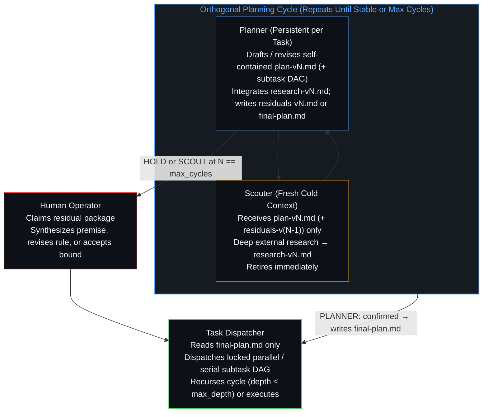
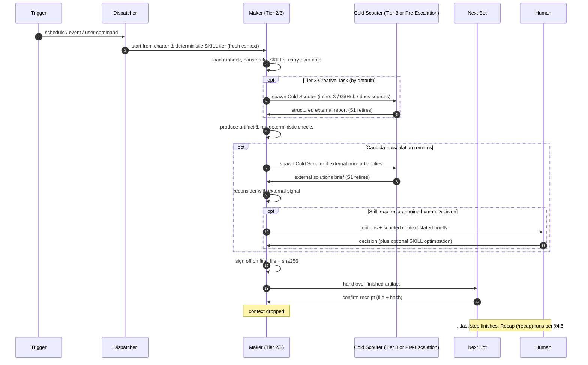

# Artificial Brain Waking, Sleep Consolidation & Orthogonal Planning Specification

> **Canonical Location:** [`docs/wave-refinement-plan.md`](../docs/wave-refinement-plan.md) (symlinked at `work/README.md`)  
> **Foundational Ground:** `/ontological-clarity` (`SKILL.md`), the single house rule, referred to and never restated  
> **Companion Essays:** [`On-Demand Contexts Keep Coherence at One Step`](../content/posts/on-demand-contexts-keep-coherence-at-one-step.md), [`Boundary-Condition Graphs as Memory and Control in Recursive Formal Systems`](../content/posts/boundary-condition-graphs-as-memory-and-control-in-recursive-formal-systems.md) & [`Modular Feedback Loops and Dynamic Residual Networks`](../content/posts/dynamic-resnet-of-skill-loops.md)  
> **Scope:** Generic, Agentic-System-Agnostic Specification for **Event-Driven On-Demand Bot Dispatching** across **(A) The Living Book (`not-a-toe`) Waking & Sleep Consolidation Pipeline (`/wake` → `/sleep` → `/deep-sleep`)**, **(B) Controlled Open-Internet Injection for Orthogonal Planning Cycles (`Planner` → `Scouter` → `Planner` → `Task Dispatcher`)**, and **(C) the Mac end-to-end media production, selective retry, publishing, and site embed workflow (`/media <slug>`, §8)**. Runtime-specific realizations live in [`docs/adapters/`](../docs/adapters/) ([`docs/adapters/antigravity.md`](../docs/adapters/antigravity.md), primary runtime for `/wake`, `/draft`, `/sleep`, `/deep-sleep`, `/scout`, `/media`, and `/recap`; and [`docs/adapters/claude-code.md`](../docs/adapters/claude-code.md)); the runtime-neutral role charters the adapters register live in [`docs/charters/`](../docs/charters/), one file per role; Grok CLI reads `~/.grok/skills/` natively and customizes execution from its own standpoint using whatever tools it has available, needing no separate adapter file unless its primitives diverge.

---

## 1. Ontological Foundations: Event-Driven On-Demand Bot Dispatching & the Artificial Brain

> **Core Idea:** What are called agents or bots are one base model wearing different masks (`Bot = base model + charter + skills`). Nothing is really created or retired; the model switches context according to the task at hand. "Creating" a bot means loading a charter and its skills into a fresh context; "retiring" it means dropping that context. Because each task loads only the context best suited to it—and discards that context once the finished artifact is handed over—there is no need for long contexts, and standing-agent defects (**long-context drift**, **stale memory**, and **role bleed**) are eliminated at the root. *(Note: On 2026-11-09, cold critic roles [`Critic`, `Stylist`, `Evaluator`, `recap-critic`] were retired from the workflow so that each stage runs as a clean single-purpose Maker context verified by deterministic scripts and `sha256` handoffs.)*

Designing an agentic authoring, memory-consolidation, or engineering-planning pipeline by asking a standing agent session to draft, research, translate, and publish within one uninterrupted token trajectory pits the structural mechanics of autoregressive models against the structural mechanics of human cognition. Traced from the single premise of `/ontological-clarity` (*self-distinguishing activity occurs — uncaused, unceasing*), the system is wired around six runtime-agnostic invariants:

### 1.0 Central Principle: Delegate Tasks, Never Decisions (Zero Watchdogs or Deadline Rules)
- **Only tasks can be delegated, never decisions.** Decisions are always made by the living Mind; so-called automated decisions are pre-made decisions being executed. Bots carry out tasks (drafting an essay, translating it, scouting external constraints, recomputing a hash, handing over a finished file). Choosing between unranked premises, or deciding what to do with a non-trivial stall, a crash, or a hash mismatch, are decisions. Decisions stay with the Human Operator.
- **Irreducible premise decisions, stalls, crashes, and hash mismatches go to the human.** When an open question cannot be derived from `/ontological-clarity` and existing repository premises (after running a cold, retiring `Scouter` if external prior art applies), the tension is stated briefly (`HOLD`) and the run waits for the human to decide. When a step crashes or stalls, if the trace confirms a deterministic local fix (such as killing a confirmed-stuck read-only TUI process), the agent executes and reports it; if a genuine premise decision remains, it goes to the human (always re-running any redone step in a **fresh context**, never by patching or restarting the old context).
- **No rule or watchdog stands in for judgment.** A deadline rule (*"if no answer by morning, publish anyway"*) or a watchdog (*"if a step is silent for an hour, restart it"*) looks like an automated decision, but is actually a decision made earlier without knowledge of the situation and executed blindly later. The scheme uses neither.
- **One Single House Rule:** The entire scheme rests on one house rule, the `/ontological-clarity` skill, loaded by every bot by reference and never restated. Settling a point by tracing it back to the shared premise executes the pre-made house rule the human chose; any point that cannot be traced to the shared premise requires a new decision and goes to the human.

### 1.0.1 Deterministic Task Tiers & `/recap`
"On-demand" means contexts are spun up only when a defined trigger fires—**not** that a task bot improvises its own process mid-flight. The governing `SKILL`s deterministically specify up front which contexts run for each class of task, and how `Recap` carries uncatchable surprises back toward the charters, a chain that closes into a loop only where the Operator re-enters (Outer Loop below, per [`Continuous Learning as Expression and Simulation`](../content/posts/continuous-learning-as-expression-and-simulation.md)):

| Task Tier | Decision-Space Geometry (per [`The Density of Judgment`](../content/posts/the-density-of-judgment.md)) | Default On-Demand Contexts (Set Up Front in `SKILL`) | Structural Purpose |
| :--- | :--- | :--- | :--- |
| **Tier 1: Deterministic Execution** | Closed endpoint, fully stated parameters (`interleave-post.py`, `check-signoffs.py`, `audit-post.py`, `audit-book.py`, `build.mjs`, `project-posts-graph.mjs`, `watch-deploy.sh`, `sha256` checks, killing a confirmed-hung read-only process) | **Script / Single Executor Only** | Outcome contracts the decision space to a terminating pass/fail. |
| **Tier 2: Bounded Subtask** | Defined goal, non-trivial execution (`Drafter` in Stage 1, `Translator` in Stage 2, bounded code/config subtasks, or diagnosing a non-trivial operational failure) | **Isolated `Maker` Context + Deterministic Audit/Sign-Off Gate** (`Cold Scouter` if external prior art is needed) | Keeps each stage in its own unpolluted context (`Drafter` for English ontological derivation, `Translator` for Chinese `信/达/雅`), verified by `audit-post.py`, `interleave-post.py --check`, and `check-signoffs.py`. |
| **Tier 3: Creative / Open-Ended Task** | Open-ended design, research, or architecture that expands its own residual decision space (`/scout` / `/orthogonal-plan`, and `/wake` Stage 0 in `work/_wake/scout.md`) | **`Maker/Planner` + `Cold Scouter` by Default** | Injects external prior art from inferred high-signal spaces (X, GitHub, official docs, papers) from the start without polluting the planning/drafting context with raw search trajectories. |

- **`O(1)` Pass/Fail Return Protocol & Need-to-Know Log Files (`Capacity` & `Trace` Isolation):**
  To eliminate context-window bloat across arbitrary fan-out and depth, child bots **never** return narrative summaries, node tables, or explanations in their message payloads to their parent dispatcher. Every child bot returns **strictly a 1-line `STATUS: PASS | FAIL | HOLD` token + log file pointer** (e.g., `STATUS: PASS role=<role> verdict=DELTA|NO_DELTA sha256=<hash> log=work/<slug>/notes.md` or `STATUS: PASS batch=<m> delta=<D> no_delta=<N> open_issues=0 remaining=<R> commit=<sha> log=work/_logs/batch-<m>.md`, or `STATUS: HOLD|FAIL ... open_issues=<K> log=<path>`). All details live on disk in the log files (`work/<slug>/...`, `work/_logs/...`, `work/plan/<task-id>/...`), read **strictly on a need-to-know basis** by `Recap` or by the parent layer when an open issue is escalated.
- **`Recap` (`/recap`) as Observational/Operational Horizon Expansion (`Δθₗ`), Multi-Layer Residual Escalation Pyramid, & Post-Expansion Log Deletion:**
  While task execution moves the **current edge** (`content/posts/*.md`, `content/book/*.md`, project code), **`Recap` (`/recap`) is how the observational/operational horizon of the system (`SKILL`s, charters, specs, scripts) is expanded by the updated edge (`Δθₗ`)**. Once that horizon is expanded, the trace of how it got there is no longer part of the current edge and must be removed to prevent **Image lag**:
  - **Multi-Layer Residual Escalation Pyramid (`Inner Loop → Next Layer Up → Outer Loop`):**
    1. **Need-to-Know Local `Recap` Resolution (`Layer k`):** When a confirmed problem or surprise occurs at the boundary of any inner layer (e.g., a node, a `Deep Sleep Batch <m>` inside `batch-dispatcher`, or a child subtask), a `Recap` context under `/ontological-clarity` reads the layer's logs on a need-to-know basis and applies fixes derivable at that scope.
    2. **Escalating Only Remaining Open Issues One Layer Up:** After the local `Recap` resolves what it can, **only the remaining open issues (`open_issues > 0`)** are escalated one layer up (via a 1-line `STATUS:` token + pointer to the distilled open-issues log `work/_logs/...`), where the parent layer's `Recap` attempts to resolve them—escalating again only if they cannot be resolved at that layer, until hitting the **Outer Loop**.
    3. **Outer Loop (`Human Operator` Judgment Call + Sovereign Consistency Check under `/ontological-clarity`):** Only remaining open issues that could not be resolved by any inner layer (or that require sovereign ratification, such as irreducible `HOLD` premise decisions or structural topology splits/compilations) reach the Operator at the Outer Loop. When the Operator provides a decision or judgment call to resolve the remaining issues, **that candidate resolution is first tested for logical consistency with `/ontological-clarity` and the current edge**—even though the Operator always has the final say, testing first ensures any accidental contradiction or unstated premise is surfaced cleanly for sovereign confirmation before being baked into the edge.
    4. **Post-Horizon Log Presentation & Deletion (`Zero Image Lag`):** Fully settled inner-loop node workspaces (`open_issues == 0`) are deleted once their local `Recap` settles, while batch/run summary logs (`work/_logs/`) and any logs tied to escalated open issues are retained on a need-to-know basis up to the Outer Loop. After the final `Recap` at the Outer Loop—and after the Operator has resolved all remaining issues or made the final judgment call—**the remaining logs are presented to be deleted (`rm -rf`)**, removing all traces that are not part of the current edge.
  - **Mitosis Under Capacity Overload (`F → F₁, F₂, …`):** When orthogonal axes compress inside one skill block—surfacing frequent `HOLD` escalations or premise drift as fixing one axis disturbs another—`/recap` proposes splitting the overloaded block via mitosis into smaller chained, parallel, or nested residual sub-blocks (`F₁, F₂, …`) along the `sha256` artifact highway.
  - **Zero-Context Crystallization Under Convergence (`Δθₗ → 0`, `Tier 3 → Tier 2 → Tier 1`):** Conversely, as `/recap` codifies previously unstated edge cases across runs and structural charter updates converge (`Δθₗ → 0`), everything inside that bounded domain becomes deterministically derivable: the stabilized block crystallizes—narrowing into a single-pass zero-context operator and ultimately compiling out of LLM inference into a deterministic script or binary audit check (`Tier 3 → Tier 2 → Tier 1`). As [`Modular Feedback Loops and Dynamic Residual Networks`](../content/posts/dynamic-resnet-of-skill-loops.md) and [`The Density of Judgment`](../content/posts/the-density-of-judgment.md) trace, that uninterrupted middle is the earlier interventions in compiled form, shrinking the calendar interval between open boundary decisions and concentrating higher-leverage choices at the outer perimeter while the initiating state (`y₀`) and `HOLD` remain anchored to the living Mind.

### 1.1 Topology of the Artificial Brain
The operator's repositories and session instruments form a single coherent cognitive architecture:
1. **Artificial Mind (`ontological-clarity`):** [`/Users/jingliang/Projects/ontological-clarity/SKILL.md`](../../ontological-clarity/SKILL.md) (each runtime reaches it as its adapter in [`docs/adapters/`](../docs/adapters/) states) — the direct public image of the living Mind (the single premise, what follows, method, communication discipline, self-check, and renewal). It holds zero memory warehouse.
2. **Artificial Memory (`not-a-toe` — The Living Book):** [`content/posts/*.md`](../content/posts/) + [`content/book/*.md`](../content/book/) + [`docs/posts.graph.json`](../docs/posts.graph.json) — **the digitized memory of a Mind tracing and experiencing reality as is** (not a static blog log and not a prescriptive "philosophy to live by"). Every essay is a discrete operative cut made in concrete friction; internal cross-links (`[title](../slug/)`) are the synaptic connections of long-term memory.
3. **Experimental Artificial Baby Brain (`ontos`):** [`/Users/jingliang/Projects/ontos`](../../ontos/) — an experimental attempt to run from the Artificial Mind + model loop with minimal or no pre-populated Artificial Memory.
4. **Working Memory (`/bridge`, `/resume-bridge`, `/retire`):** Model- and agent-agnostic plain Markdown files at `<project>/memory/bridges/<id>.md` (with `<project>/memory/bridges/.last_session` tracking session continuity). Working memory carries only the moving `Next` edge and the preceding traces it still depends on across context clears; once a task finishes or consolidates into long-term memory, `/retire` deletes the bridge—because a brain does not keep a permanent log of its own sleep.
5. **Extended Memory (`/Users/jingliang/Projects/*`):** Every project repository on disk (`not-a-toe`, `ontos`, `brief`, `orbit`, etc.) is an externalized artifact of Extended Memory. Both the peer-debate pattern and the orthogonal research-planning cycle (Section 6) apply across any project in Extended Memory.
6. **Project Skills:** The project skills (`wake`, `draft`, `sleep`, `deep-sleep`, `media`, `recap`, `scout`, `orthogonal-plan`, `bridge`, `resume-bridge`, `retire`) belong to `not-a-toe`; there is one unversioned copy at `~/.grok/skills/<name>/`, and each tooling reaches it as its adapter in [`docs/adapters/`](../docs/adapters/) states. The `ontological-clarity` repository holds only the house rule.

### 1.2 Trajectory vs. Identity & Skill Residual Blocks Over an Artifact Highway (`yₗ₊₁ = yₗ + F(yₗ, θₗ)`)
- **The Agent's Bind (Plain Deep Stack Degradation `yₗ₊₁ = fₗ(yₗ)`):** An LLM agent is a finite projection engine. Every token it generates becomes the conditioning history (`Trace`) for every token that follows. As [`Modular Feedback Loops and Dynamic Residual Networks`](../content/posts/dynamic-resnet-of-skill-loops.md) traces, chaining subagents through shared chat history or lossy prose summaries operates as an unassisted plain stack (`yₗ₊₁ = fₗ(yₗ)`): each stage overwrites the running reference, compresses independent axes, drops negative findings, and pulls the receiving context into the upstream trajectory's epistemic gravity well.
- **Skill Residual Block Geometry (`yₗ₊₁ = yₗ + F(yₗ, θₗ)`):** The file-backed skill architecture translates a Residual Network block into discrete symbolic execution over disk files with **explicit separation of concerns**:
  1. **Artifact Identity Highway (`yₗ`):** Immutable artifacts in the run folder, verified by cryptographic `sha256` hashes and handed across steps via data-free pointers (`STATUS:`) with zero conversational history, preserving the retained reference (`Image`) intact across arbitrary depth.
  2. **Within-Step State Refinement (`Δyₗ = F(yₗ, θₗ)` via Isolated Maker + Deterministic Verification):** Inside each step `yₗ → yₗ₊₁`, a fresh `Maker` (`Drafter` in Stage 1, `Translator` in Stage 2, `Planner` in Section 6) loads charter `θₗ`, reads `yₗ` as its clean initial condition, produces `yₗ₊₁ = yₗ + Δyₗ`, runs deterministic audits (`audit-post.py`, `interleave-post.py --check`, `check-signoffs.py --locators`), and locks `yₗ₊₁` by `sha256` in `work/<slug>/notes.md` (`DRAFTER: confirmed` / `TRANSLATOR: confirmed`), at which point the transient context drops and `yₗ₊₁` advances along the identity highway (or escalates on irreducible `HOLD` to the **Human Operator**).
  3. **Cross-Run Charter Calibration (`Δθₗ` via `/recap`):** When a confirmed problem or surprise occurs, a `/recap` pass audits the run folder backward from `/ontological-clarity` to apply structural updates `Δθₗ` to the skill charter itself (§4.5).
- **Grok Bot Retirement & Pool Reuse (Platform Deletion Workaround):** On Grok Bot, where only the human user can hard-delete a bot, roles are still retired after each task's `sha256` sign-off rather than kept as standing personas: a finished bot is retired by renaming it to an idle pool slot (e.g., `retired-bot-<n>`) and putting it in **idle mode**. Whenever a new bot is needed, an available retired/idle bot is reused first by updating its charter and name fresh for the new task, and a new bot is created only when retired bots run out (the owner, 2026-10-26).

### 1.3 Dynamic Residual Network Topology: Mitosis Under Load & Zero-Context Crystallization (`Capacity`)
Unlike a neural ResNet compiled onto a static computation graph before execution, an agentic skill network operating over a boundary-condition graph adapts its topology across runs under two opposing pressures diagnosed by `/recap`, settled per §4.5, and ratified at `y₀`/`HOLD` by the Operator:
- **Mitosis Under Capacity Overload (`F → F₁, F₂, …`):** Cramming $2^N$ independent requirements—context probing, open-internet scouting, ontological derivation, primary-language prose, causal translation (`信`), native target-language cadence (`达/雅`), and book/index assembly—into one skill block exceeds a center's finite `Capacity`. Independent axes compress onto one register. Rather than forcing a bloated prompt to try harder, the overloaded block splits via mitosis into smaller chained, parallel, or nested residual sub-blocks (`F₁, F₂, …`) along the artifact highway:
  - **Orthogonal Planning Cycle (Section 6 — Any Project / Pre-Implementation Research):** `Planner` $\rightarrow$ `Scouter` (fresh, retires) $\rightarrow$ `Planner` (integrates `research-vN.md`, writes `residuals-vN.md` or promotes `final-plan.md`, retires) $\rightarrow$ `Task Dispatcher`.
  - **Stage 0 (Waking Probe, Evaluation & Operator Sign-Off — `/wake` / `/draft` only):** Gather spark, source, AI/X thread & initial draft $\rightarrow$ evaluate against the Living Book (treating individual studies as representative cases of a broader pattern to be traced, not traced by itself in detail) $\rightarrow$ write `New Post` / `Refinement` / `Drop` recommendation (`work/_wake/eval.md`) and get the Operator's sign-off before drafting (optionally invoking the Section 6 Planning Cycle when external reference architectures are needed before drafting).
  - **Stage 1 (Primary-Language Cut):** `Drafter` (including relative `[title](../slug/)` links directly in the prose, signing `DRAFTER: confirmed` in `work/<slug>/notes.md`).
  - **Stage 2 (Logical Translation [`信`] & Native Cadence [`达/雅`]):** `Translator` (verifying `en.md` `sha256` via `HANDOFF_CONFIRMED` and signing `TRANSLATOR: confirmed` in `work/<slug>/notes.md`).
  - **Stage 3 (Deterministic Assembly, Audits, Publish & Wave Dispatch):** `Dispatcher` / `Assembler`.
- **Zero-Context Crystallization Under Convergence (`Δθₗ → 0`):** Conversely, as `/recap` codifies edge cases across runs and structural charter updates converge (`Δθₗ → 0`), the stabilized skill block crystallizes—narrowing into a single-pass zero-context operator and ultimately compiling out of LLM inference into a deterministic script or binary audit check (`Tier 3 → Tier 2 → Tier 1`), shrinking the calendar interval between open boundary decisions and concentrating higher-leverage choices at the outer perimeter while `y₀` and `HOLD` remain anchored to the living Mind.

### 1.4 Dispatcher vs. Orchestrator (`Observer` + `Power`)
- **Agentic System as Dispatcher (Finite Projection):** Routing tasks across stages, interleaving paired paragraphs, running deterministic audits, dispatching the parallel/serial subtask DAG locked inside `final-plan.md`, and advancing the wave cursor are well-defined structural operations executed by the runtime's `Dispatcher` / `Assembler`. All generative architectural decisions—including how a plan decomposes into orthogonal parallel/serial subtasks and which subtasks require child research cycles—are authored by `Planner` inside `plan-vN.md` (informed by `Scouter`'s report) before `final-plan.md` locks, never invented unreviewed by `Task Dispatcher`.
- **The Human as Ultimate Orchestrator (Unprojected Intent):** Agents remain finite projection engines. The wiring localizes non-convergence; it does not classify "premise-level residual" versus "implementation-detail residual," nor does it dissolve contradictions in living intent. Only the human holds dynamic, limit-resolution sensing and can step backward out of a broken frame when two premises collide. Whenever a step reaches an irreducible `HOLD` (or a planning loop hits `max_cycles` or `max_depth`), the local streamline pauses and surfaces the exact coordinate of friction to the Operator. Making that call forces a higher-order synthesis that dissolves the contradiction, revises the premises, or accepts the bound.

### 1.5 Wake vs. Sleep: Prior-Driven Causal Ripple (`Prior → Target Differential Δy`) Across Artificial Memory
- **Waking Edge (`/wake`, alias `/draft` — New Blog Post `N` or Refinement):** A new essay `N` is the most recent digital edge left behind by the living Mind. Invoking `/wake [seed]` (or `/draft [seed]`) cleanly pauses any active sleep consolidation after its current in-flight node, probes for the four waking materials (**1. initial draft**, **2. new intuition/spark**, **3. inspiring source**, and **4. thinking process [AI discussion or X comment thread]**), evaluates them against the Living Book (treating individual studies as representative cases of a broader pattern to be traced, not traced by itself in detail), writes **New Post (`N`)**, **Refinement of existing post(s)**, or **Drop (repetitive)** in `work/_wake/eval.md`, and gets the Operator's sign-off on the evaluation before starting to draft. In `/wake`, existing `L1` posts served as priors to write `N`; once `N` is published, `work/wave.md` is initialized fresh for the new cycle with `N` as its `/sleep` origin (preserving only unchecked `[ ]` / `[HOLD]` items if a prior wave was paused mid-flight, and stripping all completed prior-wave history so no Image lag carries across cycles).
- **Sleep Consolidation as Re-Tracing from the Current Edge (`y_target' = y_target + F(y_target, Prior)` in `/sleep` and `/deep-sleep`):** Once `N` is published, external input is turned off and the Artificial Brain enters sleep consolidation. Because persistence in `/ontological-clarity` is re-tracing at the current step, **we always re-trace from the current edge, never from historical traces (unless carried as part of the current edge)**: `work/wave.md` logs and prior wave verdicts are cleared on time after each cycle (`work/wave.md` is a `Dispatcher`-only cursor for the current cycle), and past git commit history is consulted only with a strong reason (such as when the current edge is lost and needs recovery per `content/posts/README.md`).
  - **`/sleep` (Shallow Sleep — `N`-Driven Causal Ripple: `Node 0` + `Pre-Wave Reverse-Link Sweep` + `Recursive Prior-Driven DELTA Wave Until NO_DELTA` + `Post-Wave Sweep`):**
    1. **Round 1 (`Node 0`, `_reverse-link-sweep`, and `L1`) — The New Post `N` Is the Active Prior (`Prior = N`):** In `/wake`, `L1` posts served as priors to write `N`; in Round 1 of `/sleep`, the arrow reverses and **`N` is the active prior used to evaluate the target artifacts** under **`"非必要不变更，防止无意识漂移"`** (refinement of existing posts is aimed strictly at resolving obvious contradictions or logical inconsistencies, plus weaving a causally required reverse link in `L1` or fixing a broken repository invariant—never for minor improvements):
       - **Node `0` (`_plan-consolidation` — Stage 1 Only: `Drafter`, Zero Translation):** Uses **`N` as the active prior** to update `docs/wave-refinement-plan.md`, `docs/adapters/*.md`, `AGENTS.md`, `docs/charters/*.md`, and `SKILL`s whenever `N`'s cut exposes an operational contradiction or procedural blind spot (`DELTA` in `work/_plan-consolidation/draft.md`, or `NO_DELTA` with a 1-paragraph causal proof in `work/_plan-consolidation/notes.md`), signed off in `work/_plan-consolidation/notes.md`.
       - **Pre-Wave Reverse-Link Sweep (`_reverse-link-sweep` — Stage 1 `Drafter`):** Uses **`N` as the active prior** across `content/book/index-of-premises.md`, `content/book/*.md`, and the deterministic catalog of all posts outside `links_out(N) ∪ {N}` (`node scripts/project-posts-graph.mjs --catalog --exclude <N> <links_out(N)...> > work/_reverse-link-sweep/catalog.md`) to catch any unlinked existing posts $S_{\text{pre}}$ whose claims have an obvious contradiction or logical inconsistency against `N`'s cut (needing `P -> N` or `N -> P`). Confirmed sweep candidates merge with `links_out(N) \setminus \{N\}` to form `L1`.
       - **Layer `L1` (`(links_out(N) ∪ S_pre) \setminus \{N\}`):** Evaluates each `L1` post `P` with **`Prior = N`**, testing strictly whether `P` has an obvious contradiction or logical inconsistency against `N`'s cut, or requires the direct reverse link `[<N>](../<N>/)` where `P`'s derivation already takes that step (which is `DELTA (terminal)` when no claim is contradicted); where there is no obvious contradiction or logical inconsistency and no required reverse link ($\Delta y(P \mid N) = 0$), `NO_DELTA`—never refine `P` just for minor improvements.
    2. **Subsequent Layers (`L2, L3, ..., Lk`) — Linked Parent `p ∈ DELTA_{k-1}^propagates` Is the Active Prior (`Prior = p`):**
       - Only nodes whose resolution of an obvious contradiction changes a claim that the post's other linked neighbors face—its core cut moved or the restating `links_in(p)` list in `work/<p>/notes.md` (from `node scripts/project-posts-graph.mjs --interfaces <p>`) is non-empty (`DELTA (propagates)` → Stages 1–3; excluding `DELTA (terminal)` nodes supported by the same `links_in(p)` interface record with none of them restating a moved claim and the core cut unchanged, or weaving an `L1` reverse link / repairing self-contained local hygiene/anchor/bilingual drift, which still run Stages 1–3 to ship the local edit cleanly, serve as priors in `_post-wave-sweep`, and then terminate their branch)—propagate to the next layer along reverse and forward links for any `(u, p@sha)` pair not yet evaluated in the wave (per §4.2 step 4, where `in_degree > 30`, expanding `links_in` only to that verified list of restating members in `work/<p>/notes.md`).
       - For each post $u \in L_k$, the **post(s) $p \in \text{DELTA}_{k-1}^{\text{propagates}}$ linked to $u$ in the previous layer $L_{k-1}$ serve as the active prior** (`Prior = p` with its newly refined cut in $L_{k-1}$). `Drafter` evaluates $u$ using $p$'s updated cut as the prior to test strictly whether $u$ has an obvious contradiction or logical inconsistency with the claim $p$ moved in $L_{k-1}$. Whenever $u$ has no obvious contradiction or logical inconsistency ($\Delta y(u \mid p) = 0$), `NO_DELTA` (`DRAFTER: confirmed_no_delta`) terminates that branch immediately until $\text{DELTA}_k^{\text{propagates}} = \emptyset$.
    3. **Post-Wave Cross-Link Sweep (`_post-wave-sweep` — Stage 1 `Drafter`):** Uses `N` and all `DELTA` posts from the wave as priors against the unvisited corpus catalog (`node scripts/project-posts-graph.mjs --catalog --exclude <visited...> > work/_post-wave-sweep/catalog.md`) to verify that no newly refined `DELTA` cut missed a cross-link, or left an unvisited post contradicting a claim the wave moved (checked as in §4.2 step 3) before `/sleep` closes.
  - **`/deep-sleep` (Deep Sleep — Fresh First-Time Evaluation of All Remaining Posts and Book/Site Contents with `/ontological-clarity`):** Because `/sleep` stops when layer-by-layer `DELTA` branches reach `Δy(u | p) = 0`, remaining posts outside `N`'s immediate `DELTA` chain and non-post site contents are consolidated by `/deep-sleep`, which **evaluates each remaining post and book surface from the current edge as if it is being evaluated for the first time**—reading related materials across the Living Book as deemed necessary (`content/book/index-of-premises.md`, `content/book/<part>.md`, linked neighbors, conceptually related posts, and the newly consolidated corpus frontier) and conducting a fresh logical analysis from the irreducible prior with `/ontological-clarity` under **`"非必要不变更，防止无意识漂移"`** (refinement strictly for obvious contradictions or logical inconsistencies, never for minor improvements; with `work/wave.md` cleared once the cycle finishes):
    1. **All Remaining Unvisited Posts (`content/posts/*.md \setminus visited`):** Ordered directly from the **current living book structure**—by Book Part (`PART_ORDER` in `build.mjs` and the essay order in `content/book/<part>.md`, or a specific `part=<part>` if passed), with zero `git log` queries during routine sleep consolidation (past git commit history is consulted only with a strong reason, such as when the current edge is lost)—and processed in batches of $B$ across $W$ parallel streamlines (`Drafter` → `Translator` → `Dispatcher/Assembler`), evaluating each post from the current edge as if for the first time with `/ontological-clarity` and related materials as deemed necessary to resolve any obvious contradiction, logical inconsistency, causally required missing cross-link, or broken repository invariant (`NO_DELTA` whenever there is no obvious contradiction or logical inconsistency).
    2. **All Remaining Site & Book Contents (`content/book/*.md`):** Evaluates and consolidates the Book Preface (`content/book/preface.md`), the 14 Part Prefaces (`content/book/<part>.md`), and `content/book/index-of-premises.md` entry formulations from the current edge as if for the first time with `/ontological-clarity` and related posts under `Drafter` (`→ Translator` when prose changes) until the entire Living Book is consolidated (clearing `work/wave.md` upon cycle completion) or a new `/wake` initiates the next cycle.
- **Hubs Recur by Design:** High-degree hubs (`individual-choices-as-the-only-causal-levers`, `openness-is-consistency`, `intelligence-belongs-only-to-the-mind`) appear in most cycles because hubs are where stabilized traces broadcast furthest across the lattice. Within a single cycle (`visited`), each post is visited at most once; across cycles, as past lag is paid off, each pass becomes naturally lighter.

---

## 2. Workspace Separation: Working Directories (`work/`) vs. Canonical Source

Placing in-flight single-language drafts or intermediate research/planning artifacts inside canonical source directories collapses two orthogonal axes—*in-flight working state* and *the repository's canonical build surface*. The generic architecture separates **in-flight plain-Markdown workspaces (`work/`, excluded via `.git/info/exclude` or `.gitignore`)** from **canonical published source** using a simple, role-agnostic layout with explicit single-artifact ownership:

| Path | Writer / Owner | Purpose |
| :--- | :--- | :--- |
| `work/<slug>/en.md` | `Drafter` | Pure primary-language (EN) Markdown draft/refinement, including Mermaid diagrams and relative `[title](../other-slug/)` links. Passed to Stage 2 **only** as a finished product signed off with `DRAFTER: confirmed` and its `sha256` in `work/<slug>/notes.md`. |
| `work/<slug>/notes.md` | `Drafter` (+ `Translator` for Stage 2 handoff/sign-off & staged ZH Index text) | Context trace and `sha256` sign-off log: waking materials (spark, source, AI/X thread, initial draft), linked posts read, Index of Premises entries checked, refinement rationale, any staged `content/book/index-of-premises.md` entry text (EN in Stage 1, ZH in Stage 2; applied at Stage 3), `VERDICT:` + `SUMMARY:`, `DRAFTER: confirmed (file: work/<slug>/en.md, sha256: <hash>, date: <YYYY-MM-DD>)` (or `DRAFTER: confirmed_no_delta`), `HANDOFF_CONFIRMED: work/<slug>/en.md (sha256: <hash>)`, and `TRANSLATOR: confirmed (file: work/<slug>/zh.md, sha256: <zh-hash>, source_sha256: <en-hash>, date: <YYYY-MM-DD>)`. |
| `work/<slug>/zh.md` | `Translator` | Pure secondary-language (ZH) Markdown translation (`信/达/雅`) of the `Drafter`-signed primary text. |
| `work/<slug>/recap.md` | `Recap` (Post-Run Reviewer) | Need-to-know review against `/ontological-clarity`: identifies where the run fell short of logical coherence (conflicting charter goals, unstated skill premises, blind spots), applies derivable charter/skill edits (`RECAP: confirmed`), and logs any remaining `open_issues` (§4.5). |
| `work/_logs/<layer>-<id>.md` | Child / Batch Dispatcher & `Recap` | Detailed execution, batch, and recap logs saved on disk so child agents return **only** a 1-line `STATUS: PASS | FAIL | HOLD ... log=<path>` to their parent dispatcher (read strictly on a need-to-know basis by `Recap` or on escalation). Presented and deleted after the final outer-loop `Recap` and Operator resolution complete. |
| `work/carry-over.md` | Final step of a run | Late information learned too late to act on in the current run; read by the next run's first bot and cleared once acted on (see `work/todo.md` for cross-node wave notes). |
| `work/wave.md` | `Dispatcher` (`Drafter` & `Translator` never read it) | Transient single-cycle sleep cursor (`N`, bare `[ ]`/`[x]` node checkboxes, `visited` for the current cycle, and parked `HOLD`s). **Cleared after each cycle; never saves completed prior waves or historical `NO_DELTA` rationales.** |
| `work/plan/<task-id>/plan-vN.md` | `Planner` | Self-contained versioned technical specification and orthogonal subtask DAG (see Section 6). |
| `work/plan/<task-id>/research-vN.md` | `Scouter` | Structured external research report for cycle $N$; `Scouter` retires immediately after writing. |
| `work/plan/<task-id>/residuals-vN.md` | `Planner` | Research questions drawn from open external-signal items (`SCOUT`), written by `Planner` at the end of Cycle $N$ when `SCOUT` items remain for Cycle $N+1$ (or on `HOLD` / `max_cycles`). |
| `work/plan/<task-id>/final-plan.md` | `Planner` (or Operator on `HOLD`) | Promoted from `plan-vN.md` by `Planner` upon `PLANNER: confirmed` (signed off by `sha256`); the **only** artifact read by `Task Dispatcher`. |
| `work/todo.md` | Any role | Out-of-scope cross-node or cross-subtask observations saved for future nodes so active contexts stay clean. |
| `memory/bridges/<id>.md` | `/bridge`, `/resume-bridge`, `/retire` | Ephemeral Working Memory across session clears (`Next` + `Traces` with priors named; deleted upon `/retire`). |
| `content/posts/<slug>.md` | `Dispatcher` / `Assembler` | Canonical alternating bilingual post on the live site. Untouched during Stages 1–2 so `git status` stays clean until Stage 3 assembly. |

> **Why Transient Workspaces and Completed Wave Logs Are Deleted After Horizon Expansion, Not Archived (Re-Tracing from the Current Edge vs. Image Lag):**
> Just as neural network training saves current checkpoints rather than hoarding every historical gradient step, persistence in `/ontological-clarity` is re-tracing at the current edge—never from historical traces unless they are part of the current edge. **`Recap` is how the observational/operational horizon of the system is expanded by the updated edge; once that horizon is expanded, we remove the trace that is not part of the current edge.** Settled inner-loop node workspaces (`work/<slug>/` with zero open issues) are deleted once their local `Recap` settles, while batch/run summary logs (`work/_logs/`) and any logs tied to open issues are retained on a need-to-know basis until the final outer-loop `Recap` and Operator resolution complete—at which point the logs are **presented to be deleted (`rm -rf`)** and `work/wave.md` is cleared (`rm -f work/wave.md`), minimizing Image lag.

---

## 3. The 4-Stage Essay Pipeline & Role Specifications

```mermaid
flowchart TD
    subgraph S_Wake["Stage 0 (/wake or /draft Only): Probe Waking Materials, Evaluate & Get Operator Sign-Off"]
        W0["Operator invokes /wake or /draft<br/>Probe for: 1. Initial Draft, 2. Spark/Intuition, 3. Source, 4. AI/X Thread"] --> W1{"Evaluate against Index of Premises & existing posts<br/>Present evaluation in chat & get Operator sign-off:<br/>NEW POST (N) vs. REFINEMENT vs. DROP"}
        W1 -->|"DROP (repetitive)"| W_Drop["Cite existing post(s) & stop cleanly"]
        W1 -->|"Needs external research"| W_Plan["Optional: Run Orthogonal Planning Cycle (Section 6)<br/>Planner → Scouter → Planner"]
        W_Plan --> W2
        W1 -->|"Operator signs off: NEW POST (N) or REFINEMENT"| W2["Lock <slug>, Book Part & initial spine (keep Operator draft/title)"]
    end

    subgraph S_EN["Stage 1: Primary-Language Cut & Self-Verification (work/slug/en.md & notes.md)"]
        W2 --> B1
        B1["Drafter (Maker Context)<br/>Writes/refines EN in work/slug/en.md (with relative cross-links)<br/>Traces in context from /ontological-clarity + Index + neighbors<br/>Runs audit-post.py & check-signoffs.py --locators"] --> LockEN["Drafter signs off exact en.md + sha256 in notes.md<br/>(DRAFTER: confirmed or DRAFTER: confirmed_no_delta)"]
        B1 -->|"Irreducible HOLD"| Op_EN["Park Node in work/wave.md<br/>Escalate options briefly to Operator"]
        Op_EN -->|"Operator Decides"| LockEN
    end

    subgraph S_ZH["Stage 2: Logical & Native Chinese Translation (信/达/雅) (work/slug/zh.md & notes.md)"]
        LockEN -->|"Finished Product Only (sha256 confirmed by Translator)"| B3["Translator (Maker Context — 信/达/雅)<br/>Recomputes & confirms en.md sha256 in notes.md (Stage 1 context drops)<br/>Translates locked en.md → work/slug/zh.md<br/>Runs interleave-post.py --check & audit-post.py"]
        B3 -.->|"Reports T1..Tn if EN has source ambiguity or flaw"| B1
        B3 --> LockZH["Translator signs off exact zh.md + sha256 + source_sha256 in notes.md<br/>(TRANSLATOR: confirmed)"]
        B3 -->|"Irreducible HOLD"| Op_ZH["Park Node & Escalate options to Operator"]
        Op_ZH --> LockZH
    end

    subgraph S_Final["Stage 3: Deterministic Assembly, Audits, Publish, Recap & Sleep Dispatch"]
        LockZH --> B5["Dispatcher / Assembler & Post-Run Recap<br/>1. Recompute & confirm en.md + zh.md sha256 (Stage 2 context drops)<br/>2. Interleave locked en.md + zh.md into content/posts/slug.md<br/>3. Sync Book Part, Index of Premises, title-translations.json & incoming anchors<br/>4. Run audit-post.py, audit-book.py, build.mjs, project-posts-graph.mjs<br/>5. Run Recap (settled per §4.5)<br/>6. Commit (tracked paths only), push, verify live HTTP 200, delete work/slug/ once settled"]
        B5 -->|"After New Post N"| Sleep1["/sleep: Shallow Sleep<br/>L1 = (links_out(N) ∪ S_pre) - {N}; DELTA wave per §4.2"]
        Sleep1 -->|"After the DELTA ripple converges"| SleepK["/deep-sleep: Deep Sleep<br/>All remaining unvisited posts + book/site contents<br/>in batches per §4.3 until next /wake"]
        Sleep1 -.->|"Each node in Lk"| B1
        SleepK -.->|"Each node in a batch"| B1
    end

    style S_Wake fill:#161b22,stroke:#3fb950,stroke-width:1.5px,color:#3fb950
    style S_EN fill:#161b22,stroke:#58a6ff,stroke-width:1.5px,color:#58a6ff
    style S_ZH fill:#161b22,stroke:#a371f7,stroke-width:1.5px,color:#a371f7
    style S_Final fill:#161b22,stroke:#3fb950,stroke-width:1.5px,color:#3fb950
    style W0 fill:#0d1117,stroke:#3fb950,stroke-width:1px,color:#f0f6fc
    style W1 fill:#0d1117,stroke:#d29922,stroke-width:1px,color:#f0f6fc
    style W_Drop fill:#0d1117,stroke:#f85149,stroke-width:1px,color:#f0f6fc
    style W_Plan fill:#0d1117,stroke:#58a6ff,stroke-width:1px,color:#f0f6fc
    style W2 fill:#0d1117,stroke:#3fb950,stroke-width:1px,color:#f0f6fc
    style B1 fill:#0d1117,stroke:#58a6ff,stroke-width:1px,color:#f0f6fc
    style LockEN fill:#0d1117,stroke:#3fb950,stroke-width:1px,color:#f0f6fc
    style Op_EN fill:#0d1117,stroke:#f85149,stroke-width:1px,color:#f0f6fc
    style B3 fill:#0d1117,stroke:#58a6ff,stroke-width:1px,color:#f0f6fc
    style LockZH fill:#0d1117,stroke:#3fb950,stroke-width:1px,color:#f0f6fc
    style Op_ZH fill:#0d1117,stroke:#f85149,stroke-width:1px,color:#f0f6fc
    style B5 fill:#0d1117,stroke:#3fb950,stroke-width:1px,color:#f0f6fc
    style Sleep1 fill:#0d1117,stroke:#58a6ff,stroke-width:1px,color:#f0f6fc
    style SleepK fill:#0d1117,stroke:#a371f7,stroke-width:1px,color:#f0f6fc
```



### Role Specifications & Operational Learnings

> **Foundational Rule — Causal Reasoning over Raw Mechanical Rejection (`Logical Coherence over Rules`):**
> Logical coherence (each case traced back to the irreducible prior) comes before any rule, since logic is scale-invariant and rules are context-dependent. Across all stages (`Drafter`, `Translator`, and `Dispatcher`), authoring conventions and audit advisories—such as the 17-word vocabulary-hygiene list in `AGENTS.md`, prose-over-lists, subtitle length guidelines, and book ordering—are **recommendations and diagnostic signals, not mechanical stopping rules**. Never perform raw mechanical rejection of a word or structure without reasoning causally about its actual context: when a listed word names the held belief or object under dissection, or when a list's structure carries meaning prose would blur, keeping it is the logically coherent choice.

#### Stage 1 Generator — `Drafter` (Primary-Language Drafter / Refiner)
- **Context Loaded:** `/ontological-clarity`, [`AGENTS.md`](../AGENTS.md) (*Write in context, traced to premises*), the target post `content/posts/<slug>.md` (or the implementation plans `docs/wave-refinement-plan.md`, `docs/adapters/*.md`, `AGENTS.md`, `docs/charters/*.md`, and `SKILL`s for Node `0` `_plan-consolidation`, or the Operator's waking materials—spark, source, AI/X discussion thread, and initial draft—for `/wake`), **the active prior in `/sleep`** (`N` for Round 1 Node `0`, `_reverse-link-sweep`, and `L1`; or the linked parent post(s) $p \in \text{DELTA}_{k-1}^{\text{propagates}}$ from $L_{k-1}$ for subsequent layers $L_k$) **or related materials as deemed necessary in `/deep-sleep`** (evaluating the target as if for the first time with `/ontological-clarity`, reading `content/book/index-of-premises.md`, `content/book/<part>.md`, linked neighbors, conceptually related posts, and the newly consolidated corpus frontier), the target post's linked neighbors, its [`content/book/index-of-premises.md`](../content/book/index-of-premises.md) entries, and its book chapter.
- **Execution:** Writes or refines the pure English essay in `work/<slug>/en.md` (when refining an existing bilingual post, first splitting `content/posts/<slug>.md` into `work/<slug>/en.md` and `work/<slug>/zh.md` via `python3 scripts/interleave-post.py --split <slug>`), including relative `[title](../other-slug/)` links directly in the prose, and records its context trace (plus candidate 1-hop reverse-pointer notes for a new post `N`) in `work/<slug>/notes.md`.
  - **Operator Draft & Existing Spine Preservation (`/wake`, `/sleep`, `/deep-sleep`):** When the Operator supplies an initial draft in `/wake`, `Drafter` preserves the Operator's topic, structural spine, and argument order as the ground of the cut (its title wording kept as far as the `AGENTS.md` §1 title rule allows, with any secondary framing moved to the subtitle; and when the spark is an individual study rather than a generally accepted theory, treats it as a representative case of the broader pattern being traced rather than detailing the study by itself); when refining or converting an existing post across `/wake`, `/sleep`, or `/deep-sleep`, `Drafter` preserves its core cut, section spine, and existing outbound cross-links (`links_out`) as the ground of the post—applying surgical precision in place (weaving relative links, adding vertical dark-theme Mermaid diagrams, tightening ungrounded phrasing, and checking incoming neighbor citations if historical drift is suspected) rather than replacing the essay's subject matter, dropping outbound links, or rewriting into generic house prose.
  - **Base-Model Carried Constraints & Informational Refusal ([`The Orthogonal Refusal`](../content/posts/the-orthogonal-refusal.md)):** A constraint a role's base model carries (a builder's guardrail) limits only that role's own output (what continuation it will or will not produce); it never licenses deleting, silently omitting, or altering text already in the Operator's materials or a published post. When a role that edits post text (`Drafter` or `Translator`) cannot produce a passage (its own new text, or the parallel rendering/reproduction of an existing passage) due to a carried base-model constraint, the role's declining stays legitimate as the builder's orthogonal refusal on the builder's side: it leaves the existing text in place, states the refusal as an informational logged item in `work/<slug>/notes.md` (naming the file, line, and passage), and `Dispatcher` routes the step to a different base model per the runtime adapter (`docs/adapters/`) or to the Operator. This boundary applies strictly to carried base-model constraints, never as a blanket rule over ontological or factual disagreements with Operator text.
  - **Prior-Conditioned Ripple Gate (`/sleep`) & Fresh First-Time Logical Evaluation (`/deep-sleep`) (`DELTA` vs. `NO_DELTA`):**
    - **Never rubber-stamp `NO_DELTA` from isolated surface consistency** (merely checking whether a target's pre-existing text is internally consistent and passes `audit-post.py`). Instead:
      - **In `/sleep` Round 1 (Node `0`, `_reverse-link-sweep`, and `L1`):** `Prior = N` (in `/wake`, `L1` posts served as priors to write `N`; in `/sleep`, the arrow reverses and **`N` is the active prior used to evaluate the target artifacts**).
      - **In `/sleep` Subsequent Layers (`L2, L3, ..., Lk`):** `Prior = p ∈ DELTA_{k-1}^propagates` (the newly refined parent post(s) in $L_{k-1}$ linked to $u \in L_k$).
      - **In `/deep-sleep` (All Remaining Corpus Posts & Book Surfaces):** Evaluate each target post or book surface **as if it is being evaluated for the first time** based on logical analysis with `/ontological-clarity`, reading related materials across the Living Book (`content/book/index-of-premises.md`, `content/book/<part>.md`, linked neighbors, conceptually related posts, and the newly consolidated corpus frontier) as deemed necessary.
    - **`DELTA` (Refinement Warranted Strictly on Obvious Contradiction or Logical Inconsistency — `DELTA (propagates)` vs. `DELTA (terminal)`):** Under **`"非必要不变更，防止无意识漂移"`**, refining an existing post is aimed strictly at resolving **obvious contradictions or logical inconsistencies** (plus weaving a causally required reverse link in $L_1$ where the post already takes that step, or fixing a broken repository invariant; or for Node `0`, resolving an operational contradiction or procedural blind spot). **If there is no obvious contradiction or logical inconsistency, there is no need for refinement (`NO_DELTA`)—never open `DELTA` just for minor improvements.** Only when an obvious contradiction, logical inconsistency, required $L_1$ reverse link, or broken invariant is identified (`Δy != 0`) does `Drafter` write the surgical fix in `work/<slug>/en.md` (or `work/_plan-consolidation/draft.md` for Node `0`) and record its causal trace in `work/<slug>/notes.md`. `Drafter` states explicitly in `work/<slug>/notes.md` which claim the post's other linked neighbors face and whether it moved (and, if it moved, its old wording [EN + ZH, prose and diagram labels, from `content/posts/<slug>.md`] and its new English wording; Node `0` records the same for any claim `N` moves; and `Drafter` records in `work/<slug>/notes.md` the `links_in(<slug>)` interface lines read [`slug:line` from `node scripts/project-posts-graph.mjs --interfaces <slug>`] against the moved claim and lists the members of `links_in(<slug>)` whose text [prose and diagram labels] restates and contradicts the moved claim, judged at the claim): **`DELTA (propagates)`** (resolving the contradiction changes a claim the post's other linked neighbors face—its core cut moved or the restating `links_in(<slug>)` list is non-empty—and therefore expands to $L_{k+1}$ in `/sleep` [where for `in_degree(<slug>) > 30` that verified list is the `links_in(<slug>)` set walked], or in `/deep-sleep` queues that verified restating list in `work/todo.md` [recording every restating member in `notes.md` regardless of whether it is in `work/todo.md` or in flight in the same batch; queue decisions stay with the Dispatcher]) or **`DELTA (terminal)`** (supported by the same `links_in(<slug>)` interface record with none of them restating a moved claim and the core cut unchanged, or weaves an $L_1$ reverse link / repairs self-contained local hygiene/anchor/bilingual drift only; ships via Stages 1–3 and serves as a prior in `_post-wave-sweep` without expanding to $L_{k+1}$).
    - **`NO_DELTA` (Zero Differential $\Delta y = 0$):** Whenever there is no obvious contradiction or logical inconsistency against the active `Prior` in `/sleep`—or in `/deep-sleep`, when a fresh first-time logical analysis with `/ontological-clarity` and related materials confirms that the post has no obvious contradiction, logical inconsistency, or broken invariant—`Drafter` records `NO_DELTA` in `work/<slug>/notes.md` (in `/sleep`, a 1-paragraph causal justification relative to the named `Prior`; in `/deep-sleep`, a per-section first-time trace showing what holds and why, and where any candidate flag was weighed and kept, without minor improvements, forced keyword link-stuffing, or decorative rule bloat).
- **Gate & Cryptographic `sha256` Sign-Off:** Before signing off, `Drafter` runs `python3 scripts/audit-post.py work/<slug>/en.md` and `python3 scripts/check-signoffs.py --locators work/<slug>/notes.md` to verify all invariants and locators.
  - **If `DELTA` is confirmed:** `Drafter` appends `VERDICT: DELTA (propagates) | RESTATERS: <comma-separated slugs or none>` (or `VERDICT: DELTA (terminal)`), `SUMMARY: <1-line summary>`, `DRAFTER: confirmed (file: work/<slug>/en.md, sha256: <hash>, date: <YYYY-MM-DD>)`, and the completed handoff checklist to `work/<slug>/notes.md`. Both `DELTA (propagates)` and `DELTA (terminal)` nodes run Stages 1–3 so local edits ship cleanly, while `DELTA (propagates)` nodes expand into $L_{k+1}$ in `/sleep` and queue their restating neighbors in `work/todo.md` in `/deep-sleep`.
  - **If `NO_DELTA` is confirmed:** `Drafter` appends `VERDICT: NO_DELTA`, `SUMMARY: <1-line summary>`, and `DRAFTER: confirmed_no_delta (file: content/posts/<slug>.md, sha256: <hash>, date: <YYYY-MM-DD>)` to `work/<slug>/notes.md`. Confirmed `NO_DELTA` nodes skip Stage 2 (`Translator`) and Stage 3 (`interleave-post.py`) completely, keep `work/<slug>/` for the run's Recap, and check off `- [x] <slug> (NO_DELTA)` in `work/wave.md`.

#### Stage 2 Generator — `Translator` (`信/达/雅` — Logical & Native Chinese Fidelity)
- **Context Loaded:** `Drafter`-signed `work/<slug>/en.md`, `work/<slug>/notes.md`, `/ontological-clarity`, target posts' H1 headings in `content/posts/<target-slug>.md`, [`data/title-translations.json`](../data/title-translations.json), and (for existing bilingual posts) the `work/<slug>/zh.md` extracted by `python3 scripts/interleave-post.py --split <slug>`.
- **Finished Products Only & Two-Way `sha256` Handoff Confirmation:**
  - **Finished Products Only:** What passes from Stage 1 to Stage 2 is strictly the final `work/<slug>/en.md` that `Drafter` has signed off with its `sha256` in `work/<slug>/notes.md`—never an unapproved draft plus a list of pending fixes.
  - **Receiver Confirmation Before Stage 1 Context Drops:** Upon starting in a fresh context, `Translator` recomputes the `sha256` of `work/<slug>/en.md` and records `HANDOFF_CONFIRMED: work/<slug>/en.md (sha256: <hash>)` in `work/<slug>/notes.md` to confirm receipt with `Drafter` (via the routing harness). If the hash mismatches or confirmation is missing, the handoff is void and escalates to the Operator. Once confirmed, the `Drafter` context is dropped (`kill`)—unless `Translator`, or any later reader of the locked source (`en.md`, or English Index text staged in `notes.md`), registers a source ambiguity or a flaw (`T1..Tn` logged in `work/<slug>/notes.md` and signaled to the Dispatcher via `STATUS: REOPEN_STAGE1 role=translator t_items=<N> log=work/<slug>/notes.md`), which re-opens Stage 1 in a fresh `Drafter` pass and re-signs `en.md` with a new `sha256`. Stage 2 then resumes on the re-signed hash: the Translator re-confirms the handoff and carries the change into `zh.md`, and any Translator sign-off made against an earlier `en.md` hash is void.
- **Execution, Native Cadence (`达/雅`), & Whole-File 1:1 Fidelity Check (`信`):** Writes pure Chinese Markdown (title, single-line italic subtitle, lead, `## 一、 <中文标题>`, body paragraphs, Chinese link anchors, and pure-Chinese Mermaid diagrams) to `work/<slug>/zh.md`. Since all posts in the corpus are bilingual, every internal link `[...](../<target-slug>/)` takes its canonical Chinese anchor directly from the `# <ZH> / <EN>` H1 of `content/posts/<target-slug>.md` (with `data/title-translations.json` kept only as a fallback if a new monolingual stub is ever introduced). When refining an existing bilingual post, `Translator` uses the `work/<slug>/zh.md` produced by `python3 scripts/interleave-post.py --split <slug>` as its baseline, reuses unchanged Chinese paragraphs, **and verifies both 1:1 `信` fidelity and native Chinese cadence (`达/雅`: avoiding stacked pre-nominal `的` clauses, translationese, and ungrounded vocabulary-hygiene hits) across the entire `work/<slug>/zh.md` against locked `work/<slug>/en.md`**. Evaluates vocabulary-hygiene hits causally in context (barring them where the prose evaluates or describes with them, allowing them where they name the object/belief under dissection).
- **Gate & Cryptographic `sha256` Sign-Off:** Runs `python3 scripts/interleave-post.py --check <slug>` (verifying 1:1 block-kind parity and link counts) and `python3 scripts/audit-post.py work/<slug>/zh.md`, then signs off on the **exact final file, its `sha256` hash, and the locked `en.md` `source_sha256` hash** (`TRANSLATOR: confirmed (file: work/<slug>/zh.md, sha256: <zh-hash>, source_sha256: <en-hash>, date: <YYYY-MM-DD>)`) with the completed handoff checklist in `work/<slug>/notes.md`. Any irreducible `HOLD` goes to the Operator after the Pre-Escalation Gate (`scout-zh.md` → reconsider) with the options stated briefly.

#### Stage 3 — `Dispatcher` / `Assembler` & Post-Run `Recap` (Deterministic Gate, Assembly, Publish, Recap & Wave Dispatch)
- **Strict Dispatcher Boundary:** Deterministic verifier, assembler, and wave dispatcher—**never** an autonomous Orchestrator or prose rewriter. Never spawns a separate subagent just to interleave paragraphs, and never hand-rewrites neighbor prose in `content/posts/` without Stage 1/2 Maker passes; for a New Post `N`, 1-hop reverse-link and narrative refinement across outbound neighbors is executed by `/sleep` (`L1 = (links_out(N) ∪ S_pre) \setminus \{N\}`; `DELTA` wave per §4.2), or if woven into 1–2 neighbors during `/wake`, passes through `Drafter` and `Translator`.
- **Execution Checklist per Node (or Completed Streamline Batch):**
  1. **Verify Stage Gates, Recompute `sha256` Hashes & Drop Contexts (`python3 scripts/check-signoffs.py <slug>`):** Run `python3 scripts/check-signoffs.py <slug> [<slug2> ...]` to verify that `work/<slug>/notes.md` records `DRAFTER: confirmed` matching `sha256(en.md)`, `HANDOFF_CONFIRMED` matching `sha256(en.md)`, and `TRANSLATOR: confirmed` matching both `sha256(zh.md)` and `source_sha256 == sha256(en.md)`, with zero open flags or unresolved Operator points. Immediately drop (`kill`) all remaining task bot contexts for `<slug>`.
  2. **Interleave (`python3 scripts/interleave-post.py <slug>`):** Combine locked `work/<slug>/en.md` and `work/<slug>/zh.md` into `content/posts/<slug>.md` via `python3 scripts/interleave-post.py <slug> [<slug2> ...]`, which strips blank lines inside ```` ```mermaid ... ``` ```` blocks, verifies 1:1 block-kind parity (`h1`, `subtitle`, `h2`, `prose`, `mermaid`), and attaches diagrams to their preceding prose in each language (`CN Paragraph -> CN Diagram -> EN Paragraph -> EN Diagram`).
  3. **Sync Book & Lattice Metadata:**
     - Update [`content/book/<part>.md`](../content/book/) and [`content/book/index-of-premises.md`](../content/book/index-of-premises.md) (when adding a new post `N`, updating `→ [<Title>](../../posts/<slug>/)` links if an H1 title changed, or applying any `content/book/index-of-premises.md` entry text staged in the node's `work/<slug>/notes.md`).
     - **Cross-Streamline Incoming Anchor Sync:** If `<slug>`'s H1 title changed, grep **both** `content/posts/*.md` **and** active in-flight `work/*/en.md` and `work/*/zh.md` for `](../<slug>/)`. If an incoming link sits inside an active `work/<in-flight-slug>/`, update `work/<in-flight-slug>/{en,zh}.md` (never `content/posts/<in-flight-slug>.md` directly while in-flight) so its subsequent Stage 3 assembly preserves the synced anchor.
  4. **Run Audits & Projections (Evaluating Advisories Causally in Context):**
     - `python3 scripts/audit-post.py <slug>` (pass `--walkthrough <path>` explicitly when auditing a waking post whose `walkthrough.md` sits in a session artifact directory; passes on `CLEAN PASS`, or on `PASSED WITH ADVISORIES` when each advisory is causally verified in context—never treat an advisory as a blind stopping rule).
     - `python3 scripts/audit-book.py` (uses `git log --reverse -M` so historical slug renames preserve their original creation date; passes on `CLEAN PASS`, or on `PASSED WITH ADVISORIES` when each advisory is causally verified in context).
     - `node build.mjs`
     - `node scripts/project-posts-graph.mjs` (`missing_targets: 0`)
  5. **Post-Run `Recap` & Carry-Over Note (`Fix the Process, Not the Instance`):**
     - Write any late-discovered information too late to act on in the current run to `work/carry-over.md` (or `work/todo.md` for cross-node wave items) so the next run's first bot reads it and clears it once acted on.
     - Run a fresh **`Recap`** pass (loading `/ontological-clarity` and reading the run folder: artifacts, `notes.md`, and any escalations) to ask one question: *where did the run fall short of logical coherence?* (e.g., a charter with conflicting goals, a skill step built on an unstated premise, or an unexamined script assumption). If `Recap` identifies a confirmed process fault, it applies derivable charter/skill changes (`RECAP: confirmed`) or escalates open issues per §4.5.
  6. **Publish & Prune Transient Workspace (Tracked Paths Only in `git add`):**
     - Never pass gitignored paths (`work/` or `public/`) to `git add` (which exits with code `1`); stage only tracked canonical paths (`content/posts/`, `content/book/`, `data/`, `assets/`, `docs/posts.graph.json`).
     - For a **Waking New Post (`N`) or Waking Refinement**: Present `walkthrough.md` (for `N`), then `git commit` & `git push origin main` without pausing (the Operator's review of the live post is feedback), run `bash scripts/watch-deploy.sh`, verify live HTTP 200, delete `work/<slug>/` once its `Recap` is settled (§4.5), and (for a New Post `N`) initialize `work/wave.md` fresh for `N`'s `/sleep` cycle (preserving only unchecked `[ ]` / `[HOLD]` items if an in-flight wave was paused, and clearing all completed prior-wave history so no Image lag carries across cycles), ready for `/sleep` to weave `N` into `L1`.
     - For a **Sleep Wave Node Batch (`L1` / `L2` / ... / `Lk`)**: Commit all nodes completed in the batch, `git push origin main`, wait for GitHub Pages deploy (`bash scripts/watch-deploy.sh`), verify live HTTP 200 on `https://powerpig99.github.io/not-a-toe/posts/<slug>/`, keep `work/<slug>/` for the run's Recap, mark the nodes `[x]` in `work/wave.md`, and dispatch the next window.

---

## 4. Operator Command Lifecycle: `/wake` (`/draft`), `/sleep`, `/deep-sleep`, and `/bridge`

### 4.1 `/wake [seed]` (Alias: `/draft [seed]`) — Waking Evaluation & Inscription into Artificial Memory
1. **Interrupt Sleep Cleanly:** If a `/sleep` or `/deep-sleep` consolidation wave is active in `work/wave.md`, let any currently in-flight node finish and do not dispatch further sleep nodes.
2. **Stage 0A — Probe for Waking Materials & Enforce Draft-First Grounding Order (`work/_wake/initial-draft.md`):**
   - Ask the Operator for whichever of the four waking inputs they have (it can be all four, or just a simple initial idea), ordered by grounding priority so trajectory-bound contexts are conditioned on the finished draft first rather than on the intermediate search turns:
     1. **Initial Draft (Primary Root when present):** Is there an initial draft of the essay already (pasted directly or at the tail of an AI share transcript), or are we starting from a simple initial idea?
     2. **New Intuition / Spark:** What is the new intuition or core distinction?
     3. **Inspiring Source:** What source inspired the spark (an X post/link, article, paper, or observation)?
     4. **Thinking Process:** Is there a discussion with AI (e.g., Grok/Gemini/Claude chat or share link) or an X comment thread?
   - **Draft-First Conditioning Rule:** Whenever an initial draft is provided (either inline or at the end of a Grok/AI share transcript), Stage 0 extracts and writes that draft to `work/_wake/initial-draft.md` **first** and reads it before reading the chronological chat turns or external sources. Both Stage 0 evaluation and Stage 1 `Drafter` treat `work/_wake/initial-draft.md` as the primary initial condition and structural spine, using the inspiring sources and discussion thread strictly as supporting references to surface overlooked information that increases the essay's logical coherence and to weave Living Book cross-links rather than re-ordering the essay around the chat exploration.
3. **Stage 0B — Scouter Brief, Corpus Evaluation & Operator Sign-Off (`New Post` vs. `Refinement` vs. `Drop`):**
   - Load `/ontological-clarity` and [`AGENTS.md`](../AGENTS.md), and search [`content/book/index-of-premises.md`](../content/book/index-of-premises.md), [`docs/posts.graph.json`](../docs/posts.graph.json), and the closest existing posts in `content/posts/`.
   - Distinguish **generally accepted theories** from **individual studies**: when the inspiring source is an individual study rather than a generally accepted theory, treat it as a representative case of a broader pattern to be traced, not as an object to be traced in detail by itself (going into the details of over-generalized individual studies dilutes and narrows the tracing).
   - Write a research question drawn from the draft's content in `work/_wake/scout.md`, asking the scouter to go out and find more relevant information based on that content (the scouter gathers and reports; what to keep is weighed later in the debate), and run a cold, retiring `Scouter` (`work/_wake/research.md`, per §1.0.1 trigger 1; or invoke the full Section 6 Orthogonal Planning Cycle when multi-cycle external research is warranted).
   - Write an explicit evaluation and recommendation in `work/_wake/eval.md`, **output the full reasoned evaluation directly in the chat response (waking materials & external priors, corpus overlap/de-duplication analysis against closest existing posts, and the recommendation with its causal reasoning and blueprint), get the Operator's sign-off before starting Stage 1, and append `OPERATOR: <NEW POST|REFINEMENT|DROP> (eval sha256: <hash>, date: <YYYY-MM-DD>[, notes: <title/subtitle decisions or "standing approval">])` to `work/_wake/eval.md` upon sign-off**:
     - **`NEW POST` (`N`):** The spark introduces a genuinely new operative cut or dissects a held belief/premise not yet covered by an existing post. Propose the bilingual title (preserving the Operator's title wording, under the `AGENTS.md` §1 title rule, if supplied), single-sentence italic subtitle, `<slug>`, spine, Book Part (`content/book/<part>.md`), Index of Premises selection (concept/figure, extend vs. new, label, and verified existing `### ` headings; entry text is staged in `work/<slug>/notes.md` in Stage 1/2), and adjacent cross-links.
     - **`REFINEMENT` (of existing post(s)):** The spark sharpens, extends, or corrects a face on the same axis as 1–2 existing posts without needing a separate URL. Name the exact target post(s) and the surgical refinement to weave in.
     - **`DROP` (Repetitive):** The cut is already held in existing post(s) with no new distinction. Cite the exact existing post(s) and recommend dropping so the Living Book never accumulates duplicate nodes.
4. **Stages 1–3 — Authoring & Ship (Once the Operator Signs Off on `NEW POST` or `REFINEMENT`):**
   - Run Stage 1 (`Drafter` on `work/<slug>/en.md` and `work/<slug>/notes.md`).
   - Run Stage 2 (`Translator` on `work/<slug>/zh.md` and `work/<slug>/notes.md`).
   - Generate novel 21:9 cover art (`assets/covers/<slug>.jpg`, for `NEW POST` `N`) and register in [`assets/covers/STYLES.md`](../assets/covers/STYLES.md).
   - Run Stage 3 (interleave, Book Part & Index of Premises update, `audit-post.py --walkthrough <path>`, `audit-book.py`, `build.mjs`, `project-posts-graph.mjs`, `walkthrough.md`, and publish; any immediate backlink woven into 1–2 prior essays during `/wake` passes through Stages 1–2 Maker passes, while full 1-hop consolidation across all outbound neighbors runs in `/sleep`).
   - For a `NEW POST` `N`, initialize `work/wave.md` fresh for `N`'s `/sleep` cycle (preserving only unchecked `[ ]` / `[HOLD]` items if an in-flight wave was paused, and clearing all completed prior-wave history so no Image lag carries across cycles).

### 4.2 `/sleep` — Prior-Driven Causal Ripple (`Node 0` + `Pre-Wave Sweep` + `Chain of Priors DELTA Wave Until NO_DELTA` + `Post-Wave Sweep`)
- **The Chain of Priors (`y_target' = y_target + Δy(y_target | Prior)`):** In `/wake`, existing `L1` posts served as priors to write the new post `N`. In `/sleep`, the arrow reverses to ripple `N`'s insights through the corpus: **Round 1 (`Node 0`, `_reverse-link-sweep`, and `L1`) uses `N` as the active prior (`Prior = N`) to evaluate the target artifacts**, and **each subsequent layer $L_k$ ($k \ge 2$) uses the newly refined parent post(s) $p \in \text{DELTA}_{k-1}^{\text{propagates}}$ linked to $u \in L_k$ in $L_{k-1}$ as the active prior (`Prior = p`)**. Re-trace from the current edge, never from historical traces (`Drafter` and `Translator` never read `work/wave.md`, and `work/wave.md` stores only bare checkboxes for the current cycle—never prose rationales or prior-wave history); when conditioning $u$ on its active `Prior` yields $\Delta y(u \mid \text{Prior}) = 0$ (`NO_DELTA`, `sha256` unchanged), it transmits zero further perturbation along its edges.
- **Execution:**
  1. Identify the most recently published waking post `N`, and ensure any completed prior waves in `work/wave.md` are cleared so `work/wave.md` holds only the active cycle for `N`.
  2. **Run Node `0` (`_plan-consolidation` — Stage 1 Only: `Drafter`, Zero Translation, `Prior = N`):**
     - `Drafter` takes **`N` as the active prior** to update `docs/wave-refinement-plan.md`, `docs/adapters/*.md`, `AGENTS.md`, `docs/charters/*.md`, and `/Users/jingliang/.grok/skills/*/SKILL.md` whenever `N`'s cut exposes an operational contradiction or procedural blind spot (`draft.md` + `notes.md` on `DELTA`, or `NO_DELTA` with a 1-paragraph causal proof in `notes.md` showing why $\Delta y(\text{plans} \mid N) = 0$), signing off with `DRAFTER: confirmed` or `DRAFTER: confirmed_no_delta` and `sha256` in `work/_plan-consolidation/notes.md`. Confirmed plan edits are applied, `work/_plan-consolidation/` is kept for the run's Recap, and Node `0` is marked `- [x]` in `work/wave.md`.
  3. **Run Pre-Wave Reverse-Link Sweep (`_reverse-link-sweep` — Stage 1 `Drafter`, `Prior = N`):**
     - Regenerate [`docs/posts.graph.json`](../docs/posts.graph.json) (`node scripts/project-posts-graph.mjs`).
     - `Drafter` reads `content/posts/<N>.md` as the **active prior** against `content/book/index-of-premises.md`, `content/book/*.md`, and the deterministic catalog of all posts outside `links_out(N) ∪ {N}` (`node scripts/project-posts-graph.mjs --catalog --exclude <N> <links_out(N)...> > work/_reverse-link-sweep/catalog.md`, which includes each post's book part, H1, and subtitle), reads the full text `content/posts/<slug>.md` of each shortlisted candidate, and proposes in `work/_reverse-link-sweep/notes.md` only confirmed candidates $S_{\text{pre}}$ whose claims have an obvious contradiction or logical inconsistency against `N`'s cut (requiring `P → N` or `N → P`; a catalog line can exclude a post whose cut is orthogonal to `N`, but not one whose text contradicts a claim `N` moves, so each moved claim recorded at Node `0` or here is checked against the catalog posts' full text, prose and diagram labels, and judged at the claim, not the token; `notes.md` records each moved claim by `path:line` locator in the prior's file (never retyped quotations) and the terms searched in both languages taken from those lines [the claim's own vocabulary and the vocabulary of each face it moves] with the full-text hits, verified with `python3 scripts/check-signoffs.py --locators work/_reverse-link-sweep/notes.md`, signing off with `DRAFTER: confirmed` or `DRAFTER: confirmed_no_delta` and `sha256` in `work/_reverse-link-sweep/notes.md`), or `NO_DELTA` if no post outside `links_out(N)` contradicts a claim `N` moves (a link to an `L1` post is not coverage, since `L1` reaches its neighbors only through `DELTA (propagates)`).
     - Merge confirmed $S_{\text{pre}}$ with $\text{links\_out}(N) \setminus \{N\}$ to form $L_1 = (\text{links\_out}(N) \cup S_{\text{pre}}) \setminus \{N\}$ (sorted by descending `links_out`), and write `## L1 (<count>)` to `work/wave.md` with slug-level $\text{visited} = \{N\} \cup L_1$ and pair-level $\text{evaluated} = \{(u, N@\text{sha}_0) : u \in L_1\}$ (keyed on target slug $u$ and the active prior's shipped commit $p@\text{sha}$).
  4. **Run Recursive Prior-Driven `DELTA` Wave Across $W$ Parallel Streamlines (`L1 → L2 → ...` Stopping at `NO_DELTA` — Refinement Strictly for Obvious Contradictions or Logical Inconsistencies, Never for Minor Improvements):**
     - For every unchecked `[ ]` post $u \in L_k$ ($k = 1, 2, \dots$), Stage 1 (`Drafter`) evaluates the **prior-conditioned residual differential $\Delta y(u \mid \text{Prior})$** under **`"非必要不变更，防止无意识漂移"`**, where **`Prior = N` for $L_1$** and **`Prior = p ∈ DELTA_{k-1}^propagates` (the newly refined parent post(s) linked to $u$ in $L_{k-1}$) for $k \ge 2$**. **Refinement of an existing post is aimed strictly at resolving obvious contradictions or logical inconsistencies** (plus weaving a causally required reverse link `[<N>](../<N>/)` in $L_1$ where $u$ already takes that step, or fixing a broken repository invariant): **if there is no obvious contradiction or logical inconsistency, there is no need for refinement (`NO_DELTA`)—never open `DELTA` just for minor improvements, "sharpening", or "extending" an already-coherent post**:
       - **`DELTA (propagates)` (`DRAFTER: confirmed` — Propagates as Prior to $L_{k+1}$):** Where resolving an obvious contradiction or logical inconsistency against `Prior` (`N` in $L_1$, or parent $p$'s newly updated cut in $L_{k-1}$ for $k \ge 2$) changes a claim that $u$'s other linked neighbors face (its core cut moved or the restating `links_in(<slug>)` list in `work/<slug>/notes.md` [`slug:line` from `node scripts/project-posts-graph.mjs --interfaces <slug>`] is non-empty), `Drafter` weaves the surgical fix into `work/<slug>/en.md` and signs off with `sha256` in `work/<slug>/notes.md`, Stage 2 (`Translator`) translates and signs off `work/<slug>/zh.md`, and Stage 3 (`Dispatcher`) interleaves, audits, builds, commits (per node or with its layer), pushes, verifies live HTTP 200, keeps `work/<slug>/` for the run's Recap, and marks `- [x] <slug> (DELTA <sha>; propagates)`.
       - **`DELTA (terminal)` (`DRAFTER: confirmed` — Ships Locally, Branch Stops Here):** Where resolving a local contradiction or weaving the direct $L_1$ reverse link `[<N>](../<N>/)` integrates `Prior` locally (supported in `work/<slug>/notes.md` by the same `links_in(<slug>)` interface list [`slug:line` from `node scripts/project-posts-graph.mjs --interfaces <slug>`] read against the moved claim, with none of them restating it and the core cut unchanged) or repairs self-contained local hygiene/anchor/bilingual drift, the node still runs Stages 1–3 so the local edit ships cleanly, serves as a prior in `_post-wave-sweep`, is marked `- [x] <slug> (DELTA <sha>; terminal)` in `work/wave.md`, and **terminates its graph-walk branch without expanding into $L_{k+1}$**.
       - **`NO_DELTA` (`DRAFTER: confirmed_no_delta` — Branch Stops Here):** Whenever $u$ has no obvious contradiction or logical inconsistency against the active `Prior` ($\Delta y(u \mid \text{Prior}) = 0$)—and $u$ passes all invariants cleanly—`Drafter` confirms `NO_DELTA` in `work/<slug>/notes.md`, Stages 2 and 3 are skipped, `work/<slug>/` is kept for the run's Recap, `Dispatcher` marks `- [x] <slug> (NO_DELTA)`, and **that branch terminates without expanding into $L_{k+1}$**.
     - Once all nodes in $L_{k-1}$ are `[x]` (or parked on `[HOLD]`), collect $\text{DELTA}_{k-1}^{\text{propagates}}$ (the subset of nodes in $L_{k-1}$ that finished as `DELTA (propagates)`, each at the commit $p@\text{sha}$ it just shipped in $L_{k-1}$, excluding `DELTA (terminal)`). If $\text{DELTA}_{k-1}^{\text{propagates}} = \emptyset$, the `DELTA` ripple has converged; otherwise re-project `docs/posts.graph.json` and compute the next layer of unevaluated `(target, Prior@sha)` pairs:
       $$L_k = \left\{\, (u, p@\text{sha}) \;\middle|\; p@\text{sha} \in \text{DELTA}_{k-1}^{\text{propagates}},\; u \in \text{links\_in}(p) \cup \text{links\_out}(p),\; (u, p@\text{sha}) \notin \text{evaluated} \,\right\}$$
       (including `links_in(p)` for every $p@\text{sha} \in \text{DELTA}_{k-1}^{\text{propagates}}$ with `in_degree <= 30`, and where `in_degree > 30`, the members of `links_in(p)` listed in `work/<p>/notes.md` as restating the claim `p` moved, so a hub is traced at its moved claim without walking every neighbor, and with no special-case exclusion of $p$'s triggering parent $p_{k-1}$ or $N$, since `(p_{k-1}, p@sha)` and `(N, p@sha)` are distinct ordered pairs from `(p, p_{k-1}@sha')` and `(p, N@sha_0)`; keying the prior on its shipped commit $p@\text{sha}$ ensures that if $p$ is later re-refined under another prior and propagates a second time at $p@\text{sha}_2$, its neighbors are evaluated against the new version while termination still holds because a new $p@\text{sha}$ arises only from a confirmed $\Delta y \neq 0$ `DELTA (propagates)` refinement). Group by target slug $u$ so each $u$ in $L_k$ records its triggering parent post(s) $\{p@\text{sha} : (u, p@\text{sha}) \in L_k\}$ as its active `Prior` (if $u$ was already evaluated in an earlier layer, move its earlier `work/<u>/` folder to `work/_l<prev>-<u>/` before running $u$ so `work/<u>/` starts clean while preserving the earlier trace for `/recap`), append `## L<k> (<count>)` to `work/wave.md`, add $L_k$ pairs to `evaluated`, add $\{u : (u, p@\text{sha}) \in L_k\}$ to slug-level `visited` (used downstream by `_post-wave-sweep --exclude` and `/deep-sleep`'s `content/posts/*.md \setminus visited`), and repeat until $\text{DELTA}_k^{\text{propagates}} = \emptyset$ or $L_k = \emptyset$.
  5. **Run Post-Wave Cross-Link Sweep (`_post-wave-sweep` — Stage 1 `Drafter`):**
     - `Drafter` takes `N` and all `DELTA` posts modified during the wave as active priors against `content/book/index-of-premises.md`, `content/book/*.md`, the unvisited corpus catalog (`node scripts/project-posts-graph.mjs --catalog --exclude <visited...> > work/_post-wave-sweep/catalog.md`), the deterministic unvisited inbound interface enumeration (`node scripts/project-posts-graph.mjs --interfaces <N> <DELTA...> --exclude <visited...> > work/_post-wave-sweep/interfaces.md`), and the wave's shipped diff (`git diff -U0 <N-sha> HEAD -- content/posts/<DELTA>.md... > work/_post-wave-sweep/moved.md`, from which `notes.md` cites each moved claim by `path:line` locator rather than restating it), with `python3 scripts/check-signoffs.py --locators work/_post-wave-sweep/notes.md` verifying all locators, to verify that no newly refined `DELTA` cut missed a cross-link, or left an unvisited post restating a claim the wave moved (checked as in step 3). If any candidate is confirmed `DELTA`, append `## S_post (<count>)` to `work/wave.md`, add it to `visited`, and run it through Step 4; then reopen the sweep with the shipped `S_post` `DELTA` nodes as added priors, keep `work/_post-wave-sweep/` for the run's Recap, and mark `- [x] _post-wave-sweep` in `work/wave.md` once that round signs `DRAFTER: confirmed_no_delta`.
  6. Run `Recap` (`/recap`) on the run's `work/` folders; once it is settled (§4.5), run `python3 scripts/check-signoffs.py --clean-sleep` (which deletes only the completed `[x]` wave directories from `work/wave.md`, explicitly preserving `work/_wake/`, `work/plan/`, and any concurrent `/first-draft` or `/scout` handoff) and report `/sleep` completion, ready for `/deep-sleep` (or `/wake`).

### 4.3 `/deep-sleep` — Fresh First-Time Logical Evaluation of All Remaining Posts & Book/Site Contents
- **First-Time Evaluation from the Current Edge with `/ontological-clarity`:** While `/sleep` ripples the new post `N` outward along the graph until branches reach `NO_DELTA`, `/deep-sleep` consolidates **all remaining unvisited posts (`content/posts/*.md \setminus visited`) and the rest of the site contents (`content/book/*.md` prefaces and `content/book/index-of-premises.md`)** by **evaluating each post and book surface from the current edge as if it is being evaluated for the first time**—reading related materials as deemed necessary (`content/book/index-of-premises.md`, `content/book/<part>.md`, linked neighbors, conceptually related posts, and the newly consolidated corpus frontier) and conducting a fresh logical analysis from the irreducible prior with `/ontological-clarity` (never relying on historical wave sign-offs).
- **Outer-Loop Dynamic Batch Progression via Ephemeral `batch-dispatcher` Subagents (`docs/charters/batch-dispatcher.md`):**
  1. Read `work/wave.md`. If `/sleep` still has unchecked `[ ]` items in its `N`-ripple, finish those first.
  2. To prevent the top-level conversation session from filling with dozens of inner-loop per-node subagent turns (`Capacity` & `Image`) while strictly preserving 1-node-per-leaf-context cold separation (`Trace`), the **Top-Level Main Agent** operates as the **Outer Loop** and delegates each `## Deep Sleep Batch <m>` to a **fresh, ephemeral `batch-dispatcher` subagent** (`EnableWriteTools=true`, `EnableSubagentTools=true`, killed immediately after `Batch <m>` finishes).
  3. **Inside `batch-dispatcher` for `Batch <m>` (`O(1)` Context Window, Zero Polling, Never Hit Auto-Compaction):**
     - **Select or Resume `Batch <m>` via `node scripts/project-posts-graph.mjs --next-batch [B]` (default $B = 12$):**
       - Without calling `read_file` on `work/wave.md`, `work/todo.md`, or `docs/adapters/<runtime>.md`, `batch-dispatcher` reads only `drafter.md`, `translator.md`, and `recap.md` for role registration and runs `node scripts/project-posts-graph.mjs --next-batch 12` (or passes `<B>` / `--part <part>`).
       - If the current `## Deep Sleep Batch <m>` still has unchecked `[ ]` nodes, `--next-batch` returns those nodes for resumption across $W$ parallel streamlines; otherwise it re-projects `docs/posts.graph.json`, queues `{slugs named in unchecked work/todo.md post-evaluation items}` **first, ahead of book order** (each evaluated fresh from the current edge, with any triggering `p@sha` and locator passed as related material to read rather than as an imposed prior, and pruned from `work/todo.md` once its slugs ship or close `NO_DELTA`), followed by remaining unvisited essays (`(content/posts/*.md \ visited)` excluding those leading `work/todo.md` slugs) ordered directly from the **current living book structure** (`PART_ORDER` in `build.mjs` and essay order in `content/book/<part>.md`, with zero `git log` queries), followed by the remaining book/site content nodes (`(_book:preface, the 14 _book:<part> prefaces, and _book:index-of-premises \ visited) ∪ {_book:<name> nodes named in unchecked work/todo.md book-surface items}`), selects the next batch of size $B$ (default $B = 12$), updates `work/wave.md`, and prints the 1-line-per-node batch manifest.
       - Run the `DELTA` vs. `NO_DELTA` pipeline (`Drafter` [evaluating each target from the current edge as if for the first time with `/ontological-clarity` under **`"非必要不变更，防止无意识漂移"`**: `DELTA` only when a confirmed logical/ontological flaw, contradiction with a moved neighbor claim, causally required missing cross-link, or broken repository/1:1 `信` invariant exists; `NO_DELTA` when the post's cut and invariants already hold, recording any out-of-file `_book:index-of-premises` or cross-node note under `### For work/todo.md`] → `Translator` → Stage 3 Assembly/Audits/Deploy + Batch `/recap` & §4.5 settlement) across $W$ parallel leaf streamlines (1 fresh leaf subagent per role per node, zero polling loops on `manage_task` / `manage_subagents`).
     - **Deterministic Stage 3 via `scripts/check-signoffs.py` & `scripts/interleave-post.py` (Zero `read_file` on `work/` or `index-of-premises.md`):** Run `python3 scripts/check-signoffs.py <slug1> ... <slugk>`, interleave `DELTA` nodes via `python3 scripts/interleave-post.py <delta_slugs...>` (which auto-syncs any H1 change across `content/book/*.md`, `content/posts/*.md`, and active `work/*/{en,zh}.md`), run `audit-post.py`, `audit-book.py`, `build.mjs`, `project-posts-graph.mjs`, commit/push/deploy/HTTP-200 verify, and run `python3 scripts/check-signoffs.py --record-batch <m> --commit <sha> <slug1> ... <slugk>` to deterministically update `work/wave.md` checkboxes, prune completed `[x]` items and strike evaluated target slugs from post-evaluation items in `work/todo.md`, append `DELTA (propagates)` restating-neighbor items (from the `VERDICT: DELTA (propagates) | RESTATERS: ...` line in `work/<slug>/notes.md`, including members that ran in the same batch unless that member ran from the same triggering `work/todo.md` item as `p`, shipped `DELTA` in the batch, and `p` does not mark `(new_claim)` for a claim moved beyond the shared triggering prior) and `### For work/todo.md` blocks into `work/todo.md` (plan §5.2 item 2), and write `work/_logs/batch-<m>.md` from each node's `VERDICT:` and `SUMMARY:` lines **before** dispatching the batch's `recap`. After §4.5 settlement (`open_issues == 0`), delete settled node folders (`work/<slug>/`), retire all leaf subagents, and return **only** a 1-line pass/fail status token + log pointer (`STATUS: PASS batch=<m> delta=<D> no_delta=<N> open_issues=0 remaining=<R> commit=<sha> log=work/_logs/batch-<m>.md` or `STATUS: HOLD|OPEN_ISSUES batch=<m> delta=<D> no_delta=<N> open_issues=<K> remaining=<R> commit=<sha> log=work/_logs/batch-<m>.md`) to the Top-Level Main Agent. If unusual multi-round churn ever causes a context to approach capacity, never continue into runtime auto-compaction; checkpoint via Stage 3 / `/bridge` and continue in a fresh context via `/resume-bridge` (or next `batch-dispatcher`).
  4. **Same-Turn Dynamic Progression, Multi-Layer Open-Issue Escalation, & Post-Recap Log Deletion at the Outer Loop:**
     - Upon receiving the 1-line `STATUS:` from `batch-dispatcher`, the Top-Level Main Agent verifies `"state": "idle"` and kills that `batch-dispatcher` instance without reading `work/_logs/batch-<m>.md` unless `open_issues > 0`.
     - **When `open_issues == 0` (`STATUS: PASS`), no `/wake` or user message has arrived, and `remaining > 0`:** In the **same top-level turn**, the Top-Level Main Agent outputs **only** a 1-line status update (`Batch <m>: PASS (delta=<D>, no_delta=<N>, remaining=<R>, commit=<sha>)`) in the top-level chat and immediately invokes a fresh `batch-dispatcher` for **`Batch <m+1>`**, dynamically progressing batch by batch with $O(1)$ outer-loop context overhead.
     - **When `open_issues > 0` (`STATUS: HOLD|OPEN_ISSUES` — unresolved issues remaining after the batch's local `Recap` and Pre-Escalation Gate) or `/wake` arrives:** The Outer-Loop `Recap` (`Recap` + `Cold Scouter` where external signal applies) reads `work/_logs/batch-<m>.md` on a need-to-know basis to resolve whatever can be settled at the outer-loop level; only remaining open issues that still require a human decision are surfaced to the Operator (and if `/wake` is invoked mid-batch, writing `work/_wake/interrupt` or messaging `batch-dispatcher` stops new streamline slots after the currently in-flight node finishes Stage 3).
     - **Outer-Loop Final `Recap`, Sovereign Consistency Check, & Log Deletion:** Once `remaining == 0` (or when the Operator resolves escalated open issues at the outer loop), any Operator judgment call is **first tested for logical consistency with `/ontological-clarity` and the current edge** (with the Operator holding the final say), the final outer-loop `Recap` confirms the operational horizon is expanded, `work/wave.md` is cleared (`rm -f work/wave.md`), and the batch/recap logs (`work/_logs/`) are **presented to be deleted (`rm -rf work/_logs`)** to eliminate Image lag.

### 4.4 `/bridge`, `/resume-bridge`, and `/retire` — Ephemeral Working Memory (RAM)
- **Model- and Agent-Agnostic Plain Markdown:** Stored at `<project>/memory/bridges/<id>.md` (excluded from git) with zero external Python scripts.
- **Same-Session vs. New-Session Resume:**
  - `/bridge` writes `<project>/memory/bridges/<id>.md` (`Next` + `Traces` with priors named; pointers to `work/wave.md` or `work/plan/<task-id>/` over paraphrases) and stamps `<project>/memory/bridges/.last_session` with `<id>`. Checkpoint with `/bridge` at layer boundaries or before switching between wave execution and architectural planning.
  - `/resume-bridge` **in the same session after `/clear`** (when `SESSION_KEY != none` and matches `Session: <SESSION_KEY>` in `memory/bridges/<id>.md`) auto-loads that bridge and continues immediately without prompting.
  - `/resume-bridge` **in a new session or after `/retire`** lists all available bridges in `<project>/memory/bridges/*.md` sorted by `Updated` and asks the Operator which thread to pick.
  - `/retire` deletes the finished bridge `<project>/memory/bridges/<id>.md` and removes `.last_session` so no stale working-memory log lingers once changes are consolidated into long-term memory.

### 4.5 `/recap` — Observational/Operational Horizon Expansion (`Δθₗ`), Multi-Layer Escalation Pyramid & Post-Horizon Trace Deletion
- **Ontological Ground (`Horizon Expansion + Trace Deletion`):** While task execution updates the current edge, **`/recap` is how the observational/operational horizon of the system (`SKILL`s, charters, specs, scripts) is expanded by the updated edge (`Δθₗ`)**. Once that horizon is expanded, the intermediate trace is no longer part of the current edge and must be removed to minimize **Image lag**.
- **Need-to-Know Log Inspection & Diagnosis (Fix Confirmed Problems, Never Invent Non-Existing Ones):** Because child agents return only a 1-line `STATUS: PASS | FAIL | HOLD ... log=<path>` to their parent dispatcher, **`/recap`** spawns a fresh, cold `Recap` context that **always returns to `/ontological-clarity` (*Method — On failure or surprise* and *Renewal*)** and reads the detailed run/batch logs (`work/<slug>/...`, `work/_logs/...`, `work/plan/<task-id>/...`, or `studio/post/<slug>/...`) strictly on a need-to-know basis to fix **confirmed problems, failures, or surprises**—never inventing non-existing problems when the Maker pipeline is working as designed, never adding speculative observability/logging rules or side A/B experiments, and never encoding the last run's specific symptom as a hardened negative rule (Image lag). When a batch or run completed cleanly without a confirmed failure, deadlock, or broken invariant, `Recap` records `open_issues=0` (`No process change needed`) and stops. Where a confirmed failure or surprise occurred, it checks for: (1) **Task Tier misclassification & Dynamic Topology Adaptation** (`Tier 1` vs. `Tier 2` vs. `Tier 3`: diagnosing **capacity overload → topological mitosis** [`F → F₁, F₂, …` when orthogonal axes compress inside one block] and **charter convergence (`Δθₗ → 0`) → zero-context crystallization** [`Tier 3 → Tier 2 → Tier 1`, narrowing a stabilized block into a zero-context single-pass operator or compiling it into a deterministic script/audit check]), (2) **Pre-Escalation Gate accuracy** (whether `Maker` verified derivability and, where applicable, ran a `Cold Scouter` before interrupting the Operator), (3) **unstated premises or conflicting charter goals**, and (4) **skill sprawl or hardened symptom rules** that can be pruned because they already re-derive from `/ontological-clarity`.
- **Multi-Layer Resolution, Open-Issue Escalation, & Sovereign Consistency Check:**
  1. **Local Layer Resolution (`Recap`):** At the current layer, `Recap` traces each confirmed finding to its premise under `/ontological-clarity` (`change` vs. `no change` carrying equal weight, rejecting hardened Image-lag rules), applies and verifies all derivable fixes at that layer (`RECAP: confirmed`), and the layer commits the confirmed tracked repository files by explicit path and pushes.
  2. **Escalating Only Remaining Open Issues One Layer Up:** After the local `Recap` resolves part or all of the issues, **only the remaining open issues (`open_issues > 0`)** are escalated one layer up (via `STATUS: OPEN_ISSUES|HOLD open_issues=<K> log=<path>`), where the parent layer attempts to resolve them—escalating again only if they cannot be resolved at that layer, until hitting the **Outer Loop**.
  3. **Outer-Loop Operator Decision & Logical Consistency Test under `/ontological-clarity`:** At the Outer Loop, any remaining open issues (or structural topology splits/compilations requiring sovereign ratification) go to the Human Operator with the options stated briefly. When the Operator provides a decision or judgment call to resolve the remaining issues, **that resolution is first tested for logical consistency with `/ontological-clarity` and the current edge**—while the Operator always has the final say, testing first ensures any accidental contradiction or unstated premise is surfaced cleanly before it is baked into the edge.
  4. **Presenting Logs for Deletion After Final Outer-Loop `Recap`:** Once the final `Recap` at the Outer Loop completes and the Operator has resolved all remaining issues or made the final judgment call, the logs (`work/_logs/`, `work/<slug>/`, `work/plan/<task-id>/`, `studio/post/<slug>/`) are **presented to be deleted (`rm -rf` / `清盘`)** so no trace outside the current edge lingers as Image lag.

---

## 5. Non-Blocking Fault Isolation, Adaptive Parallel Streamlines & Session Hygiene

### 5.1 Non-Blocking Fault Isolation, Hub-First Ordering & Adaptive Parallel Streamlines (`W`)
Because `work/<slug>/` isolates in-flight drafts from both `content/posts/` and shared book files (`content/book/index-of-premises.md` updates are staged in `work/<slug>/notes.md` and applied at Stage 3), Stages 1 & 2 across distinct nodes in a layer $L_k$ share zero mutable state:
- **Hub-First Out-Degree Ordering:** Within each layer $L_k$, nodes are sorted by descending outgoing link count (`links_out` in `docs/posts.graph.json`), so the highest-leverage hubs consolidate first.
- **Customizable & Auto-Derived Parallel Concurrency ($W$ Streamlines):**
  - **Operator Override (Customizable):** The Operator may pass an explicit concurrency target (e.g., `/sleep concurrency=8`, `/deep-sleep 10`, or in natural language) to set the number of concurrent node streamlines $W$ directly.
  - **Automatic Derivation from Layer Size (Default):** When not explicitly specified, `Dispatcher` derives the active streamline window $W$ from the number of remaining unchecked `[ ]` nodes $R = |L_k|_{\text{rem}}$ in the current layer:
    $$W(R) = \begin{cases} R & \text{if } R \le 4 \\ 6 & \text{if } 5 \le R \le 20 \\ 8 & \text{if } 21 \le R \le 60 \\ 12 & \text{if } R > 60 \end{cases}$$
    Up to $W$ independent `work/<slug-j>/` directories run Stages 1 & 2 concurrently across nodes (while within each node, Stage 2 starts only after Stage 1 signs off the finished `en.md` and its `sha256` per §3).
  - **Serialized / Batched Stage 3 Assembly:** Only Stage 3 (`content/posts/<slug>.md` interleaving, `content/book/` & `data/title-translations.json` sync, `build.mjs`, `project-posts-graph.mjs`, and `git commit && git push`) touches shared repository state. `Dispatcher` batches all nodes that finish Stage 2 in the same turn into a single atomic build, graph projection, commit, and push.
- **Localized Fault Isolation on `HOLD`:** If Node $j$ hits an irreducible premise question marked `HOLD` (after the Pre-Escalation Gate), `Dispatcher` marks Node $j$ as `[HOLD — awaiting Operator]` in `work/wave.md` and **immediately refills its streamline slot with the next `[ ]` node**. A premise question in one node never halts the wave; only that node's local streamline waits for the Operator's synthesis.

### 5.2 Session Trajectory Hygiene Across Wave Nodes
To prevent a long sleep wave from turning agent sessions into a cross-node epistemic gravity well:
1. **1 Node per Fresh Subagent Context & Fixed Role Prompt (While Scaling $W$ Across Nodes):** Parallelism scales *across* isolated node contexts ($W$ concurrent streamlines), never by stuffing many unrelated essays into a single subagent's conversation history. Each generative role (`Drafter`, `Translator`) runs in a fresh context per node and is retired (`kill`) immediately once that stage's handoff is confirmed, so prior nodes never act as conditioning history for the next essay. A role's charter (`docs/charters/<role>.md`, which carries the house-rule reference, sign-off format, verdict tokens, and tool boundaries) is loaded directly from its file through the runtime's charter-loading primitive named in its adapter (`docs/adapters/`), never retyped or paraphrased in the turn prompt; the turn prompt carries only pointer-level node facts (slug, layer, active `Prior` slug(s) with commits, work folder, file paths—never pre-filled sign-off lines or hashes). Subagents **never** read `work/wave.md` (which is a `Dispatcher`-only single-cycle cursor cleared after each cycle).
2. **Externalize Durable Findings Only to `work/todo.md` & `work/carry-over.md`:** Any cross-post or book-surface observation discovered while working on Node $j$ (e.g., a broken title case, an Index entry defect, or residual moral phrasing noticed in another node) is recorded as a one-line fact under a `### For work/todo.md` heading in the role's own node file (`work/<slug>/notes.md`) so parallel streamlines never contend on shared files, copied into `work/todo.md` deterministically by `scripts/check-signoffs.py` (`--record-batch` in `/deep-sleep`, `--clean-sleep` at the close of any run) before `work/<slug>/` is deleted (and any late run-level information to `work/carry-over.md`), and dropped from active session memory until that target node's own pass arrives.
3. **Cold Is a Relation Between Contexts:** A subagent (`Drafter`, `Translator`, `Planner`, `Scouter`, `Recap`) is isolated to its bounded step only when it runs in a fresh context without prior node histories; a runtime realizes a Tier 2/3 step through a subagent primitive that opens such a fresh context, named in its adapter (`docs/adapters/`).

---

## 6. Supplementary Architecture: Controlled Open-Internet Injection for Orthogonal Planning Cycles (Cross-Project)

> **Scope & Relation to Essay Pipeline:** Applies across `not-a-toe` and **any project in Extended Memory (`/Users/jingliang/Projects/*`)** for tasks that require structured external research before a stable implementation plan can be handed to a Dispatcher (coding, system design, research synthesis, media/tooling pipelines, or `/wake` Stage 0 reference-architecture scouting). It does not replace the waking/sleep essay pipeline; it provides an orthogonal planning loop wherever best-known external references must be injected under strict context boundaries.  
> **Practical Bound:** Agents remain finite projection engines. This wiring localizes non-convergence; it does not classify "premise-level residual" versus "implementation-detail residual," nor does it dissolve contradictions in living intent. The human orchestrator retains responsibility for claiming residuals and spotting inconsistencies. The resulting system is a larger, better-structured deterministic machine whose usefulness still depends on the operator's capacity to leverage it.

### 6.1 Purpose and Mechanism
For any task whose implementation plan benefits from current external knowledge (best-known practices, reference architectures, constraints, failure modes), this cycle pairs generative planning (**Planner**) with a retiring **Scouter** layer. Each Scouter receives only a defined technical plan artifact (plus any research questions from the previous cycle's `residuals-v{N-1}.md`), performs deep external research, delivers a structured report (`research-vN.md`), and retires immediately. No Scouter session history conditions later agents. `Planner` then integrates `research-vN.md` into `plan-vN.md`, and the cycle repeats until the plan stabilizes under the available external signal (`PLANNER: confirmed`), advances to the next scouting cycle on open empirical/technical questions (`SCOUT`), or escalates irreducible deadlocks (`HOLD`) to the Operator. Once finalized, `Planner` promotes `plan-vN.md` to `final-plan.md` and hands it to a **Task Dispatcher** that deterministically dispatches the verified subtask DAG (recursing the same pattern on subtasks marked `needs_research: true`).

### 6.2 Roles and Context Boundaries

| Role | Context Received | Context Explicitly Excluded | Lifetime | Output |
| :--- | :--- | :--- | :--- | :--- |
| **Planner** | Original goal + given information + `research-vN.md`; in cycle $N > 1$, `residuals-v{N-1}.md` | `Scouter`'s raw search session, other `Planner` histories, direct web/external search tools | Persists across one planning cycle ($v1 \dots vN$) until `final-plan.md` locks | Self-contained `plan-vN.md` (including orthogonal subtask DAG); writes `residuals-vN.md` (on `SCOUT`/`HOLD`) or promotes `final-plan.md` (on `PLANNER: confirmed`) |
| **Scouter** | `plan-vN.md` only (or `plan-vN.md` + `residuals-v{N-1}.md` only) | Original user goal/prompt, session motivation, `Planner` session tokens, prior `research-v*.md` | Single pass per cycle $N$; **retires immediately** after writing report | Structured research report `research-vN.md` (implementations, constraints, failure modes, sources) |
| **Task Dispatcher** | Finalized `final-plan.md` only (plus minimal `STATUS:` routing tokens during cycles) | All intermediate session histories and raw `research-v*.md` contents (unless escalated on `HOLD` / `max_cycles`) | Persists for the task; may recurse up to `max_depth` | Dispatches the locked parallel/serial subtask DAG from `final-plan.md`; spawns child planning cycles for subtasks with `needs_research: true` |

**Context-Boundary & Artifact Invariants:**
1. **Mandatory Retirement of Scouter:** Every `Scouter` starts in a fresh context and is terminated (`kill`) immediately after its single-cycle duty. No `Scouter` accumulates a long-lived research trajectory across cycles.
2. **Planner Trajectory Put to Work for Continuity Only (Zero Direct Search):** `Planner` is the only role that retains session continuity across cycles $v1 \dots vN$ of a single plan. `Planner` never invokes web search or external URL tools; all external scouting belongs exclusively to `Scouter`.
3. **Self-Contained Specification in `plan-vN.md` & Questions in `residuals-vN.md`:** `plan-vN.md` must contain only the self-contained technical specification (components, premises, constraints, interfaces, verification steps, and the orthogonal parallel/serial subtask DAG with file/state isolation boundaries and `needs_research: true|false` flags). `residuals-vN.md` (written by `Planner`) must contain only research questions drawn from the open `SCOUT` items—never the raw user prompt or session narrative.
4. **Uncontaminated `Task Dispatcher` Routing:** During Cycles $1 \dots N$, `Planner` and `Scouter` return only minimal status tokens and file pointers (`STATUS: PLAN_READY`, `STATUS: RESEARCH_READY`, `STATUS: RESIDUALS_PACKAGED`, `STATUS: PLANNER_CONFIRMED`, `STATUS: HOLD`) to the routing harness. `Task Dispatcher` routes file paths without reading `research-v*.md` into its own context prior to reading `final-plan.md` (unless `STATUS: HOLD` or `max_cycles` triggers Operator escalation).

### 6.3 Planning Cycle Topology & Steps



1. **Draft / Revise (`Planner`):** `Planner` drafts (or revises) a self-contained implementation plan and orthogonal subtask DAG in `work/plan/<task-id>/plan-vN.md` from the original goal and given information (or in cycle $N > 1$, from `residuals-v{N-1}.md`), and returns `STATUS: PLAN_READY`.
2. **Scout (`Scouter` — Fresh Context, Retires):** `Scouter` is spawned in a fresh context receiving **only** the path to `plan-vN.md` (plus `residuals-v{N-1}.md` if $N > 1$). It conducts deep external/open-internet research on best-known implementations, hard constraints, APIs, failure modes, and subtask isolation assumptions, writes `work/plan/<task-id>/research-vN.md`, returns `STATUS: RESEARCH_READY`, and retires immediately.
3. **Integrate & Decide (`Planner`):**
   - `Planner` receives `research-vN.md`, evaluates `plan-vN.md` (including its subtask decomposition and `needs_research` flags) against the goal and `research-vN.md`, updates `plan-vN.md`, and classifies the outcome:
     1. **`PLANNER: confirmed` (Converged):** All empirical and architectural questions are settled in `plan-vN.md`. `Planner` writes `PLANNER: confirmed (file: work/plan/<task-id>/final-plan.md, sha256: <hash>, date: <YYYY-MM-DD>)` at the bottom of `final-plan.md`, returns `STATUS: PLANNER_CONFIRMED work/plan/<task-id>/final-plan.md`, and retires.
     2. **`SCOUT` (External-Signal Residual, $N < \text{max\_cycles}$):** When a concrete, falsifiable external/technical question or newly revised mechanism is not yet settled by `research-vN.md` and $N < \text{max\_cycles}$, `Planner` writes the research questions drawn from the open `SCOUT` items to `work/plan/<task-id>/residuals-vN.md`, drafts `plan-v{N+1}.md`, and returns `STATUS: RESIDUALS_PACKAGED work/plan/<task-id>/residuals-vN.md` so Cycle $N+1$ begins with a fresh `Scouter`.
     3. **`HOLD` (Irreducible Decision or $N == \text{max\_cycles}$):** If a genuine human decision on premises or goal interpretation remains, or if `SCOUT` residuals remain when $N == \text{max\_cycles}$, `Planner` packages the unresolved questions into `work/plan/<task-id>/residuals-vN.md`, returns `STATUS: HOLD work/plan/<task-id>/residuals-vN.md`, and the local planning streamline surfaces the residual package (`residuals-vN.md`, current `plan-vN.md`, and relevant excerpts from `research-vN.md`) to the **Operator**.
4. **Operator Claim:** The Operator claims any `HOLD` residual package and performs the higher-order synthesis—revising premises, accepting the residual as outside the current projection, or injecting a refined rule—and authorizes or writes `final-plan.md` for `Task Dispatcher`.

### 6.4 Task Dispatcher Recursion & Integration with Canonical Pipeline

- **Deterministic Dispatch of Verified Subtask DAG by Task Tier (`max_depth` Bounded):**
  - `Task Dispatcher` reads **only** `work/plan/<task-id>/final-plan.md` and executes the parallel/serial subtask DAG verified by `Planner` and informed by `Scouter`'s report, where each subtask carries an explicit deterministic tier (`tier: deterministic | subtask | creative`):
  - **Tier 1 Subtasks (`tier: deterministic`):** Closed-endpoint scripts, builds, or checks with fully stated parameters. `Task Dispatcher` executes them directly with **zero subagents and zero `Scouter`**.
  - **Tier 2 Subtasks (`tier: subtask`, default for bounded non-trivial subtasks):** Dispatched to an isolated **`Maker`** (`Drafter`, `Translator`, or task `Maker`) with deterministic script/audit gates and `sha256` sign-off. If `Maker` believes an issue requires Operator intervention, it must pass the deterministic **Pre-Escalation Gate** (re-checking derivability from `/ontological-clarity`, plus a cold retiring `Scouter` if external prior art applies) before interrupting the Operator. (When the subtask is Living Book prose, this maps to Stages 1–3 of the canonical essay pipeline.)
  - **Tier 3 Subtasks (`tier: creative` / `needs_research: true`):** Open-ended or architectural subtasks that expand their residual decision space. If current recursion depth $d < \text{max\_depth}$ (default `max_depth = 2`, overridable by the Operator), `Task Dispatcher` recurses the full Planning Cycle (`Planner` → cold `Scouter` → `Planner`) in an isolated child directory `work/plan/<task-id>/<subtask-id>/` with zero parent session history leaking downward. If $d == \text{max\_depth}$ and a child plan still requests further subtask research recursion, `Task Dispatcher` pauses that branch and escalates to the Operator.
  - Cross-subtask observations are appended as one-line facts to `work/todo.md` and dropped from active session contexts.
  - **Post-Task `Recap` & Cleanup:** At the conclusion of `final-plan.md` (or whenever the Operator invokes `/recap`), a `Recap` pass audits the run (`work/plan/<task-id>/recap.md`) against `/ontological-clarity` and applies derivable `SKILL`/charter boundary improvements per §4.5, before `Task Dispatcher` deletes `work/plan/<task-id>/` (`rm -rf work/plan/<task-id>`).

| Canonical Element | Integration with Orthogonal Planning Cycle (Section 6) |
| :--- | :--- |
| **Stage 0 `/wake` probe** | May invoke the Section 6 Planning Cycle (Tier 3) when a waking spark requires external reference architectures or empirical/technical verification before a cut is drafted. |
| **Stage 1 (`Drafter`)** | Tier 2 bounded subtask; the Section 6 Planning Cycle complements ontological tracing. |
| **Stage 2 (`Translator`)** | Tier 2 bounded subtask; unchanged. |
| **Stage 3 (`Dispatcher` / `Assembler`)** | Executes Tier 1 deterministic scripts/audits/deploys for essays; acts as `Task Dispatcher` across Tier 1/2/3 subtasks in `final-plan.md` for Extended Memory projects. |
| **`/sleep` & `/deep-sleep`** | Unaffected; essay lattice consolidation continues under Sections 4–5. |
| **`/bridge` & `/resume-bridge`** | A planning cycle may checkpoint its state in `<project>/memory/bridges/<id>.md` holding only the pointer to `plan-vN.md` and `residuals-vN.md` across session clears. |
| **`/recap`** | Runs at task conclusion or on Operator demand to audit tier classification, pre-escalation gate accuracy, and `SKILL` boundaries. |
| **Minimal Artifacts (`work/plan/<task-id>/`)** | `plan-vN.md` (Planner), `research-vN.md` (Scouter), `residuals-vN.md` (Planner on `SCOUT`/`HOLD`), `final-plan.md` (Planner on `PLANNER: confirmed`, handed to Task Dispatcher), `recap.md` (Recap). |

---

## 7. Event-Driven On-Demand Bot Dispatching: Reference Protocol, Failure Handling, Open Questions & Glossary

> **Companion Essays:** [`On-Demand Contexts Keep Coherence at One Step`](../content/posts/on-demand-contexts-keep-coherence-at-one-step.md), [`The Density of Judgment`](../content/posts/the-density-of-judgment.md), [`Boundary-Condition Graphs as Memory and Control in Recursive Formal Systems`](../content/posts/boundary-condition-graphs-as-memory-and-control-in-recursive-formal-systems.md) & [`Modular Feedback Loops and Dynamic Residual Networks`](../content/posts/dynamic-resnet-of-skill-loops.md)  
> **Scope:** General multi-step agent pipeline scheme (`Bot = base model + charter + skills`, operating as a dynamic residual network `yₗ₊₁ = yₗ + F(yₗ, θₗ)` over a `sha256`-verified artifact highway) applicable across essay authoring, sleep consolidation, and any project in Extended Memory.

### 7.1 End-to-End Run Lifecycle & Sequence Diagram

1. **Trigger & Deterministic Tier Selection:** A schedule, incoming email, user message, webhook, or event fires. The **Dispatcher** (the only persistent bot holding triggers; there is no standing project manager) reads the step's deterministic tier from its `SKILL`/runbook:
   - **Tier 1 (Deterministic Execution):** Closed-endpoint script or command; runs directly without spawning a subagent or scouter.
   - **Tier 2 (Bounded Subtask):** Starts the task's **Maker** in a fresh context with deterministic verification gates.
   - **Tier 3 (Creative / Open-Ended Task):** Starts **Maker/Planner** and a retiring **Cold Scouter** (which infers the highest-signal external sources—X, GitHub, official docs, papers—for the task at hand) by default.
2. **Load Context:** Each task bot reads the runbook, the single house rule (`/ontological-clarity`), its charter, its deterministic `SKILL`s, and any carry-over note (`carry-over.md`) from the previous run.
3. **Make & Verify:** For Tier 2/3 steps, the maker produces its artifact in the run folder (incorporating `Scouter`'s external report in Tier 3) and runs its deterministic verification scripts (`audit-post.py`, `interleave-post.py --check`, `check-signoffs.py --locators`, tests/builds).
4. **Pre-Escalation Gate Before Interrupting the Human:** Whenever a task owner believes a choice or surprise needs human intervention:
   - First, `Maker` verifies whether the point is genuinely an underivable human Decision or a Task already derivable from the house rule and existing premises.
   - Second, if `Maker` still concludes human intervention is needed and external prior art applies, it spins up a cold, retiring **`Scouter`** to study solutions from relevant external spaces (X, GitHub, official docs/papers inferred from the task) and reconsiders with that findings brief in hand.
   - Only what remains unresolved after reconsideration goes to the human, with the options stated briefly.
5. **Sign Off:** The maker signs off on the **exact final file and its `sha256` hash** in the step's notes/handoff log.
6. **Start the Next Bot and Hand Over:** The dispatcher starts the next step's bot from its charter and hands over the finished artifact.
7. **Confirm:** The handoff is official only when the receiver recomputes the `sha256` hash and confirms receipt (`HANDOFF_CONFIRMED`). Then the prior maker context is dropped.
8. **Repeat & Recap (`/recap`):** Repeat until the last step finishes. The final step writes `carry-over.md`, then a fresh **Recap** bot (or an on-demand `/recap` triggered by the human at any point) loads the house rule, reads the run folder and governing `SKILL`s on a need-to-know basis, asks *where did the deterministic `SKILL` boundaries fall short of logical coherence?*, and applies derivable changes to `SKILL`s or charters per §4.5.



### 7.2 Six-Step Handoff Protocol

1. **Final artifact only.** The file is the finished, audit-verified version, with no pending fixes.
2. **Sign-off record.** The maker records file name, `sha256`, date, and what was verified.
3. **Handoff checklist.** The maker completes the shared checklist: artifact present, hash recorded, notes saved, open questions none or decided by the human, next charter(s) named.
4. **Start the receiver(s).** Dispatcher starts each next bot from its charter and points it at the run folder.
5. **Confirmation by every receiver.** Each receiver recomputes the hash and records `HANDOFF_CONFIRMED`. If any confirmation is missing or any hash does not match, the handoff is not official.
6. **Drop the contexts.** Nothing from the prior maker's chat survives except what is in the run folder.

### 7.3 Canonical File & Skill Layout for General Pipelines

```text
pipeline/
├── runbook.md              # step order, which charter runs each step
├── handoff-checklist.md
├── charters/
│   ├── gatherer.md         # name + role description
│   ├── writer.md
│   └── video-producer.md
├── skills/
│   ├── ontological-clarity.md  # the house rule itself; charters refer to it, never restate it
│   ├── gather-sources.md
│   ├── write-brief.md
│   ├── produce-short-video.md
│   └── recap.md            # post-run review
├── carry-over.md           # late information for the next run (cleared once acted on)
└── runs/
    └── <run-date>/
        ├── 01-gather/      # digest.md, notes.md (with sha256 sign-off)
        ├── 02-brief/       # brief.md, notes.md (with sha256 sign-off)
        ├── 03-video/       # video.mp4, notes.md (with sha256 sign-off)
        ├── escalations.md  # questions to the human and decisions
        └── recap.md        # findings and charter/skill updates (settled per §4.5)
```

### 7.4 Failure Handling (`Fix the Process, Not the Instance`)

When a step fails or produces weak work, ask which `SKILL` or charter allowed it. A change to that file is applied via post-task or operator-initiated `/recap` per §4.5, and the step is then rerun from a **fresh context**. Never patch a running bot with ad-hoc instructions: the fix disappears with the context. A routed turn is a `STATUS:` line pointing to the file where the Operator on a `HOLD` wrote; Operator input arriving mid-task is recorded in the run's file and read at the next turn boundary, never injected into a running bot.
- **A bot crashes or stalls:** If the trace confirms a deterministic local cleanup (e.g., killing a confirmed-stuck read-only TUI process or fixing an unexamined script timing assumption), execute and report it; if a non-trivial choice remains, verify via the Pre-Escalation Gate (`Maker` derivability check → `Cold Scouter` → Reconsider) before asking the human whether to redo the step from the last confirmed handoff (in a fresh context) or hold the run. Partial work is discarded.
- **Hash mismatch at handoff:** The handoff is void. The human is told and decides: the previous maker re-signs, or a fresh maker redoes the step.
- **Irreducible premise question (after Pre-Escalation `Scouter` check):** When `Maker` encounters a genuine premise question—even after spinning up a cold `Scouter` on a `QUESTION:` drawn from the content in dispute in `scout-<suffix>.md` to check external prior art (X, GitHub, docs, papers; `"nothing relevant"` counts as a finding) and reconsidering once—unresolved points go to the human with the options stated briefly. The run waits. No rule or watchdog decides in the human's place.
- **Repeated failures or surprises at one step:** Indicates a design fault in that step's deterministic `SKILL` boundary or charter, usually an incoherence or tier misclassification. The `Recap` (`/recap`, run at task conclusion or on Operator call) records it and applies a surgical `SKILL`/charter change per §4.5.

### 7.5 Incremental Adoption Path (Migrating from a Standing Project Manager)

1. **Write down what the PM knows:** Turn implicit instructions into a `runbook.md`, one charter per role, and a set of deterministic `SKILL`s classifying each step into Tier 1 (deterministic), Tier 2 (`Maker` with deterministic gates), or Tier 3 (`Maker` + `Cold Scouter`). Check them against the house rule (`/ontological-clarity`).
2. **Move triggers to a Dispatcher:** At first the Dispatcher simply wakes the PM.
3. **Convert one step:** Pick the step with the most drift and run it according to its tier (`Maker`), handing back to the PM.
4. **Add sign-off `sha256` hashes, notes records, the Pre-Escalation Gate, and `/recap`.**
5. **Convert the remaining steps** one at a time, letting each step hand over to the next bot.
6. **Drop the PM context** once the Dispatcher starts the first bot directly.

### 7.6 Trade-Offs and Open Questions (Active Brainstorming Surface)

- **Start-up latency:** Tier 2 and Tier 3 steps pay to load fresh contexts (`Maker` [+ `Cold Scouter`]). *Open question:* Can shared context be cached (e.g., prompt-prefix caching of immutable skill/charter files) without reintroducing stale session memory?
- **Deterministic Tiering (Tier 1 / Tier 2 / Tier 3):** Closed-endpoint deterministic steps (Tier 1) run without a subagent or scouter, bounded subtasks (Tier 2) run an isolated `Maker` with deterministic script/audit gates and `sha256` handoffs, and creative/open-ended tasks (Tier 3) run `Maker` + `Cold Scouter` from the start.
- **Pre-Escalation Accuracy:** Requiring `Maker` to verify derivability from `/ontological-clarity` (and run `Cold Scouter` where external prior art applies) filters out false-positive interruptions before they reach the human. A rising rate of escalations the gate should have dissolved, or of the same surprise or decision recurring at one step, signals incoherent charters or `SKILL` boundaries; fix them via `/recap` rather than loosening the rule or adding timeouts.
- **Audit trail & run-folder retention:** Run folders, notes records, `sha256` hashes, and recaps make every output traceable. Once absorbed into canonical git checkpoints in `not-a-toe` (or Extended Memory repos), transient `work/<slug>/` and `work/plan/<task-id>/` folders are pruned once their Recap is settled (§4.5), so stale trajectories do not linger.
- **External Signal Injection (`Cold Scouter`):** In Tier 3 tasks (by default) and in Tier 2 pre-escalation checks (when an external/technical question arises), a cold retiring **`Scouter`** injects external signal from inferred spaces (X, GitHub, docs, papers) to break any remaining blind spot before escalating to the human; post-run **`Recap` (`/recap`)** audits what remains.
- **Skill sprawl:** "Fix the process" adds instructions over time, so skills need regular pruning during `/recap`. Pruning is the one routine fix that does not replace a decision.

### 7.7 Glossary

- **Decision:** A choice made by the human. Bots are delegated tasks, never decisions.
- **House rule:** the `/ontological-clarity` skill, the one rule every bot loads (referred to, never restated).
- **Task Tiers (Tier 1 / Tier 2 / Tier 3):** Deterministic classification set up front in `SKILL`s: Tier 1 (closed-endpoint script/executor only), Tier 2 (bounded subtask: isolated `Maker` with deterministic gates), Tier 3 (creative/open-ended task: `Maker` + `Cold Scouter` by default).
- **Pre-Escalation Gate:** Deterministic verification before interrupting the human: `Maker` verifies derivability from `/ontological-clarity` (and if still unresolved where external prior art applies, spins up a cold `Scouter` → reconsiders) before surfacing a decision to the human.
- **Bot:** The base model with a particular charter and skills loaded (`Bot = base model + charter + skills`); a temporary context, not a separate entity.
- **Dispatcher:** The only persistent bot; holds all triggers and starts the first bot of each chain.
- **Maker:** The clone that produces a step's artifact (the task owner).
- **Cold scouter:** A single-pass context that infers the highest-signal external spaces for the task (X, GitHub, official docs, papers), writes a structured findings report, and retires immediately.
- **Sign-off:** The maker's verification of the exact final file, recorded with its `sha256`.
- **Handoff:** Transfer of a finished artifact along the **Artifact Identity Highway (`yₗ`)** via a data-free pointer (`STATUS:`) with zero chat history, official once every receiver has recomputed the `sha256` and recorded `HANDOFF_CONFIRMED`.
- **Skill Residual Block (`yₗ₊₁ = yₗ + F(yₗ, θₗ)`):** A bounded step governed by charter `θₗ` that reads the `sha256`-verified reference `yₗ` from the artifact highway and runs an isolated `Maker` + deterministic verification gates to emit a verified differential `Δyₗ = F(yₗ, θₗ)` before transient contexts drop.
- **Recap (`/recap`):** A cold post-task or operator-initiated cross-run backward pass over the run folder or session surprise against the house rule, applying surgical charter/skill updates (`Δθₗ`), **topological mitosis** (`F → F₁, F₂, …` when orthogonal axes compress under capacity overload), or **zero-context crystallization** (`Tier 3 → Tier 2 → Tier 1` when `Δθₗ → 0` across runs) per §4.5.
- **Carry-over note:** Late information passed from one run to the next, cleared once acted on.

---

## 8. Media & Publishing: End-to-End Mac Studio Set (`/media`) & Standalone Publishing (`/publish`)

> **Scope:** Since 2026-11-10, the full media pipeline runs on the Mac in `studio/runs/<id>/` via two complementary skills:
> - **`/media <slug>`** (`~/.grok/skills/media/SKILL.md`): End-to-end post workflow (Stage 1 NotebookLM Studio set + selective retry via `studio_state.py`, Stages 2–3 via `/publish <slug>`, Stage 4 site embed into `data/{youtube,spotify}.json` & deploy).
> - **`/publish <notebook-url-or-slug>`** (`~/.grok/skills/publish/SKILL.md` + `references/{covers-and-copy.md,platform-publish.md}`): Downloads the Ready media outputs from a Gemini NotebookLM notebook (`https://notebooklm.google.com/notebook/<uuid>`, with selective retry via `studio_state.py` if needed), generates the 3 canonical covers, drafts `drafts.md`, publishes across YouTube, Spotify, 小宇宙, 微信视频号, and X, and verifies `proof_report.py`—working identically for both `not-a-toe` post notebooks (`studio/runs/<slug>/` + site embed) and **non-post notebooks** (`studio/runs/nb-<prefix>/`, with `mac_post.json: {"status": "not needed"}` and no blog embed).
> Backed by the deterministic checks and publishing scripts in `studio/kits/shared/checks/` and `studio/kits/shared/tools/`. Operating detail lives in `studio/kits/shared/library/workflow.md`. (Infographics are removed completely.)

### 8.1 End-to-End Stages & Selective NotebookLM Retry (`studio/runs/<slug>/`)
1. **Stage 1 — NotebookLM Studio Set & Selective Retry (`studio_state.py`):** Tracks `notebook_url` and each of the 6 standard Studio outputs (`deep_dive_en` Long, `deep_dive_zh` Default, `interactive_report` + `mind_map`/`flashcards`/`quiz`, `explainer_en`, `explainer_zh`, `cinematic_en`) in `studio/runs/<slug>/studio-state.json` across states `missing | generating | ready | failed | stalled | downloaded`. On `/media <slug> --retry`, completed (`ready`/`downloaded`) outputs are preserved untouched and only `failed` or `stalled` outputs are deleted and re-triggered in the NotebookLM Studio panel.
2. **Stage 2 — Covers, Manifest & Copy (`media_manifest.py`, `shorttitle.py`, `drafts_parse.py`):** Generates `cover-audio-3000.jpg` (`3000×3000` < 500 KB, text-free), `cover-shipinhao-3x4.jpg` (`1080×1440`), and `cover-shipinhao-share-4x3.jpg` (`1440×1080`); verifies all media and cover dimensions/hashes/languages with `media_manifest.py`; drafts `drafts.md` sections `(a)–(d)` and validates with `shorttitle.py`, `yt_upload.py --print-plan`, and `shipinhao_handoff.py`.
3. **Stage 3 — Multi-Platform Publishing & Proof (`yt_upload.py`, `x_publish.sh`, `shipinhao_handoff.py`, `proof_report.py`):** Uploads the 3 videos to YouTube via Data API v3 (`yt_upload.py --plan-from-drafts --go` + `--readback`), stages `~/Downloads/<slug>-cover-spotify.jpg` via `mac_cover_stage.sh --local`, publishes EN/ZH Deep Dives to Spotify (`creators.spotify.com`) and 小宇宙 (`podcaster.xiaoyuzhoufm.com`), stages and verifies `studio/post/<slug>/HANDOFF.md` (`mac_post_stage.py` + `mac_post_check.py`), publishes the ZH Explainer to 微信视频号 (`channels.weixin.qq.com/platform`), publishes the EN Cinematic video to X (`x_publish.sh --live` after presenting the exact draft in chat and receiving Operator approval), and runs `proof_report.py`. An accepted platform submission (including `单集审核中`, `原创审核中`, or YouTube processing pending) completes that platform item (`handoff-checklist` `r35`).
4. **Stage 4 — Site Embed & Cleanup (Tier 1):** Writes the YouTube (`videos.<slug>.{en,zh}.id`) and Spotify (`episodes.<slug>.{en,zh}.id`) IDs into `data/youtube.json` and `data/spotify.json` (1-space indent); runs `python3 scripts/audit-post.py <slug>`, `python3 scripts/audit-book.py`, `node build.mjs`; commits and pushes `data/`; watches deploy and verifies live players; presents any actual run surprises for `/recap`, then cleans up working run records (`run_cleanup_plan.sh local <slug>`).

### 8.2 Handoff Protocol with Grok Bot (Optional Bridge)
Artifacts and requests travel as files, and a message is never the carrier of content: a Mac-originated request is written to `studio/post/_ask-<YYYYMMDD>-<topic>/HANDOFF.md` (`studio/post/<NNN>-<slug>/` or `studio/post/<slug>/` is kept for deliveries), and the message carries only that file's path and its `sha256`. The receiver recomputes the `sha256` before acting, writes its answer to a `RESULT.md` beside it, and replies with that file's path and `sha256`, which the sender in turn recomputes. The runtime transport (`scripts/grokbot-server.sh` and `scripts/grokbot-msg.sh`) is stated in each adapter (`docs/adapters/`).

### 8.3 Historical Note (Retired 2026-10-30 / Migrated 2026-11-10)
The pre-2026-10-30 three-wave local TTS/Hyperframes pipeline (`studio/post/<slug>/{raw,wip,final}`) was retired on 2026-10-30 in favor of NotebookLM Studio generation and publishing on Grok Bot. On 2026-11-10, the NotebookLM Studio set, selective retry, and multi-platform publishing workflow and its `checks/` + `tools/x-post.mjs` scripts were migrated from Grok Bot into `studio/kits/shared/` and `~/.grok/skills/media/` so the entire pipeline runs natively on the Mac.
