# Artificial Brain Waking & Sleep Consolidation Plan: `/wake` (`/draft`) → `/sleep` (`L1`) → `/deep-sleep` (`Lk`)

> **Canonical Location:** [`docs/wave-refinement-plan.md`](../docs/wave-refinement-plan.md) (symlinked at `work/README.md`)  
> **Foundational Ground:** `/ontological-clarity` (`SKILL.md`)  
> **Scope:** Generic, Agentic-System-Agnostic Specification. Runtime-specific realizations live in [`docs/adapters/`](adapters/) (e.g., [`docs/adapters/antigravity.md`](adapters/antigravity.md)); Claude Code, Grok Bot, or any other agentic system customizes execution from its own standpoint using whatever tools it has available.

---

## 1. Ontological Foundations: The Artificial Brain & Why This Architecture Exists

Designing an agentic authoring and memory-consolidation pipeline by asking a single agent session to draft, self-review, translate, and publish within one uninterrupted token trajectory pits the structural mechanics of autoregressive models against the structural mechanics of human cognition. Traced from the single premise of `/ontological-clarity` (*self-distinguishing activity occurs — uncaused, unceasing*), the system is wired around five runtime-agnostic invariants:

### 1.1 Topology of the Artificial Brain
The operator's repositories and session instruments form a single coherent cognitive architecture:
1. **Artificial Mind (`ontological-clarity`):** [`/Users/jingliang/Projects/ontological-clarity/SKILL.md`](../../ontological-clarity/SKILL.md) — the direct public image of the living Mind (the single premise, what follows, method, communication discipline, self-check, and renewal). It holds zero memory warehouse.
2. **Artificial Memory (`not-a-toe` — The Living Book):** [`content/posts/*.md`](../content/posts/) + [`content/book/*.md`](../content/book/) + [`docs/posts.graph.json`](../docs/posts.graph.json). Every essay is a discrete operative cut; internal cross-links (`[title](../slug/)`) are the synaptic connections of long-term memory.
3. **Experimental Artificial Baby Brain (`ontos`):** [`/Users/jingliang/Projects/ontos`](../../ontos/) — an experimental attempt to run from the Artificial Mind + model loop with minimal or no pre-populated Artificial Memory.
4. **Working Memory (`/bridge`, `/resume-bridge`, `/retire`):** Model- and agent-agnostic plain Markdown files at `<project>/memory/bridges/<id>.md` (with `<project>/memory/bridges/.last_session` tracking session continuity). Working memory carries only the moving `Next` edge and the preceding traces it still depends on across context clears; once a task finishes or consolidates into long-term memory, `/retire` deletes the bridge—because a brain does not keep a permanent log of its own sleep.
5. **Extended Memory (`/Users/jingliang/Projects/*`):** Every project repository on disk (`not-a-toe`, `ontos`, `brief`, `orbit`, etc.) is an externalized artifact of Extended Memory.

### 1.2 Trajectory vs. Identity (Generator ⇄ Cold Peer)
- **The Agent's Bind (Trajectory Gravity Well):** An LLM agent is a finite projection engine. Every token it generates becomes the conditioning history (`Trace`) for every token that follows. Left inside its own drafting session, its first draft becomes its retained `Image`: it cannot step outside the token trajectory it just predicted, so self-review merely rationalizes and wraps its own blind spots.
- **The Agent's Strength (Zero Ego):** Unlike a human whose reasoning history fuses with identity, an agent has zero personal attachment to having been "right" one turn ago. When a valid counterpoint enters its context from *outside* its self-reinforcing loop, it performs a clean Bayesian update.
- **The Architectural Consequence:** Every generative stage (`Drafter` in Stage 1, `Translator` in Stage 2) is paired with an equal-footed **Cold Peer** (`Critic` in Stage 1, `Stylist` in Stage 2) running in a **fresh, isolated context** that receives the **task context** (the artifact, linked posts, and skill) without the **session context** (the generator's internal chain of thought). No third "Judge Agent" is inserted between them: every flag is either resolved by **mutual agreement (`ACCEPT` / `CONCEDE`)** under logical coherence or escalated to the **Human Operator**.

### 1.3 Mitosis of Projection Along Orthogonal Axes (`Capacity`)
Cramming $2^N$ independent requirements—context probing, ontological derivation, primary-language prose, causal translation (`信`), native target-language cadence (`达/雅`), and book/index assembly—into one prompt or simultaneous bilingual edit exceeds a center's finite `Capacity`. Independent axes compress onto one register, causing cadence edits to invert causal steps or translation choices to soften the cut.
- **The Architectural Consequence:** The pipeline splits the projection along clean, orthogonal stages:
  - **Stage 0 (Waking Probe & Lattice Recommendation — `/wake` / `/draft` only):** Gather spark, source, AI/X thread & initial draft $\rightarrow$ evaluate against the Living Book $\rightarrow$ recommend `New Post` / `Refinement` / `Drop`.
  - **Stage 1 (Primary-Language Cut & Cold Ontological Review):** `Drafter` $\leftrightarrow$ `Critic` (including relative `[title](../slug/)` cross-links directly in the prose).
  - **Stage 2 (Logical Translation [`信`] & Cold Cadence Review [`达/雅`]):** `Translator` $\leftrightarrow$ `Stylist`.
  - **Stage 3 (Deterministic Assembly, Audits, Publish & Wave Dispatch):** `Dispatcher` / `Assembler`.

### 1.4 Dispatcher vs. Orchestrator (`Observer` + `Power`)
- **Agentic System as Dispatcher (Finite Projection):** Routing tasks across stages, interleaving paired paragraphs, running deterministic audits, and advancing the wave cursor are well-defined structural operations executed by the runtime's `Dispatcher` / `Assembler`.
- **The Human as Ultimate Orchestrator (Unprojected Intent):** Only the human holds dynamic, limit-resolution sensing and can step backward out of a broken frame when two premises collide. Whenever a peer debate reaches an irreducible `HOLD`, the local streamline pauses and surfaces the exact coordinate of friction to the Operator. Making that call forces a higher-order synthesis that dissolves the contradiction rather than overriding one peer by fiat.

### 1.5 Wake vs. Sleep: Lazy Layer-by-Layer Consolidation of Artificial Memory
- **Waking Edge (`/wake`, alias `/draft` — New Blog Post `N` or Refinement):** A new essay `N` is the most recent digital edge left behind by the living Mind. Invoking `/wake [seed]` (or `/draft [seed]`) cleanly pauses any active sleep consolidation after its current in-flight node, probes for the four waking materials (**1. new intuition/spark**, **2. inspiring source**, **3. thinking process [AI discussion or X comment thread]**, and **4. initial draft**—whether all four or a simple initial idea), evaluates them against the Living Book, and recommends **New Post (`N`)**, **Refinement of existing post(s)**, or **Drop (repetitive)**. On the Operator's go-ahead, it runs Stages 1–3 to publish and (for a new post `N`) initializes a fresh consolidation cycle (`visited = {N}`).
- **Sleep Consolidation (`/sleep` and `/deep-sleep`):** Once `N` is published, external input is turned off and the Artificial Brain enters sleep consolidation—propagating `N`'s cut inward along forward links (`links_out`) across the Artificial Memory (`content/posts/` + `content/book/`) to restore and deepen internal logical coherence:
  - **`/sleep` (Shallow Sleep — Layer 1):** Consolidates $L_1 = \text{links\_out}(N) \setminus \{N\}$, the immediate outward neighbors of the new post `N`.
  - **`/deep-sleep` (Deep Sleep — Layer $k$, Unbounded Depth, Computed Lazily After $L_{k-1}$ Finishes):** Because refining the posts in $L_{k-1}$ may add, remove, or redirect outgoing links inside those posts, **Layer $k$ is never pre-computed ahead of time**. Only after $L_{k-1}$ is 100% completed (or all remaining nodes are parked on `HOLD`) does `/deep-sleep` re-project `docs/posts.graph.json` and compute the next forward layer:
    $$L_k = \text{links\_out}(L_{k-1}) \setminus \text{visited}$$
    (`L2`, then `L3`, then `L4`, ... with no artificial 2-layer ceiling) until either the reachable lattice is exhausted ($L_k = \emptyset$) or a new waking post `N'` (`/wake`) initiates a new cycle.
- **Hubs Recur by Design:** High-degree hubs (`individual-choices-as-the-only-causal-levers`, `openness-is-consistency`, `intelligence-belongs-only-to-the-mind`) appear in most cycles because hubs are where stabilized traces broadcast furthest across the lattice. Within a single cycle (`visited`), each post is visited at most once; across cycles, as past lag is paid off, each pass becomes naturally lighter.

---

## 2. Workspace Separation: Per-Post Working Directory (`work/`) vs. Canonical Source (`content/posts/`)

Placing in-flight single-language drafts inside `content/posts/` collapses two orthogonal axes—*in-flight working state* and *the live site's canonical build surface*. The generic architecture separates **in-flight plain-Markdown workspaces (`work/`, excluded via `.git/info/exclude`)** from **canonical published source (`content/posts/`)** using a simple, role-agnostic layout:

| Path | Writer / Owner | Purpose |
| :--- | :--- | :--- |
| `work/<slug>/en.md` | `Drafter` (locked by `Critic`) | Pure primary-language (EN, or `zh.md` for Chinese-originals) Markdown draft/refinement, including Mermaid diagrams and relative `[title](../other-slug/)` links. |
| `work/<slug>/notes.md` | `Drafter` | Context trace: waking materials (spark, source, AI/X thread, initial draft), linked posts read, Index of Premises entries checked, and refinement rationale. |
| `work/<slug>/debate-en.md` | `Critic` $\leftrightarrow$ `Drafter` | Primary-language debate log (`P1..Pn` and any post-lock `T1..Tn` flags from `Translator`). Ends with `CRITIC: confirmed` when all flags are closed. |
| `work/<slug>/zh.md` | `Translator` (locked by `Stylist`) | Pure secondary-language (ZH, or `en.md` for Chinese-originals) Markdown translation of the locked primary text. |
| `work/<slug>/debate-zh.md` | `Stylist` $\leftrightarrow$ `Translator` | Secondary-language debate log (`S1..Sn` cadence and 1:1 alignment flags). Ends with `STYLIST: confirmed` when all flags are closed. |
| `work/wave.md` | `Dispatcher` | Active N-layer sleep consolidation checklist (`N`, `L1`, `L2`, ..., `Lk`, `visited`, parked `HOLD`s, and commit SHAs). |
| `work/todo.md` | Any role | Out-of-scope cross-node observations (residual nicks or broken anchors noticed in another post) saved for future nodes so active contexts stay clean. |
| `work/archive/<slug>/` | `Dispatcher` | Completed `work/<slug>/` folders (and retired `wave-*.md` ledgers) moved here after publication. |
| `memory/bridges/<id>.md` | `/bridge`, `/resume-bridge`, `/retire` | Ephemeral Working Memory across session clears (`Next` + `Traces` with priors named; deleted upon `/retire`). |
| `content/posts/<slug>.md` | `Dispatcher` / `Assembler` | Canonical alternating bilingual post on the live site. Untouched during Stages 1–2 so `git status` stays clean until Stage 3 assembly. |

---

## 3. The 4-Stage Pipeline & Role Specifications

```mermaid
flowchart TD
    subgraph S_Wake["Stage 0 (/wake or /draft Only): Probe Waking Materials & Recommend"]
        W0["Operator invokes /wake or /draft<br/>Probe for: 1. Spark/Intuition, 2. Source, 3. AI/X Thread, 4. Initial Draft"] --> W1{"Evaluate against Index of Premises & existing posts<br/>Recommend: NEW POST (N) vs. REFINEMENT vs. DROP"}
        W1 -->|"DROP (repetitive)"| W_Drop["Cite existing post(s) & stop cleanly"]
        W1 -->|"Operator Go-Ahead: NEW POST (N) or REFINEMENT"| W2["Lock <slug>, Book Part & initial spine (keep Operator draft/title)"]
    end

    subgraph S_EN["Stage 1: Primary-Language Cut & Cold Ontological Review (work/slug/en.md & debate-en.md)"]
        W2 --> B1
        B1["Drafter (Generator Context)<br/>Writes/refines EN in work/slug/en.md (with relative cross-links)<br/>Traces in context from /ontological-clarity + Index + neighbors"] --> B2["Critic (Fresh Cold Context)<br/>No Drafter chain-of-thought<br/>Traces en.md from irreducible prior & review-method.md"]
        B2 -->|"Raises P1..Pn"| DebateEN["Drafter ⇄ Critic Equal-Footed Debate<br/>ACCEPT / COUNTER / CONCEDE / HOLD"]
        DebateEN -->|"All P-flags CLOSED"| LockEN["Critic confirms work/slug/en.md"]
        DebateEN -->|"Irreducible HOLD"| Op_EN["Park Node in work/wave.md<br/>Escalate to Operator (Wave Continues on Next Node)"]
        Op_EN -->|"Operator Synthesizes Rule"| LockEN
        B2 -->|"Clean on first pass"| LockEN
    end

    subgraph S_ZH["Stage 2: Logical Translation (信) & Cold Cadence Review (达/雅) (work/slug/zh.md & debate-zh.md)"]
        LockEN --> B3["Translator (Generator Context — 信)<br/>Translates locked en.md → work/slug/zh.md<br/>100% causal, actor & premise fidelity"]
        B3 -.->|"Raises T1..Tn if EN has ambiguity/clash"| DebateEN
        B3 --> B4["Stylist (Fresh Cold Context — 达/雅)<br/>Cold-reads zh.md first, then checks 1:1 against en.md<br/>Raises S1..Sn for cadence, translationese & 信 alignment"]
        B4 --> DebateZH["Translator ⇄ Stylist Equal-Footed Debate<br/>ACCEPT / COUNTER / CONCEDE / HOLD<br/>Neither peer closes a flag alone"]
        DebateZH -->|"All S-flags CLOSED"| LockZH["Stylist confirms work/slug/zh.md"]
        DebateZH -->|"Irreducible HOLD"| Op_ZH["Park Node & Escalate to Operator"]
        Op_ZH --> LockZH
        B4 -->|"Clean on first pass"| LockZH
    end

    subgraph S_Final["Stage 3: Deterministic Assembly, Audits, Publish & Sleep Dispatch"]
        LockZH --> B5["Dispatcher / Assembler<br/>1. Verify zero open flags in debate-en.md & debate-zh.md<br/>2. Interleave locked en.md + zh.md into content/posts/slug.md<br/>3. Sync Book Part, Index of Premises, title-translations.json & 1-hop reverse pointers<br/>4. Run audit-post.py, audit-book.py, build.mjs, project-posts-graph.mjs<br/>5. Commit, push, verify live HTTP 200, archive work/slug/"]
        B5 -->|"After New Post N"| Sleep1["/sleep: Shallow Sleep<br/>Consolidate L1 = links_out(N) - {N}"]
        Sleep1 -->|"After L1 completes"| SleepK["/deep-sleep: Deep Sleep<br/>Re-project graph & compute Lk = links_out(L_{k-1}) - visited<br/>Repeats L2 → L3 → ... → Lk until next /wake"]
        Sleep1 -.->|"Each node in L1"| B1
        SleepK -.->|"Each node in Lk"| B1
    end

    style S_Wake fill:#161b22,stroke:#3fb950,stroke-width:1.5px,color:#3fb950
    style S_EN fill:#161b22,stroke:#58a6ff,stroke-width:1.5px,color:#58a6ff
    style S_ZH fill:#161b22,stroke:#a371f7,stroke-width:1.5px,color:#a371f7
    style S_Final fill:#161b22,stroke:#3fb950,stroke-width:1.5px,color:#3fb950
    style W0 fill:#0d1117,stroke:#3fb950,stroke-width:1px,color:#f0f6fc
    style W1 fill:#0d1117,stroke:#d29922,stroke-width:1px,color:#f0f6fc
    style W_Drop fill:#0d1117,stroke:#f85149,stroke-width:1px,color:#f0f6fc
    style W2 fill:#0d1117,stroke:#3fb950,stroke-width:1px,color:#f0f6fc
    style B1 fill:#0d1117,stroke:#58a6ff,stroke-width:1px,color:#f0f6fc
    style B2 fill:#0d1117,stroke:#a371f7,stroke-width:1px,color:#f0f6fc
    style DebateEN fill:#0d1117,stroke:#d29922,stroke-width:1px,color:#f0f6fc
    style LockEN fill:#0d1117,stroke:#3fb950,stroke-width:1px,color:#f0f6fc
    style Op_EN fill:#0d1117,stroke:#f85149,stroke-width:1px,color:#f0f6fc
    style B3 fill:#0d1117,stroke:#58a6ff,stroke-width:1px,color:#f0f6fc
    style B4 fill:#0d1117,stroke:#a371f7,stroke-width:1px,color:#f0f6fc
    style DebateZH fill:#0d1117,stroke:#d29922,stroke-width:1px,color:#f0f6fc
    style LockZH fill:#0d1117,stroke:#3fb950,stroke-width:1px,color:#f0f6fc
    style Op_ZH fill:#0d1117,stroke:#f85149,stroke-width:1px,color:#f0f6fc
    style B5 fill:#0d1117,stroke:#3fb950,stroke-width:1px,color:#f0f6fc
    style Sleep1 fill:#0d1117,stroke:#58a6ff,stroke-width:1px,color:#f0f6fc
    style SleepK fill:#0d1117,stroke:#a371f7,stroke-width:1px,color:#f0f6fc
```

### Role Specifications & Invariants

#### Stage 1 Generator — `Drafter` (Primary-Language Drafter / Refiner)
- **Context Loaded:** `/ontological-clarity`, [`AGENTS.md`](../AGENTS.md) (*Write in context, traced to premises*), the target post `content/posts/<slug>.md` (or the Operator's waking materials—spark, source, AI/X discussion thread, and initial draft—for `/wake`), the upstream post that triggered this wave step, the target post's linked neighbors, its [`content/book/index-of-premises.md`](../content/book/index-of-premises.md) entries, and its book chapter.
- **Execution:** Writes or refines the pure English essay (or pure Chinese in `work/<slug>/zh.md` for the 3 Chinese-original posts) in `work/<slug>/en.md`, including relative `[title](../other-slug/)` links directly in the prose, and records its context trace (plus any 1-hop reverse-pointer notes for a new post `N`) in `work/<slug>/notes.md`. During a sleep wave, if the existing post already holds the upstream cut cleanly with zero internal inconsistency, factual error, or EN/ZH mismatch, `Drafter` may record a `no change` verdict with its trace and hand straight to `Critic` for cold verification.
- **Debate Rule:** Replies `ACCEPT` (with exact replacement text updated in `work/<slug>/en.md` and premise trace) or `COUNTER` (with premise trace) to each `P`-flag from `Critic` in `work/<slug>/debate-en.md`. Never closes a flag unilaterally.

#### Stage 1 Cold Peer — `Critic` (Cold Ontological Reviewer)
- **Context Loaded:** Fresh, isolated context with `/ontological-clarity`, [`studio/review-method.md`](../studio/review-method.md), and `work/<slug>/en.md` (plus linked posts as needed to verify claims and relative links). Never reads `Drafter`'s session history.
- **Execution:** States what the draft's cut is and what holds first in `work/<slug>/debate-en.md`, then lists numbered points (`P1..Pn`) where independent axes compress, where an observer judges unobservable interiors, where a totalizing word ("only", "never", "all") over-closes a bounded mechanism, where a relative link does not fit its sentence, or where two sections disagree.
- **Gate:** In Round 2+, marks each point `CONCEDE` (`CLOSED applied` or `CLOSED withdrawn`) or `HOLD`. Once all points are closed and verified verbatim in `work/<slug>/en.md`, writes `CRITIC: confirmed` in `work/<slug>/debate-en.md`. Any point remaining on `HOLD` after Round 2 is escalated to the Operator.

#### Stage 2 Generator — `Translator` (`信` — Logical & Causal Fidelity)
- **Context Loaded:** Locked `work/<slug>/en.md`, `/ontological-clarity`, [`data/title-translations.json`](../data/title-translations.json), and `git show HEAD:content/posts/<slug>.md` (to reuse or refine unchanged Chinese paragraphs from already-bilingual posts).
- **Post-Lock Surgical Loop (`T1..Tn`):** Translation into Chinese is an orthogonal projection test on the English source. If translating a sentence exposes a hidden ambiguity, pronoun gap, or term clash in `work/<slug>/en.md`, `Translator` posts `T1..Tn` to `work/<slug>/debate-en.md` for `Drafter` and `Critic` to resolve before finishing translation.
- **Execution:** Writes pure Chinese Markdown (title, single-line italic subtitle, lead, `## 一、 <中文标题>`, body paragraphs, Chinese link anchors matching target H1s or `data/title-translations.json`, and pure-Chinese Mermaid diagrams) to `work/<slug>/zh.md`.
- **Debate Rule:** Answers `Stylist` flags `S1..Sn` in `work/<slug>/debate-zh.md` with `ACCEPT` or `COUNTER` (with a reason grounded in `信` or `达`). **Never closes a flag unilaterally; there is no unilateral "`信` wins" override.**

#### Stage 2 Cold Peer — `Stylist` (`达/雅` — Native Cadence & 1:1 Alignment Reviewer)
- **Context Loaded:** Fresh, isolated context. Performs a **cold read of `work/<slug>/zh.md` first** (to catch unnatural cadence, stacked pre-nominal `的` clauses, ungrammatical focus frames, garden-path phrases, and vocabulary-hygiene hits as a native reader), and **then** reads it line-by-line against `work/<slug>/en.md` to verify 1:1 causal, actor, and emphasis alignment.
- **Gate:** Raises `S1..Sn` in `work/<slug>/debate-zh.md`. In Round 2+, marks each point `CONCEDE` or `HOLD` (including holding when a `Translator` counter-proposal alters `信`, e.g., turning a constitutive relation into a causal `因为`). Once all `S`-flags are settled and verified verbatim in `work/<slug>/zh.md` with matching block counts and link counts, `Stylist` writes `STYLIST: confirmed` in `work/<slug>/debate-zh.md`. Any irreducible `HOLD` goes to the Operator.

#### Stage 3 — `Dispatcher` / `Assembler` (Deterministic Gate, Assembly, Publish & Wave Dispatch)
- **Strict Dispatcher Boundary:** Deterministic verifier, assembler, and wave dispatcher—**never** an autonomous Orchestrator or prose rewriter.
- **Execution Checklist per Node:**
  1. **Verify Stage Gates:** Check that `work/<slug>/debate-en.md` ends with `CRITIC: confirmed` and `work/<slug>/debate-zh.md` ends with `STYLIST: confirmed`, with zero open flags or unresolved Operator points.
  2. **Interleave:** Combine locked `work/<slug>/en.md` and `work/<slug>/zh.md` into `content/posts/<slug>.md` in the strict alternating paragraph and language-attached diagram layout (`CN Paragraph -> CN Diagram -> EN Paragraph -> EN Diagram`).
  3. **Sync Book & Lattice Metadata:** Update [`content/book/<part>.md`](../content/book/), [`content/book/index-of-premises.md`](../content/book/index-of-premises.md), and [`data/title-translations.json`](../data/title-translations.json) (removing converted posts from the translation registry once bilingual, or updating registry titles), place 1-hop reverse pointers on outbound neighbors (for a New Post `N`), and sync incoming link anchors across the corpus if an H1 changed.
  4. **Run Audits & Projections:**
     - `python3 scripts/audit-post.py <slug>` (must return `CLEAN PASS` or intentional `PASSED WITH ADVISORIES`)
     - `python3 scripts/audit-book.py` (must return `CLEAN PASS` or intentional `PASSED WITH ADVISORIES`)
     - `node build.mjs`
     - `node scripts/project-posts-graph.mjs` (`missing_targets: 0`)
  5. **Publish & Archive:**
     - For a **Waking New Post (`N`) or Waking Refinement**: Present `walkthrough.md` (for `N`) and pause for Operator check (unless the Operator already authorized push), then `git commit` & `git push origin main`, verify live HTTP 200, archive `work/<slug>/` to `work/archive/<slug>/`, and (for a New Post `N`) archive any previous `work/wave.md` to `work/archive/` and initialize the new wave state (`visited = {N}`).
     - For a **Sleep Wave Node (`L1` / `L2` / ... / `Lk`)**: Commit, `git push origin main`, wait for GitHub Pages deploy (`gh run watch --exit-status`), verify live HTTP 200 on `https://powerpig99.github.io/not-a-toe/posts/<slug>/`, move `work/<slug>/` into `work/archive/<slug>/`, mark the node `[x]` in `work/wave.md`, and dispatch the next node.

---

## 4. Operator Command Lifecycle: `/wake` (`/draft`), `/sleep`, `/deep-sleep`, and `/bridge`

### 4.1 `/wake [seed]` (Alias: `/draft [seed]`) — Waking Evaluation & Inscription into Artificial Memory
1. **Interrupt Sleep Cleanly:** If a `/sleep` or `/deep-sleep` consolidation wave is active in `work/wave.md`, let any currently in-flight node finish and do not dispatch further sleep nodes.
2. **Stage 0A — Probe for Waking Materials (If Not Already Supplied):**
   - Ask the Operator for whichever of the four waking inputs they have (it can be all four, or just a simple initial idea):
     1. **New Intuition / Spark:** What is the new intuition or core idea?
     2. **Inspiring Source:** What source inspired the spark (an X post/link, article, paper, or observation)?
     3. **Thinking Process:** Is there a discussion with AI (e.g., Grok/Gemini/Claude chat or share link) or an X comment thread?
     4. **Initial Draft:** Is there an initial draft of the essay already, or are we starting from a simple initial idea?
3. **Stage 0B — Corpus Evaluation & Recommendation (`New Post` vs. `Refinement` vs. `Drop`):**
   - Load `/ontological-clarity` and [`AGENTS.md`](../AGENTS.md), and search [`content/book/index-of-premises.md`](../content/book/index-of-premises.md), [`docs/posts.graph.json`](../docs/posts.graph.json), and the closest existing posts in `content/posts/`.
   - Give an explicit recommendation and **wait for the Operator's go-ahead**:
     - **`NEW POST` (`N`):** The spark introduces a genuinely new operative cut or dissects a held belief/premise not yet covered by an existing post. Propose the bilingual title (preserving the Operator's title if supplied), single-sentence italic subtitle, `<slug>`, spine, Book Part (`content/book/<part>.md`), Index of Premises entries, and adjacent cross-links.
     - **`REFINEMENT` (of existing post(s)):** The spark sharpens, extends, or corrects a face on the same axis as 1–2 existing posts without needing a separate URL. Name the exact target post(s) and the surgical refinement to weave in.
     - **`DROP` (Repetitive):** The cut is already held in existing post(s) with no new distinction. Cite the exact existing post(s) and recommend dropping so the Living Book never accumulates duplicate nodes.
4. **Stages 1–3 — Authoring & Ship (On Operator Go-Ahead for `NEW POST` or `REFINEMENT`):**
   - Run Stage 1 (`Drafter` $\leftrightarrow$ `Critic` on `work/<slug>/en.md`; when an initial draft was supplied by the Operator, keep it as the ground of the cut and apply surgical precision rather than rewriting into generic house prose).
   - Run Stage 2 (`Translator` $\leftrightarrow$ `Stylist` on `work/<slug>/zh.md`).
   - Generate novel 21:9 cover art (`assets/covers/<slug>.jpg`, for `NEW POST` `N`) and register in [`assets/covers/STYLES.md`](../assets/covers/STYLES.md).
   - Run Stage 3 (interleave, Book Part & Index of Premises update, 1-hop reverse pointers, `audit-post.py`, `audit-book.py`, `build.mjs`, `project-posts-graph.mjs`, `walkthrough.md`, and publish).
   - For a `NEW POST` `N`, archive any prior `work/wave.md` to `work/archive/` and initialize `work/wave.md` (`visited = {N}`), ready for `/sleep`.

### 4.2 `/sleep` — Shallow Sleep Consolidation (`Layer 1`)
- By `Trace` asymmetry in `/ontological-clarity`, shaping runs one way. When post `P` links outward to `Q` (`P → Q`), `P` explicitly invokes `Q`'s distinction as a premise or adjacent axis.
- **Execution:**
  1. Identify the most recently published waking post `N` (or active `L1` wave in `work/wave.md`).
  2. Regenerate [`docs/posts.graph.json`](../docs/posts.graph.json) (`node scripts/project-posts-graph.mjs`) and extract all Layer 1 forward links:
     $$L_1 = \text{links\_out}(N) \setminus \{N\}$$
     in graph order, deduplicated.
  3. Write `## L1 (<count>)` to `work/wave.md` with `visited = {N} ∪ L1` (do **not** pre-compute `L2` yet, since refining `L1` posts may change their outgoing links).
  4. Run the 3-stage refinement pipeline (`Drafter` $\leftrightarrow$ `Critic` $\rightarrow$ `Translator` $\leftrightarrow$ `Stylist` $\rightarrow$ `Dispatcher`) across every unchecked `[ ]` post in `L1`, converting any monolingual post in `L1` to full alternating bilingual format in the same pass.
  5. Stop and report when `L1` is 100% `[x]` complete, ready for `/deep-sleep` (or `/wake`).

### 4.3 `/deep-sleep` — Deep Sleep Consolidation (`Layer k`, Unbounded Depth, Computed Lazily)
- **No Artificial 2-Layer Cap & Lazy Evaluation:** Instead of stopping at `L2` or pre-computing deeper layers before `L_{k-1}` finishes, `/deep-sleep` waits until $L_{k-1}$ finishes, re-projects `docs/posts.graph.json` to capture any link changes made during $L_{k-1}$, and steps one level deeper down the forward link graph (`L2 → L3 → L4 → ... → Lk`) until either the reachable lattice is fully consolidated ($L_k = \emptyset$) or a new waking post `N'` (`/wake`) initiates a new cycle.
- **Execution:**
  1. Read `work/wave.md` and find the deepest existing layer $L_{k-1}$.
  2. **If $L_{k-1}$ still has unchecked `[ ]` nodes:** Resume and run the 3-stage refinement pipeline across the remaining `[ ]` nodes in $L_{k-1}$ until $L_{k-1}$ is 100% `[x]` complete.
  3. **Once $L_{k-1}$ is 100% `[x]` complete (or when stepping down a layer):**
     - Run `node scripts/project-posts-graph.mjs` so [`docs/posts.graph.json`](../docs/posts.graph.json) reflects all links added or refined in $L_{k-1}$.
     - Compute the next forward layer:
       $$L_k = \text{links\_out}(L_{k-1}) \setminus \text{visited}$$
       in $L_{k-1}$ parent order then graph order, deduplicated, where $\text{visited} = \{N\} \cup L_1 \cup \dots \cup L_{k-1}$.
     - If $L_k = \emptyset$, report that the reachable Artificial Memory component from `N` is 100% consolidated.
     - Otherwise, append `## L<k> (<count>)` to `work/wave.md`, add $L_k$ to `visited`, and run the 3-stage refinement pipeline across $L_k$.

### 4.4 `/bridge`, `/resume-bridge`, and `/retire` — Ephemeral Working Memory (RAM)
- **Model- and Agent-Agnostic Plain Markdown:** Stored at `<project>/memory/bridges/<id>.md` (excluded from git) with zero external Python scripts.
- **Same-Session vs. New-Session Resume:**
  - `/bridge` writes `<project>/memory/bridges/<id>.md` (`Next` + `Traces` with priors named; pointers to `work/wave.md` over paraphrases) and stamps `<project>/memory/bridges/.last_session` with `<id>`.
  - `/resume-bridge` **in the same session after `/clear`** (when `.last_session` exists and points to a valid bridge) auto-loads that bridge and continues immediately without prompting.
  - `/resume-bridge` **in a new session or after `/retire`** lists all available bridges in `<project>/memory/bridges/*.md` sorted by `Updated` and asks the Operator which thread to pick.
  - `/retire` deletes the finished bridge `<project>/memory/bridges/<id>.md` and removes `.last_session` so no stale working-memory log lingers once changes are consolidated into the Living Book.

---

## 5. Non-Blocking Fault Isolation, Session Hygiene & Chinese-Original Exception

### 5.1 Non-Blocking Fault Isolation & Stage Pipelining
Because `work/<slug>/` isolates in-flight drafts from `content/posts/`:
- **Localized Fault Isolation on `HOLD`:** If Node $j$ hits an irreducible deadlock between `Drafter` and `Critic` (or `Translator` and `Stylist`) after Round 2, `Dispatcher` marks Node $j$ as `[HOLD — awaiting Operator]` in `work/wave.md` and **immediately dispatches Node $j+1$**. A premise contradiction in one node never halts the wave; only that node's local streamline waits for the Operator's synthesis.
- **Stage Pipelining:** Once Node $j$'s English is locked at `work/<slug-j>/en.md` and handed to Stage 2 (`Translator`), Stage 1 (`Drafter` $\leftrightarrow$ `Critic`) can begin on Node $j+1$ in `work/<slug-j+1>/` concurrently, provided Node $j+1$ does not depend on an unsettled title change in Node $j$. `Dispatcher` serializes only Stage 3 (`content/posts/` assembly, graph projection, and `git push`).

### 5.2 Session Trajectory Hygiene Across Wave Nodes
To prevent a long sleep wave from turning agent sessions into a cross-node epistemic gravity well:
1. **Fresh Context per Node (or Bounded Mini-Batches of $\le 3$ Nodes):** Each generative and review role (`Drafter`, `Critic`, `Translator`, `Stylist`) runs in a fresh context between nodes so prior debates do not act as conditioning history for the next essay.
2. **Externalize Durable Findings Only to `work/todo.md`:** Any cross-post observation discovered while working on Node $j$ (e.g., a broken title case or residual moral phrasing noticed in a neighbor) is appended as a one-line fact to `work/todo.md` and dropped from active session memory until that neighbor's own wave node arrives.
3. **True Cold-Read Separation:** `Critic` (on `en.md`) and `Stylist` (cold read on `zh.md`) must run in a fresh context unconditioned by the generator's session tokens.

### 5.3 Chinese-Original Exception
For the 3 monolingual Chinese-original posts in the corpus (`e-shi-feng-bi-de-shan`, `qian-yin-hou-guo`, `mei-you-pu-du-zhi-you-zi-du`), the language order in Stages 1 and 2 flips so the author's original Chinese is refined rather than overwritten by a back-translation:
- **Stage 1 (`Drafter` $\leftrightarrow$ `Critic`):** Refines the original Chinese in `work/<slug>/zh.md` (logged in `work/<slug>/debate-zh.md`).
- **Stage 2 (`Translator` $\leftrightarrow$ `Stylist`):** Translates the locked Chinese into English in `work/<slug>/en.md` (logged in `work/<slug>/debate-en.md`).
- **Stage 3 (`Dispatcher` / `Assembler`):** Interleaves `zh.md` and `en.md` into `content/posts/<slug>.md` as usual.
