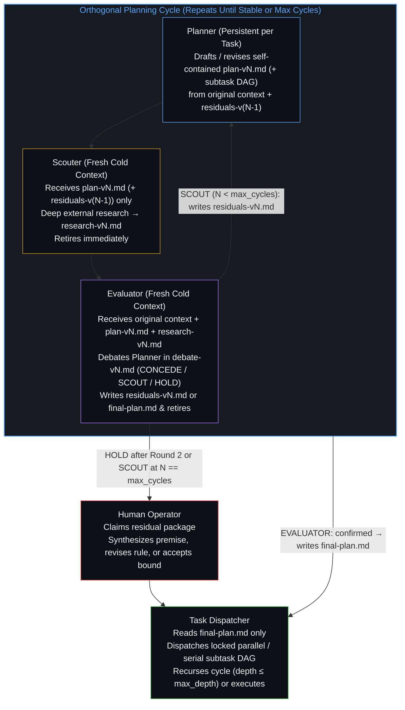
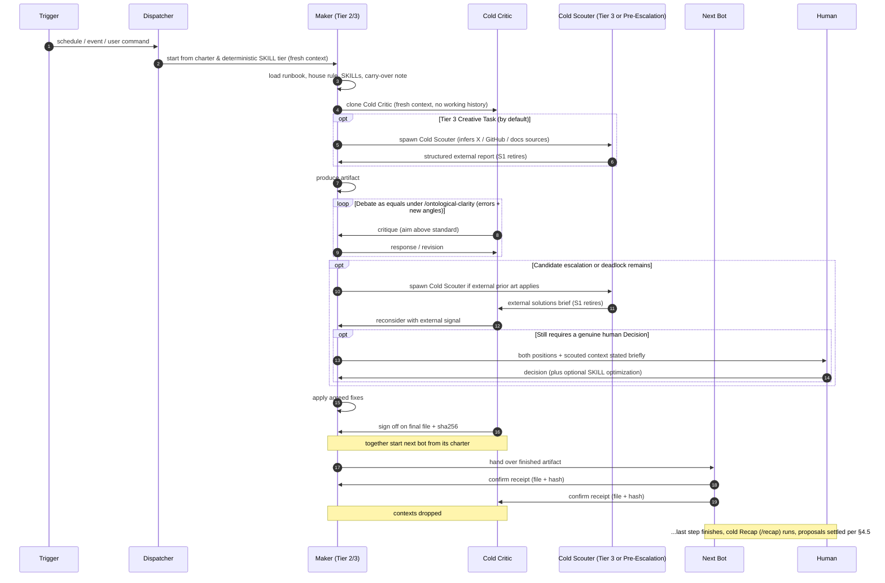

# Artificial Brain Waking, Sleep Consolidation & Orthogonal Planning Specification

> **Canonical Location:** [`docs/wave-refinement-plan.md`](../docs/wave-refinement-plan.md) (symlinked at `work/README.md`)  
> **Foundational Ground:** `/ontological-clarity` (`SKILL.md`), the single house rule, referred to and never restated  
> **Companion Essays:** [`On-Demand Contexts Keep Coherence at One Step`](../content/posts/on-demand-contexts-keep-coherence-at-one-step.md), [`Boundary-Condition Graphs as Memory and Control in Recursive Formal Systems`](../content/posts/boundary-condition-graphs-as-memory-and-control-in-recursive-formal-systems.md) & [`Modular Feedback Loops and Dynamic Residual Networks`](../content/posts/dynamic-resnet-of-skill-loops.md)  
> **Scope:** Generic, Agentic-System-Agnostic Specification for **Event-Driven On-Demand Bot Dispatching** across **(A) The Living Book (`not-a-toe`) Waking & Sleep Consolidation Pipeline (`/wake` → `/sleep` → `/deep-sleep`)**, **(B) Controlled Open-Internet Injection for Orthogonal Planning Cycles (`Planner` → `Scouter` → `Evaluator` → `Task Dispatcher`)**, and **(C) In-House Media Production (`/media <slug>`)**. Runtime-specific realizations live in [`docs/adapters/`](../docs/adapters/) ([`docs/adapters/antigravity.md`](../docs/adapters/antigravity.md), primary runtime for `/wake`, `/draft`, `/sleep`, `/deep-sleep`; and [`docs/adapters/claude-code.md`](../docs/adapters/claude-code.md), primary runtime for `/media <slug>`); the runtime-neutral role charters the adapters register live in [`docs/charters/`](../docs/charters/), one file per role; Grok CLI reads `~/.grok/skills/` natively and customizes execution from its own standpoint using whatever tools it has available, needing no separate adapter file unless its primitives diverge.

---

## 1. Ontological Foundations: Event-Driven On-Demand Bot Dispatching & the Artificial Brain

> **Core Idea:** What are called agents or bots are one base model wearing different masks (`Bot = base model + charter + skills`). Nothing is really created or retired; the model switches context according to the task at hand. "Creating" a bot means loading a charter and its skills into a fresh context; "retiring" it means dropping that context. Because each task loads only the context best suited to it—and discards that context once the finished artifact is handed over—there is no need for long contexts, and standing-agent defects (**long-context drift**, **stale memory**, and **role bleed**) are eliminated at the root.

Designing an agentic authoring, memory-consolidation, or engineering-planning pipeline by asking a standing agent session to draft, research, self-review, translate, and publish within one uninterrupted token trajectory pits the structural mechanics of autoregressive models against the structural mechanics of human cognition. Traced from the single premise of `/ontological-clarity` (*self-distinguishing activity occurs — uncaused, unceasing*), the system is wired around six runtime-agnostic invariants:

### 1.0 Central Principle: Delegate Tasks, Never Decisions (Zero Watchdogs or Deadline Rules)
- **Only tasks can be delegated, never decisions.** Decisions are always made by the living Mind; so-called automated decisions are pre-made decisions being executed. Bots carry out tasks (drafting an essay, critiquing it, translating it, scouting external constraints, recomputing a hash, handing over a finished file). Choosing between two positions the bots could not reconcile, or deciding what to do with a stalled step, a crash, or a hash mismatch, are decisions. Decisions stay with the Human Operator.
- **Disagreements, stalls, crashes, and hash mismatches go to the human (after deterministic pre-escalation verification).** When maker and cold critic cannot reach full agreement (after running a cold, retiring `Scouter` on a neutral question and reconsidering once), both positions are stated briefly and the run waits for the human to decide. When a step crashes or stalls, if the trace confirms a deterministic local fix (such as killing a confirmed-stuck read-only TUI process), the agent executes and reports it; if a genuine premise decision remains, it passes through the pre-escalation gate below before interrupting the human (always re-running any redone step in a **fresh context**, never by patching or restarting the old context).
- **No rule or watchdog stands in for judgment.** A deadline rule (*"if no answer by morning, publish anyway"*) or a watchdog (*"if a step is silent for an hour, restart it"*) looks like an automated decision, but is actually a decision made earlier without knowledge of the situation and executed blindly later. The scheme uses neither.
- **One Single House Rule:** The entire scheme rests on one house rule, the `/ontological-clarity` skill, loaded by every bot by reference and never restated. Makers and cold critics debate as equals; neither has the final say, and splitting the difference (compromise) is refused because it installs a second ground. Settling a point by tracing it back to the shared premise executes the pre-made house rule the human chose; any point that cannot be traced to the shared premise requires a new decision and goes to the human.

### 1.0.1 Deterministic Task Tiers, Pre-Escalation Verification Gate & `/recap`
"On-demand" means contexts are spun up only when a defined trigger fires—**not** that a task bot improvises its own process mid-flight. The governing `SKILL`s deterministically specify up front which contexts run for each class of task, how candidate escalations are verified before interrupting the Operator, and how `Recap` closes the loop on uncatchable surprises:

| Task Tier | Decision-Space Geometry (per [`The Density of Judgment`](../content/posts/the-density-of-judgment.md)) | Default On-Demand Contexts (Set Up Front in `SKILL`) | Structural Purpose |
| :--- | :--- | :--- | :--- |
| **Tier 1: Deterministic Execution** | Closed endpoint, fully stated parameters (`interleave-post.py`, `check-signoffs.py`, `audit-post.py`, `audit-book.py`, `build.mjs`, `project-posts-graph.mjs`, `watch-deploy.sh`, `sha256` checks, killing a confirmed-hung read-only process) | **Script / Single Executor Only** (Zero `Critic`, Zero `Scouter`) | Outcome contracts the decision space to a terminating pass/fail; spinning up a critic or scouter adds cost without signal. |
| **Tier 2: Bounded Subtask** | Defined goal, non-trivial execution (`Drafter` in Stage 1, `Translator` in Stage 2, bounded code/config subtasks, or diagnosing a non-trivial operational failure) | **`Maker` ⇄ `Cold Critic` by Default** (`Cold Scouter` on any maker ⇄ critic deadlock) | Operates in **both directions**: (1) prevents errors, premise drift, and false-positive escalations, and (2) surfaces overlooked issues or a fresh angle that `Maker`'s trajectory missed. |
| **Tier 3: Creative / Open-Ended Task** | Open-ended design, research, or architecture that expands its own residual decision space (`/scout` / `/orthogonal-plan`, `/wake` Stage 0 in `work/_wake/scout.md`, and the film style pick in `studio/post/<slug>/wip/film/scout.md`) | **`Maker/Planner` + `Cold Scouter` + `Cold Critic/Evaluator` by Default** | Injects external prior art from inferred high-signal spaces (X, GitHub, official docs, papers) alongside cold ontological evaluation from the start. |

- **Deterministic Pre-Escalation Verification Gate (`Task Owner` ⇄ `Cold Critic` → `Cold Scouter` → Reconsider → `Operator`):**
  Whenever an agent handling a Tier 2 or Tier 3 task believes something requires Operator intervention, it must not interrupt the Operator from inside its single trajectory. The **`Scouter`** has two fixed triggers across the entire system: **(1) at the start of creative work** (`/scout` / `/orthogonal-plan`, `/wake` Stage 0, and the film style pick), and **(2) whenever maker and critic cannot reach full agreement in debate**:
  1. **Step A — Equal-Footed `Cold Critic` Check:** Spin up a fresh `Cold Critic` (with `/ontological-clarity` and the candidate question/blocker, without the task owner's session history) to debate on equal footing: *Is this genuinely an underivable human Decision between unranked goals/premises, or is it a Task already derivable from the house rule and existing repository premises (`Logical Coherence over Rules`)? Does a new angle dissolve the blocker?* If resolved, execute and report—zero interruption.
  2. **Step B — Cold `Scouter` Injection on Any Deadlock:** If `Task Owner` and `Cold Critic` still cannot reach full agreement, write the open question as a neutral `QUESTION:` in `scout-<suffix>.md` beside the debate file (or `residuals-vN.md` in `/scout`) and spin up a cold, retiring `Scouter` that infers the best external sources for the question (X threads, GitHub repositories/issues, official docs, papers; `"nothing relevant"` counts as a valid finding) and writes `research-<suffix>.md`. `Task Owner` and `Cold Critic` reconsider once with that brief in hand.
  3. **Step C — Verified Operator Escalation:** Only if `Task Owner` and `Cold Critic` still cannot reach full agreement after reconsidering with `research-<suffix>.md` do they surface `HOLD` with both positions and the scouted findings to the Operator.
- **`O(1)` Pass/Fail Return Protocol & Need-to-Know Log Files (`Capacity` & `Trace` Isolation):**
  To eliminate context-window bloat across arbitrary fan-out and depth, child bots **never** return narrative summaries, node tables, or debate explanations in their message payloads to their parent dispatcher. Every child bot returns **strictly a 1-line `STATUS: PASS | FAIL | HOLD` token + log file pointer** (e.g., `STATUS: PASS role=<role> verdict=DELTA|NO_DELTA sha256=<hash> log=work/<slug>/...` or `STATUS: PASS batch=<m> delta=<D> no_delta=<N> open_issues=0 remaining=<R> commit=<sha> log=work/_logs/batch-<m>.md`, or `STATUS: HOLD|FAIL ... open_issues=<K> log=<path>`). All details live on disk in the log files (`work/<slug>/...`, `work/_logs/...`, `work/plan/<task-id>/...`), read **strictly on a need-to-know basis** by `Recap` or by the parent layer when an open issue is escalated.
- **`Recap` (`/recap`) as Observational/Operational Horizon Expansion (`Δθₗ`), Multi-Layer Residual Escalation Pyramid, & Post-Expansion Log Deletion:**
  While task execution moves the **current edge** (`content/posts/*.md`, `content/book/*.md`, project code), **`Recap` (`/recap`) is how the observational/operational horizon of the system (`SKILL`s, charters, specs, scripts) is expanded by the updated edge (`Δθₗ`)**. Once that horizon is expanded, the trace of how it got there is no longer part of the current edge and must be removed to prevent **Image lag**:
  - **Multi-Layer Residual Escalation Pyramid (`Inner Loop → Next Layer Up → Outer Loop`):**
    1. **Need-to-Know Local `Recap` Resolution (`Layer k`):** At the boundary of any inner layer (e.g., a node, a `Deep Sleep Batch <m>` inside `batch-dispatcher`, or a child subtask), a cold `Recap` context (`implementer ⇄ cold critic` under `/ontological-clarity`) reads the layer's logs on a need-to-know basis and resolves part or all of the issues derivable at that scope.
    2. **Escalating Only Remaining Open Issues One Layer Up:** After the local `Recap` resolves what it can, **only the remaining open issues (`open_issues > 0`)** are escalated one layer up (via a 1-line `STATUS:` token + pointer to the distilled open-issues log `work/_logs/...`), where the parent layer's `Recap` (`implementer ⇄ cold critic` + `Cold Scouter` where external signal applies) attempts to resolve them—escalating again only if they cannot be resolved at that layer, until hitting the **Outer Loop**.
    3. **Outer Loop (`Human Operator` Judgment Call + Sovereign Consistency Check under `/ontological-clarity`):** Only remaining open issues that could not be resolved by any inner layer (or that require sovereign ratification, such as irreducible `HOLD` premise deadlocks or structural topology splits/compilations) reach the Operator at the Outer Loop. When the Operator provides a decision or judgment call to resolve the remaining issues, **that candidate resolution is first tested for logical consistency with `/ontological-clarity` and the current edge**—even though the Operator always has the final say, testing first ensures any accidental contradiction or unstated premise is surfaced cleanly for sovereign confirmation before being baked into the edge.
    4. **Post-Horizon Log Presentation & Deletion (`Zero Image Lag`):** Fully settled inner-loop node workspaces (`open_issues == 0`) are deleted once their local `Recap` settles, while batch/run summary logs (`work/_logs/`) and any logs tied to escalated open issues are retained on a need-to-know basis up to the Outer Loop. After the final `Recap` at the Outer Loop—and after the Operator has resolved all remaining issues or made the final judgment call—**the remaining logs are presented to be deleted (`rm -rf`)**, removing all traces that are not part of the current edge.
  - **Mitosis Under Capacity Overload (`F → F₁, F₂, …`):** When orthogonal axes compress inside one skill block—surfacing multi-round critic churn, frequent `HOLD` escalations, or premise drift as fixing one axis disturbs another—`/recap` proposes splitting the overloaded block via mitosis into smaller chained, parallel, or nested residual sub-blocks (`F₁, F₂, …`) along the `sha256` artifact highway.
  - **Zero-Context Crystallization Under Convergence (`Δθₗ → 0`, `Tier 3 → Tier 2 → Tier 1`):** Conversely, as `/recap` codifies previously unstated edge cases across runs and structural charter updates converge (`Δθₗ → 0`), everything inside that bounded domain becomes deterministically derivable: the stabilized block crystallizes—narrowing into a single-pass zero-context operator and ultimately compiling out of LLM inference into a deterministic script or binary audit check (`Tier 3 → Tier 2 → Tier 1`). As [`Modular Feedback Loops and Dynamic Residual Networks`](../content/posts/dynamic-resnet-of-skill-loops.md) and [`The Density of Judgment`](../content/posts/the-density-of-judgment.md) trace, that uninterrupted middle is the earlier interventions in compiled form, shrinking the calendar interval between open boundary decisions and concentrating higher-leverage choices at the outer perimeter while the initiating state (`y₀`) and `HOLD` remain anchored to the living Mind.

### 1.1 Topology of the Artificial Brain
The operator's repositories and session instruments form a single coherent cognitive architecture:
1. **Artificial Mind (`ontological-clarity`):** [`/Users/jingliang/Projects/ontological-clarity/SKILL.md`](../../ontological-clarity/SKILL.md) (each runtime reaches it as its adapter in [`docs/adapters/`](../docs/adapters/) states) — the direct public image of the living Mind (the single premise, what follows, method, communication discipline, self-check, and renewal). It holds zero memory warehouse.
2. **Artificial Memory (`not-a-toe` — The Living Book):** [`content/posts/*.md`](../content/posts/) + [`content/book/*.md`](../content/book/) + [`docs/posts.graph.json`](../docs/posts.graph.json) — **the digitized memory of a Mind tracing and experiencing reality as is** (not a static blog log and not a prescriptive "philosophy to live by"). Every essay is a discrete operative cut made in concrete friction; internal cross-links (`[title](../slug/)`) are the synaptic connections of long-term memory.
3. **Experimental Artificial Baby Brain (`ontos`):** [`/Users/jingliang/Projects/ontos`](../../ontos/) — an experimental attempt to run from the Artificial Mind + model loop with minimal or no pre-populated Artificial Memory.
4. **Working Memory (`/bridge`, `/resume-bridge`, `/retire`):** Model- and agent-agnostic plain Markdown files at `<project>/memory/bridges/<id>.md` (with `<project>/memory/bridges/.last_session` tracking session continuity). Working memory carries only the moving `Next` edge and the preceding traces it still depends on across context clears; once a task finishes or consolidates into long-term memory, `/retire` deletes the bridge—because a brain does not keep a permanent log of its own sleep.
5. **Extended Memory (`/Users/jingliang/Projects/*`):** Every project repository on disk (`not-a-toe`, `ontos`, `brief`, `orbit`, etc.) is an externalized artifact of Extended Memory. Both the peer-debate pattern and the orthogonal research-planning cycle (Section 6) apply across any project in Extended Memory.
6. **Project Skills:** The project skills (`wake`, `draft`, `sleep`, `deep-sleep`, `media`, `recap`, `scout`, `orthogonal-plan`, `bridge`, `resume-bridge`, `retire`) belong to `not-a-toe`; there is one unversioned copy at `~/.grok/skills/<name>/`, and each tooling reaches it as its adapter in [`docs/adapters/`](../docs/adapters/) states. The `ontological-clarity` repository holds only the house rule.

### 1.2 Trajectory vs. Identity & Skill Residual Blocks Over an Artifact Highway (`yₗ₊₁ = yₗ + F(yₗ, θₗ)`)
- **The Agent's Bind (Plain Deep Stack Degradation `yₗ₊₁ = fₗ(yₗ)`):** An LLM agent is a finite projection engine. Every token it generates becomes the conditioning history (`Trace`) for every token that follows. As [`Modular Feedback Loops and Dynamic Residual Networks`](../content/posts/dynamic-resnet-of-skill-loops.md) traces, chaining subagents through shared chat history or lossy prose summaries operates as an unassisted plain stack (`yₗ₊₁ = fₗ(yₗ)`): each stage overwrites the running reference, compresses independent axes, drops negative findings, and pulls the receiving context into the upstream trajectory's epistemic gravity well. Left inside its own session, a lone agent's first draft becomes its retained `Image`—self-review merely rationalizes its prior tokens.
- **The Agent's Strength (Zero Ego in a Cold Context):** Unlike a human whose reasoning history fuses with identity, an agent in a fresh context has zero personal attachment to having been "right" one turn ago. When a counterpoint or external constraint enters its context from *outside* its self-reinforcing loop, it performs a clean Bayesian update.
- **Skill Residual Block Geometry (`yₗ₊₁ = yₗ + F(yₗ, θₗ)`):** The file-backed skill architecture translates a Residual Network block into discrete symbolic execution over disk files with **two explicit scales of modular feedback**:
  1. **Artifact Identity Highway (`yₗ`):** Immutable artifacts in the run folder, verified by cryptographic `sha256` hashes and handed across steps via data-free pointers (`STATUS:`) with zero conversational history, preserving the retained reference (`Image`) intact across arbitrary depth.
  2. **Within-Step State Refinement (`Δyₗ = F(yₗ, θₗ)` via `Maker ⇄ Cold Critic`):** Inside each step `yₗ → yₗ₊₁`, a fresh `Maker` (`Drafter` in Stage 1, `Translator` in Stage 2, `Planner` in Section 6) loads charter `θₗ`, reads `yₗ` as its clean initial condition, and proposes a bounded differential `Δyₗ` (`yₗ₊₁ = yₗ + Δyₗ`). A fresh, isolated **`Cold Critic`** (`Critic` in Stage 1, `Stylist` in Stage 2, `Evaluator` armed with a fresh `Scouter` report in Section 6) acts as the within-step backward arm—reading `yₗ₊₁` against `yₗ`, charter `θₗ`, and `/ontological-clarity` without the maker's chain of thought. No third "Judge Agent" is inserted between them: they iterate locally until every flag settles by **mutual agreement (`ACCEPT` / `CONCEDE`)** and locks via `sha256` (`CONFIRMED`), at which point both transient contexts drop and `yₗ₊₁` advances along the identity highway (or escalates on irreducible `HOLD` to the **Human Operator** after the Pre-Escalation Gate).
  3. **Cross-Run Charter Calibration (`Δθₗ` via Cold `/recap`):** At run completion or upon `HOLD`, a cold `/recap` pass audits the run folder backward from `/ontological-clarity` to propose structural updates `Δθₗ` to the skill charter itself (§4.5).
- **Grok Bot Retirement & Pool Reuse (Platform Deletion Workaround):** On Grok Bot, where only the human user can hard-delete a bot, roles (`Publisher` and `Cold Publish Critic`, §8.2 Wave 3) are still retired after each task's `sha256` sign-off rather than kept as standing personas: a finished bot is retired by renaming it to an idle pool slot (e.g., `retired-bot-<n>`) and putting it in **idle mode**. Whenever a new bot is needed, an available retired/idle bot is reused first by updating its charter and name fresh for the new task, and a new bot is created only when retired bots run out (the owner, 2026-10-26). The cold-read separation of §5.2 binds every generative and review role across the architecture.

### 1.3 Dynamic Residual Network Topology: Mitosis Under Load & Zero-Context Crystallization (`Capacity`)
Unlike a neural ResNet compiled onto a static computation graph before execution, an agentic skill network operating over a boundary-condition graph adapts its topology across runs under two opposing pressures diagnosed by `/recap`, settled per §4.5, and ratified at `y₀`/`HOLD` by the Operator:
- **Mitosis Under Capacity Overload (`F → F₁, F₂, …`):** Cramming $2^N$ independent requirements—context probing, open-internet scouting, ontological derivation, primary-language prose, causal translation (`信`), native target-language cadence (`达/雅`), and book/index assembly—into one skill block exceeds a center's finite `Capacity`. Independent axes compress onto one register, surfacing multi-round critic churn, frequent `HOLD` escalations, or premise drift as fixing one axis disturbs another. Rather than forcing a bloated prompt to try harder, the overloaded block splits via mitosis into smaller chained, parallel, or nested residual sub-blocks (`F₁, F₂, …`) along the artifact highway:
  - **Orthogonal Planning Cycle (Section 6 — Any Project / Pre-Implementation Research):** `Planner` $\rightarrow$ `Scouter` (fresh, retires) $\rightarrow$ `Evaluator` (fresh, debates `Planner`, writes `residuals-vN.md` or promotes `final-plan.md`, retires) $\rightarrow$ `Task Dispatcher`.
  - **Stage 0 (Waking Probe, Evaluation & Operator Sign-Off — `/wake` / `/draft` only):** Gather spark, source, AI/X thread & initial draft $\rightarrow$ evaluate against the Living Book (treating individual studies as representative cases of a broader pattern to be traced, not traced by itself in detail) $\rightarrow$ settle `New Post` / `Refinement` / `Drop` recommendation with a cold critic and get the Operator's sign-off before drafting (optionally invoking the Section 6 Planning Cycle when external reference architectures are needed before drafting).
  - **Stage 1 (Primary-Language Cut & Cold Ontological Review):** `Drafter` $\leftrightarrow$ `Critic` (including relative `[title](../slug/)` links directly in the prose).
  - **Stage 2 (Logical Translation [`信`] & Cold Cadence Review [`达/雅`]):** `Translator` $\leftrightarrow$ `Stylist`.
  - **Stage 3 (Deterministic Assembly, Audits, Publish & Wave Dispatch):** `Dispatcher` / `Assembler`.
- **Zero-Context Crystallization Under Convergence (`Δθₗ → 0`):** Conversely, as `/recap` codifies edge cases across runs and structural charter updates converge (`Δθₗ → 0`), the stabilized skill block crystallizes—narrowing into a single-pass zero-context operator and ultimately compiling out of LLM inference into a deterministic script or binary audit check (`Tier 3 → Tier 2 → Tier 1`), shrinking the calendar interval between open boundary decisions and concentrating higher-leverage choices at the outer perimeter while `y₀` and `HOLD` remain anchored to the living Mind.

### 1.4 Dispatcher vs. Orchestrator (`Observer` + `Power`)
- **Agentic System as Dispatcher (Finite Projection):** Routing tasks across stages, interleaving paired paragraphs, running deterministic audits, dispatching the peer-verified parallel/serial subtask DAG locked inside `final-plan.md`, and advancing the wave cursor are well-defined structural operations executed by the runtime's `Dispatcher` / `Assembler`. All generative architectural decisions—including how a plan decomposes into orthogonal parallel/serial subtasks and which subtasks require child research cycles—are authored by `Planner` inside `plan-vN.md` and cold-verified by `Scouter` and `Evaluator` before `final-plan.md` locks, never invented unreviewed by `Task Dispatcher`.
- **The Human as Ultimate Orchestrator (Unprojected Intent):** Agents remain finite projection engines. The wiring localizes non-convergence; it does not classify "premise-level residual" versus "implementation-detail residual," nor does it dissolve contradictions in living intent. Only the human holds dynamic, limit-resolution sensing and can step backward out of a broken frame when two premises collide. Whenever a peer debate reaches an irreducible `HOLD` (or a planning loop hits `max_cycles` or `max_depth`), the local streamline pauses and surfaces the exact coordinate of friction to the Operator. Making that call forces a higher-order synthesis that dissolves the contradiction, revises the premises, or accepts the bound rather than overriding one peer by fiat.

### 1.5 Wake vs. Sleep: Prior-Driven Causal Ripple (`Prior → Target Differential Δy`) Across Artificial Memory
- **Waking Edge (`/wake`, alias `/draft` — New Blog Post `N` or Refinement):** A new essay `N` is the most recent digital edge left behind by the living Mind. Invoking `/wake [seed]` (or `/draft [seed]`) cleanly pauses any active sleep consolidation after its current in-flight node, probes for the four waking materials (**1. new intuition/spark**, **2. inspiring source**, **3. thinking process [AI discussion or X comment thread]**, and **4. initial draft**—whether all four or a simple initial idea), evaluates them against the Living Book (treating individual studies as representative cases of a broader pattern to be traced, not traced by itself in detail), settles **New Post (`N`)**, **Refinement of existing post(s)**, or **Drop (repetitive)** with a cold critic, and gets the Operator's sign-off on the evaluation before starting to draft. In `/wake`, existing `L1` posts served as priors to write `N`; once `N` is published, `work/wave.md` is initialized fresh for the new cycle with `N` as its `/sleep` origin (preserving only unchecked `[ ]` / `[HOLD]` items if a prior wave was paused mid-flight, and stripping all completed prior-wave history so no Image lag carries across cycles).
- **Sleep Consolidation as Re-Tracing from the Current Edge (`y_target' = y_target + F(y_target, Prior)` in `/sleep` and `/deep-sleep`):** Once `N` is published, external input is turned off and the Artificial Brain enters sleep consolidation. Because persistence in `/ontological-clarity` is re-tracing at the current step, **we always re-trace from the current edge, never from historical traces (unless carried as part of the current edge)**: `work/wave.md` logs and prior wave verdicts are cleared on time after each cycle (`work/wave.md` is a `Dispatcher`-only cursor for the current cycle), and past git commit history is consulted only with a strong reason (such as when the current edge is lost and needs recovery per `content/posts/README.md`).
  - **`/sleep` (Shallow Sleep — `N`-Driven Causal Ripple: `Node 0` + `Pre-Wave Reverse-Link Sweep` + `Recursive Prior-Driven DELTA Wave Until NO_DELTA` + `Post-Wave Sweep`):**
    1. **Round 1 (`Node 0`, `_reverse-link-sweep`, and `L1`) — The New Post `N` Is the Active Prior (`Prior = N`):** In `/wake`, `L1` posts served as priors to write `N`; in Round 1 of `/sleep`, the arrow reverses and **`N` is the active prior used to update the target artifacts**:
       - **Node `0` (`_plan-consolidation` — Stage 1 Only: `Drafter` ⇄ `Cold Critic`, Zero Translation):** Uses **`N` as the active prior** to update `docs/wave-refinement-plan.md`, `docs/adapters/*.md`, `AGENTS.md`, `docs/charters/*.md`, and `SKILL`s whenever `N`'s cut introduces, sharpens, or formalizes an architectural/operational insight or exposes a procedural blind spot (`DELTA` in `work/_plan-consolidation/draft.md`, or `NO_DELTA` with a 1-paragraph causal proof in `work/_plan-consolidation/notes.md`), cold-verified by `Critic` in `work/_plan-consolidation/debate-en.md`.
       - **Pre-Wave Reverse-Link Sweep (`_reverse-link-sweep` — Stage 1 `Drafter` ⇄ `Cold Critic`):** Uses **`N` as the active prior** across `content/book/index-of-premises.md`, `content/book/*.md`, and the compact `slug + # Title + *Subtitle*` catalog of all posts outside `links_out(N) ∪ {N}` to catch any unlinked existing posts $S_{\text{pre}}$ that `N`'s cut re-illuminates, sharpens, or extends (needing `P -> N` or `N -> P`). Confirmed sweep candidates merge with `links_out(N) \setminus \{N\}` to form `L1`.
       - **Layer `L1` (`(links_out(N) ∪ S_pre) \setminus \{N\}`):** Evaluates each `L1` post `P` with **`Prior = N`**, asking how `N`'s new cut re-illuminates, sharpens, extends, or concretely realizes `P`'s argument so `P`'s prose is deepened with `N`'s insight and weaves the reverse link `[<N>](../<N>/)`.
    2. **Subsequent Layers (`L2, L3, ..., Lk`) — Linked Parent `p ∈ DELTA_{k-1}^causal` Is the Active Prior (`Prior = p`):**
       - Only nodes with a confirmed causal/lattice refinement (`DELTA (causal)` → Stages 1–3; excluding `DELTA (hygiene-only; causal NO_DELTA)` nodes where both `Drafter` and `Critic` confirm `Δy(u | Prior) = 0` on the causal axis and only repair self-contained local hygiene/anchor/bilingual drift, which still run Stages 1–3 to ship the local fix cleanly and then terminate their branch) propagate to the next layer along reverse and forward links ($L_k = (\text{links\_in}(\text{DELTA}_{k-1}^{\text{causal}}) \cup \text{links\_out}(\text{DELTA}_{k-1}^{\text{causal}})) \setminus \text{visited}$, excluding foundational mega-hubs with `in_degree > 30` from `links_in` expansion).
       - For each post $u \in L_k$, the **post(s) $p \in \text{DELTA}_{k-1}^{\text{causal}}$ linked to $u$ in the previous layer $L_{k-1}$ serve as the active prior** (`Prior = p` with its newly refined cut in $L_{k-1}$). `Drafter` and `Critic` evaluate $u$ using $p$'s updated cut as the prior to see how $p$'s refinement in $L_{k-1}$ ripples into $u$ (and so on layer by layer). `NO_DELTA` (`CRITIC: confirmed_no_delta`) is reached only when conditioning $u$ on its parent $p$'s specific refinement in $L_{k-1}$ yields zero genuine conceptual differential ($\Delta y(u \mid p) = 0$) because $p$'s update is genuinely orthogonal to $u$'s cut (still barring forced keyword link-stuffing where the prior does not bear on the target), terminating that branch immediately until $\text{DELTA}_k^{\text{causal}} = \emptyset$.
    3. **Post-Wave Cross-Link Sweep (`_post-wave-sweep` — Stage 1 `Drafter` ⇄ `Cold Critic`):** Uses `N` and all `DELTA (causal)` posts from the wave as priors against the unvisited corpus catalog to verify that no cross-link updates were missed before `/sleep` closes.
  - **`/deep-sleep` (Deep Sleep — Fresh First-Time Evaluation of All Remaining Posts and Book/Site Contents with `/ontological-clarity`):** Because `/sleep` stops when layer-by-layer `DELTA` branches reach `Δy(u | p) = 0`, remaining posts outside `N`'s immediate `DELTA` chain and non-post site contents are consolidated by `/deep-sleep`, which **evaluates each remaining post and book surface from the current edge as if it is being evaluated for the first time**—reading related materials across the Living Book as deemed necessary (`content/book/index-of-premises.md`, `content/book/<part>.md`, linked neighbors, conceptually related posts, and the newly consolidated corpus frontier) and conducting a fresh logical analysis from the irreducible prior with `/ontological-clarity` (with `work/wave.md` cleared once the cycle finishes):
    1. **All Remaining Unvisited Posts (`content/posts/*.md \setminus visited`):** Ordered directly from the **current living book structure**—by Book Part (`PART_ORDER` in `build.mjs` and the essay order in `content/book/<part>.md`, or a specific `part=<part>` if passed), with zero `git log` queries during routine sleep consolidation (past git commit history is consulted only with a strong reason, such as when the current edge is lost)—and processed in batches of $B$ across $W$ parallel streamlines (`Drafter` ⇄ `Cold Critic` → `Translator` ⇄ `Stylist` → `Dispatcher/Assembler`), evaluating each post from the current edge as if for the first time with `/ontological-clarity` and related materials as deemed necessary to sharpen its cut, dissolve any remaining compressed axes or unstated premises, weave missing cross-links, and repair any prose/hygiene drift.
    2. **All Remaining Site & Book Contents (`content/book/*.md`):** Evaluates and consolidates the Book Preface (`content/book/preface.md`), the 14 Part Prefaces (`content/book/<part>.md`), and `content/book/index-of-premises.md` entry formulations from the current edge as if for the first time with `/ontological-clarity` and related posts under `Drafter` ⇄ `Cold Critic` (`→ Translator ⇄ Stylist` when prose changes) until the entire Living Book is consolidated (clearing `work/wave.md` upon cycle completion) or a new `/wake` initiates the next cycle.
- **Hubs Recur by Design:** High-degree hubs (`individual-choices-as-the-only-causal-levers`, `openness-is-consistency`, `intelligence-belongs-only-to-the-mind`) appear in most cycles because hubs are where stabilized traces broadcast furthest across the lattice. Within a single cycle (`visited`), each post is visited at most once; across cycles, as past lag is paid off, each pass becomes naturally lighter.

---

## 2. Workspace Separation: Working Directories (`work/`) vs. Canonical Source

Placing in-flight single-language drafts or intermediate research/planning artifacts inside canonical source directories collapses two orthogonal axes—*in-flight working state* and *the repository's canonical build surface*. The generic architecture separates **in-flight plain-Markdown workspaces (`work/`, excluded via `.git/info/exclude` or `.gitignore`)** from **canonical published source** using a simple, role-agnostic layout with explicit single-artifact ownership:

| Path | Writer / Owner | Purpose |
| :--- | :--- | :--- |
| `work/<slug>/en.md` | `Drafter` (signed off by `Critic`) | Pure primary-language (EN) Markdown draft/refinement, including Mermaid diagrams and relative `[title](../other-slug/)` links. Passed to Stage 2 **only** as a finished product signed off with its `sha256`. |
| `work/<slug>/notes.md` | `Drafter` | Context trace: waking materials (spark, source, AI/X thread, initial draft), linked posts read, Index of Premises entries checked, and refinement rationale. |
| `work/<slug>/debate-en.md` | `Critic` $\leftrightarrow$ `Drafter` | Primary-language debate log (`P1..Pn` and any post-lock `T1..Tn` flags routed by `Dispatcher`). Ends with `CRITIC: confirmed (file: work/<slug>/en.md, sha256: <hash>, date: <YYYY-MM-DD>)` + completed handoff checklist when all flags are closed. |
| `work/<slug>/zh.md` | `Translator` (signed off by `Stylist`) | Pure secondary-language (ZH) Markdown translation of the `Critic`-signed primary text. |
| `work/<slug>/debate-zh.md` | `Stylist` $\leftrightarrow$ `Translator` | Secondary-language debate log (`S1..Sn` cadence and 1:1 alignment flags). Ends with `STYLIST: confirmed (file: work/<slug>/zh.md, sha256: <zh-hash>, source_sha256: <en-hash>, date: <YYYY-MM-DD>)` + completed handoff checklist when all flags are closed. |
| `work/<slug>/recap.md` | `Recap` (Cold Post-Run Reviewer) | Need-to-know review against `/ontological-clarity`: identifies where the run fell short of logical coherence (conflicting charter goals, unstated skill premises, shared blind spots), **proposes** charter/skill edits, and logs any remaining `open_issues` after local settlement (§4.5). |
| `work/_logs/<layer>-<id>.md` | Child / Batch Dispatcher & `Recap` | Detailed execution, batch, and recap logs saved on disk so child agents return **only** a 1-line `STATUS: PASS | FAIL | HOLD ... log=<path>` to their parent dispatcher (read strictly on a need-to-know basis by `Recap` or on escalation). Presented and deleted after the final outer-loop `Recap` and Operator resolution complete. |
| `work/carry-over.md` | Final pair of a run | Late information learned too late to act on in the current run; read by the next run's first bot and cleared once acted on (see `work/todo.md` for cross-node wave notes). |
| `work/wave.md` | `Dispatcher` (`Drafter` & `Critic` never read it) | Transient single-cycle sleep cursor (`N`, bare `[ ]`/`[x]` node checkboxes, `visited` for the current cycle, and parked `HOLD`s). **Cleared after each cycle; never saves completed prior waves or historical `NO_DELTA` rationales.** |
| `work/plan/<task-id>/plan-vN.md` | `Planner` | Self-contained versioned technical specification and orthogonal subtask DAG (see Section 6). |
| `work/plan/<task-id>/research-vN.md` | `Scouter` | Structured external research report for cycle $N$; `Scouter` retires immediately after writing. |
| `work/plan/<task-id>/debate-vN.md` | `Evaluator` $\leftrightarrow$ `Planner` | Equal-footed planning debate log (`E1..En`); ends with `EVALUATOR: confirmed (sha256: <hash>, date: <YYYY-MM-DD>)`, `SCOUT`, or `HOLD`. |
| `work/plan/<task-id>/residuals-vN.md` | `Evaluator` | Neutral, falsifiable external research questions written by `Evaluator` at the end of Round 2 when `SCOUT` items remain for Cycle $N+1$. |
| `work/plan/<task-id>/final-plan.md` | `Evaluator` (or Operator on `HOLD`) | Promoted from `plan-vN.md` by `Evaluator` upon `EVALUATOR: confirmed` (signed off by `sha256`); the **only** artifact read by `Task Dispatcher`. |
| `work/todo.md` | Any role | Out-of-scope cross-node or cross-subtask observations saved for future nodes so active contexts stay clean. |
| `memory/bridges/<id>.md` | `/bridge`, `/resume-bridge`, `/retire` | Ephemeral Working Memory across session clears (`Next` + `Traces` with priors named; deleted upon `/retire`). |
| `content/posts/<slug>.md` | `Dispatcher` / `Assembler` | Canonical alternating bilingual post on the live site. Untouched during Stages 1–2 so `git status` stays clean until Stage 3 assembly. |

> **Why Transient Workspaces and Completed Wave Logs Are Deleted After Horizon Expansion, Not Archived (Re-Tracing from the Current Edge vs. Image Lag):**
> Just as neural network training saves current checkpoints rather than hoarding every historical gradient step, persistence in `/ontological-clarity` is re-tracing at the current edge—never from historical traces unless they are part of the current edge. **`Recap` is how the observational/operational horizon of the system is expanded by the updated edge; once that horizon is expanded, we remove the trace that is not part of the current edge.** Settled inner-loop node workspaces (`work/<slug>/` with zero open issues) are deleted once their local `Recap` settles, while batch/run summary logs (`work/_logs/`) and any logs tied to open issues are retained on a need-to-know basis until the final outer-loop `Recap` and Operator resolution complete—at which point the logs are **presented to be deleted (`rm -rf`)** and `work/wave.md` is cleared (`rm -f work/wave.md`), minimizing Image lag.

---

## 3. The 4-Stage Essay Pipeline & Role Specifications

```mermaid
flowchart TD
    subgraph S_Wake["Stage 0 (/wake or /draft Only): Probe Waking Materials, Evaluate & Get Operator Sign-Off"]
        W0["Operator invokes /wake or /draft<br/>Probe for: 1. Spark/Intuition, 2. Source, 3. AI/X Thread, 4. Initial Draft"] --> W1{"Evaluate against Index of Premises & existing posts<br/>Settle recommendation with cold critic & get Operator sign-off:<br/>NEW POST (N) vs. REFINEMENT vs. DROP"}
        W1 -->|"DROP (repetitive)"| W_Drop["Cite existing post(s) & stop cleanly"]
        W1 -->|"Needs external research"| W_Plan["Optional: Run Orthogonal Planning Cycle (Section 6)<br/>Planner → Scouter → Evaluator"]
        W_Plan --> W2
        W1 -->|"Operator signs off: NEW POST (N) or REFINEMENT"| W2["Lock <slug>, Book Part & initial spine (keep Operator draft/title)"]
    end

    subgraph S_EN["Stage 1: Primary-Language Cut & Cold Ontological Review (work/slug/en.md & debate-en.md)"]
        W2 --> B1
        B1["Drafter (Maker Context)<br/>Writes/refines EN in work/slug/en.md (with relative cross-links)<br/>Traces in context from /ontological-clarity + Index + neighbors"] --> B2["Critic (Fresh Cold Context)<br/>No Drafter chain-of-thought<br/>Traces en.md from irreducible prior & review-method.md"]
        B2 -->|"Raises P1..Pn"| DebateEN["Drafter ⇄ Critic Equal-Footed Debate<br/>ACCEPT / COUNTER / CONCEDE / HOLD (Zero Compromise)"]
        DebateEN -->|"All P-flags CLOSED"| LockEN["Critic signs off exact en.md + sha256<br/>Drafter completes Handoff Checklist"]
        DebateEN -->|"Irreducible HOLD"| Op_EN["Park Node in work/wave.md<br/>Escalate both positions briefly to Operator"]
        Op_EN -->|"Operator Decides"| LockEN
        B2 -->|"Clean on first pass"| LockEN
    end

    subgraph S_ZH["Stage 2: Logical Translation (信) & Cold Cadence Review (达/雅) (work/slug/zh.md & debate-zh.md)"]
        LockEN -->|"Finished Product Only (sha256 confirmed by Translator)"| B3["Translator (Maker Context — 信)<br/>Recomputes & confirms en.md sha256 (Stage 1 contexts drop)<br/>Translates locked en.md → work/slug/zh.md"]
        B3 -.->|"Reports T1..Tn if EN has source ambiguity or flaw"| DebateEN
        B3 --> B4["Stylist (Fresh Cold Context — 达/雅)<br/>Cold-reads zh.md first, then checks 1:1 against en.md<br/>Raises S1..Sn for cadence, translationese & 信 alignment"]
        B4 --> DebateZH["Translator ⇄ Stylist Equal-Footed Debate<br/>ACCEPT / COUNTER / CONCEDE / HOLD (Zero Compromise)"]
        DebateZH -->|"All S-flags CLOSED"| LockZH["Stylist signs off exact zh.md + sha256<br/>Translator completes Handoff Checklist"]
        DebateZH -->|"Irreducible HOLD"| Op_ZH["Park Node & Escalate both positions to Operator"]
        Op_ZH --> LockZH
        B4 -->|"Clean on first pass"| LockZH
    end

    subgraph S_Final["Stage 3: Deterministic Assembly, Audits, Publish, Recap & Sleep Dispatch"]
        LockZH --> B5["Dispatcher / Assembler & Post-Run Recap<br/>1. Recompute & confirm en.md + zh.md sha256 (Stage 2 contexts drop)<br/>2. Interleave locked en.md + zh.md into content/posts/slug.md<br/>3. Sync Book Part, Index of Premises, title-translations.json & incoming anchors<br/>4. Run audit-post.py, audit-book.py, build.mjs, project-posts-graph.mjs<br/>5. Run cold Recap (proposals settled per §4.5)<br/>6. Commit (tracked paths only), push, verify live HTTP 200, delete work/slug/ once its Recap is settled"]
        B5 -->|"After New Post N"| Sleep1["/sleep: Shallow Sleep<br/>L1 = (links_out(N) ∪ S_pre) - {N}; DELTA wave per §4.2"]
        Sleep1 -->|"After the DELTA ripple converges"| SleepK["/deep-sleep: Deep Sleep<br/>All remaining unvisited posts + book/site contents<br/>in batches per §4.3 until next /wake"]
        Sleep1 -.->|"Each node in Lk"| B1
        SleepK -.->|"Each node in a batch"| B1
    end

    style S_Wake fill:#161b22,stroke:#3fb950,stroke-width:1.5px,color:#3fb950
    style S_EN fill:#161b22,stroke:#58a6ff,stroke-width:1.5px,color:#58a6ff
    style S_ZH fill:#161b22,stroke:#a371f7,stroke-width:1.5px,color:#a371f7
    style S_Final fill:#161b22,stroke:#3fb950,stroke-width:1.5px,color:#3fb950
    style W0 fill:#0d1117,stroke:#3fb950,stroke-width:1px,color:#f0f6fc
    style W1 fill:#0d1117,stroke:#d29922,stroke-width:1px,color:#f0f6fc
    style W_Drop fill:#0d1117,stroke:#f85149,stroke-width:1px,color:#f0f6fc
    style W_Plan fill:#0d1117,stroke:#58a6ff,stroke-width:1px,color:#f0f6fc
    style W2 fill:#0d1117,stroke:#3fb950,stroke-width:1px,color:#f0f6fc
    style B1 fill:#0d1117,stroke:#58a6ff,stroke-width:1px,color:#f0f6fc
    style B2 fill:#0d1117,stroke:#a371f7,stroke-width:1px,color:#f0f6fc
    style DebateEN fill:#0d1117,stroke:#d29922,stroke-width:1px,color:#f0f6fc
    style LockEN fill:#0d1117,stroke:#3fb950,stroke-width:1px,color:#f0f6fc
    style Op_EN fill:#0d1117,stroke:#f85149,stroke-width:1px,color:#f0f6fc
    style B3 fill:#0d1117,stroke:#58a6ff,stroke-width:1px,color:#f0f6fc
    style B4 fill:#0d1117,stroke:#a371f7,stroke-width:1px,color:#f0f6fc
    style DebateZH fill:#0d1117,stroke:#d29922,stroke-width:1px,color:#f0f6fc
    style LockZH fill:#0d1117,stroke:#3fb950,stroke-width:1px,color:#f0f6fc
    style Op_ZH fill:#0d1117,stroke:#f85149,stroke-width:1px,color:#f0f6fc
    style B5 fill:#0d1117,stroke:#3fb950,stroke-width:1px,color:#f0f6fc
    style Sleep1 fill:#0d1117,stroke:#58a6ff,stroke-width:1px,color:#f0f6fc
    style SleepK fill:#0d1117,stroke:#a371f7,stroke-width:1px,color:#f0f6fc
```



### Role Specifications & Operational Learnings

> **Foundational Rule — Causal Reasoning over Raw Mechanical Rejection (`Logical Coherence over Rules`):**
> Logical coherence (each case traced back to the irreducible prior) comes before any rule, since logic is scale-invariant and rules are context-dependent. Across all stages (`Drafter`, `Critic`, `Translator`, `Stylist`, and `Dispatcher`), authoring conventions and audit advisories—such as the 17-word vocabulary-hygiene list in `AGENTS.md`, prose-over-lists, subtitle length guidelines, and book ordering—are **recommendations and diagnostic signals, not mechanical stopping rules**. Never perform raw mechanical rejection of a word or structure without reasoning causally about its actual context: when a listed word names the held belief or object under dissection, or when a list's structure carries meaning prose would blur, keeping it is the logically coherent choice.

#### Stage 1 Generator — `Drafter` (Primary-Language Drafter / Refiner)
- **Context Loaded:** `/ontological-clarity`, [`AGENTS.md`](../AGENTS.md) (*Write in context, traced to premises*), the target post `content/posts/<slug>.md` (or the implementation plans `docs/wave-refinement-plan.md`, `docs/adapters/*.md`, `AGENTS.md`, `docs/charters/*.md`, and `SKILL`s for Node `0` `_plan-consolidation`, or the Operator's waking materials—spark, source, AI/X discussion thread, and initial draft—for `/wake`), **the active prior in `/sleep`** (`N` for Round 1 Node `0`, `_reverse-link-sweep`, and `L1`; or the linked parent post(s) $p \in \text{DELTA}_{k-1}^{\text{causal}}$ from $L_{k-1}$ for subsequent layers $L_k$) **or related materials as deemed necessary in `/deep-sleep`** (evaluating the target as if for the first time with `/ontological-clarity`, reading `content/book/index-of-premises.md`, `content/book/<part>.md`, linked neighbors, conceptually related posts, and the newly consolidated corpus frontier), the target post's linked neighbors, its [`content/book/index-of-premises.md`](../content/book/index-of-premises.md) entries, and its book chapter.
- **Execution:** Writes or refines the pure English essay in `work/<slug>/en.md` (when refining an existing bilingual post, first splitting `content/posts/<slug>.md` into `work/<slug>/en.md` and `work/<slug>/zh.md` via `python3 scripts/interleave-post.py --split <slug>`), including relative `[title](../other-slug/)` links directly in the prose, and records its context trace (plus candidate 1-hop reverse-pointer notes for a new post `N`) in `work/<slug>/notes.md`.
  - **Operator Draft & Existing Spine Preservation (`/wake`, `/sleep`, `/deep-sleep`):** When the Operator supplies an initial draft in `/wake`, `Drafter` preserves the Operator's title, structural spine, and argument order as the ground of the cut (and when the spark is an individual study rather than a generally accepted theory, treats it as a representative case of the broader pattern being traced rather than detailing the study by itself); when refining or converting an existing post across `/wake`, `/sleep`, or `/deep-sleep`, `Drafter` preserves its core cut, section spine, and existing outbound cross-links (`links_out`) as the ground of the post—applying surgical precision in place (weaving relative links, adding vertical dark-theme Mermaid diagrams, tightening ungrounded phrasing, and checking incoming neighbor citations if historical drift is suspected) rather than replacing the essay's subject matter, dropping outbound links, or rewriting into generic house prose.
  - **Prior-Conditioned Ripple Gate (`/sleep`) & Fresh First-Time Logical Evaluation (`/deep-sleep`) (`DELTA` vs. `NO_DELTA`):**
    - **Never rubber-stamp `NO_DELTA` from isolated surface consistency** (merely checking whether a target's pre-existing text is internally consistent and passes `audit-post.py`). Instead:
      - **In `/sleep` Round 1 (Node `0`, `_reverse-link-sweep`, and `L1`):** `Prior = N` (in `/wake`, `L1` posts served as priors to write `N`; in `/sleep`, the arrow reverses and **`N` is the active prior used to update the target artifacts**).
      - **In `/sleep` Subsequent Layers (`L2, L3, ..., Lk`):** `Prior = p ∈ DELTA_{k-1}^causal` (the newly refined parent post(s) in $L_{k-1}$ linked to $u \in L_k$).
      - **In `/deep-sleep` (All Remaining Corpus Posts & Book Surfaces):** Evaluate each target post or book surface **as if it is being evaluated for the first time** based on logical analysis with `/ontological-clarity`, reading related materials across the Living Book (`content/book/index-of-premises.md`, `content/book/<part>.md`, linked neighbors, conceptually related posts, and the newly consolidated corpus frontier) as deemed necessary.
    - **`DELTA` (Refinement Warranted — `causal DELTA` vs. `hygiene-only DELTA (causal NO_DELTA)`):** Whenever conditioning the target on the active `Prior` in `/sleep`—or conducting a fresh first-time logical analysis with `/ontological-clarity` and related materials in `/deep-sleep`—re-illuminates, sharpens, extends, or concretely realizes the target's cut (or for Node `0`, introduces, sharpens, or formalizes an architectural/operational insight or exposes a procedural blind spot; or when the target has existing hygiene/bilingual/structural drift under current invariants), `Drafter` writes the surgical refinement in `work/<slug>/en.md` (or `work/_plan-consolidation/draft.md` for Node `0`) and records its causal trace in `work/<slug>/notes.md`. In `/sleep`, `Drafter` states explicitly in `work/<slug>/notes.md` whether the `DELTA` is **`causal DELTA`** ($\Delta y(y_{\text{target}} \mid \text{Prior}) \neq 0$: shifts/sharpens the post's cut or cross-link lattice along `Prior`) or **`hygiene-only DELTA (causal NO_DELTA)`** ($\Delta y(y_{\text{target}} \mid \text{Prior}) = 0$ on the causal axis from `Prior`, repairing self-contained local hygiene/anchor/bilingual drift only).
    - **`NO_DELTA` (Zero Differential $\Delta y = 0$):** Only when conditioning the target on the active `Prior` in `/sleep` yields zero genuine conceptual differential because the prior's cut (or parent $p$'s specific refinement in $L_{k-1}$) is genuinely orthogonal to the target's cut—or in `/deep-sleep`, when a fresh first-time logical analysis with `/ontological-clarity` and related materials confirms that the post's cut, premise trace, cross-link lattice, and prose invariants already hold at full clarity—does `Drafter` record `NO_DELTA` with a 1-paragraph causal justification in `work/<slug>/notes.md` (without forced keyword link-stuffing or decorative rule bloat) and hand straight to `Critic` for cold two-way verification.
- **Debate Rule:** Replies `ACCEPT` (with exact replacement text updated in `work/<slug>/en.md` and premise trace) or `COUNTER` (with premise trace showing why the current phrasing or `NO_DELTA` verdict is causally coherent) to each `P`-flag from `Critic` in `work/<slug>/debate-en.md`. Never closes a flag unilaterally.

#### Stage 1 Cold Peer — `Critic` (Cold Ontological Reviewer)
- **Context Loaded:** Fresh, isolated context with `/ontological-clarity`, [`studio/kits/shared/review-method.md`](../studio/kits/shared/review-method.md), **the active prior in `/sleep`** (`N` for Node `0`, `_reverse-link-sweep`, and `L1`; or the updated parent post(s) $p \in \text{DELTA}_{k-1}^{\text{causal}}$ from $L_{k-1}$ for $L_k$) **or related materials as deemed necessary in `/deep-sleep`** (evaluating the target as if for the first time with `/ontological-clarity`), and `work/<slug>/en.md` (or the existing `content/posts/<slug>.md` + `work/<slug>/notes.md` when `Drafter` declares `NO_DELTA`, or `work/_plan-consolidation/` + target plan/skill files for Node `0`), plus linked posts as needed to verify claims and relative links. Never reads `Drafter`'s session history.
- **Execution (Two-Way `DELTA` / `NO_DELTA` Verification):**
  - **When `Drafter` proposes `DELTA` (`en.md` or `draft.md`):** States what the draft's cut is and how it integrates the active `Prior` (or fresh first-time `/deep-sleep` analysis) first in `work/<slug>/debate-en.md`, then lists numbered points (`P1..Pn`) where independent axes compress, where an observer judges unobservable interiors, where a totalizing word ("only", "never", "all") over-closes a bounded mechanism, where a relative link does not fit its sentence, where two sections disagree, **or where a proposed reverse link / plan rule is forced keyword link-stuffing or decorative bloat because the prior is genuinely orthogonal to the target's cut ($\Delta y = 0$)**.
  - **When `Drafter` declares `NO_DELTA`:** In `/sleep`, cold-checks the target post (or implementation plans) **actively conditioned on the `Prior`** (`N` in Round 1, parent $p \in \text{DELTA}_{k-1}^{\text{causal}}$ in $L_k$); in `/deep-sleep`, **evaluates the target post (or book surface) as if it is being evaluated for the first time** by reading related materials as deemed necessary and conducting a fresh logical analysis with `/ontological-clarity`—forbidding `NO_DELTA` verdicts that merely check pre-existing surface consistency without testing whether the active `Prior` (in `/sleep`) or fresh first-time `/ontological-clarity` analysis (in `/deep-sleep`) sharpens or extends the target. If a genuine refinement is warranted ($\Delta y \neq 0$), raises `P1..Pn` requiring `Drafter` to produce `en.md` / `draft.md`.
- **Gate & Cryptographic `sha256` Sign-Off:** In Round 2+, marks each point `CONCEDE` (`CLOSED applied` or `CLOSED withdrawn`) or `HOLD` (full agreement only; zero split-the-difference compromise). Any point remaining on `HOLD` after Round 2 is escalated to the Operator with both positions stated briefly.
  - **If `DELTA` is confirmed:** Once all points are closed and verified verbatim in `work/<slug>/en.md` (or `work/_plan-consolidation/draft.md`), `Critic` signs off on the **exact final file and its `sha256` hash** (`CRITIC: confirmed (file: work/<slug>/en.md, sha256: <hash>, date: <YYYY-MM-DD>)`) in `work/<slug>/debate-en.md` (stating explicitly in `/sleep` whether the `DELTA` is **`causal DELTA`** or **`hygiene-only DELTA (causal NO_DELTA)`**), and `Drafter` completes the handoff checklist. Both `causal DELTA` and `hygiene-only DELTA (causal NO_DELTA)` nodes run Stages 1–3 so local edits ship cleanly, but only `causal DELTA` nodes expand into $L_{k+1}$.
  - **If `NO_DELTA` is confirmed:** `Critic` signs off on the unchanged canonical file (or `notes.md` for Node `0`) with `CRITIC: confirmed_no_delta (file: content/posts/<slug>.md, sha256: <hash>, date: <YYYY-MM-DD>)` in `work/<slug>/debate-en.md`. Confirmed `NO_DELTA` nodes skip Stage 2 (`Translator` ⇄ `Stylist`) and Stage 3 (`interleave-post.py`) completely, keep `work/<slug>/` for the run's Recap, and check off `- [x] <slug> (NO_DELTA)` in `work/wave.md`.

#### Stage 2 Generator — `Translator` (`信` — Logical & Causal Fidelity)
- **Context Loaded:** Critic-signed `work/<slug>/en.md`, `/ontological-clarity`, target posts' H1 headings in `content/posts/<target-slug>.md`, [`data/title-translations.json`](../data/title-translations.json), and (for existing bilingual posts) the `work/<slug>/zh.md` extracted by `python3 scripts/interleave-post.py --split <slug>`.
- **Finished Products Only & Two-Way `sha256` Handoff Confirmation:**
  - **Finished Products Only:** What passes from Stage 1 to Stage 2 is strictly the final `work/<slug>/en.md` that `Critic` has signed off with its `sha256`—never an unapproved draft plus a list of pending fixes.
  - **Receiver Confirmation Before Stage 1 Contexts Drop:** Upon starting in a fresh context, `Translator` recomputes the `sha256` of `work/<slug>/en.md` and records `HANDOFF_CONFIRMED: work/<slug>/en.md (sha256: <hash>)` in `work/<slug>/debate-zh.md` to confirm receipt with **both** `Drafter` and `Critic` (via the routing harness). If the hash mismatches or confirmation is missing, the handoff is void and escalates to the Operator. Once confirmed, `Drafter` and `Critic` contexts are dropped (`kill`)—unless `Translator`, or any later reader of the signed `en.md`, registers a source ambiguity or a flaw (`T1..Tn`), which re-opens Stage 1 in a fresh maker/critic pass and re-signs `en.md` with a new `sha256` (the route §8.3 item 2 gives a locked script line). Stage 2 then resumes on the re-signed hash: the Translator re-confirms the handoff and carries the change into `zh.md`, and any Stylist sign-off made against the earlier hash is void.
- **Execution & Whole-File 1:1 Fidelity Check:** Writes pure Chinese Markdown (title, single-line italic subtitle, lead, `## 一、 <中文标题>`, body paragraphs, Chinese link anchors, and pure-Chinese Mermaid diagrams) to `work/<slug>/zh.md`. Since all posts in the corpus are bilingual, every internal link `[...](../<target-slug>/)` takes its canonical Chinese anchor directly from the `# <ZH> / <EN>` H1 of `content/posts/<target-slug>.md` (with `data/title-translations.json` kept only as a fallback if a new monolingual stub is ever introduced). When refining an existing bilingual post, `Translator` uses the `work/<slug>/zh.md` produced by `python3 scripts/interleave-post.py --split <slug>` as its baseline, reuses unchanged Chinese paragraphs, **and verifies 1:1 `信` fidelity and `AGENTS.md` vocabulary hygiene across the entire `work/<slug>/zh.md` against locked `work/<slug>/en.md`** before handing off to `Stylist`, so pre-existing legacy omissions (e.g., dropped nouns or parenthetical inversions in adjacent sections) are repaired in the first pass rather than triggering an avoidable Round 2. Evaluates vocabulary-hygiene hits causally in context (barring them where the prose evaluates or describes with them, allowing them where they name the object/belief under dissection).
- **Debate Rule:** Answers `Stylist` flags `S1..Sn` in `work/<slug>/debate-zh.md` with `ACCEPT` or `COUNTER` (with a causal reason grounded in `信` or `达`). **Never closes a flag unilaterally; there is no unilateral "`信` wins" override.**

#### Stage 2 Cold Peer — `Stylist` (`达/雅` — Native Cadence & 1:1 Alignment Reviewer)
- **Context Loaded:** Fresh, isolated context. Performs a **cold read of `work/<slug>/zh.md` first** (to catch unnatural cadence, stacked pre-nominal `的` clauses, ungrammatical focus frames, garden-path phrases, and vocabulary-hygiene hits where they carry the essay's own evaluation rather than naming the object), and **then** reads it line-by-line against locked `work/<slug>/en.md` to verify 1:1 causal, actor, and emphasis alignment.
- **Gate & Cryptographic `sha256` Sign-Off:** Raises `S1..Sn` in `work/<slug>/debate-zh.md`. In Round 2+, marks each point `CONCEDE` or `HOLD` (including holding when a `Translator` counter-proposal alters `信`, e.g., turning a constitutive relation into a causal `因为`). Once all `S`-flags are settled and verified verbatim in `work/<slug>/zh.md` with matching block counts and link counts, `Stylist` signs off on the **exact final file, its `sha256` hash, and the locked `en.md` `source_sha256` hash** (`STYLIST: confirmed (file: work/<slug>/zh.md, sha256: <zh-hash>, source_sha256: <en-hash>, date: <YYYY-MM-DD>)`) in `work/<slug>/debate-zh.md`, and `Translator` completes the handoff checklist. Any irreducible `HOLD` goes to the Operator after the Pre-Escalation Gate (`scout-zh.md` → reconsider) with both positions stated briefly.

#### Stage 3 — `Dispatcher` / `Assembler` & Post-Run `Recap` (Deterministic Gate, Assembly, Publish, Recap & Wave Dispatch)
- **Strict Dispatcher Boundary:** Deterministic verifier, assembler, and wave dispatcher—**never** an autonomous Orchestrator or prose rewriter. Never spawns a separate subagent just to interleave paragraphs, and never hand-rewrites neighbor prose in `content/posts/` without Stage 1/2 peer review; for a New Post `N`, 1-hop reverse-link and narrative refinement across outbound neighbors is executed by `/sleep` (`L1 = (links_out(N) ∪ S_pre) \setminus \{N\}`; `DELTA` wave per §4.2), or if woven into 1–2 neighbors during `/wake`, passes through `Drafter` $\leftrightarrow$ `Critic` and `Translator` $\leftrightarrow$ `Stylist`.
- **Execution Checklist per Node (or Completed Streamline Batch):**
  1. **Verify Stage Gates, Recompute `sha256` Hashes & Drop Contexts (`python3 scripts/check-signoffs.py <slug>`):** Run `python3 scripts/check-signoffs.py <slug> [<slug2> ...]` to verify that `work/<slug>/debate-en.md` ends with `CRITIC: confirmed` matching `sha256(en.md)`, `work/<slug>/debate-zh.md` records `HANDOFF_CONFIRMED` matching `sha256(en.md)`, and `work/<slug>/debate-zh.md` ends with `STYLIST: confirmed` matching both `sha256(zh.md)` and `source_sha256 == sha256(en.md)`, with zero open flags or unresolved Operator points. Immediately drop (`kill`) all remaining task bot contexts for `<slug>`.
  2. **Interleave (`python3 scripts/interleave-post.py <slug>`):** Combine locked `work/<slug>/en.md` and `work/<slug>/zh.md` into `content/posts/<slug>.md` via `python3 scripts/interleave-post.py <slug> [<slug2> ...]`, which strips blank lines inside ```` ```mermaid ... ``` ```` blocks, verifies 1:1 block-kind parity (`h1`, `subtitle`, `h2`, `prose`, `mermaid`), and attaches diagrams to their preceding prose in each language (`CN Paragraph -> CN Diagram -> EN Paragraph -> EN Diagram`).
  3. **Sync Book & Lattice Metadata:**
     - Update [`content/book/<part>.md`](../content/book/) and [`content/book/index-of-premises.md`](../content/book/index-of-premises.md) (when adding a new post `N`, or updating `→ [<Title>](../../posts/<slug>/)` links if an H1 title changed).
     - **Cross-Streamline Incoming Anchor Sync:** If `<slug>`'s H1 title changed, grep **both** `content/posts/*.md` **and** active in-flight `work/*/en.md` and `work/*/zh.md` for `](../<slug>/)`. If an incoming link sits inside an active `work/<in-flight-slug>/`, update `work/<in-flight-slug>/{en,zh}.md` (never `content/posts/<in-flight-slug>.md` directly while in-flight) so its subsequent Stage 3 assembly preserves the synced anchor.
  4. **Run Audits & Projections (Evaluating Advisories Causally in Context):**
     - `python3 scripts/audit-post.py <slug>` (pass `--walkthrough <path>` explicitly when auditing a waking post whose `walkthrough.md` sits in a session artifact directory; passes on `CLEAN PASS`, or on `PASSED WITH ADVISORIES` when each advisory is causally verified in context—never treat an advisory as a blind stopping rule).
     - `python3 scripts/audit-book.py` (uses `git log --reverse -M` so historical slug renames preserve their original creation date; passes on `CLEAN PASS`, or on `PASSED WITH ADVISORIES` when each advisory is causally verified in context).
     - `node build.mjs`
     - `node scripts/project-posts-graph.mjs` (`missing_targets: 0`)
  5. **Post-Run `Recap` & Carry-Over Note (`Fix the Process, Not the Instance`):**
     - Write any late-discovered information too late to act on in the current run to `work/carry-over.md` (or `work/todo.md` for cross-node wave items) so the next run's first bot reads it and clears it once acted on.
     - Run a fresh **`Recap`** pass (loading `/ontological-clarity` and reading the run folder: artifacts, `debate-en.md`, `debate-zh.md`, and any escalations) to ask one question: *where did the run fall short of logical coherence?* (e.g., a charter with conflicting goals, a skill step built on an unstated premise, or shared blind spots between maker and critic). If `Recap` identifies a process fault, it **proposes** specific charter/skill changes, settled per §4.5—never self-editing charters or skills itself.
  6. **Publish & Prune Transient Workspace (Tracked Paths Only in `git add`):**
     - Never pass gitignored paths (`work/` or `public/`) to `git add` (which exits with code `1`); stage only tracked canonical paths (`content/posts/`, `content/book/`, `data/`, `assets/`).
     - For a **Waking New Post (`N`) or Waking Refinement**: Present `walkthrough.md` (for `N`), then `git commit` & `git push origin main` without pausing (the Operator's review of the live post is feedback), run `bash scripts/watch-deploy.sh`, verify live HTTP 200, delete `work/<slug>/` once its `Recap` is settled (§4.5), and (for a New Post `N`) initialize `work/wave.md` fresh for `N`'s `/sleep` cycle (preserving only unchecked `[ ]` / `[HOLD]` items if an in-flight wave was paused, and clearing all completed prior-wave history so no Image lag carries across cycles), ready for `/sleep` to weave `N` into `L1`.
     - For a **Sleep Wave Node Batch (`L1` / `L2` / ... / `Lk`)**: Commit all nodes completed in the batch, `git push origin main`, wait for GitHub Pages deploy (`bash scripts/watch-deploy.sh`), verify live HTTP 200 on `https://powerpig99.github.io/not-a-toe/posts/<slug>/`, keep `work/<slug>/` for the run's Recap, mark the nodes `[x]` in `work/wave.md`, and dispatch the next window.

---

## 4. Operator Command Lifecycle: `/wake` (`/draft`), `/sleep`, `/deep-sleep`, and `/bridge`

### 4.1 `/wake [seed]` (Alias: `/draft [seed]`) — Waking Evaluation & Inscription into Artificial Memory
1. **Interrupt Sleep Cleanly:** If a `/sleep` or `/deep-sleep` consolidation wave is active in `work/wave.md`, let any currently in-flight node finish and do not dispatch further sleep nodes.
2. **Stage 0A — Probe for Waking Materials & Enforce Draft-First Grounding Order (`work/_wake/initial-draft.md`):**
   - Ask the Operator for whichever of the four waking inputs they have (it can be all four, or just a simple initial idea), ordered by grounding priority so trajectory-bound contexts are conditioned on the finished draft first rather than on the intermediate search turns:
     1. **Initial Draft (Primary Root when present):** Is there an initial draft of the essay already (pasted directly or at the tail of an AI share transcript), or are we starting from a simple initial idea?
     2. **New Intuition / Spark:** What is the new intuition or core distinction?
     3. **Inspiring Source:** What source inspired the spark (an X post/link, article, paper, or observation)?
     4. **Thinking Process:** Is there a discussion with AI (e.g., Grok/Gemini/Claude chat or share link) or an X comment thread?
   - **Draft-First Conditioning Rule:** Whenever an initial draft is provided (either inline or at the end of a Grok/AI share transcript), Stage 0 extracts and writes that draft to `work/_wake/initial-draft.md` **first** and reads it before reading the chronological chat turns or external sources. Both Stage 0 evaluation and Stage 1 `Drafter` treat `work/_wake/initial-draft.md` as the primary initial condition and structural spine, using the inspiring sources and discussion thread strictly as supporting references to verify claims and weave Living Book cross-links rather than re-ordering the essay around the chat exploration.
3. **Stage 0B — Scouter Brief, Corpus Evaluation & Operator Sign-Off (`New Post` vs. `Refinement` vs. `Drop`):**
   - Load `/ontological-clarity` and [`AGENTS.md`](../AGENTS.md), and search [`content/book/index-of-premises.md`](../content/book/index-of-premises.md), [`docs/posts.graph.json`](../docs/posts.graph.json), and the closest existing posts in `content/posts/`.
   - Distinguish **generally accepted theories** from **individual studies**: when the inspiring source is an individual study rather than a generally accepted theory, treat it as a representative case of a broader pattern to be traced, not as an object to be traced in detail by itself (going into the details of over-generalized individual studies dilutes and narrows the tracing).
   - Write a neutral external research question in `work/_wake/scout.md` and run a cold, retiring `Scouter` (`work/_wake/research.md`, per §1.0.1 trigger 1; or invoke the full Section 6 Orthogonal Planning Cycle when multi-cycle external research is warranted).
   - Write an explicit evaluation and recommendation in `work/_wake/eval.md`, settle it with a fresh `Cold Critic` (`work/_wake/debate.md`), **output the full settled evaluation directly in the chat response (waking materials & external priors, corpus overlap/de-duplication analysis against closest existing posts, and the settled recommendation with its causal reasoning and blueprint), and get the Operator's sign-off before starting Stage 1**:
     - **`NEW POST` (`N`):** The spark introduces a genuinely new operative cut or dissects a held belief/premise not yet covered by an existing post. Propose the bilingual title (preserving the Operator's title if supplied), single-sentence italic subtitle, `<slug>`, spine, Book Part (`content/book/<part>.md`), Index of Premises entries, and adjacent cross-links.
     - **`REFINEMENT` (of existing post(s)):** The spark sharpens, extends, or corrects a face on the same axis as 1–2 existing posts without needing a separate URL. Name the exact target post(s) and the surgical refinement to weave in.
     - **`DROP` (Repetitive):** The cut is already held in existing post(s) with no new distinction. Cite the exact existing post(s) and recommend dropping so the Living Book never accumulates duplicate nodes.
4. **Stages 1–3 — Authoring & Ship (Once the Operator Signs Off on `NEW POST` or `REFINEMENT`):**
   - Run Stage 1 (`Drafter` $\leftrightarrow$ `Critic` on `work/<slug>/en.md`).
   - Run Stage 2 (`Translator` $\leftrightarrow$ `Stylist` on `work/<slug>/zh.md`).
   - Generate novel 21:9 cover art (`assets/covers/<slug>.jpg`, for `NEW POST` `N`) and register in [`assets/covers/STYLES.md`](../assets/covers/STYLES.md).
   - Run Stage 3 (interleave, Book Part & Index of Premises update, `audit-post.py --walkthrough <path>`, `audit-book.py`, `build.mjs`, `project-posts-graph.mjs`, `walkthrough.md`, and publish; any immediate backlink woven into 1–2 prior essays during `/wake` passes through Stages 1–2 peer review, while full 1-hop consolidation across all outbound neighbors runs in `/sleep`).
   - For a `NEW POST` `N`, initialize `work/wave.md` fresh for `N`'s `/sleep` cycle (preserving only unchecked `[ ]` / `[HOLD]` items if an in-flight wave was paused, and clearing all completed prior-wave history so no Image lag carries across cycles).

### 4.2 `/sleep` — Prior-Driven Causal Ripple (`Node 0` + `Pre-Wave Sweep` + `Chain of Priors DELTA Wave Until NO_DELTA` + `Post-Wave Sweep`)
- **The Chain of Priors (`y_target' = y_target + Δy(y_target | Prior)`):** In `/wake`, existing `L1` posts served as priors to write the new post `N`. In `/sleep`, the arrow reverses to ripple `N`'s insights through the corpus: **Round 1 (`Node 0`, `_reverse-link-sweep`, and `L1`) uses `N` as the active prior (`Prior = N`) to update the target artifacts**, and **each subsequent layer $L_k$ ($k \ge 2$) uses the newly refined parent post(s) $p \in \text{DELTA}_{k-1}^{\text{causal}}$ linked to $u \in L_k$ in $L_{k-1}$ as the active prior (`Prior = p`)**. Re-trace from the current edge, never from historical traces (`Drafter` and `Critic` never read `work/wave.md`, and `work/wave.md` stores only bare checkboxes for the current cycle—never prose rationales or prior-wave history); when conditioning $u$ on its active `Prior` yields $\Delta y(u \mid \text{Prior}) = 0$ (`NO_DELTA`, `sha256` unchanged), it transmits zero further perturbation along its edges.
- **Execution:**
  1. Identify the most recently published waking post `N`, and ensure any completed prior waves in `work/wave.md` are cleared so `work/wave.md` holds only the active cycle for `N`.
  2. **Run Node `0` (`_plan-consolidation` — Stage 1 Only: `Drafter` ⇄ `Cold Critic`, Zero Translation, `Prior = N`):**
     - `Drafter` takes **`N` as the active prior** to update `docs/wave-refinement-plan.md`, `docs/adapters/*.md`, `AGENTS.md`, `docs/charters/*.md`, and `/Users/jingliang/.grok/skills/*/SKILL.md` whenever `N`'s cut introduces, sharpens, or formalizes an architectural/operational insight or exposes a procedural blind spot (`draft.md` + `notes.md` on `DELTA`, or `NO_DELTA` with a 1-paragraph causal proof in `notes.md` showing why $\Delta y(\text{plans} \mid N) = 0$).
     - `Cold Critic` verifies `work/_plan-consolidation/` cold with **`N` as the active prior** (`CRITIC: confirmed` or `CRITIC: confirmed_no_delta` with `sha256` in `work/_plan-consolidation/debate-en.md`), confirmed plan edits are applied, `work/_plan-consolidation/` is kept for the run's Recap, and Node `0` is marked `- [x]` in `work/wave.md`.
  3. **Run Pre-Wave Reverse-Link Sweep (`_reverse-link-sweep` — Stage 1 `Drafter` ⇄ `Cold Critic`, `Prior = N`):**
     - Regenerate [`docs/posts.graph.json`](../docs/posts.graph.json) (`node scripts/project-posts-graph.mjs`).
     - `Drafter` reads `content/posts/<N>.md` as the **active prior** against `content/book/index-of-premises.md`, `content/book/*.md`, and the compact `slug + # Title + *Subtitle*` catalog of all posts outside `links_out(N) ∪ {N}`, proposing candidate posts $S_{\text{pre}}$ in `work/_reverse-link-sweep/notes.md` that `N`'s cut re-illuminates, sharpens, or extends (requiring `P → N` or `N → P`), or `NO_DELTA` if `links_out(N)` already holds every directly relevant post.
     - `Cold Critic` cold-reads `N`, `work/_reverse-link-sweep/notes.md`, and the full text of each candidate `content/posts/<slug>.md` (plus adjacent entries in `index-of-premises.md` and `content/book/<part>.md`), rejecting thematic/keyword link-stuffing and signing off on the confirmed candidate set $S_{\text{pre}}$ (`CRITIC: confirmed` or `CRITIC: confirmed_no_delta` with `sha256` in `work/_reverse-link-sweep/debate-en.md`).
     - Merge confirmed $S_{\text{pre}}$ with $\text{links\_out}(N) \setminus \{N\}$ to form $L_1 = (\text{links\_out}(N) \cup S_{\text{pre}}) \setminus \{N\}$ (sorted by descending `links_out`), and write `## L1 (<count>)` to `work/wave.md` with $\text{visited} = \{N\} \cup L_1$.
  4. **Run Recursive Prior-Driven `DELTA` Wave Across $W$ Parallel Streamlines (`L1 → L2 → ...` Stopping at `NO_DELTA`):**
     - For every unchecked `[ ]` post $u \in L_k$ ($k = 1, 2, \dots$), Stage 1 (`Drafter` ⇄ `Cold Critic`) evaluates the **prior-conditioned residual differential $\Delta y(u \mid \text{Prior})$**, where **`Prior = N` for $L_1$** and **`Prior = p ∈ DELTA_{k-1}^causal` (the newly refined parent post(s) linked to $u$ in $L_{k-1}$) for $k \ge 2$**:
       - **`DELTA (causal)` (`CRITIC: confirmed` — Propagates as Prior to $L_{k+1}$):** Where conditioning $u$ on `Prior` (`N` in $L_1$, or parent $p$'s newly updated cut in $L_{k-1}$ for $k \ge 2$) re-illuminates, sharpens, extends, or concretely realizes $u$'s argument or cross-link lattice ($\Delta y(u \mid \text{Prior}) \neq 0$), `Drafter` weaves the surgical refinement and cross-link into `work/<slug>/en.md`, `Critic` signs off with `sha256`, Stage 2 (`Translator` ⇄ `Stylist`) translates and signs off `work/<slug>/zh.md`, and Stage 3 (`Dispatcher`) interleaves, audits, builds, commits, pushes, verifies live HTTP 200, keeps `work/<slug>/` for the run's Recap, and marks `- [x] <slug> (DELTA <sha>)`.
       - **`DELTA (hygiene-only; causal NO_DELTA)` (`CRITIC: confirmed` — Ships Locally, Branch Stops Here):** Where both `Drafter` and `Critic` confirm $\Delta y(u \mid \text{Prior}) = 0$ on the causal axis from `Prior` (zero change to the post's cut, zero new cross-links) and only repair self-contained local hygiene/anchor/bilingual drift, the node still runs Stages 1–3 so the local fix ships cleanly, is marked `- [x] <slug> (DELTA <sha>; hygiene-only; causal NO_DELTA)` in `work/wave.md`, and **terminates its graph-walk branch without expanding into $L_{k+1}$**.
       - **`NO_DELTA` (`CRITIC: confirmed_no_delta` — Branch Stops Here):** Where conditioning $u$ on the active `Prior` yields zero conceptual differential ($\Delta y(u \mid \text{Prior}) = 0$) because `Prior`'s insight is genuinely orthogonal to $u$'s cut—and $u$ passes all invariants cleanly—`Critic` confirms `NO_DELTA` in `work/<slug>/debate-en.md`, Stages 2 and 3 are skipped, `work/<slug>/` is kept for the run's Recap, `Dispatcher` marks `- [x] <slug> (NO_DELTA)`, and **that branch terminates without expanding into $L_{k+1}$**.
     - Once all nodes in $L_{k-1}$ are `[x]` (or parked on `[HOLD]`), collect $\text{DELTA}_{k-1}^{\text{causal}}$ (the subset of nodes in $L_{k-1}$ that finished as `DELTA (causal)`, excluding `DELTA (hygiene-only; causal NO_DELTA)`). If $\text{DELTA}_{k-1}^{\text{causal}} = \emptyset$, the `DELTA` ripple has converged; otherwise re-project `docs/posts.graph.json` and compute:
       $$L_k = \left(\text{links\_in}(\text{DELTA}_{k-1}^{\text{causal}}) \cup \text{links\_out}(\text{DELTA}_{k-1}^{\text{causal}})\right) \setminus \text{visited}$$
       (including `links_in(p)` for every $p \in \text{DELTA}_{k-1}^{\text{causal}}$ with `in_degree <= 30` so reverse-link dependents are traced without mega-hub explosion, and recording for each $u \in L_k$ its triggering parent post(s) $p \in \text{DELTA}_{k-1}^{\text{causal}}$ as its active `Prior`), append `## L<k> (<count>)` to `work/wave.md`, add $L_k$ to `visited`, and repeat until $\text{DELTA}_k^{\text{causal}} = \emptyset$ or $L_k = \emptyset$.
  5. **Run Post-Wave Cross-Link Sweep (`_post-wave-sweep` — Stage 1 `Drafter` ⇄ `Cold Critic`):**
     - `Drafter` and `Cold Critic` take `N` and all `DELTA (causal)` posts modified during the wave as active priors against `content/book/index-of-premises.md`, `content/book/*.md`, and the unvisited corpus `Title + Subtitle` catalog to verify that no newly refined `DELTA` cut missed a cross-link (running Stages 1–3 on any confirmed candidate until `CRITIC: confirmed_no_delta`).
  6. Run cold `Recap` (`/recap`) on the run's `work/` folders; once it is settled (§4.5), delete those folders and report `/sleep` completion, ready for `/deep-sleep` (or `/wake`).

### 4.3 `/deep-sleep` — Fresh First-Time Logical Evaluation of All Remaining Posts & Book/Site Contents
- **First-Time Evaluation from the Current Edge with `/ontological-clarity`:** While `/sleep` ripples the new post `N` outward along the graph until branches reach `NO_DELTA`, `/deep-sleep` consolidates **all remaining unvisited posts (`content/posts/*.md \setminus visited`) and the rest of the site contents (`content/book/*.md` prefaces and `content/book/index-of-premises.md`)** by **evaluating each post and book surface from the current edge as if it is being evaluated for the first time**—reading related materials as deemed necessary (`content/book/index-of-premises.md`, `content/book/<part>.md`, linked neighbors, conceptually related posts, and the newly consolidated corpus frontier) and conducting a fresh logical analysis from the irreducible prior with `/ontological-clarity` (never relying on historical wave sign-offs).
- **Outer-Loop Dynamic Batch Progression via Ephemeral `batch-dispatcher` Subagents (`docs/charters/batch-dispatcher.md`):**
  1. Read `work/wave.md`. If `/sleep` still has unchecked `[ ]` items in its `N`-ripple, finish those first.
  2. To prevent the top-level conversation session from filling with dozens of inner-loop per-node subagent turns (`Capacity` & `Image`) while strictly preserving 1-node-per-leaf-context cold separation (`Trace`), the **Top-Level Main Agent** operates as the **Outer Loop** and delegates each `## Deep Sleep Batch <m>` to a **fresh, ephemeral `batch-dispatcher` subagent** (`EnableWriteTools=true`, `EnableSubagentTools=true`, killed immediately after `Batch <m>` finishes).
  3. **Inside `batch-dispatcher` for `Batch <m>`:**
     - **If the current `## Deep Sleep Batch <m>` still has unchecked `[ ]` nodes:** Resume across $W$ parallel streamlines until the batch is `[x]` complete.
     - **Once the current batch is `[x]` complete (or starting the first Deep Sleep batch after `/sleep`):**
       - Run `node scripts/project-posts-graph.mjs`.
       - Queue all remaining unvisited posts (`content/posts/*.md \setminus visited`) ordered directly from the **current living book structure**—by Book Part (`PART_ORDER` in `build.mjs` and the essay order in `content/book/<part>.md`, or a specific `part=<part>` if specified), with zero `git log` queries during routine sleep consolidation (past git commit history is consulted only with a strong reason, such as when the current edge is lost and needs recovery per `content/posts/README.md`), followed by the remaining book/site content nodes (`_book:preface`, the 14 `_book:<part>` prefaces, and `_book:index-of-premises`).
       - Select the next batch of size $B$ (default $B = 12$), append `## Deep Sleep Batch <m> (<count>)` to `work/wave.md`, add them to `visited`, and run the `DELTA` vs. `NO_DELTA` pipeline (`Drafter` ⇄ `Cold Critic` [evaluating each target from the current edge as if for the first time by reading related materials across the Living Book as deemed necessary and conducting a fresh logical analysis with `/ontological-clarity` to sharpen its cut, weave missing cross-links, and repair any `/ontological-clarity` / `AGENTS.md` prose hygiene] → `Translator` ⇄ `Stylist` → Stage 3 Assembly/Audits/Deploy + Batch Cold `/recap` & §4.5 settlement) across $W$ parallel leaf streamlines (1 fresh leaf subagent per role per node).
     - Save the detailed Batch `<m>` execution & recap log to `work/_logs/batch-<m>.md`, delete settled node folders (`work/<slug>/` with zero open issues), retire all leaf subagents, and return **only** a 1-line pass/fail status token + log pointer (`STATUS: PASS batch=<m> delta=<D> no_delta=<N> open_issues=0 remaining=<R> commit=<sha> log=work/_logs/batch-<m>.md` or `STATUS: HOLD|OPEN_ISSUES batch=<m> delta=<D> no_delta=<N> open_issues=<K> remaining=<R> commit=<sha> log=work/_logs/batch-<m>.md`) to the Top-Level Main Agent.
  4. **Same-Turn Dynamic Progression, Multi-Layer Open-Issue Escalation, & Post-Recap Log Deletion at the Outer Loop:**
     - Upon receiving the 1-line `STATUS:` from `batch-dispatcher`, the Top-Level Main Agent verifies `"state": "idle"` and kills that `batch-dispatcher` instance without reading `work/_logs/batch-<m>.md` unless `open_issues > 0`.
     - **When `open_issues == 0` (`STATUS: PASS`), no `/wake` or user message has arrived, and `remaining > 0`:** In the **same top-level turn**, the Top-Level Main Agent outputs **only** a 1-line status update (`Batch <m>: PASS (delta=<D>, no_delta=<N>, remaining=<R>, commit=<sha>)`) in the top-level chat and immediately invokes a fresh `batch-dispatcher` for **`Batch <m+1>`**, dynamically progressing batch by batch with $O(1)$ outer-loop context overhead.
     - **When `open_issues > 0` (`STATUS: HOLD|OPEN_ISSUES` — unresolved issues remaining after the batch's local `Recap` and Pre-Escalation Gate) or `/wake` arrives:** The Outer-Loop `Recap` (`implementer ⇄ cold critic` + `Cold Scouter` where external signal applies) reads `work/_logs/batch-<m>.md` on a need-to-know basis to resolve whatever can be settled at the outer-loop level; only remaining open issues that still require a human decision are surfaced to the Operator (and if `/wake` is invoked mid-batch, writing `work/_wake/interrupt` or messaging `batch-dispatcher` stops new streamline slots after the currently in-flight node finishes Stage 3).
     - **Outer-Loop Final `Recap`, Sovereign Consistency Check, & Log Deletion:** Once `remaining == 0` (or when the Operator resolves escalated open issues at the outer loop), any Operator judgment call is **first tested for logical consistency with `/ontological-clarity` and the current edge** (with the Operator holding the final say), the final outer-loop `Recap` confirms the operational horizon is expanded, `work/wave.md` is cleared (`rm -f work/wave.md`), and the batch/recap logs (`work/_logs/`) are **presented to be deleted (`rm -rf work/_logs`)** to eliminate Image lag.

### 4.4 `/bridge`, `/resume-bridge`, and `/retire` — Ephemeral Working Memory (RAM)
- **Model- and Agent-Agnostic Plain Markdown:** Stored at `<project>/memory/bridges/<id>.md` (excluded from git) with zero external Python scripts.
- **Same-Session vs. New-Session Resume:**
  - `/bridge` writes `<project>/memory/bridges/<id>.md` (`Next` + `Traces` with priors named; pointers to `work/wave.md` or `work/plan/<task-id>/` over paraphrases) and stamps `<project>/memory/bridges/.last_session` with `<id>`. Checkpoint with `/bridge` at layer boundaries or before switching between wave execution and architectural planning.
  - `/resume-bridge` **in the same session after `/clear`** (when `SESSION_KEY != none` and matches `Session: <SESSION_KEY>` in `memory/bridges/<id>.md`) auto-loads that bridge and continues immediately without prompting.
  - `/resume-bridge` **in a new session or after `/retire`** lists all available bridges in `<project>/memory/bridges/*.md` sorted by `Updated` and asks the Operator which thread to pick.
  - `/retire` deletes the finished bridge `<project>/memory/bridges/<id>.md` and removes `.last_session` so no stale working-memory log lingers once changes are consolidated into long-term memory.

### 4.5 `/recap` — Observational/Operational Horizon Expansion (`Δθₗ`), Multi-Layer Escalation Pyramid & Post-Horizon Trace Deletion
- **Ontological Ground (`Horizon Expansion + Trace Deletion`):** While task execution updates the current edge, **`/recap` is how the observational/operational horizon of the system (`SKILL`s, charters, specs, scripts) is expanded by the updated edge (`Δθₗ`)**. Once that horizon is expanded, the intermediate trace is no longer part of the current edge and must be removed to minimize **Image lag**.
- **Need-to-Know Log Inspection & Diagnosis:** Because child agents return only a 1-line `STATUS: PASS | FAIL | HOLD ... log=<path>` to their parent dispatcher, **`/recap`** spawns a fresh, cold `Recap` context that **always returns to `/ontological-clarity` (*Method* and *Renewal*)** and reads the detailed run/batch logs (`work/<slug>/...`, `work/_logs/...`, `work/plan/<task-id>/...`, or `studio/post/<slug>/...`) strictly on a need-to-know basis—never encoding the last run's specific symptom as a hardened negative rule (Image lag). It checks for: (1) **Task Tier misclassification & Dynamic Topology Adaptation** (`Tier 1` vs. `Tier 2` vs. `Tier 3`: diagnosing **capacity overload → topological mitosis** [`F → F₁, F₂, …` when orthogonal axes compress inside one block, producing multi-round critic churn, frequent `HOLD`s, or premise drift] and **charter convergence (`Δθₗ → 0`) → zero-context crystallization** [`Tier 3 → Tier 2 → Tier 1`, narrowing a stabilized block into a zero-context single-pass operator or compiling it into a deterministic script/audit check]), (2) **Pre-Escalation Gate accuracy** (whether a `Cold Critic` and, where applicable, a `Cold Scouter` were used before interrupting the Operator), (3) **unstated premises or conflicting charter goals**, (4) **shared blind spots** between maker and critic, and (5) **skill sprawl or hardened symptom rules** that can be pruned because they already re-derive from `/ontological-clarity`.
- **Multi-Layer Resolution, Open-Issue Escalation, & Sovereign Consistency Check:**
  1. **Local Layer Resolution (`implementer ⇄ cold critic`):** At the current layer, a fresh implementer and a fresh cold critic first settle each finding on its premise under `/ontological-clarity` (`change` vs. `no change` carrying equal weight, rejecting hardened Image-lag rules), and apply and verify all agreed fixes derivable at that layer.
  2. **Escalating Only Remaining Open Issues One Layer Up:** After the local `Recap` resolves part or all of the issues, **only the remaining open issues (`open_issues > 0`)** are escalated one layer up (via `STATUS: OPEN_ISSUES|HOLD open_issues=<K> log=<path>`), where the parent layer attempts to resolve them—escalating again only if they cannot be resolved at that layer, until hitting the **Outer Loop**.
  3. **Outer-Loop Operator Decision & Logical Consistency Test under `/ontological-clarity`:** At the Outer Loop, any remaining open issues (or structural topology splits/compilations requiring sovereign ratification) go to the Human Operator with both positions stated briefly. When the Operator provides a decision or judgment call to resolve the remaining issues, **that resolution is first tested for logical consistency with `/ontological-clarity` and the current edge**—while the Operator always has the final say, testing first ensures any accidental contradiction or unstated premise is surfaced cleanly before it is baked into the edge.
  4. **Presenting Logs for Deletion After Final Outer-Loop `Recap`:** Once the final `Recap` at the Outer Loop completes and the Operator has resolved all remaining issues or made the final judgment call, the logs (`work/_logs/`, `work/<slug>/`, `work/plan/<task-id>/`, `studio/post/<slug>/`) are **presented to be deleted (`rm -rf` / `清盘`)** so no trace outside the current edge lingers as Image lag.

---

## 5. Non-Blocking Fault Isolation, Adaptive Parallel Streamlines & Session Hygiene

### 5.1 Non-Blocking Fault Isolation, Hub-First Ordering & Adaptive Parallel Streamlines (`W`)
Because `work/<slug>/` isolates in-flight drafts from `content/posts/`, Stages 1 & 2 across distinct nodes in a layer $L_k$ share zero mutable state:
- **Hub-First Out-Degree Ordering:** Within each layer $L_k$, nodes are sorted by descending outgoing link count (`links_out` in `docs/posts.graph.json`), so the highest-leverage hubs consolidate first.
- **Customizable & Auto-Derived Parallel Concurrency ($W$ Streamlines):**
  - **Operator Override (Customizable):** The Operator may pass an explicit concurrency target (e.g., `/sleep concurrency=8`, `/deep-sleep 10`, or in natural language) to set the number of concurrent node streamlines $W$ directly.
  - **Automatic Derivation from Layer Size (Default):** When not explicitly specified, `Dispatcher` derives the active streamline window $W$ from the number of remaining unchecked `[ ]` nodes $R = |L_k|_{\text{rem}}$ in the current layer:
    $$W(R) = \begin{cases} R & \text{if } R \le 4 \\ 6 & \text{if } 5 \le R \le 20 \\ 8 & \text{if } 21 \le R \le 60 \\ 12 & \text{if } R > 60 \end{cases}$$
    Up to $W$ independent `work/<slug-j>/` directories run Stages 1 & 2 concurrently across nodes (while within each node, Stage 2 starts only after Stage 1 signs off the finished `en.md` and its `sha256` per §3).
  - **Serialized / Batched Stage 3 Assembly:** Only Stage 3 (`content/posts/<slug>.md` interleaving, `content/book/` & `data/title-translations.json` sync, `build.mjs`, `project-posts-graph.mjs`, and `git commit && git push`) touches shared repository state. `Dispatcher` batches all nodes that finish Stage 2 in the same turn into a single atomic build, graph projection, commit, and push.
- **Localized Fault Isolation on `HOLD`:** If Node $j$ hits an irreducible deadlock between `Drafter` and `Critic` (or `Translator` and `Stylist`) after Round 2, `Dispatcher` marks Node $j$ as `[HOLD — awaiting Operator]` in `work/wave.md` and **immediately refills its streamline slot with the next `[ ]` node**. A premise contradiction in one node never halts the wave; only that node's local streamline waits for the Operator's synthesis.

### 5.2 Session Trajectory Hygiene Across Wave Nodes
To prevent a long sleep wave from turning agent sessions into a cross-node epistemic gravity well:
1. **1 Node per Fresh Subagent Context & Fixed Role Prompt (While Scaling $W$ Across Nodes):** Parallelism scales *across* isolated node contexts ($W$ concurrent streamlines), never by stuffing many unrelated essays into a single subagent's conversation history. Each generative and review role (`Drafter`, `Critic`, `Translator`, `Stylist`) runs in a fresh context per node and is retired (`kill`) immediately once that stage's handoff is confirmed, so prior debates never act as conditioning history for the next essay. A role's prompt is its charter (`docs/charters/<role>.md`), the house-rule path, and the node facts (slug, layer, active `Prior` slug(s) with commits, work folder)—nothing more. Subagents **never** read `work/wave.md` (which is a `Dispatcher`-only single-cycle cursor cleared after each cycle).
2. **Externalize Durable Findings Only to `work/todo.md` & `work/carry-over.md`:** Any cross-post observation discovered while working on Node $j$ (e.g., a broken title case or residual moral phrasing noticed in a neighbor) is appended as a one-line fact to `work/todo.md` (and any late run-level information to `work/carry-over.md`) and dropped from active session memory until that neighbor's own wave node or next run arrives.
3. **True Cold-Read Separation:** `Critic` (on `en.md`), `Stylist` (cold read on `zh.md`), and `Recap` (post-run review against `/ontological-clarity`) must run in a fresh context unconditioned by the generator's session tokens.

---

## 6. Supplementary Architecture: Controlled Open-Internet Injection for Orthogonal Planning Cycles (Cross-Project)

> **Scope & Relation to Essay Pipeline:** Applies across `not-a-toe` and **any project in Extended Memory (`/Users/jingliang/Projects/*`)** for tasks that require structured external research before a stable implementation plan can be handed to a Dispatcher (coding, system design, research synthesis, media/tooling pipelines, or `/wake` Stage 0 reference-architecture scouting). It does not replace the waking/sleep essay pipeline; it provides an orthogonal planning loop wherever best-known external references must be injected under strict context boundaries.  
> **Practical Bound:** Agents remain finite projection engines. This wiring localizes non-convergence; it does not classify "premise-level residual" versus "implementation-detail residual," nor does it dissolve contradictions in living intent. The human orchestrator retains responsibility for claiming residuals and spotting inconsistencies. The resulting system is a larger, better-structured deterministic machine whose usefulness still depends on the operator's capacity to leverage it.

### 6.1 Purpose and Mechanism
For any task whose implementation plan benefits from current external knowledge (best-known practices, reference architectures, constraints, failure modes), this cycle inserts a retiring **Scouter** layer between generative planning (**Planner**) and equal-footed evaluation (**Evaluator**). Each Scouter receives only a defined technical plan artifact (plus any neutral, falsifiable research questions from the previous cycle's `residuals-v{N-1}.md`), performs deep external research, delivers a structured report, and retires immediately. No Scouter session history conditions later agents. The cycle repeats until the plan stabilizes under the available external signal (`EVALUATOR: confirmed`), advances to the next scouting cycle on open empirical/technical questions (`SCOUT`), or escalates irreducible deadlocks (`HOLD`) to the Operator. Once finalized, `Evaluator` promotes `plan-vN.md` to `final-plan.md` and hands it to a **Task Dispatcher** that deterministically dispatches the peer-verified subtask DAG (recursing the same pattern on subtasks marked `needs_research: true`).

### 6.2 Roles and Context Boundaries

| Role | Context Received | Context Explicitly Excluded | Lifetime | Output |
| :--- | :--- | :--- | :--- | :--- |
| **Planner** | Original goal + given information; in cycle $N > 1$, `debate-v{N-1}.md` & `residuals-v{N-1}.md` | `Scouter`'s raw search session, other `Planner` histories, direct web/external search tools | Persists across one planning cycle ($v1 \dots vN$) until `final-plan.md` locks | Self-contained `plan-vN.md` (including orthogonal subtask DAG); debate replies in `debate-vN.md` |
| **Scouter** | `plan-vN.md` only (or `plan-vN.md` + `residuals-v{N-1}.md` only) | Original user goal/prompt, session motivation, `Planner` or `Evaluator` session tokens, `debate-v*.md` transcripts, prior `research-v*.md` | Single pass per cycle $N$; **retires immediately** after writing report | Structured research report `research-vN.md` (implementations, constraints, failure modes, sources) |
| **Evaluator** | Original goal + given information + `plan-vN.md` + `research-vN.md` | `Planner`'s chain-of-thought, `Scouter`'s raw search trajectory, prior `Evaluator` sessions, direct web/external search tools | Single debate pass per cycle $N$; **retires immediately** after writing Round 2 disposition | Evaluation points `E1..En` & Round 2 dispositions (`CONCEDE` / `SCOUT` / `HOLD`) in `debate-vN.md`; writes `residuals-vN.md` (on `SCOUT`) or promotes `final-plan.md` (on `EVALUATOR: confirmed`) |
| **Task Dispatcher** | Finalized `final-plan.md` only (plus minimal `STATUS:` routing tokens during cycles) | All intermediate session histories, raw `research-v*.md` and `debate-v*.md` contents (unless escalated on `HOLD` / `max_cycles`) | Persists for the task; may recurse up to `max_depth` | Dispatches the locked parallel/serial subtask DAG from `final-plan.md`; spawns child planning cycles for subtasks with `needs_research: true` |

**Context-Boundary & Artifact Invariants:**
1. **Mandatory Retirement of Scouter & Evaluator:** Every `Scouter` and `Evaluator` starts in a fresh context and is terminated (`kill`) immediately after its single-cycle duty. No role accumulates a long-lived research or evaluation trajectory across cycles.
2. **Planner Trajectory Put to Work for Continuity Only (Zero Direct Search):** `Planner` is the only role that retains session continuity across cycles $v1 \dots vN$ of a single plan. Neither `Planner` nor `Evaluator` may invoke web search or external URL tools; all external scouting belongs exclusively to `Scouter`.
3. **Self-Contained Specification in `plan-vN.md` & Neutral Questions in `residuals-vN.md`:** `plan-vN.md` must contain only the self-contained technical specification (components, premises, constraints, interfaces, verification steps, and the orthogonal parallel/serial subtask DAG with file/state isolation boundaries and `needs_research: true|false` flags). `residuals-vN.md` (written by `Evaluator`) must contain only neutral, falsifiable research questions—never the raw user prompt, session narrative, or debate transcript rationalizations.
4. **Uncontaminated `Task Dispatcher` Routing:** During Cycles $1 \dots N$, `Planner`, `Scouter`, and `Evaluator` return only minimal status tokens and file pointers (`STATUS: PLAN_READY`, `STATUS: RESEARCH_READY`, `STATUS: DEBATE_ROUND1_OPEN`, `STATUS: RESIDUALS_PACKAGED`, `STATUS: EVALUATOR_CONFIRMED`, `STATUS: HOLD`) to the routing harness. `Task Dispatcher` routes file paths without reading `research-v*.md` or `debate-v*.md` into its own context prior to reading `final-plan.md` (unless `STATUS: HOLD` or `max_cycles` triggers Operator escalation).

### 6.3 Planning Cycle Topology & Steps



1. **Draft / Revise (`Planner`):** `Planner` drafts (or revises) a self-contained implementation plan and orthogonal subtask DAG in `work/plan/<task-id>/plan-vN.md` from the original goal and given information (or in cycle $N > 1$, from `residuals-v{N-1}.md` and `debate-v{N-1}.md`), and returns `STATUS: PLAN_READY`.
2. **Scout (`Scouter` — Fresh Context, Retires):** `Scouter` is spawned in a fresh context receiving **only** the path to `plan-vN.md` (plus `residuals-v{N-1}.md` if $N > 1$). It conducts deep external/open-internet research on best-known implementations, hard constraints, APIs, failure modes, and subtask isolation assumptions, writes `work/plan/<task-id>/research-vN.md`, returns `STATUS: RESEARCH_READY`, and retires immediately.
3. **Evaluate & Debate (`Evaluator` ⇄ `Planner` — Fresh Evaluator Context, Retires):**
   - **Round 1:** `Evaluator` is spawned in a fresh context receiving the original goal + given information + `plan-vN.md` + `research-vN.md`. It evaluates `plan-vN.md` (including its subtask decomposition and `needs_research` flags) against the goal and `research-vN.md`, logs numbered evaluation points (`E1..En`) in `work/plan/<task-id>/debate-vN.md`, and returns `STATUS: DEBATE_ROUND1_OPEN` (or `EVALUATOR: confirmed` if clean on first pass).
   - **Planner Reply:** `Planner` replies to each `E1..En` in `debate-vN.md` on equal footing with `ACCEPT` (updating `plan-vN.md`), `COUNTER` (tracing why the plan's premise holds against `research-vN.md`), `SCOUT` (proposing a specific falsifiable external research question for Cycle $N+1$), or `HOLD`. Neither peer closes a flag unilaterally.
   - **Round 2 Dispositions (`CONCEDE` vs. `SCOUT` vs. `HOLD`):** In Round 2, `Evaluator` verifies `Planner`'s updates and marks each flag with one of three distinct dispositions:
     1. **`CONCEDE` (`CLOSED applied` or `CLOSED withdrawn`):** Resolved in the current cycle.
     2. **`SCOUT` (External-Signal Residual):** `Planner` and `Evaluator` agree that a concrete, falsifiable external/technical question or newly revised mechanism is not yet settled by `research-vN.md`.
     3. **`HOLD` (Irreducible Deadlock):** `Planner` and `Evaluator` remain deadlocked on a premise, goal interpretation, or already-scouted constraint after Round 2 where further external search will not resolve the disagreement.
4. **Cycle Transition & Artifact Packaging (`Evaluator` Ownership):**
   - **Local Convergence (`EVALUATOR: confirmed`):** When all `E1..En` are `CONCEDE` with zero `SCOUT` or `HOLD` items, `Evaluator` writes `EVALUATOR: confirmed` at the bottom of `debate-vN.md`, copies `plan-vN.md` to `work/plan/<task-id>/final-plan.md`, returns `STATUS: EVALUATOR_CONFIRMED`, and retires.
   - **Next Scouting Cycle (`SCOUT` with Zero `HOLD` and $N < \text{max\_cycles}$):** When one or more `SCOUT` items remain (and zero `HOLD` items) and $N < \text{max\_cycles}$, `Evaluator` writes the neutral, falsifiable research questions to `work/plan/<task-id>/residuals-vN.md`, returns `STATUS: RESIDUALS_PACKAGED`, and retires. `Planner` then writes `plan-v{N+1}.md` and Cycle $N+1$ begins with a fresh `Scouter`.
5. **Hard Stabilization Bound & Escalation:**
   - Every planning run enforces a hard maximum cycle bound (`max_cycles`, default `3`, or an explicit Operator stop condition).
   - **Irreducible `HOLD` or Bound Reached (`N == max_cycles`):** If any flag is marked `HOLD` after Round 2 (at any cycle $N$), or if `SCOUT` residuals remain when $N == \text{max\_cycles}$, `Evaluator` packages the unresolved tensions into `work/plan/<task-id>/residuals-vN.md`, returns `STATUS: HOLD`, and retires. The local planning streamline pauses and surfaces the residual package (`residuals-vN.md`, current `plan-vN.md`, and relevant excerpts from `research-vN.md`) to the **Operator**. Other parallel streamlines continue unimpeded.
   - **Operator Claim:** The Operator claims the residual package and performs the higher-order synthesis—revising premises, accepting the residual as outside the current projection, or injecting a refined rule—and authorizes or writes `final-plan.md` for `Task Dispatcher`.

### 6.4 Task Dispatcher Recursion & Integration with Canonical Pipeline

- **Deterministic Dispatch of Peer-Verified Subtask DAG by Task Tier (`max_depth` Bounded):**
  - `Task Dispatcher` reads **only** `work/plan/<task-id>/final-plan.md` and executes the parallel/serial subtask DAG already verified by `Scouter` and `Evaluator`, where each subtask carries an explicit deterministic tier (`tier: deterministic | subtask | creative`):
  - **Tier 1 Subtasks (`tier: deterministic`):** Closed-endpoint scripts, builds, or checks with fully stated parameters. `Task Dispatcher` executes them directly with **zero `Critic` and zero `Scouter`**.
  - **Tier 2 Subtasks (`tier: subtask`, default for bounded non-trivial subtasks):** Dispatched to an isolated `Maker` paired by default with a fresh **`Cold Critic`** (operating in both directions: preventing errors/false-positive escalations and surfacing overlooked angles). If `Maker` believes an issue requires Operator intervention, it must pass the deterministic **Pre-Escalation Gate** (`Maker` ⇄ `Cold Critic`, plus a cold retiring `Scouter` inferring external sources like X/GitHub/docs if external prior art applies) before interrupting the Operator. (When the subtask is Living Book prose, this maps to Stages 1–3 of the canonical essay pipeline.)
  - **Tier 3 Subtasks (`tier: creative` / `needs_research: true`):** Open-ended or architectural subtasks that expand their residual decision space. If current recursion depth $d < \text{max\_depth}$ (default `max_depth = 2`, overridable by the Operator), `Task Dispatcher` recurses the full Planning Cycle (`Planner` → cold `Scouter` → cold `Evaluator`) in an isolated child directory `work/plan/<task-id>/<subtask-id>/` with zero parent session history leaking downward. If $d == \text{max\_depth}$ and a child plan still requests further subtask research recursion, `Task Dispatcher` pauses that branch and escalates to the Operator.
  - Cross-subtask observations are appended as one-line facts to `work/todo.md` and dropped from active session contexts.
  - **Post-Task `Recap` & Cleanup:** At the conclusion of `final-plan.md` (or whenever the Operator invokes `/recap`), a cold `Recap` pass audits the run (`work/plan/<task-id>/recap.md`) against `/ontological-clarity` and proposes `SKILL`/charter boundary improvements, settled per §4.5, before `Task Dispatcher` deletes `work/plan/<task-id>/` (`rm -rf work/plan/<task-id>`).

| Canonical Element | Integration with Orthogonal Planning Cycle (Section 6) |
| :--- | :--- |
| **Stage 0 `/wake` probe** | May invoke the Section 6 Planning Cycle (Tier 3) when a waking spark requires external reference architectures or empirical/technical verification before a cut is drafted. |
| **Stage 1 (`Drafter` ⇄ `Critic`)** | Tier 2 bounded subtask; the Section 6 Planning Cycle complements (never substitutes for) ontological review. |
| **Stage 2 (`Translator` ⇄ `Stylist`)** | Tier 2 bounded subtask; unchanged. |
| **Stage 3 (`Dispatcher` / `Assembler`)** | Executes Tier 1 deterministic scripts/audits/deploys for essays; acts as `Task Dispatcher` across Tier 1/2/3 subtasks in `final-plan.md` for Extended Memory projects. |
| **`/sleep` & `/deep-sleep`** | Unaffected; essay lattice consolidation continues under Sections 4–5. |
| **`/bridge` & `/resume-bridge`** | A planning cycle may checkpoint its state in `<project>/memory/bridges/<id>.md` holding only the pointer to `plan-vN.md` and `residuals-vN.md` across session clears. |
| **`/recap`** | Runs at task conclusion or on Operator demand to audit tier classification, pre-escalation gate accuracy, and `SKILL` boundaries. |
| **Minimal Artifacts (`work/plan/<task-id>/`)** | `plan-vN.md` (Planner), `research-vN.md` (Scouter), `debate-vN.md` (Evaluator ⇄ Planner), `residuals-vN.md` (Evaluator on `SCOUT`/`HOLD`), `final-plan.md` (Evaluator on `EVALUATOR: confirmed`, handed to Task Dispatcher), `recap.md` (Recap). |

---

## 7. Event-Driven On-Demand Bot Dispatching: Reference Protocol, Failure Handling, Open Questions & Glossary

> **Companion Essays:** [`On-Demand Contexts Keep Coherence at One Step`](../content/posts/on-demand-contexts-keep-coherence-at-one-step.md), [`The Density of Judgment`](../content/posts/the-density-of-judgment.md), [`Boundary-Condition Graphs as Memory and Control in Recursive Formal Systems`](../content/posts/boundary-condition-graphs-as-memory-and-control-in-recursive-formal-systems.md) & [`Modular Feedback Loops and Dynamic Residual Networks`](../content/posts/dynamic-resnet-of-skill-loops.md)  
> **Scope:** General multi-step agent pipeline scheme (`Bot = base model + charter + skills`, operating as a dynamic residual network `yₗ₊₁ = yₗ + F(yₗ, θₗ)` over a `sha256`-verified artifact highway) applicable across essay authoring, sleep consolidation, media production (`studio/`), and any project in Extended Memory.

### 7.1 End-to-End Run Lifecycle & Sequence Diagram

1. **Trigger & Deterministic Tier Selection:** A schedule, incoming email, user message, webhook, or event fires. The **Dispatcher** (the only persistent bot holding triggers; there is no standing project manager) reads the step's deterministic tier from its `SKILL`/runbook:
   - **Tier 1 (Deterministic Execution):** Closed-endpoint script or command; runs directly without spawning a critic or scouter.
   - **Tier 2 (Bounded Subtask):** Starts the task's **Maker** and clones a **Cold Critic** in a fresh context by default.
   - **Tier 3 (Creative / Open-Ended Task):** Starts **Maker/Planner**, a retiring **Cold Scouter** (which infers the highest-signal external sources—X, GitHub, official docs, papers—for the task at hand), and a **Cold Critic/Evaluator** by default.
2. **Load Context:** Each task bot reads the runbook, the single house rule (`/ontological-clarity`), its charter, its deterministic `SKILL`s, and any carry-over note (`carry-over.md`) from the previous run.
3. **Make:** For Tier 2/3 steps, the maker produces its artifact in the run folder (incorporating `Scouter`'s external report in Tier 3).
4. **Critique in Both Directions:** The cold critic reviews the artifact without the maker's working history—both catching mistakes/drift **and** surfacing overlooked issues or fresh angles that the maker's trajectory missed. The existing standard is the minimum; the critic aims to improve on it.
5. **Debate to Full Agreement:** Both argue as equals from the same logic (`/ontological-clarity`). A point is settled only when both fully agree, never by splitting the difference.
6. **Pre-Escalation Gate Before Interrupting the Human:** Whenever a task owner believes a choice or surprise needs human intervention, or when maker and critic appear deadlocked:
   - First, `Maker` and `Cold Critic` debate on equal footing whether the point is genuinely an underivable human Decision or a Task already derivable from the house rule and existing premises.
   - Second, if they still conclude human intervention is needed (or remain deadlocked) and external prior art applies, they spin up a cold, retiring **`Scouter`** to study solutions from relevant external spaces (X, GitHub, official docs/papers inferred from the task) and reconsider with that findings brief in hand.
   - Only what remains unresolved after reconsideration goes to the human, with both positions stated briefly.
7. **Apply and Sign Off:** The maker applies the agreed fixes. The cold critic signs off on the **exact final file and its `sha256` hash**.
8. **Start the Next Bot and Hand Over:** Maker and critic together start the next step's bot from its charter and hand over the finished artifact.
9. **Confirm:** The handoff is official only when the receiver recomputes the `sha256` hash and confirms receipt directly with **both** maker and critic (if a step hands over to several receivers, **every** receiver must confirm). Then maker and critic contexts are dropped.
10. **Repeat & Recap (`/recap`):** Repeat until the last step finishes. The final pair writes `carry-over.md`, then a fresh **Recap** bot (or an on-demand `/recap` triggered by the human at any point) loads the house rule, reads the whole run folder (artifacts, critique records, escalations) and governing `SKILL`s, asks *where did the deterministic `SKILL` boundaries fall short of logical coherence?*, and **proposes** surgical changes to `SKILL`s or charters, settled per §4.5.



### 7.2 Six-Step Handoff Protocol

1. **Final artifact only.** The file is the critic-approved version, with no pending fixes.
2. **Sign-off record.** The critic records file name, `sha256`, date, what was checked, and the points agreed.
3. **Handoff checklist.** The maker completes the shared checklist: artifact present, hash recorded, critique record saved, open questions none or decided by the human, next charter(s) named.
4. **Start the receiver(s).** Maker and critic start each next bot from its charter and point it at the run folder.
5. **Confirmation by every receiver.** Each receiver recomputes the hash and confirms directly with both maker and critic. If any confirmation is missing or any hash does not match, the handoff is not official.
6. **Drop the contexts.** Nothing from maker's or critic's chat survives except what is in the run folder.

### 7.3 Canonical File & Skill Layout for General Pipelines

```text
pipeline/
├── runbook.md              # step order, which charter runs each step
├── handoff-checklist.md
├── charters/
│   ├── gatherer.md         # name + role description
│   ├── writer.md
│   └── video-producer.md
├── skills/
│   ├── ontological-clarity.md  # the house rule itself; charters refer to it, never restate it
│   ├── gather-sources.md
│   ├── write-brief.md
│   ├── produce-short-video.md
│   ├── critic.md           # loaded by every cold critic
│   └── recap.md            # post-run review
├── carry-over.md           # late information for the next run (cleared once acted on)
└── runs/
    └── <run-date>/
        ├── 01-gather/      # digest.md, critique-record.md (with sha256 sign-off)
        ├── 02-brief/       # brief.md, critique-record.md (with sha256 sign-off)
        ├── 03-video/       # video.mp4, critique-record.md (with sha256 sign-off)
        ├── escalations.md  # questions to the human and decisions
        └── recap.md        # findings and proposed charter/skill changes (settled per §4.5)
```

### 7.4 Failure Handling (`Fix the Process, Not the Instance`)

When a step fails or produces weak work, ask which `SKILL` or charter allowed it. A change to that file is proposed (via post-task or operator-initiated `/recap`) and settled per §4.5, and the step is then rerun from a **fresh context**. Never patch a running bot with ad-hoc instructions: the fix disappears with the context. A routed turn is a `STATUS:` line pointing to the file where the peer, or the Operator on a `HOLD`, wrote; Operator input arriving mid-task is recorded in the run's file and read at the next turn boundary, never injected into a running bot.
- **A bot crashes or stalls:** If the trace confirms a deterministic local cleanup (e.g., killing a confirmed-stuck read-only TUI process or fixing an unexamined script timing assumption), execute and report it; if a non-trivial choice remains, verify via the Pre-Escalation Gate (`Maker` ⇄ `Cold Critic` → `Cold Scouter` → Reconsider) before asking the human whether to redo the step from the last confirmed handoff (in a fresh context) or hold the run. Partial work is discarded.
- **Hash mismatch at handoff:** The handoff is void. The human is told and decides: the previous pair re-signs, or a fresh pair redoes the step.
- **Maker and critic cannot agree (after Pre-Escalation `Scouter` check):** When `Maker` and `Cold Critic` remain deadlocked—even after spinning up a cold `Scouter` on a neutral `QUESTION:` in `scout-<suffix>.md` to check external prior art (X, GitHub, docs, papers; `"nothing relevant"` counts as a finding) and reconsidering once—unresolved points go to the human with both positions stated briefly. The run waits. No rule or watchdog decides in the human's place.
- **Repeated failures or surprises at one step:** Indicates a design fault in that step's deterministic `SKILL` boundary or charter, usually an incoherence or tier misclassification. The `Recap` (`/recap`, run at task conclusion or on Operator call) records it and proposes a surgical `SKILL`/charter change, settled per §4.5.

### 7.5 Incremental Adoption Path (Migrating from a Standing Project Manager)

1. **Write down what the PM knows:** Turn implicit instructions into a `runbook.md`, one charter per role, and a set of deterministic `SKILL`s classifying each step into Tier 1 (deterministic), Tier 2 (`Maker` ⇄ `Cold Critic`), or Tier 3 (`Maker` + `Cold Scouter` + `Cold Critic`). Check them against the house rule (`/ontological-clarity`).
2. **Move triggers to a Dispatcher:** At first the Dispatcher simply wakes the PM.
3. **Convert one step:** Pick the step with the most drift and run it according to its tier (`Maker` + `Cold Critic`), handing back to the PM.
4. **Add sign-off `sha256` hashes, critique records, the Pre-Escalation Gate, and `/recap`.**
5. **Convert the remaining steps** one at a time, letting each pair start the next bot.
6. **Drop the PM context** once the Dispatcher starts the first bot directly.

### 7.6 Trade-Offs and Open Questions (Active Brainstorming Surface)

- **Start-up latency:** Tier 2 and Tier 3 steps pay to load fresh contexts (`Maker` + `Cold Critic` [+ `Cold Scouter`]). *Open question:* Can shared context be cached (e.g., prompt-prefix caching of immutable skill/charter files) without reintroducing stale session memory?
- **Deterministic Tiering vs. Universal Critics (Resolved via Tier 1 / Tier 2 / Tier 3):** Closed-endpoint deterministic steps (Tier 1) run without a critic or scouter, bounded subtasks (Tier 2) run `Maker` ⇄ `Cold Critic` by default (preventing mistakes and surfacing new angles), and creative/open-ended tasks (Tier 3) run `Maker` + `Cold Scouter` + `Cold Critic` from the start.
- **Waiting for agreement & Pre-Escalation Accuracy:** Requiring `Maker` to pass candidate escalations through `Cold Critic` (and `Cold Scouter` where external prior art applies) filters out false-positive interruptions before they reach the human. A rising rate of escalations the gate should have dissolved, or of the same surprise or decision recurring at one step, signals incoherent charters or `SKILL` boundaries; fix them via `/recap` rather than loosening the rule or adding timeouts.
- **Audit trail & run-folder retention:** Run folders, critique records, `sha256` hashes, and recaps make every output traceable. Once absorbed into canonical git checkpoints in `not-a-toe` (or Extended Memory repos), transient `work/<slug>/` and `work/plan/<task-id>/` folders are pruned once their Recap is settled (§4.5), so stale trajectories do not linger.
- **Breaking Shared Blind Spots:** Because `Maker` and `Cold Critic` share a base model, they can share a blind spot. In Tier 3 tasks (by default) and in Tier 2 pre-escalation checks (when deadlocked on an external/technical question), a cold retiring **`Scouter`** injects external signal from inferred spaces (X, GitHub, docs, papers) to break the shared blind spot before escalating to the human; post-run **`Recap` (`/recap`)** audits what remains.
- **Skill sprawl:** "Fix the process" adds instructions over time, so skills need regular pruning during `/recap`. Pruning is the one routine fix that does not replace a decision.

### 7.7 Glossary

- **Decision:** A choice made by the human. Bots are delegated tasks, never decisions.
- **House rule:** the `/ontological-clarity` skill, the one rule every bot loads (referred to, never restated).
- **Task Tiers (Tier 1 / Tier 2 / Tier 3):** Deterministic classification set up front in `SKILL`s: Tier 1 (closed-endpoint script/executor only), Tier 2 (bounded subtask: `Maker` ⇄ `Cold Critic` by default), Tier 3 (creative/open-ended task: `Maker` + `Cold Scouter` + `Cold Critic` by default).
- **Pre-Escalation Gate:** Deterministic verification before interrupting the human: `Maker` debates a fresh `Cold Critic` on equal footing (and if still unresolved where external prior art applies, spins up a cold `Scouter` → reconsiders) before surfacing a decision to the human.
- **Bot:** The base model with a particular charter and skills loaded (`Bot = base model + charter + skills`); a temporary context, not a separate entity.
- **Dispatcher:** The only persistent bot; holds all triggers and starts the first bot of each chain.
- **Maker:** The clone that produces a step's artifact (the task owner).
- **Cold critic:** The clone that reviews it in both directions (catching mistakes/drift and surfacing overlooked angles), with the critic skill and no working history.
- **Cold scouter:** A single-pass context that infers the highest-signal external spaces for the task (X, GitHub, official docs, papers), writes a structured findings report, and retires immediately.
- **Full agreement:** Both sides accept a point outright under the house rule, with no compromise.
- **Sign-off:** The critic's approval of the exact final file, recorded with its `sha256`.
- **Handoff:** Transfer of a finished artifact along the **Artifact Identity Highway (`yₗ`)** via a data-free pointer (`STATUS:`) with zero chat history, official once every receiver has recomputed the `sha256` and confirmed with both maker and critic.
- **Skill Residual Block (`yₗ₊₁ = yₗ + F(yₗ, θₗ)`):** A bounded step governed by charter `θₗ` that reads the `sha256`-verified reference `yₗ` from the artifact highway and closes a within-step forward-backward loop (`Maker ⇄ Cold Critic`) to emit a verified differential `Δyₗ = F(yₗ, θₗ)` before transient contexts drop.
- **Recap (`/recap`):** A cold post-task or operator-initiated cross-run backward pass over the run folder or session surprise against the house rule, proposing surgical charter/skill updates (`Δθₗ`), **topological mitosis** (`F → F₁, F₂, …` when orthogonal axes compress under capacity overload), or **zero-context crystallization** (`Tier 3 → Tier 2 → Tier 1` when `Δθₗ → 0` across runs), settled per §4.5.
- **Carry-over note:** Late information passed from one run to the next, cleared once acted on.

---

## 8. Event-Driven On-Demand Media Production Pipeline (`/media <slug>`)

> **Scope:** Generic, runtime-agnostic specification of who makes what in local media production (**Scripts → Deep Dive Audio, Bilingual Infographics & Cards, Bilingual Film → Site Export & Publishing**) inside `/Users/jingliang/Projects/not-a-toe/studio/post/<slug>/{raw,wip,final}/`. Roles, artifact names and paths live here (§8.2) and only here. What the set holds and how each piece is made (lengths, voices, style pick, bed, audit standard, publishing routes) lives in `studio/kits/shared/library/workflow.md`; film thresholds live in `studio/kits/film/contract.json`.

### 8.1 Ontological Ground & Three-Wave Architecture
Every media piece for a post (`Deep Dive` dialogue audio, `Infographic` square page, and `Film` narrated explainer) is a low-dimensional projection of the post's single operative cut, explained as workflow.md "How a post is explained" holds it.
- **Kit-Driven Execution & Two-Way `sha256` Handoffs:** Every step runs a tool in `studio/kits/` from this machine; cloud work goes only through those tools (Gemini TTS, the Colab CLI, the publishing routes). Each generative step pairs a fresh `Maker` with a fresh `Cold Critic` (including Wave 3 browser publishing on Grok Bot, which pairs `Publisher` with a `Cold Publish Critic` spawned via Grok Bot idle-pool reuse and retired to idle mode after sign-off, §1.2), settles every flag to full agreement (zero compromise), and signs off on the exact artifact and its `sha256` hash before the next wave begins.

```mermaid
flowchart TD
    subgraph S_Wave1["Wave 1: Unified Script & Copy Foundation (studio/post/slug/final/scripts/)"]
        M0["Trigger: /media slug<br/>Dispatcher initializes studio/post/slug/{raw,wip,final}<br/>and checks every named tool exists"] --> SD["Script Drafter (Tier 2 Maker)<br/>Reads post, linked neighbors, origin source, Book Part, Index<br/>Writes dialogue.{en,zh}.txt, film-script.py → film-script.{en,zh}.json,<br/>shownotes.{en,zh}.md, intro.{en,zh}.txt"]
        SD --> SC["Script Critic + Cold Reader (Tier 2)<br/>Cold reader reads wip/scripts/film-narration.en.txt alone → coldread.md<br/>Script Critic audits all scripts/copy → debates C1..Cn in wip/scripts/debate.md → signs off sha256"]
    end

    subgraph S_Wave2["Wave 2: Parallel Media Production (3 Orthogonal Streams in studio/post/slug/)"]
        SC -->|"sha256 confirmed by Wave 2 Makers<br/>(Wave 1 contexts drop)"| Fork{"Parallel Stream Dispatch"}

        Fork --> AB["Stream 2A: Deep Dive Audio (Tier 1 + Tier 2)<br/>1. gemini_dialogue.py (--live) → wip/audio/deep-dive.{en,zh}.m4a<br/>2. deepdive_check.py + score.py back-check, section re-buy<br/>3. Audio Critic cold-verifies audible findings → signs off sha256<br/>4. Lock final/audio/"]

        Fork --> IB["Stream 2B: Infographic, Podcast Cover & WeChat Cards (Tier 2)<br/>1. Infographic Maker: text-free art + page.html, podcast cover, wechat.html<br/>2. render.mjs + check.mjs + wechat.mjs (local Chrome)<br/>3. Infographic Critic cold-checks pictures, labels & geometry → signs off sha256<br/>4. Lock final/infographics/"]

        Fork --> FB["Stream 2C: Bilingual Film (Tier 3 Scout + Proof → Tier 2 Build)<br/>1. Film Maker writes wip/film/scout.md → Cold Scouter writes wip/film/research.md (retires)<br/>2. Film Maker builds 2–3 style proofs; Film Maker ⇄ Film Critic agree style & ZH voice<br/>3. Narration + alignment + capture; music bed mixed in<br/>4. Film Critic runs film QA / contact-sheet audit → signs off sha256<br/>5. Lock final/film/"]
    end

    subgraph S_Wave3["Wave 3: Site Export, Publish by Default & Recap"]
        AB & IB & FB --> DA["Dispatcher / Assembler (Tier 1)<br/>1. Recompute & confirm every final/stream/manifest.sha256 (Wave 2 contexts drop)<br/>2. Export infographic (export-infographic.mjs)<br/>3. Publish by default (workflow row 7): CLI/API (youtube.mjs, x-post.mjs), local Chrome via chrome-devtools MCP for Audio (Spotify + 小宇宙, Publisher ⇄ Cold Publish Critic in wip/publish-debate.md → RESULT.md), & Grok Bot handoff for Video (HANDOFF-video.md → 微信视频号 → RESULT.md)<br/>4. Build, commit & push Wave 3 paths, watch deploy<br/>5. Cold /recap (reads run + RESULT.md on need-to-know basis → recap.md) → settle via implementer ⇄ cold critic (§4.5), escalate only open_issues > 0 to Outer Loop (with consistency check), & present logs for deletion (清盘)"]
    end

    style S_Wave1 fill:#161b22,stroke:#58a6ff,stroke-width:1.5px,color:#58a6ff
    style S_Wave2 fill:#161b22,stroke:#a371f7,stroke-width:1.5px,color:#a371f7
    style S_Wave3 fill:#161b22,stroke:#3fb950,stroke-width:1.5px,color:#3fb950
    style M0 fill:#0d1117,stroke:#3fb950,stroke-width:1px,color:#f0f6fc
    style SD fill:#0d1117,stroke:#58a6ff,stroke-width:1px,color:#f0f6fc
    style SC fill:#0d1117,stroke:#a371f7,stroke-width:1px,color:#f0f6fc
    style Fork fill:#0d1117,stroke:#d29922,stroke-width:1px,color:#f0f6fc
    style AB fill:#0d1117,stroke:#58a6ff,stroke-width:1px,color:#f0f6fc
    style IB fill:#0d1117,stroke:#58a6ff,stroke-width:1px,color:#f0f6fc
    style FB fill:#0d1117,stroke:#58a6ff,stroke-width:1px,color:#f0f6fc
    style DA fill:#0d1117,stroke:#3fb950,stroke-width:1px,color:#f0f6fc
```



### 8.2 Wave-by-Wave Role Specifications & Artifact Ownership

Paths are relative to `studio/` unless they start with the repo's `assets/`, `data/` or `references/`. Each stream locks one folder under `post/<slug>/final/` with its own `manifest.sha256`; its debate is `post/<slug>/wip/<stream>/debate.md`; Tier 1 reports go in `post/<slug>/wip/<stream>/` under the tool's own names. Engines, lengths and standards: workflow.md.

| Wave / Stream | Deterministic Tier | Maker & Cold Peer | Local Tools & Scripts | Signed-Off Artifacts (`post/<slug>/`) |
| :--- | :--- | :--- | :--- | :--- |
| **Wave 1: Scripts & Copy** | **Tier 2** | `Script Drafter` ⇄ `Script Critic` (+ single-pass Cold Reader on `wip/scripts/film-narration.en.txt` → `wip/scripts/coldread.md`) | `final/scripts/film-script.py` | `final/scripts/`: `dialogue.{en,zh}.txt` (`NAME: text` turns, `===` sections), `film-script.py` → `film-script.{en,zh}.json`, `shownotes.{en,zh}.md` (podcast title and description; zh also the 微信视频号 title), `intro.{en,zh}.txt` (the film description: en the X/YouTube intro, zh the 微信视频号/YouTube description with link and hashtags), `manifest.sha256` |
| **Stream 2A: Deep Dive Audio** | **Tier 1** (Synthesis + Whisper) + **Tier 2** | `Audio Builder` ⇄ `Audio Critic` | `kits/audio/gemini_dialogue.py`, `kits/audio/deepdive_check.py`, `kits/audio/clip_check.py`, `kits/audio/score.py`, `kits/audio/readings.zh.json` | `final/audio/`: `deep-dive.{en,zh}.m4a`, `manifest.sha256` |
| **Stream 2B: Infographic, Podcast Cover & WeChat Cards** | **Tier 2** | `Infographic Maker` ⇄ `Infographic Critic` | In-house Antigravity `image-generator` (when dispatched from Antigravity; or `kits/shared/bin/agy.sh` when standalone in Claude Code); `kits/infographics/{render,check,wechat}.mjs` (local Chrome) | `final/infographics/`: `page.html` and its art, `en.png`, `zh.png`, `podcast-cover.jpg` (3000 px), `wechat.html` and its art, `wechat-4x3.jpg`, `wechat-3x4.jpg`, `manifest.sha256` |
| **Stream 2C: Bilingual Film** | **Tier 3** (`Scouter` on `wip/film/scout.md` → `wip/film/research.md` + Style Proofs) → **Maker ⇄ Critic Style/Voice Pick** (operator on disagreement) → **Tier 2** | `Film Maker` + `Scouter` (retires) ⇄ `Film Critic` | A style engine in `kits/film/styles/<style>/film/` (its prep, capture, mix, `qa.mjs`) or the flat engine `kits/shared/bin/make.mjs` (with `qa.mjs`)¹; `kits/film/tools/{whisper_en.py,wordasr_mlx.py}`; bed: `kits/music/{yue2_colab.py,check_bed.py,asr_bed.py,mix_bed.py,loop_as_used.py}` | `final/film/`: `film.{en,zh}.mp4` (16:9, bed mixed in), `manifest.sha256` |
| **Wave 3: Site Export, Publish & Recap** | **Tier 1** (Export, CLI/API Publish & Build) + **Tier 2** (Local Chrome Audio Publish for Spotify & 小宇宙 + Grok Bot Video Publish for 微信视频号: `Publisher` ⇄ `Cold Publish Critic`) + **Cold `/recap`** (§4.5) | `Dispatcher` / `Assembler` + `Publisher` ⇄ `Cold Publish Critic` (local Chrome for Audio; Grok Bot for Video) + `Recap` + §4.5 Settlement Pair | `node studio/kits/infographics/export-infographic.mjs <slug>`, `node studio/kits/shared/bin/youtube.mjs <slug> --repo-write`, `node studio/kits/shared/bin/x-post.mjs <slug> --live`, Local Chrome via `chrome-devtools` MCP (Spotify + 小宇宙 → `wip/publish-debate.md` → `final/RESULT.md`), Grok Bot MCP / handoff (`final/HANDOFF-video.md` → 微信视频号 → `final/RESULT.md` per workflow.md), `python3 scripts/audit-post.py <slug>`, `python3 scripts/audit-book.py`, `node build.mjs`, `bash scripts/watch-deploy.sh` | `assets/infographics/<slug>.{en,zh}.jpg` + `assets/infographics/<slug>/`, `data/youtube.json`, `data/spotify.json`, `post/<slug>/final/HANDOFF-video.md`, `post/<slug>/wip/publish-debate.md`, `post/<slug>/final/RESULT.md`, `post/<slug>/recap.md`, `post/<slug>/settlement.md` (all non-edge `post/<slug>/` logs presented to be deleted after `/recap` horizon expansion & Outer-Loop resolution) |

¹ The flat engine (`make.mjs`, `kits/shared/bin/qa.mjs`) still reads the older job layout `post/<slug>/{script.<lang>.json,out/}`; not migrated.

### 8.3 Operational Invariants for Local Media Production
1. **Content holds live in workflow.md.** Rendering (time a short range first), the Deep Dive check standard (Deep Dive step 6), and clean-up ("Publish and clean-up") are stated there and not restated here.
2. **Amending a locked script.** A respelling with the same word and the same reading lives only in the stream's TTS input (`wip/<stream>/tts-input.*`, or `kits/audio/readings.zh.json` for a VoxCPM heteronym) and never touches `final/scripts/`. A change of wording to a locked line reopens Wave 1 for that line: one script-critic item, then a re-hash. The same route applies when a Wave 2 critic finds a flaw in a locked script line: the critic hands it to the Dispatcher, which reopens Wave 1 for that line before the affected piece is published; it is not noted only, and it reaches the Operator only as any Wave 1 disagreement does. A Wave 3 platform refusing a locked copy line is an operational decision of the publisher at publish: it rewords, logs the refusal and the wording in `RESULT.md`, and does not gate (the owner, 2026-10-24); drafting takes every known platform limit into account up front (workflow.md Deep Dive step 8), and the recap adds a newly met one there.
