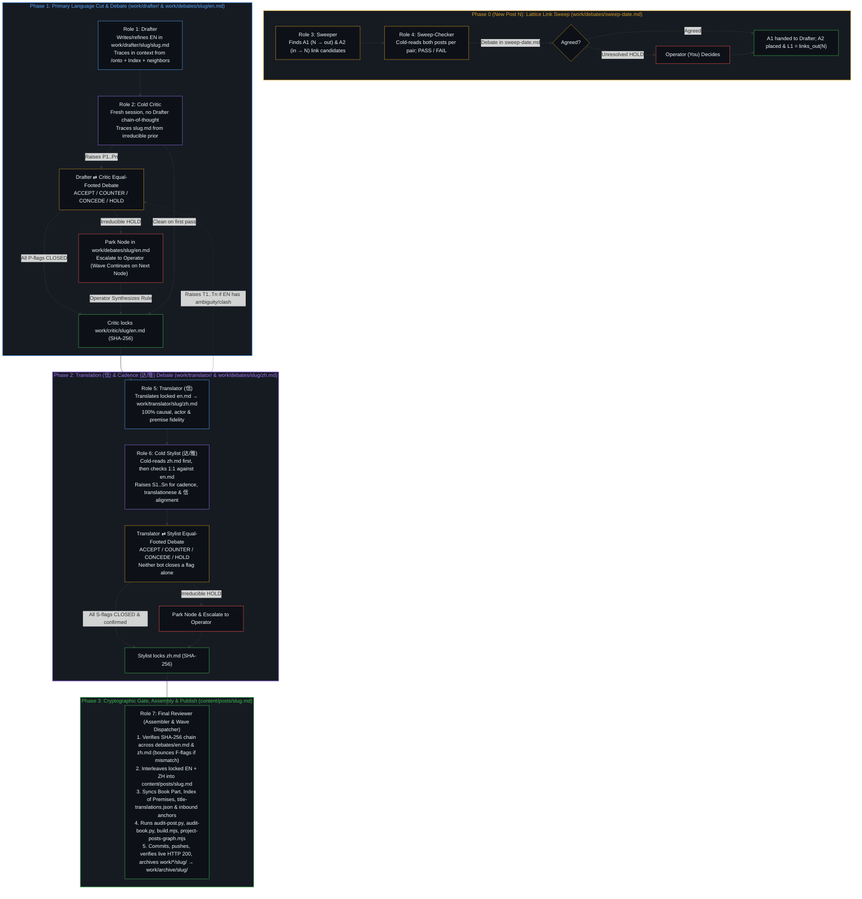

# Multi-Bot Authoring & 2-Layer Wave Refinement Architecture (v4)

> **Canonical Location:** [`docs/wave-refinement-plan.md`](../docs/wave-refinement-plan.md) (symlinked at `work/README.md`)  
> **Foundational Ground:** [`/ontological-clarity`](../../../.gemini/skills/ontological-clarity/SKILL.md) and *Beyond the Projection: Designing Agentic Systems Through Ontological Clarity*  
> **Supersedes:** `~/.gemini/antigravity/brain/7b783e22-5619-46cf-8548-7a9f4a6dac88/implementation_plan.md` (v1–v3) and incorporates all settled rulings from `2026-10-18-wave-plan-review.md` and live Wave 1–2 execution (Oct 19, 2026).

---

## 1. Ontological Foundations: Why This Architecture Exists

Designing an agentic authoring and refinement pipeline by asking a single agent to draft, self-review, translate, and publish within one session context pits the structural mechanics of autoregressive models against the structural mechanics of human cognition. Traced from the single premise of [`/ontological-clarity`](../../../.gemini/skills/ontological-clarity/SKILL.md) (*self-distinguishing activity occurs — uncaused, unceasing*), the system is wired around four structural invariants:

### 1.1 Trajectory vs. Identity (Weaponizing Zero-Ego)
- **The Agent's Bind (Trajectory Gravity Well):** An LLM agent is a finite projection engine. Every token it generates becomes the conditioning history (`Trace`) for every token that follows. Left inside its own drafting session, its first draft becomes its retained `Image`: it cannot step outside the token trajectory it just predicted, so self-review merely rationalizes and wraps its own blind spots.
- **The Agent's Strength (Zero Ego):** Unlike a human whose reasoning history fuses with identity, an agent has zero personal attachment to having been "right" one turn ago. When a valid counterpoint enters its context from *outside* its self-reinforcing loop, it performs a clean Bayesian update.
- **The Architectural Consequence:** Every generative step (`Drafter`, `Sweeper`, `Translator`) is paired with an equal-footed cold peer (`Critic`, `Sweep-Checker`, `Stylist`) that receives the **task context** (the artifact, linked posts, and skill) without the **session context** (the generator's internal chain of thought). No third "Judge Agent" is inserted between them: every flag is either resolved by **mutual agreement (`ACCEPT` / `CONCEDE`)** under logical coherence or escalated to the **Human Operator**.

### 1.2 Mitosis of Projection Along Orthogonal Axes (`Capacity`)
Cramming $2^N$ independent requirements—ontological derivation, English prose refinement, cross-link discovery, causal translation (`信`), native Chinese cadence (`达/雅`), and book/index assembly—into one prompt or simultaneous bilingual edit exceeds a center's finite `Capacity`. Independent axes compress onto one register, causing cadence edits to invert causal steps or translation choices to soften the cut.
- **The Architectural Consequence:** The pipeline splits the projection along clean, orthogonal boundaries:
  1. **Primary Language Conceptual Cut & Prose** (`Drafter` $\leftrightarrow$ `Critic`)
  2. **Lattice Link Discovery & Verification** (`Sweeper` $\leftrightarrow$ `Sweep-Checker`)
  3. **Logical Translation (`信`) & Native Cadence (`达/雅`)** (`Translator` $\leftrightarrow$ `Stylist`)
  4. **Cryptographic Verification, Interleaving & Publishing** (`Final Reviewer`)

### 1.3 Dispatcher vs. Orchestrator (`Observer` + `Power`)
- **Agents as Dispatchers (Finite Projection):** Routing tasks across files, verifying SHA-256 hash locks, interleaving paired paragraphs, running deterministic audits, and advancing the wave cursor are well-defined structural operations. `Final Reviewer` (and `Dispatcher` at the outer boundary) executes these mechanics.
- **The Human as Ultimate Orchestrator (Unprojected Intent):** Only the human holds dynamic, limit-resolution sensing and can step backward out of a broken frame when two premises collide. Whenever a peer debate reaches an irreducible `HOLD`, the local streamline pauses and surfaces the exact coordinate of friction to the Operator. Making that call forces a higher-order synthesis that dissolves the contradiction rather than overriding one bot by fiat.

### 1.4 Continuous Narrowing of Excess Image Lag (Wave Refinement)
- **Refinement Follows New Writing:** The standalone backlog queue is retired. A wave begins only when a new post `N` is published. The new essay's cut is the differential signal against which neighboring posts register residual `Image` lag.
- **Hubs Recur by Design:** High-degree hubs (`individual-choices-as-the-only-causal-levers`, `openness-is-consistency`, `intelligence-belongs-only-to-the-mind`) appear in most waves because hubs are where stabilized traces broadcast furthest across the lattice. As past lag is paid off, each pass becomes naturally lighter without artificial caps or "light modes."

---

## 2. Workspace Separation: Role-Scoped Plain Markdown (`work/`) vs. Canonical Source (`content/posts/`)

Earlier iterations either hid Chinese text inside opaque JSON blobs (`zh.json` + `interleave.py`) or proposed writing intermediate single-language files directly into `content/posts/<slug>.md` and `content/posts/<slug>.zh-tmp.md`. Placing in-flight drafts inside `content/posts/` collapsed two orthogonal axes—*human-readable plain Markdown* and *the live site's canonical build surface*—forcing a single-threaded global lock where any deadlock halted the entire repository.

The v4 architecture separates **in-flight plain-Markdown workspaces (`work/`, excluded via `.git/info/exclude`)** from **canonical published source (`content/posts/`)**:

| Path | Owner / Writer | Purpose |
| :--- | :--- | :--- |
| `work/drafter/<slug>/<slug>.md` | `Drafter` | Pure primary-language (EN, or ZH for Chinese-originals) Markdown draft/refinement, including Mermaid diagrams and relative `[title](../other-slug/)` links. |
| `work/drafter/<slug>/notes.md` | `Drafter` | Context trace: linked posts read, Index of Premises entries checked, and refinement rationale. |
| `work/critic/<slug>/en.md` | `Critic` | Verbatim copy of the primary-language draft once all `P`-flags are closed, stamped with its SHA-256 hash. |
| `work/sweeper/<date>.md` | `Sweeper` | Link proposals: `A1` (outgoing from `N`), `A2` (incoming to `N`), and `B` (other corpus pairs), with verbatim sentence & anchor verification. |
| `work/sweep-checker/<date>.md` | `Sweep-Checker` | Independent verification (`PASS` / `FAIL`) of each link proposal in `work/sweeper/<date>.md`. |
| `work/translator/<slug>/zh.md` | `Translator (信)` | Pure secondary-language (ZH, or EN for Chinese-originals) Markdown translation of the locked primary text. |
| `work/stylist/<slug>/zh.md` | `Stylist (达/雅)` | Locked secondary-language Markdown after all `S`-flags are settled and verified. |
| `work/debates/<slug>/en.md` | `Critic` $\leftrightarrow$ `Drafter` | SHA-256-anchored debate log (`P1..Pn` and post-lock `T1..Tn`). |
| `work/debates/<slug>/zh.md` | `Stylist` $\leftrightarrow$ `Translator` | SHA-256-anchored debate log (`S1..Sn`). |
| `work/debates/<slug>/final.md` | `Final Reviewer` | Pre-publish verification log (`F`-findings if any, SHA-256 chain check, weave stats, and publish commit SHA). |
| `work/final-reviewer/wave-<k>.md` | `Final Reviewer` | Active 2-layer wave checklist (`N`, `L1`, `L2`, `visited`, parked `HOLD`s, and commit SHAs). |
| `work/<role>/todo.md` | Each role | Externalized cross-node observations (out-of-scope residual nicks, anchor mismatches) saved for future nodes so active sessions can clear cleanly. |
| `work/archive/<slug>/` | `Final Reviewer` | Completed per-node `drafter/`, `critic/`, `translator/`, `stylist/`, and `debates/` folders moved here immediately after publish. |
| `content/posts/<slug>.md` | `Final Reviewer` (Wave) / `Essay Writer` (New Post init) | Canonical alternating bilingual post on the live site. Untouched during wave node Stages 1–4 so `git status` stays clean. |

---

## 3. The 7 Cooperating Bot Roles & Dialectical Topology

### Role Specifications & Invariants

#### Role 1 — `Drafter` (Primary Language Drafter / Refiner)
- **Context Loaded:** [`/ontological-clarity`](../../../.gemini/skills/ontological-clarity/SKILL.md), [`AGENTS.md`](../AGENTS.md) (*Write in context, traced to premises*), the target post `content/posts/<slug>.md`, the upstream post that triggered this wave step, the target post's linked neighbors, its [`content/book/index-of-premises.md`](../content/book/index-of-premises.md) entries, and its book chapter.
- **Execution:** Extracts or refines the pure English essay (or pure Chinese for the 3 Chinese-original posts) in `work/drafter/<slug>/<slug>.md`, recording its context trace in `work/drafter/<slug>/notes.md`. If the existing post already holds the upstream cut cleanly with zero internal inconsistency, factual error, or EN/ZH mismatch, `Drafter` may record a `no change` verdict with its trace and hand straight to `Critic` for cold verification.
- **Debate Rule:** Replies `ACCEPT` (with exact replacement text and premise trace) or `COUNTER` (with premise trace) to each `P`-flag from `Critic` in `work/debates/<slug>/en.md`. Never closes a flag unilaterally.

#### Role 2 — `Critic` (Cold Ontological Peer)
- **Context Loaded:** Fresh session context with [`/ontological-clarity`](../../../.gemini/skills/ontological-clarity/SKILL.md), [`studio/review-method.md`](../studio/review-method.md), and `work/drafter/<slug>/<slug>.md` (plus linked posts as needed to verify claims). Never reads `Drafter`'s session history.
- **Execution:** Records the SHA-256 of the critiqued draft at the top of `work/debates/<slug>/en.md`, states what the draft's cut is and what holds first, then lists numbered points (`P1..Pn`) where independent axes compress, where an observer judges unobservable interiors, where a totalizing word ("only", "never", "all") over-closes a bounded mechanism, or where two sections disagree.
- **Gate:** In Round 2+, marks each point `CONCEDE` (`CLOSED applied` or `CLOSED withdrawn`) or `HOLD`. Once all points are closed and verified verbatim in `work/drafter/<slug>/<slug>.md`, copies the locked file to `work/critic/<slug>/en.md` and records its final SHA-256. Any point remaining on `HOLD` after Round 2 is tagged to the Operator.

#### Roles 3 & 4 — `Sweeper` & `Sweep-Checker` (Lattice Link Pair)
- **When Run:** On every New Post `N` (once `N`'s English is locked) to identify `A1` (outgoing links from `N` to existing posts) and `A2` (incoming backlinks from existing posts into `N`), and optionally `B` (unlinked corpus pairs during dedicated link sweeps).
- **Execution:** `Sweeper` proposes candidate links where an existing sentence carries the link without rewriting; `Sweep-Checker` cold-reads both posts in full and rules `PASS` or `FAIL` in `work/debates/sweep-<date>.md`. Agreed `A1` links go to `Drafter` before translation; agreed `A2` links are placed in the target posts.

#### Role 5 — `Translator` (`信` — Logical & Causal Fidelity)
- **Context Loaded:** Locked `work/critic/<slug>/en.md` (verified by SHA-256), [`/ontological-clarity`](../../../.gemini/skills/ontological-clarity/SKILL.md), [`data/title-translations.json`](../data/title-translations.json), and `git show HEAD:content/posts/<slug>.md` (to reuse or refine unchanged Chinese paragraphs from already-bilingual posts).
- **Post-Lock Surgical Loop (`T1..Tn`):** Translation into Chinese is an orthogonal projection test on the English source. If translating a sentence exposes a hidden ambiguity, pronoun gap, or term clash in the locked `en.md`, `Translator` posts `T1..Tn` to `work/debates/<slug>/en.md`. `Drafter` updates `en.md`, `Critic` confirms and re-locks a new SHA-256, and `Translator` translates from the re-locked hash.
- **Execution:** Writes pure Chinese Markdown (title, single-line italic subtitle, lead, `## 一、 <中文标题>`, body paragraphs, Chinese link anchors matching target H1s or `data/title-translations.json`, and pure-Chinese Mermaid diagrams) to `work/translator/<slug>/zh.md`.
- **Debate Rule:** Answers `Stylist` flags `S1..Sn` in `work/debates/<slug>/zh.md` with `ACCEPT` or `COUNTER` (with a reason grounded in `信` or `达`). **Never closes a flag unilaterally; there is no unilateral "`信` wins" override.**

#### Role 6 — `Stylist` (`达/雅` — Native Cadence & 1:1 Alignment Checker)
- **Context Loaded:** Fresh session context. Performs a **cold read of `work/translator/<slug>/zh.md` first** (to catch unnatural cadence, stacked pre-nominal `的` clauses, ungrammaticalfocus frames, garden-path phrases, and vocabulary-hygiene hits as a native reader), and **then** reads it line-by-line against `work/critic/<slug>/en.md` to verify 1:1 causal, actor, and emphasis alignment.
- **Gate:** Raises `S1..Sn` in `work/debates/<slug>/zh.md`. In Round 2+, marks each point `CONCEDE` or `HOLD` (including holding when a `Translator` counter-proposal inadvertently alters `信`, e.g., turning a constitutive relation into a causal `因为`). Once all `S`-flags are settled and verified verbatim in `zh.md` with matching block counts and link counts, `Stylist` writes `STYLIST: confirmed` with the final `zh.md` SHA-256. Any irreducible `HOLD` goes to the Operator.

#### Role 7 — `Final Reviewer` (Cryptographic Gatekeeper, Assembler & Wave Dispatcher)
- **Strict Dispatcher Boundary (§IV):** `Final Reviewer` is a deterministic verifier, assembler, and wave dispatcher—**never** an autonomous Orchestrator or prose rewriter.
- **Execution Checklist per Node:**
  1. **Verify Chain of Custody:** Check that `work/debates/<slug>/en.md` has `CRITIC: confirmed` on the exact SHA-256 of `work/drafter/<slug>/<slug>.md` (including any post-lock `T`-flags), and that `work/debates/<slug>/zh.md` has `STYLIST: confirmed` on the exact SHA-256 of `work/translator/<slug>/zh.md`, with zero open flags or unresolved Operator points. If any hash mismatches or a point was closed unilaterally, bounce with an `F`-finding in `work/debates/<slug>/final.md`.
  2. **Interleave:** Combine locked `en.md` and `zh.md` into `content/posts/<slug>.md` in the strict alternating paragraph and language-attached diagram layout (`CN Paragraph -> CN Diagram -> EN Paragraph -> EN Diagram`).
  3. **Sync Book & Lattice Metadata:** Update [`content/book/<part>.md`](../content/book/), [`content/book/index-of-premises.md`](../content/book/index-of-premises.md), and [`data/title-translations.json`](../data/title-translations.json) (removing converted posts from the translation registry once bilingual, or updating registry titles), and sync incoming link anchors across the corpus if an H1 changed.
  4. **Run Audits & Projections:**
     - `python3 scripts/audit-post.py <slug>` (must return `CLEAN PASS` or intentional `PASSED WITH ADVISORIES`)
     - `python3 scripts/audit-book.py` (must return `CLEAN PASS` or intentional `PASSED WITH ADVISORIES`)
     - `node build.mjs`
     - `node scripts/project-posts-graph.mjs` (`missing_targets: 0`)
  5. **Publish & Archive:**
     - For a **New Post (`N`)**: Pause for Operator check before `git commit` & `git push`.
     - For a **Wave Node (`L1` / `L2`)**: Commit, `git push origin main`, wait for GitHub Pages deploy (`gh run watch --exit-status`), verify live HTTP 200 on `https://powerpig99.github.io/not-a-toe/posts/<slug>/`, move `work/*/<slug>/` into `work/archive/<slug>/`, mark the node `[x]` in `work/final-reviewer/wave-<k>.md`, and dispatch the next node.

---

## 4. 2-Layer Forward Wave Topology & Parallel Streamlines

### 4.1 Forward-Only Propagation (`links_out`)
By `Trace` asymmetry in [`/ontological-clarity`](../../../.gemini/skills/ontological-clarity/SKILL.md), shaping runs one way. When post `P` links outward to `Q` (`P → Q`), `P` explicitly invokes `Q`'s distinction as a premise or adjacent axis. Including *incoming* links at Layer 2 (`links_in` to every hub in `L1`) conflates "premises `L1` relies on" with "every post in the book that cites a hub."

Therefore, a wave's topology is strictly:
1. **Origin (`N`):** New Post `N` is drafted, debated, translated, styled, and published. `Sweeper` $\leftrightarrow$ `Sweep-Checker` places both `N`'s outgoing links (`A1`) and incoming reverse links from existing posts (`A2`). Initialize `visited = {N}`.
2. **Layer 1 (`L1`):** All forward links from `N` (`links_out(N)` in [`docs/posts.graph.json`](../docs/posts.graph.json) after `N` ships), in graph order, minus `visited`.
3. **Layer 2 (`L2`):** Once `L1` completes and `docs/posts.graph.json` is regenerated, collect all forward links from every post in `L1` (`links_out(L1)`), in `L1` order then graph order, deduplicated, minus `visited` (`N` $\cup$ `L1`).
4. **One Wave in Flight:** No new post is initiated mid-wave; the wave runs through `L1` and `L2` to completion before the next New Post begins.

### 4.2 Non-Blocking Fault Isolation & Stage Pipelining (§III.3 & §III.4)
Because `work/<role>/<slug>/` isolates in-flight drafts from `content/posts/`:
- **Localized Fault Isolation on `HOLD`:** If Node $k$ hits an irreducible deadlock between `Drafter` and `Critic` (or `Translator` and `Stylist`) after Round 2, `Final Reviewer` marks Node $k$ as `[HOLD — awaiting Operator]` in `work/final-reviewer/wave-<k>.md` and **immediately dispatches Node $k+1$**. A premise contradiction in one node never halts the wave; only that node's local streamline waits for the Operator's synthesis.
- **Stage Pipelining:** Once Node $k$'s English is locked at `work/critic/<slug-k>/en.md` and handed to `Translator` (Phase 2), `Drafter` $\leftrightarrow$ `Critic` can begin Phase 1 on Node $k+1$ in `work/drafter/<slug-k+1>/` concurrently, provided Node $k+1$ does not depend on an unsettled title change in Node $k$. `Final Reviewer` serializes only Phase 3 (`content/posts/` assembly, graph projection, and `git push`).

### 4.3 Session Trajectory Hygiene Across Wave Nodes (§I & §III.2)
To prevent a long wave (e.g., 70+ nodes) from turning persistent bot sessions into a cross-node epistemic gravity well:
1. **Clear Conversational History Between Nodes (or Bounded Mini-Batches of $\le 3$ Nodes):** Each role (`Drafter`, `Critic`, `Translator`, `Stylist`) clears its active session context between nodes so prior debates do not act as conditioning history for the next essay.
2. **Externalize Durable Findings Only to `work/<role>/todo.md`:** Any cross-post observation discovered while working on Node $k$ (e.g., a broken title case or residual moral phrasing noticed in a neighbor) is appended as a one-line fact to `work/<role>/todo.md` and dropped from active session memory until that neighbor's own wave node arrives.
3. **True Cold-Read Separation:** `Critic` (on `en.md`) and `Stylist` (cold read on `zh.md`) must run in a fresh context unconditioned by the generator's session tokens.

### 4.4 Chinese-Original Exception
For the 3 monolingual Chinese-original posts in the corpus (`e-shi-feng-bi-de-shan`, `qian-yin-hou-guo`, `mei-you-pu-du-zhi-you-zi-du`), the language order in Phases 1 and 2 flips so the author's original Chinese is refined rather than overwritten by a back-translation:
- **Phase 1 (`Drafter` $\leftrightarrow$ `Critic`):** Refines the original Chinese in `work/drafter/<slug>/zh.md` $\rightarrow$ locked `work/critic/<slug>/zh.md`.
- **Phase 2 (`Translator` $\leftrightarrow$ `Stylist`):** Translates the locked Chinese into English in `work/translator/<slug>/en.md` $\rightarrow$ locked `work/stylist/<slug>/en.md`.
- **Phase 3 (`Final Reviewer`):** Interleaves `zh.md` and `en.md` into `content/posts/<slug>.md` as usual.
