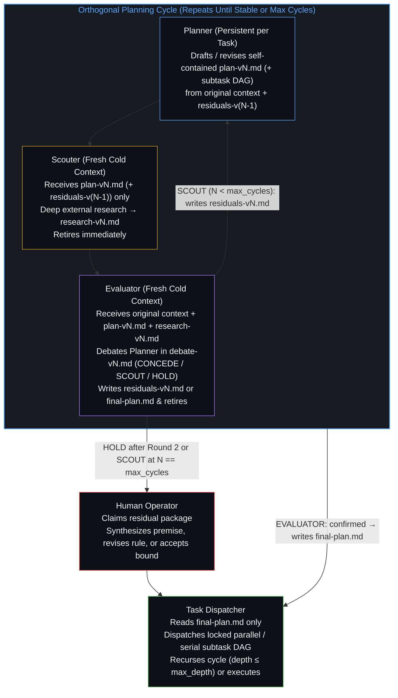

# Artificial Brain Waking, Sleep Consolidation & Orthogonal Planning Specification

> **Canonical Location:** [`docs/wave-refinement-plan.md`](../docs/wave-refinement-plan.md) (symlinked at `work/README.md`)  
> **Foundational Ground:** `/ontological-clarity` (`SKILL.md`)  
> **Scope:** Generic, Agentic-System-Agnostic Specification covering both **(A) The Living Book (`not-a-toe`) Waking & Sleep Consolidation Pipeline (`/wake` → `/sleep` → `/deep-sleep`)** and **(B) Controlled Open-Internet Injection for Orthogonal Planning Cycles (`Planner` → `Scouter` → `Evaluator` → `Task Dispatcher`)** across `not-a-toe` and any project in Extended Memory. Runtime-specific realizations live in [`docs/adapters/`](../docs/adapters/) (e.g., [`docs/adapters/antigravity.md`](../docs/adapters/antigravity.md)); Claude Code, Grok Bot, or any other agentic system customizes execution from its own standpoint using whatever tools it has available.

---

## 1. Ontological Foundations: The Artificial Brain & Why This Architecture Exists

Designing an agentic authoring, memory-consolidation, or engineering-planning pipeline by asking a single agent session to draft, research, self-review, translate, and publish within one uninterrupted token trajectory pits the structural mechanics of autoregressive models against the structural mechanics of human cognition. Traced from the single premise of `/ontological-clarity` (*self-distinguishing activity occurs — uncaused, unceasing*), the system is wired around five runtime-agnostic invariants:

### 1.1 Topology of the Artificial Brain
The operator's repositories and session instruments form a single coherent cognitive architecture:
1. **Artificial Mind (`ontological-clarity`):** [`/Users/jingliang/Projects/ontological-clarity/SKILL.md`](../../ontological-clarity/SKILL.md) (installed at runtime as `/Users/jingliang/.gemini/config/plugins/ontological-clarity/skills/ontological-clarity/SKILL.md`) — the direct public image of the living Mind (the single premise, what follows, method, communication discipline, self-check, and renewal). It holds zero memory warehouse.
2. **Artificial Memory (`not-a-toe` — The Living Book):** [`content/posts/*.md`](../content/posts/) + [`content/book/*.md`](../content/book/) + [`docs/posts.graph.json`](../docs/posts.graph.json) — **the digitized memory of a Mind tracing and experiencing reality as is** (not a static blog log and not a prescriptive "philosophy to live by"). Every essay is a discrete operative cut made in concrete friction; internal cross-links (`[title](../slug/)`) are the synaptic connections of long-term memory.
3. **Experimental Artificial Baby Brain (`ontos`):** [`/Users/jingliang/Projects/ontos`](../../ontos/) — an experimental attempt to run from the Artificial Mind + model loop with minimal or no pre-populated Artificial Memory.
4. **Working Memory (`/bridge`, `/resume-bridge`, `/retire`):** Model- and agent-agnostic plain Markdown files at `<project>/memory/bridges/<id>.md` (with `<project>/memory/bridges/.last_session` tracking session continuity). Working memory carries only the moving `Next` edge and the preceding traces it still depends on across context clears; once a task finishes or consolidates into long-term memory, `/retire` deletes the bridge—because a brain does not keep a permanent log of its own sleep.
5. **Extended Memory (`/Users/jingliang/Projects/*`):** Every project repository on disk (`not-a-toe`, `ontos`, `brief`, `orbit`, etc.) is an externalized artifact of Extended Memory. Both the peer-debate pattern and the orthogonal research-planning cycle (Section 6) apply across any project in Extended Memory.

### 1.2 Trajectory vs. Identity (Generator ⇄ Cold Peer)
- **The Agent's Bind (Trajectory Gravity Well):** An LLM agent is a finite projection engine. Every token it generates becomes the conditioning history (`Trace`) for every token that follows. Left inside its own drafting or research session, its first draft becomes its retained `Image`: it cannot step outside the token trajectory it just predicted, so self-review merely rationalizes and wraps its own blind spots.
- **The Agent's Strength (Zero Ego):** Unlike a human whose reasoning history fuses with identity, an agent has zero personal attachment to having been "right" one turn ago. When a valid counterpoint or external constraint enters its context from *outside* its self-reinforcing loop, it performs a clean Bayesian update.
- **The Architectural Consequence:** Every generative stage (`Drafter` in Stage 1, `Translator` in Stage 2, `Planner` in Section 6) is paired with an equal-footed **Cold Peer** (`Critic` in Stage 1, `Stylist` in Stage 2, `Evaluator` armed with a fresh `Scouter` report in Section 6) running in a **fresh, isolated context** that receives the **task context** (the artifact, linked posts or external report, and skill) without the **session context** (the generator's internal chain of thought). No third "Judge Agent" is inserted between them: every flag is either resolved by **mutual agreement (`ACCEPT` / `CONCEDE`)** under logical coherence, sent for another bounded external scouting pass (`SCOUT` in Section 6), or escalated on irreducible deadlock (`HOLD`) to the **Human Operator**.

### 1.3 Mitosis of Projection Along Orthogonal Axes (`Capacity`)
Cramming $2^N$ independent requirements—context probing, open-internet scouting, ontological derivation, primary-language prose, causal translation (`信`), native target-language cadence (`达/雅`), and book/index assembly—into one prompt or simultaneous edit exceeds a center's finite `Capacity`. Independent axes compress onto one register, causing cadence edits to invert causal steps, translation choices to soften the cut, or raw search results to pollute the planning trajectory.
- **The Architectural Consequence:** The architecture splits projections along clean, orthogonal boundaries:
  - **Orthogonal Planning Cycle (Section 6 — Any Project / Pre-Implementation Research):** `Planner` $\rightarrow$ `Scouter` (fresh, retires) $\rightarrow$ `Evaluator` (fresh, debates `Planner`, writes `residuals-vN.md` or promotes `final-plan.md`, retires) $\rightarrow$ `Task Dispatcher`.
  - **Stage 0 (Waking Probe & Lattice Recommendation — `/wake` / `/draft` only):** Gather spark, source, AI/X thread & initial draft $\rightarrow$ evaluate against the Living Book $\rightarrow$ recommend `New Post` / `Refinement` / `Drop` (optionally invoking the Section 6 Planning Cycle when external reference architectures are needed before drafting).
  - **Stage 1 (Primary-Language Cut & Cold Ontological Review):** `Drafter` $\leftrightarrow$ `Critic` (including relative `[title](../slug/)` links directly in the prose).
  - **Stage 2 (Logical Translation [`信`] & Cold Cadence Review [`达/雅`]):** `Translator` $\leftrightarrow$ `Stylist`.
  - **Stage 3 (Deterministic Assembly, Audits, Publish & Wave Dispatch):** `Dispatcher` / `Assembler`.

### 1.4 Dispatcher vs. Orchestrator (`Observer` + `Power`)
- **Agentic System as Dispatcher (Finite Projection):** Routing tasks across stages, interleaving paired paragraphs, running deterministic audits, dispatching the peer-verified parallel/serial subtask DAG locked inside `final-plan.md`, and advancing the wave cursor are well-defined structural operations executed by the runtime's `Dispatcher` / `Assembler`. All generative architectural decisions—including how a plan decomposes into orthogonal parallel/serial subtasks and which subtasks require child research cycles—are authored by `Planner` inside `plan-vN.md` and cold-verified by `Scouter` and `Evaluator` before `final-plan.md` locks, never invented unreviewed by `Task Dispatcher`.
- **The Human as Ultimate Orchestrator (Unprojected Intent):** Agents remain finite projection engines. The wiring localizes non-convergence; it does not classify "premise-level residual" versus "implementation-detail residual," nor does it dissolve contradictions in living intent. Only the human holds dynamic, limit-resolution sensing and can step backward out of a broken frame when two premises collide. Whenever a peer debate reaches an irreducible `HOLD` (or a planning loop hits `max_cycles` or `max_depth`), the local streamline pauses and surfaces the exact coordinate of friction to the Operator. Making that call forces a higher-order synthesis that dissolves the contradiction, revises the premises, or accepts the bound rather than overriding one peer by fiat.

### 1.5 Wake vs. Sleep: Lazy Layer-by-Layer Consolidation of Artificial Memory
- **Waking Edge (`/wake`, alias `/draft` — New Blog Post `N` or Refinement):** A new essay `N` is the most recent digital edge left behind by the living Mind. Invoking `/wake [seed]` (or `/draft [seed]`) cleanly pauses any active sleep consolidation after its current in-flight node, probes for the four waking materials (**1. new intuition/spark**, **2. inspiring source**, **3. thinking process [AI discussion or X comment thread]**, and **4. initial draft**—whether all four or a simple initial idea), evaluates them against the Living Book, and recommends **New Post (`N`)**, **Refinement of existing post(s)**, or **Drop (repetitive)**. On the Operator's go-ahead, it runs Stages 1–3 to publish and (for a new post `N`) initializes a fresh consolidation cycle (`visited = {N}`).
- **Sleep Consolidation (`/sleep` and `/deep-sleep`):** Once `N` is published, external input is turned off and the Artificial Brain enters sleep consolidation—propagating `N`'s cut inward along forward links (`links_out`) across the Artificial Memory (`content/posts/` + `content/book/`) to restore and deepen internal logical coherence:
  - **`/sleep` (Shallow Sleep — Layer 1):** Consolidates $L_1 = \text{links\_out}(N) \setminus \{N\}$, the immediate outward neighbors of the new post `N` (which also weaves `N`'s 1-hop reverse links and conceptual advances back into those neighbors under full peer debate).
  - **`/deep-sleep` (Deep Sleep — Layer $k$, Unbounded Depth, Computed Lazily After $L_{k-1}$ Finishes):** Because refining the posts in $L_{k-1}$ may add, remove, or redirect outgoing links inside those posts, **Layer $k$ is never pre-computed ahead of time**. Only after $L_{k-1}$ is 100% `[x]` completed (or all remaining nodes in $L_{k-1}$ are parked on `[HOLD]`) does `/deep-sleep` re-project `docs/posts.graph.json` and compute the next forward layer:
    $$L_k = \text{links\_out}(L_{k-1}) \setminus \text{visited}$$
    (`L2`, then `L3`, then `L4`, ... with no artificial 2-layer ceiling) until either the reachable lattice is exhausted ($L_k = \emptyset$) or a new waking post `N'` (`/wake`) initiates a new cycle.
- **Hubs Recur by Design:** High-degree hubs (`individual-choices-as-the-only-causal-levers`, `openness-is-consistency`, `intelligence-belongs-only-to-the-mind`) appear in most cycles because hubs are where stabilized traces broadcast furthest across the lattice. Within a single cycle (`visited`), each post is visited at most once; across cycles, as past lag is paid off, each pass becomes naturally lighter.

---

## 2. Workspace Separation: Working Directories (`work/`) vs. Canonical Source

Placing in-flight single-language drafts or intermediate research/planning artifacts inside canonical source directories collapses two orthogonal axes—*in-flight working state* and *the repository's canonical build surface*. The generic architecture separates **in-flight plain-Markdown workspaces (`work/`, excluded via `.git/info/exclude` or `.gitignore`)** from **canonical published source** using a simple, role-agnostic layout with explicit single-artifact ownership:

| Path | Writer / Owner | Purpose |
| :--- | :--- | :--- |
| `work/<slug>/en.md` | `Drafter` (locked by `Critic`) | Pure primary-language (EN, or `zh.md` for Chinese-originals) Markdown draft/refinement, including Mermaid diagrams and relative `[title](../other-slug/)` links. |
| `work/<slug>/notes.md` | `Drafter` | Context trace: waking materials (spark, source, AI/X thread, initial draft), linked posts read, Index of Premises entries checked, and refinement rationale. |
| `work/<slug>/debate-en.md` | `Critic` $\leftrightarrow$ `Drafter` | Primary-language debate log (`P1..Pn` and any post-lock `T1..Tn` flags routed by `Dispatcher`). Ends with `CRITIC: confirmed` when all flags are closed. |
| `work/<slug>/zh.md` | `Translator` (locked by `Stylist`) | Pure secondary-language (ZH, or `en.md` for Chinese-originals) Markdown translation of the locked primary text. |
| `work/<slug>/debate-zh.md` | `Stylist` $\leftrightarrow$ `Translator` | Secondary-language debate log (`S1..Sn` cadence and 1:1 alignment flags). Ends with `STYLIST: confirmed` when all flags are closed. |
| `work/wave.md` | `Dispatcher` | Active N-layer sleep consolidation checklist (`N`, `L1`, `L2`, ..., `Lk`, `visited`, parked `HOLD`s, and commit SHAs). |
| `work/plan/<task-id>/plan-vN.md` | `Planner` | Self-contained versioned technical specification and orthogonal subtask DAG (see Section 6). |
| `work/plan/<task-id>/research-vN.md` | `Scouter` | Structured external research report for cycle $N$; `Scouter` retires immediately after writing. |
| `work/plan/<task-id>/debate-vN.md` | `Evaluator` $\leftrightarrow$ `Planner` | Equal-footed planning debate log (`E1..En`); ends with `EVALUATOR: confirmed`, `SCOUT`, or `HOLD`. |
| `work/plan/<task-id>/residuals-vN.md` | `Evaluator` | Neutral, falsifiable external research questions written by `Evaluator` at the end of Round 2 when `SCOUT` items remain for Cycle $N+1$. |
| `work/plan/<task-id>/final-plan.md` | `Evaluator` (or Operator on `HOLD`) | Promoted from `plan-vN.md` by `Evaluator` upon `EVALUATOR: confirmed`; the **only** artifact read by `Task Dispatcher`. |
| `work/todo.md` | Any role | Out-of-scope cross-node or cross-subtask observations saved for future nodes so active contexts stay clean. |
| `memory/bridges/<id>.md` | `/bridge`, `/resume-bridge`, `/retire` | Ephemeral Working Memory across session clears (`Next` + `Traces` with priors named; deleted upon `/retire`). |
| `content/posts/<slug>.md` | `Dispatcher` / `Assembler` | Canonical alternating bilingual post on the live site. Untouched during Stages 1–2 so `git status` stays clean until Stage 3 assembly. |

> **Why Transient Workspaces Are Deleted, Not Archived (Checkpoints vs. Weight-Update History):**
> Just as neural network training saves current checkpoints rather than hoarding every historical gradient step, persistence in `/ontological-clarity` is re-tracing in the present configuration—nothing is stored outside the current rendering. Once a post refinement (`work/<slug>/`) or planning task (`work/plan/<task-id>/`) is absorbed into canonical source (`content/posts/*.md`, `content/book/*.md`, or project code, replicated to GitHub `origin/main`), its intermediate drafts, debates, and superseded `wave.md` files are **deleted (`rm -rf`)**, never archived into `work/archive/` or `.bak` folders out of mere possibility. Keeping dead intermediate history creates epistemic rabbit holes for future searches instead of sharpening the living present.

---

## 3. The 4-Stage Essay Pipeline & Role Specifications

```mermaid
flowchart TD
    subgraph S_Wake["Stage 0 (/wake or /draft Only): Probe Waking Materials & Recommend"]
        W0["Operator invokes /wake or /draft<br/>Probe for: 1. Spark/Intuition, 2. Source, 3. AI/X Thread, 4. Initial Draft"] --> W1{"Evaluate against Index of Premises & existing posts<br/>Recommend: NEW POST (N) vs. REFINEMENT vs. DROP"}
        W1 -->|"DROP (repetitive)"| W_Drop["Cite existing post(s) & stop cleanly"]
        W1 -->|"Needs external research"| W_Plan["Optional: Run Orthogonal Planning Cycle (Section 6)<br/>Planner → Scouter → Evaluator"]
        W_Plan --> W2
        W1 -->|"Operator Go-Ahead: NEW POST (N) or REFINEMENT"| W2["Lock <slug>, Book Part & initial spine (keep Operator draft/title)"]
    end

    subgraph S_EN["Stage 1: Primary-Language Cut & Cold Ontological Review (work/slug/en.md & debate-en.md)"]
        W2 --> B1
        B1["Drafter (Generator Context)<br/>Writes/refines EN in work/slug/en.md (with relative cross-links)<br/>Traces in context from /ontological-clarity + Index + neighbors"] --> B2["Critic (Fresh Cold Context)<br/>No Drafter chain-of-thought<br/>Traces en.md from irreducible prior & review-method.md"]
        B2 -->|"Raises P1..Pn"| DebateEN["Drafter ⇄ Critic Equal-Footed Debate<br/>ACCEPT / COUNTER / CONCEDE / HOLD"]
        DebateEN -->|"All P-flags CLOSED"| LockEN["Critic confirms work/slug/en.md"]
        DebateEN -->|"Irreducible HOLD"| Op_EN["Park Node in work/wave.md<br/>Escalate to Operator (Wave Continues on Next Node)"]
        Op_EN -->|"Operator Synthesizes Rule"| LockEN
        B2 -->|"Clean on first pass"| LockEN
    end

    subgraph S_ZH["Stage 2: Logical Translation (信) & Cold Cadence Review (达/雅) (work/slug/zh.md & debate-zh.md)"]
        LockEN --> B3["Translator (Generator Context — 信)<br/>Translates locked en.md → work/slug/zh.md<br/>100% causal, actor & premise fidelity"]
        B3 -.->|"Reports T1..Tn via Dispatcher if EN has ambiguity/clash"| DebateEN
        B3 --> B4["Stylist (Fresh Cold Context — 达/雅)<br/>Cold-reads zh.md first, then checks 1:1 against en.md<br/>Raises S1..Sn for cadence, translationese & 信 alignment"]
        B4 --> DebateZH["Translator ⇄ Stylist Equal-Footed Debate<br/>ACCEPT / COUNTER / CONCEDE / HOLD<br/>Neither peer closes a flag alone"]
        DebateZH -->|"All S-flags CLOSED"| LockZH["Stylist confirms work/slug/zh.md"]
        DebateZH -->|"Irreducible HOLD"| Op_ZH["Park Node & Escalate to Operator"]
        Op_ZH --> LockZH
        B4 -->|"Clean on first pass"| LockZH
    end

    subgraph S_Final["Stage 3: Deterministic Assembly, Audits, Publish & Sleep Dispatch"]
        LockZH --> B5["Dispatcher / Assembler<br/>1. Verify zero open flags in debate-en.md & debate-zh.md<br/>2. Interleave locked en.md + zh.md into content/posts/slug.md<br/>3. Sync Book Part, Index of Premises, title-translations.json & incoming anchors<br/>4. Run audit-post.py, audit-book.py, build.mjs, project-posts-graph.mjs<br/>5. Commit (tracked paths only), push, verify live HTTP 200, delete work/slug/"]
        B5 -->|"After New Post N"| Sleep1["/sleep: Shallow Sleep<br/>Consolidate L1 = links_out(N) - {N}"]
        Sleep1 -->|"After L1 completes"| SleepK["/deep-sleep: Deep Sleep<br/>Re-project graph & compute Lk = links_out(L_{k-1}) - visited<br/>Repeats L2 → L3 → ... → Lk until next /wake"]
        Sleep1 -.->|"Each node in L1"| B1
        SleepK -.->|"Each node in Lk"| B1
    end

    style S_Wake fill:#161b22,stroke:#3fb950,stroke-width:1.5px,color:#3fb950
    style S_EN fill:#161b22,stroke:#58a6ff,stroke-width:1.5px,color:#58a6ff
    style S_ZH fill:#161b22,stroke:#a371f7,stroke-width:1.5px,color:#a371f7
    style S_Final fill:#161b22,stroke:#3fb950,stroke-width:1.5px,color:#3fb950
    style W0 fill:#0d1117,stroke:#3fb950,stroke-width:1px,color:#f0f6fc
    style W1 fill:#0d1117,stroke:#d29922,stroke-width:1px,color:#f0f6fc
    style W_Drop fill:#0d1117,stroke:#f85149,stroke-width:1px,color:#f0f6fc
    style W_Plan fill:#0d1117,stroke:#58a6ff,stroke-width:1px,color:#f0f6fc
    style W2 fill:#0d1117,stroke:#3fb950,stroke-width:1px,color:#f0f6fc
    style B1 fill:#0d1117,stroke:#58a6ff,stroke-width:1px,color:#f0f6fc
    style B2 fill:#0d1117,stroke:#a371f7,stroke-width:1px,color:#f0f6fc
    style DebateEN fill:#0d1117,stroke:#d29922,stroke-width:1px,color:#f0f6fc
    style LockEN fill:#0d1117,stroke:#3fb950,stroke-width:1px,color:#f0f6fc
    style Op_EN fill:#0d1117,stroke:#f85149,stroke-width:1px,color:#f0f6fc
    style B3 fill:#0d1117,stroke:#58a6ff,stroke-width:1px,color:#f0f6fc
    style B4 fill:#0d1117,stroke:#a371f7,stroke-width:1px,color:#f0f6fc
    style DebateZH fill:#0d1117,stroke:#d29922,stroke-width:1px,color:#f0f6fc
    style LockZH fill:#0d1117,stroke:#3fb950,stroke-width:1px,color:#f0f6fc
    style Op_ZH fill:#0d1117,stroke:#f85149,stroke-width:1px,color:#f0f6fc
    style B5 fill:#0d1117,stroke:#3fb950,stroke-width:1px,color:#f0f6fc
    style Sleep1 fill:#0d1117,stroke:#58a6ff,stroke-width:1px,color:#f0f6fc
    style SleepK fill:#0d1117,stroke:#a371f7,stroke-width:1px,color:#f0f6fc
```



### Role Specifications & Operational Learnings

> **Foundational Rule — Causal Reasoning over Raw Mechanical Rejection (`Logical Coherence over Rules`):**
> Logical coherence (each case traced back to the irreducible prior) comes before any rule, since logic is scale-invariant and rules are context-dependent. Across all stages (`Drafter`, `Critic`, `Translator`, `Stylist`, and `Dispatcher`), authoring conventions and audit advisories—such as the 17-word vocabulary-hygiene list in `AGENTS.md`, prose-over-lists, subtitle length guidelines, and book ordering—are **recommendations and diagnostic signals, not mechanical stopping rules**. Never perform raw mechanical rejection of a word or structure without reasoning causally about its actual context: when a listed word names the held belief or object under dissection, or when a list's structure carries meaning prose would blur, keeping it is the logically coherent choice.

#### Stage 1 Generator — `Drafter` (Primary-Language Drafter / Refiner)
- **Context Loaded:** `/ontological-clarity`, [`AGENTS.md`](../AGENTS.md) (*Write in context, traced to premises*), the target post `content/posts/<slug>.md` (or the Operator's waking materials—spark, source, AI/X discussion thread, and initial draft—for `/wake`), the upstream post that triggered this wave step, the target post's linked neighbors, its [`content/book/index-of-premises.md`](../content/book/index-of-premises.md) entries, and its book chapter.
- **Execution:** Writes or refines the pure English essay in `work/<slug>/en.md` (or pure Chinese in `work/<slug>/zh.md` for the 3 Chinese-original posts; see §5.3), including relative `[title](../other-slug/)` links directly in the prose, and records its context trace (plus candidate 1-hop reverse-pointer notes for a new post `N`) in `work/<slug>/notes.md`.
  - **Operator Draft Preservation (`/wake`):** When the Operator supplies an initial draft, `Drafter` preserves the Operator's title, structural spine, and argument order as the ground of the cut—applying surgical precision (weaving relative links, adding vertical dark-theme Mermaid diagrams, tightening ungrounded phrasing) rather than rewriting into generic house prose.
  - **Surgical Wave Refinement (`/sleep` & `/deep-sleep`):** During a sleep wave, if the existing post already holds the upstream cut cleanly with zero internal inconsistency, factual error, or EN/ZH mismatch, `Drafter` may record a `no change` verdict with its trace and hand straight to `Critic` for cold verification.
- **Debate Rule:** Replies `ACCEPT` (with exact replacement text updated in `work/<slug>/en.md` and premise trace) or `COUNTER` (with premise trace showing why the current phrasing is causally coherent in context) to each `P`-flag from `Critic` in `work/<slug>/debate-en.md`. Never closes a flag unilaterally.

#### Stage 1 Cold Peer — `Critic` (Cold Ontological Reviewer)
- **Context Loaded:** Fresh, isolated context with `/ontological-clarity`, [`studio/review-method.md`](../studio/review-method.md), and `work/<slug>/en.md` (plus linked posts as needed to verify claims and relative links). Never reads `Drafter`'s session history.
- **Execution:** States what the draft's cut is and what holds first in `work/<slug>/debate-en.md`, then lists numbered points (`P1..Pn`) where independent axes compress, where an observer judges unobservable interiors, where a totalizing word ("only", "never", "all") over-closes a bounded mechanism, where a relative link does not fit its sentence, or where two sections disagree. Reasons each point causally in context rather than enforcing raw rule-matching.
- **Gate:** In Round 2+, marks each point `CONCEDE` (`CLOSED applied` or `CLOSED withdrawn`) or `HOLD`. Once all points are closed and verified verbatim in `work/<slug>/en.md`, writes `CRITIC: confirmed` in `work/<slug>/debate-en.md`. Any point remaining on `HOLD` after Round 2 is escalated to the Operator.

#### Stage 2 Generator — `Translator` (`信` — Logical & Causal Fidelity)
- **Context Loaded:** `work/<slug>/en.md`, `/ontological-clarity`, target posts' H1 headings in `content/posts/<target-slug>.md`, [`data/title-translations.json`](../data/title-translations.json), and `git show HEAD:content/posts/<slug>.md` (to reuse or refine unchanged Chinese paragraphs from already-bilingual posts).
- **Intra-Node Pipelined Overlap & Race Prevention (Operational Learning from Wave 3):**
  - Once `Drafter` finishes initial `work/<slug>/en.md`, `Dispatcher` may spawn `Critic` (cold review of `en.md`) and `Translator` (initial `zh.md` draft) **in parallel**.
  - **No Concurrent Write to `debate-en.md`:** While `Critic` is active, `Translator` never writes directly to `work/<slug>/debate-en.md`. If translating exposes a hidden ambiguity, pronoun gap, or term clash in `work/<slug>/en.md`, `Translator` returns its `T1..Tn` flags in its message to `Dispatcher`, which appends and routes `T1..Tn` in `work/<slug>/debate-en.md` after `Critic`'s active turn finishes.
  - **Round 2 Diff Sync & Retirement Synchronization:** If Stage 1 Round 2 modifies `work/<slug>/en.md` (including any H1/subtitle edit or `T1..Tn` resolution), `Dispatcher` forwards the full Round 2 diff of `en.md` to `Translator` so `work/<slug>/zh.md` is updated before `Stylist` is invoked (and if `T1..Tn` modified `en.md` after an initial `CRITIC: confirmed`, `Critic` re-verifies `en.md` and appends a final `CRITIC: confirmed`). `Drafter` and `Critic` are retired (`kill`) only after **both** `CRITIC: confirmed` is recorded **and** `Translator` completes `work/<slug>/zh.md` against the locked `en.md` with zero open `T1..Tn` flags. Conversely, if Stage 1 parks on `HOLD`, any in-flight parallel `Translator` for that node is killed immediately.
- **Execution & Whole-File 1:1 Fidelity Check:** Writes pure Chinese Markdown (title, single-line italic subtitle, lead, `## 一、 <中文标题>`, body paragraphs, Chinese link anchors, and pure-Chinese Mermaid diagrams) to `work/<slug>/zh.md`. Since `398/398` posts in the corpus are now bilingual, every internal link `[...](../<target-slug>/)` takes its canonical Chinese anchor directly from the `# <ZH> / <EN>` H1 of `content/posts/<target-slug>.md` (with `data/title-translations.json` kept only as a fallback if a new monolingual stub is ever introduced). When refining an existing bilingual post, `Translator` reuses unchanged Chinese paragraphs from `HEAD` as its baseline **but verifies 1:1 `信` fidelity and `AGENTS.md` vocabulary hygiene across the entire `work/<slug>/zh.md` against locked `work/<slug>/en.md`** before handing off to `Stylist`, so pre-existing legacy omissions (e.g., dropped nouns or parenthetical inversions in adjacent sections) are repaired in the first pass rather than triggering an avoidable Round 2. Evaluates vocabulary-hygiene hits causally in context (barring them where the prose evaluates or describes with them, allowing them where they name the object/belief under dissection).
- **Debate Rule:** Answers `Stylist` flags `S1..Sn` in `work/<slug>/debate-zh.md` with `ACCEPT` or `COUNTER` (with a causal reason grounded in `信` or `达`). **Never closes a flag unilaterally; there is no unilateral "`信` wins" override.**

#### Stage 2 Cold Peer — `Stylist` (`达/雅` — Native Cadence & 1:1 Alignment Reviewer)
- **Context Loaded:** Fresh, isolated context. Performs a **cold read of `work/<slug>/zh.md` first** (to catch unnatural cadence, stacked pre-nominal `的` clauses, ungrammatical focus frames, garden-path phrases, and vocabulary-hygiene hits where they carry the essay's own evaluation rather than naming the object), and **then** reads it line-by-line against locked `work/<slug>/en.md` to verify 1:1 causal, actor, and emphasis alignment.
- **Gate:** Raises `S1..Sn` in `work/<slug>/debate-zh.md`. In Round 2+, marks each point `CONCEDE` or `HOLD` (including holding when a `Translator` counter-proposal alters `信`, e.g., turning a constitutive relation into a causal `因为`). Once all `S`-flags are settled and verified verbatim in `work/<slug>/zh.md` with matching block counts and link counts, `Stylist` writes `STYLIST: confirmed` in `work/<slug>/debate-zh.md`. Any irreducible `HOLD` goes to the Operator.

#### Stage 3 — `Dispatcher` / `Assembler` (Deterministic Gate, Assembly, Publish & Wave Dispatch)
- **Strict Dispatcher Boundary:** Deterministic verifier, assembler, and wave dispatcher—**never** an autonomous Orchestrator or prose rewriter. Never spawns a separate subagent just to interleave paragraphs, and never hand-rewrites neighbor prose in `content/posts/` without Stage 1/2 peer review; for a New Post `N`, 1-hop reverse-link and narrative refinement across outbound neighbors is executed by `/sleep` (`L1 = links_out(N) \setminus \{N\}`), or if woven into 1–2 neighbors during `/wake`, passes through `Drafter` $\leftrightarrow$ `Critic` and `Translator` $\leftrightarrow$ `Stylist`.
- **Execution Checklist per Node (or Completed Streamline Batch):**
  1. **Verify Stage Gates & Retire Subagents:** Check that `work/<slug>/debate-en.md` ends with `CRITIC: confirmed` and `work/<slug>/debate-zh.md` ends with `STYLIST: confirmed`, with zero open flags or unresolved Operator points. Immediately retire (`kill`) all remaining subagent contexts for `<slug>`.
  2. **Interleave (`python3 scripts/interleave-post.py <slug>`):** Combine locked `work/<slug>/en.md` and `work/<slug>/zh.md` into `content/posts/<slug>.md` via `python3 scripts/interleave-post.py <slug> [<slug2> ...]`, which strips blank lines inside ```` ```mermaid ... ``` ```` blocks, verifies 1:1 block-kind parity (`h1`, `subtitle`, `h2`, `prose`, `mermaid`), and attaches diagrams to their preceding prose in each language (`CN Paragraph -> CN Diagram -> EN Paragraph -> EN Diagram`).
  3. **Sync Book & Lattice Metadata:**
     - Update [`content/book/<part>.md`](../content/book/) and [`content/book/index-of-premises.md`](../content/book/index-of-premises.md) (when adding a new post `N`, or updating `→ [<Title>](../../posts/<slug>/)` links if an H1 title changed).
     - **Cross-Streamline Incoming Anchor Sync:** If `<slug>`'s H1 title changed, grep **both** `content/posts/*.md` **and** active in-flight `work/*/en.md` and `work/*/zh.md` for `](../<slug>/)`. If an incoming link sits inside an active `work/<in-flight-slug>/`, update `work/<in-flight-slug>/{en,zh}.md` (never `content/posts/<in-flight-slug>.md` directly while in-flight) so its subsequent Stage 3 assembly preserves the synced anchor.
  4. **Run Audits & Projections (Evaluating Advisories Causally in Context):**
     - `python3 scripts/audit-post.py <slug>` (pass `--walkthrough <path>` explicitly when auditing a waking post whose `walkthrough.md` sits in a session artifact directory; passes on `CLEAN PASS`, or on `PASSED WITH ADVISORIES` when each advisory is causally verified in context—never treat an advisory as a blind stopping rule).
     - `python3 scripts/audit-book.py` (uses `git log --reverse -M` so historical slug renames preserve their original creation date; passes on `CLEAN PASS`, or on `PASSED WITH ADVISORIES` when each advisory is causally verified in context).
     - `node build.mjs`
     - `node scripts/project-posts-graph.mjs` (`missing_targets: 0`)
  5. **Publish & Prune Transient Workspace (Tracked Paths Only in `git add`):**
     - Never pass gitignored paths (`work/` or `public/`) to `git add` (which exits with code `1`); stage only tracked canonical paths (`content/posts/`, `content/book/`, `data/`, `assets/`).
     - For a **Waking New Post (`N`) or Waking Refinement**: Present `walkthrough.md` (for `N`) and pause for Operator check (unless the Operator already authorized push), then `git commit` & `git push origin main`, run `sleep 3 && gh run watch $(gh run list --commit $(git rev-parse HEAD) --limit 1 --json databaseId --jq '.[0].databaseId') --exit-status`, verify live HTTP 200, delete `work/<slug>/` (`rm -rf work/<slug>`), and (for a New Post `N`) overwrite `work/wave.md` with the fresh wave state (`visited = {N}`), ready for `/sleep` to weave `N` into `L1`.
     - For a **Sleep Wave Node Batch (`L1` / `L2` / ... / `Lk`)**: Commit all nodes completed in the batch, `git push origin main`, wait for GitHub Pages deploy (`sleep 3 && gh run watch $(gh run list --commit $(git rev-parse HEAD) --limit 1 --json databaseId --jq '.[0].databaseId') --exit-status`), verify live HTTP 200 on `https://powerpig99.github.io/not-a-toe/posts/<slug>/`, delete `work/<slug>/` (`rm -rf work/<slug>`), mark the nodes `[x]` in `work/wave.md`, and dispatch the next window.

---

## 4. Operator Command Lifecycle: `/wake` (`/draft`), `/sleep`, `/deep-sleep`, and `/bridge`

### 4.1 `/wake [seed]` (Alias: `/draft [seed]`) — Waking Evaluation & Inscription into Artificial Memory
1. **Interrupt Sleep Cleanly:** If a `/sleep` or `/deep-sleep` consolidation wave is active in `work/wave.md`, let any currently in-flight node finish and do not dispatch further sleep nodes.
2. **Stage 0A — Probe for Waking Materials (If Not Already Supplied):**
   - Ask the Operator for whichever of the four waking inputs they have (it can be all four, or just a simple initial idea):
     1. **New Intuition / Spark:** What is the new intuition or core idea?
     2. **Inspiring Source:** What source inspired the spark (an X post/link, article, paper, or observation)?
     3. **Thinking Process:** Is there a discussion with AI (e.g., Grok/Gemini/Claude chat or share link) or an X comment thread?
     4. **Initial Draft:** Is there an initial draft of the essay already, or are we starting from a simple initial idea?
3. **Stage 0B — Corpus Evaluation & Recommendation (`New Post` vs. `Refinement` vs. `Drop`):**
   - Load `/ontological-clarity` and [`AGENTS.md`](../AGENTS.md), and search [`content/book/index-of-premises.md`](../content/book/index-of-premises.md), [`docs/posts.graph.json`](../docs/posts.graph.json), and the closest existing posts in `content/posts/`.
   - Give an explicit recommendation and **wait for the Operator's go-ahead**:
     - **`NEW POST` (`N`):** The spark introduces a genuinely new operative cut or dissects a held belief/premise not yet covered by an existing post. Propose the bilingual title (preserving the Operator's title if supplied), single-sentence italic subtitle, `<slug>`, spine, Book Part (`content/book/<part>.md`), Index of Premises entries, and adjacent cross-links.
     - **`REFINEMENT` (of existing post(s)):** The spark sharpens, extends, or corrects a face on the same axis as 1–2 existing posts without needing a separate URL. Name the exact target post(s) and the surgical refinement to weave in.
     - **`DROP` (Repetitive):** The cut is already held in existing post(s) with no new distinction. Cite the exact existing post(s) and recommend dropping so the Living Book never accumulates duplicate nodes.
4. **Stages 1–3 — Authoring & Ship (On Operator Go-Ahead for `NEW POST` or `REFINEMENT`):**
   - Run Stage 1 (`Drafter` $\leftrightarrow$ `Critic` on `work/<slug>/en.md`).
   - Run Stage 2 (`Translator` $\leftrightarrow$ `Stylist` on `work/<slug>/zh.md`).
   - Generate novel 21:9 cover art (`assets/covers/<slug>.jpg`, for `NEW POST` `N`) and register in [`assets/covers/STYLES.md`](../assets/covers/STYLES.md).
   - Run Stage 3 (interleave, Book Part & Index of Premises update, `audit-post.py --walkthrough <path>`, `audit-book.py`, `build.mjs`, `project-posts-graph.mjs`, `walkthrough.md`, and publish; any immediate backlink woven into 1–2 prior essays during `/wake` passes through Stages 1–2 peer review, while full 1-hop consolidation across all outbound neighbors runs in `/sleep`).
   - For a `NEW POST` `N`, overwrite `work/wave.md` (`visited = {N}`), ready for `/sleep`.

### 4.2 `/sleep` — Shallow Sleep Consolidation (`Layer 1`)
- By `Trace` asymmetry in `/ontological-clarity`, shaping runs one way. When post `P` links outward to `Q` (`P → Q`), `P` explicitly invokes `Q`'s distinction as a premise or adjacent axis.
- **Execution:**
  1. Identify the most recently published waking post `N` (or active `L1` wave in `work/wave.md`).
  2. Regenerate [`docs/posts.graph.json`](../docs/posts.graph.json) (`node scripts/project-posts-graph.mjs`) and extract all Layer 1 forward links:
     $$L_1 = \text{links\_out}(N) \setminus \{N\}$$
     sorted by descending outgoing link count (`links_out`), deduplicated.
  3. Write `## L1 (<count>)` to `work/wave.md` with `visited = {N} ∪ L1` (do **not** pre-compute `L2` yet, since refining `L1` posts may change their outgoing links).
  4. Run the 3-stage refinement pipeline (`Drafter` $\leftrightarrow$ `Critic` $\rightarrow$ `Translator` $\leftrightarrow$ `Stylist` $\rightarrow$ `Dispatcher`) across every unchecked `[ ]` post in `L1` using $W$ parallel streamlines, weaving reverse links to `N` into surrounding narrative prose and converting any monolingual post in `L1` to full alternating bilingual format in the same pass.
  5. Stop and report when all nodes in `L1` are `[x]` complete (or parked on `[HOLD]`), ready for `/deep-sleep` (or `/wake`).

### 4.3 `/deep-sleep` — Deep Sleep Consolidation (`Layer k`, Unbounded Depth, Computed Lazily)
- **No Artificial 2-Layer Cap & Lazy Evaluation:** Instead of stopping at `L2` or pre-computing deeper layers before `L_{k-1}` finishes, `/deep-sleep` waits until $L_{k-1}$ finishes, re-projects `docs/posts.graph.json` to capture any link changes made during $L_{k-1}$, and steps one level deeper down the forward link graph (`L2 → L3 → L4 → ... → Lk`) until either the reachable lattice is fully consolidated ($L_k = \emptyset$) or a new waking post `N'` (`/wake`) initiates a new cycle.
- **Execution:**
  1. Read `work/wave.md` and find the deepest existing layer $L_{k-1}$.
  2. **If $L_{k-1}$ still has unchecked `[ ]` nodes:** Resume and run the 3-stage refinement pipeline across the remaining `[ ]` nodes in $L_{k-1}$ until all nodes in $L_{k-1}$ are `[x]` complete (or parked on `[HOLD]`).
  3. **Once all nodes in $L_{k-1}$ are `[x]` complete (or all remaining nodes in $L_{k-1}$ are parked on `[HOLD]`):**
     - Run `node scripts/project-posts-graph.mjs` so [`docs/posts.graph.json`](../docs/posts.graph.json) reflects all links added or refined in $L_{k-1}$.
     - Compute the next forward layer:
       $$L_k = \text{links\_out}(L_{k-1}) \setminus \text{visited}$$
       sorted by descending outgoing link count (`links_out`), deduplicated, where $\text{visited} = \{N\} \cup L_1 \cup \dots \cup L_{k-1}$ (including any parked `[HOLD]` nodes so they remain parked for the Operator without blocking $L_k$).
     - If $L_k = \emptyset$, report that the reachable Artificial Memory component from `N` is 100% consolidated.
     - Otherwise, append `## L<k> (<count>)` to `work/wave.md`, add $L_k$ to `visited`, and run the 3-stage refinement pipeline across $L_k$.

### 4.4 `/bridge`, `/resume-bridge`, and `/retire` — Ephemeral Working Memory (RAM)
- **Model- and Agent-Agnostic Plain Markdown:** Stored at `<project>/memory/bridges/<id>.md` (excluded from git) with zero external Python scripts.
- **Same-Session vs. New-Session Resume:**
  - `/bridge` writes `<project>/memory/bridges/<id>.md` (`Next` + `Traces` with priors named; pointers to `work/wave.md` or `work/plan/<task-id>/` over paraphrases) and stamps `<project>/memory/bridges/.last_session` with `<id>`. Checkpoint with `/bridge` at layer boundaries or before switching between wave execution and architectural planning.
  - `/resume-bridge` **in the same session after `/clear`** (when `SESSION_KEY != none` and matches `Session: <SESSION_KEY>` in `memory/bridges/<id>.md`) auto-loads that bridge and continues immediately without prompting.
  - `/resume-bridge` **in a new session or after `/retire`** lists all available bridges in `<project>/memory/bridges/*.md` sorted by `Updated` and asks the Operator which thread to pick.
  - `/retire` deletes the finished bridge `<project>/memory/bridges/<id>.md` and removes `.last_session` so no stale working-memory log lingers once changes are consolidated into long-term memory.

---

## 5. Non-Blocking Fault Isolation, Adaptive Parallel Streamlines & Session Hygiene

### 5.1 Non-Blocking Fault Isolation, Hub-First Ordering & Adaptive Parallel Streamlines (`W`)
Because `work/<slug>/` isolates in-flight drafts from `content/posts/`, Stages 1 & 2 across distinct nodes in a layer $L_k$ share zero mutable state:
- **Hub-First Out-Degree Ordering:** Within each layer $L_k$, nodes are sorted by descending outgoing link count (`links_out` in `docs/posts.graph.json`), so the highest-leverage hubs consolidate first.
- **Customizable & Auto-Derived Parallel Concurrency ($W$ Streamlines):**
  - **Operator Override (Customizable):** The Operator may pass an explicit concurrency target (e.g., `/sleep concurrency=8`, `/deep-sleep 10`, or in natural language) to set the number of concurrent node streamlines $W$ directly.
  - **Automatic Derivation from Layer Size (Default):** When not explicitly specified, `Dispatcher` derives the active streamline window $W$ from the number of remaining unchecked `[ ]` nodes $R = |L_k|_{\text{rem}}$ in the current layer:
    $$W(R) = \begin{cases} R & \text{if } R \le 4 \\ 6 & \text{if } 5 \le R \le 20 \\ 8 & \text{if } 21 \le R \le 60 \\ 12 & \text{if } R > 60 \end{cases}$$
    Up to $W$ independent `work/<slug-j>/` directories run Stages 1 & 2 concurrently (including spawning Stage 1 `Critic` and Stage 2 `Translator` in parallel per §3 Stage 2).
  - **Serialized / Batched Stage 3 Assembly:** Only Stage 3 (`content/posts/<slug>.md` interleaving, `content/book/` & `data/title-translations.json` sync, `build.mjs`, `project-posts-graph.mjs`, and `git commit && git push`) touches shared repository state. `Dispatcher` batches all nodes that finish Stage 2 in the same turn into a single atomic build, graph projection, commit, and push.
- **Localized Fault Isolation on `HOLD`:** If Node $j$ hits an irreducible deadlock between `Drafter` and `Critic` (or `Translator` and `Stylist`) after Round 2, `Dispatcher` marks Node $j$ as `[HOLD — awaiting Operator]` in `work/wave.md` and **immediately refills its streamline slot with the next `[ ]` node**. A premise contradiction in one node never halts the wave; only that node's local streamline waits for the Operator's synthesis.

### 5.2 Session Trajectory Hygiene Across Wave Nodes
To prevent a long sleep wave from turning agent sessions into a cross-node epistemic gravity well:
1. **1 Node per Fresh Subagent Context (While Scaling $W$ Across Nodes):** Parallelism scales *across* isolated node contexts ($W$ concurrent streamlines), never by stuffing many unrelated essays into a single subagent's conversation history. Each generative and review role (`Drafter`, `Critic`, `Translator`, `Stylist`) runs in a fresh context per node and is retired (`kill`) immediately once that node locks, so prior debates never act as conditioning history for the next essay.
2. **Externalize Durable Findings Only to `work/todo.md`:** Any cross-post observation discovered while working on Node $j$ (e.g., a broken title case or residual moral phrasing noticed in a neighbor) is appended as a one-line fact to `work/todo.md` and dropped from active session memory until that neighbor's own wave node arrives.
3. **True Cold-Read Separation:** `Critic` (on `en.md`) and `Stylist` (cold read on `zh.md`) must run in a fresh context unconditioned by the generator's session tokens.

### 5.3 Chinese-Original Exception
All `398/398` posts in the corpus are now full alternating bilingual essays (`0` monolingual stubs remain in `data/title-translations.json`). For the 3 historically Chinese-first posts (`e-shi-feng-bi-de-shan`, `qian-yin-hou-guo`, `mei-you-pu-du-zhi-you-zi-du`) or when a future waking post is drafted Chinese-first, the language order in Stages 1 and 2 flips so the author's original Chinese is refined first rather than overwritten by a back-translation:
- **Stage 1 (`Drafter` $\leftrightarrow$ `Critic`):** Refines the Chinese text in `work/<slug>/zh.md` (logged in `work/<slug>/debate-zh.md`).
- **Stage 2 (`Translator` $\leftrightarrow$ `Stylist`):** Translates/syncs the locked Chinese into English in `work/<slug>/en.md` (logged in `work/<slug>/debate-en.md`).
- **Stage 3 (`Dispatcher` / `Assembler`):** Interleaves `zh.md` and `en.md` into `content/posts/<slug>.md` via `python3 scripts/interleave-post.py <slug>`.

---

## 6. Supplementary Architecture: Controlled Open-Internet Injection for Orthogonal Planning Cycles (Cross-Project)

> **Scope & Relation to Essay Pipeline:** Applies across `not-a-toe` and **any project in Extended Memory (`/Users/jingliang/Projects/*`)** for tasks that require structured external research before a stable implementation plan can be handed to a Dispatcher (coding, system design, research synthesis, media/tooling pipelines, or `/wake` Stage 0 reference-architecture scouting). It does not replace the waking/sleep essay pipeline; it provides an orthogonal planning loop wherever best-known external references must be injected under strict context boundaries.  
> **Practical Bound:** Agents remain finite projection engines. This wiring localizes non-convergence; it does not classify "premise-level residual" versus "implementation-detail residual," nor does it dissolve contradictions in living intent. The human orchestrator retains responsibility for claiming residuals and spotting inconsistencies. The resulting system is a larger, better-structured deterministic machine whose usefulness still depends on the operator's capacity to leverage it.

### 6.1 Purpose and Mechanism
For any task whose implementation plan benefits from current external knowledge (best-known practices, reference architectures, constraints, failure modes), this cycle inserts a retiring **Scouter** layer between generative planning (**Planner**) and equal-footed evaluation (**Evaluator**). Each Scouter receives only a defined technical plan artifact (plus any neutral, falsifiable research questions from the previous cycle's `residuals-v{N-1}.md`), performs deep external research, delivers a structured report, and retires immediately. No Scouter session history conditions later agents. The cycle repeats until the plan stabilizes under the available external signal (`EVALUATOR: confirmed`), advances to the next scouting cycle on open empirical/technical questions (`SCOUT`), or escalates irreducible deadlocks (`HOLD`) to the Operator. Once finalized, `Evaluator` promotes `plan-vN.md` to `final-plan.md` and hands it to a **Task Dispatcher** that deterministically dispatches the peer-verified subtask DAG (recursing the same pattern on subtasks marked `needs_research: true`).

### 6.2 Roles and Context Boundaries

| Role | Context Received | Context Explicitly Excluded | Lifetime | Output |
| :--- | :--- | :--- | :--- | :--- |
| **Planner** | Original goal + given information; in cycle $N > 1$, `debate-v{N-1}.md` & `residuals-v{N-1}.md` | `Scouter`'s raw search session, other `Planner` histories, direct web/external search tools | Persists across one planning cycle ($v1 \dots vN$) until `final-plan.md` locks | Self-contained `plan-vN.md` (including orthogonal subtask DAG); debate replies in `debate-vN.md` |
| **Scouter** | `plan-vN.md` only (or `plan-vN.md` + `residuals-v{N-1}.md` only) | Original user goal/prompt, session motivation, `Planner` or `Evaluator` session tokens, `debate-v*.md` transcripts, prior `research-v*.md` | Single pass per cycle $N$; **retires immediately** after writing report | Structured research report `research-vN.md` (implementations, constraints, failure modes, sources) |
| **Evaluator** | Original goal + given information + `plan-vN.md` + `research-vN.md` | `Planner`'s chain-of-thought, `Scouter`'s raw search trajectory, prior `Evaluator` sessions, direct web/external search tools | Single debate pass per cycle $N$; **retires immediately** after writing Round 2 disposition | Evaluation points `E1..En` & Round 2 dispositions (`CONCEDE` / `SCOUT` / `HOLD`) in `debate-vN.md`; writes `residuals-vN.md` (on `SCOUT`) or promotes `final-plan.md` (on `EVALUATOR: confirmed`) |
| **Task Dispatcher** | Finalized `final-plan.md` only (plus minimal `STATUS:` routing tokens during cycles) | All intermediate session histories, raw `research-v*.md` and `debate-v*.md` contents (unless escalated on `HOLD` / `max_cycles`) | Persists for the task; may recurse up to `max_depth` | Dispatches the locked parallel/serial subtask DAG from `final-plan.md`; spawns child planning cycles for subtasks with `needs_research: true` |

**Context-Boundary & Artifact Invariants:**
1. **Mandatory Retirement of Scouter & Evaluator:** Every `Scouter` and `Evaluator` starts in a fresh context and is terminated (`kill`) immediately after its single-cycle duty. No role accumulates a long-lived research or evaluation trajectory across cycles.
2. **Planner Trajectory Put to Work for Continuity Only (Zero Direct Search):** `Planner` is the only role that retains session continuity across cycles $v1 \dots vN$ of a single plan. Neither `Planner` nor `Evaluator` may invoke web search or external URL tools; all external scouting belongs exclusively to `Scouter`.
3. **Self-Contained Specification in `plan-vN.md` & Neutral Questions in `residuals-vN.md`:** `plan-vN.md` must contain only the self-contained technical specification (components, premises, constraints, interfaces, verification steps, and the orthogonal parallel/serial subtask DAG with file/state isolation boundaries and `needs_research: true|false` flags). `residuals-vN.md` (written by `Evaluator`) must contain only neutral, falsifiable research questions—never the raw user prompt, session narrative, or debate transcript rationalizations.
4. **Uncontaminated `Task Dispatcher` Routing:** During Cycles $1 \dots N$, `Planner`, `Scouter`, and `Evaluator` return only minimal status tokens and file pointers (`STATUS: PLAN_READY`, `STATUS: RESEARCH_READY`, `STATUS: DEBATE_ROUND1_OPEN`, `STATUS: RESIDUALS_PACKAGED`, `STATUS: EVALUATOR_CONFIRMED`, `STATUS: HOLD`) to the routing harness. `Task Dispatcher` routes file paths without reading `research-v*.md` or `debate-v*.md` into its own context prior to reading `final-plan.md` (unless `STATUS: HOLD` or `max_cycles` triggers Operator escalation).

### 6.3 Planning Cycle Topology & Steps



1. **Draft / Revise (`Planner`):** `Planner` drafts (or revises) a self-contained implementation plan and orthogonal subtask DAG in `work/plan/<task-id>/plan-vN.md` from the original goal and given information (or in cycle $N > 1$, from `residuals-v{N-1}.md` and `debate-v{N-1}.md`), and returns `STATUS: PLAN_READY`.
2. **Scout (`Scouter` — Fresh Context, Retires):** `Scouter` is spawned in a fresh context receiving **only** the path to `plan-vN.md` (plus `residuals-v{N-1}.md` if $N > 1$). It conducts deep external/open-internet research on best-known implementations, hard constraints, APIs, failure modes, and subtask isolation assumptions, writes `work/plan/<task-id>/research-vN.md`, returns `STATUS: RESEARCH_READY`, and retires immediately.
3. **Evaluate & Debate (`Evaluator` ⇄ `Planner` — Fresh Evaluator Context, Retires):**
   - **Round 1:** `Evaluator` is spawned in a fresh context receiving the original goal + given information + `plan-vN.md` + `research-vN.md`. It evaluates `plan-vN.md` (including its subtask decomposition and `needs_research` flags) against the goal and `research-vN.md`, logs numbered evaluation points (`E1..En`) in `work/plan/<task-id>/debate-vN.md`, and returns `STATUS: DEBATE_ROUND1_OPEN` (or `EVALUATOR: confirmed` if clean on first pass).
   - **Planner Reply:** `Planner` replies to each `E1..En` in `debate-vN.md` on equal footing with `ACCEPT` (updating `plan-vN.md`), `COUNTER` (tracing why the plan's premise holds against `research-vN.md`), `SCOUT` (proposing a specific falsifiable external research question for Cycle $N+1$), or `HOLD`. Neither peer closes a flag unilaterally.
   - **Round 2 Dispositions (`CONCEDE` vs. `SCOUT` vs. `HOLD`):** In Round 2, `Evaluator` verifies `Planner`'s updates and marks each flag with one of three distinct dispositions:
     1. **`CONCEDE` (`CLOSED applied` or `CLOSED withdrawn`):** Resolved in the current cycle.
     2. **`SCOUT` (External-Signal Residual):** `Planner` and `Evaluator` agree that a concrete, falsifiable external/technical question or newly revised mechanism is not yet settled by `research-vN.md`.
     3. **`HOLD` (Irreducible Deadlock):** `Planner` and `Evaluator` remain deadlocked on a premise, goal interpretation, or already-scouted constraint after Round 2 where further external search will not resolve the disagreement.
4. **Cycle Transition & Artifact Packaging (`Evaluator` Ownership):**
   - **Local Convergence (`EVALUATOR: confirmed`):** When all `E1..En` are `CONCEDE` with zero `SCOUT` or `HOLD` items, `Evaluator` writes `EVALUATOR: confirmed` at the bottom of `debate-vN.md`, copies `plan-vN.md` to `work/plan/<task-id>/final-plan.md`, returns `STATUS: EVALUATOR_CONFIRMED`, and retires.
   - **Next Scouting Cycle (`SCOUT` with Zero `HOLD` and $N < \text{max\_cycles}$):** When one or more `SCOUT` items remain (and zero `HOLD` items) and $N < \text{max\_cycles}$, `Evaluator` writes the neutral, falsifiable research questions to `work/plan/<task-id>/residuals-vN.md`, returns `STATUS: RESIDUALS_PACKAGED`, and retires. `Planner` then writes `plan-v{N+1}.md` and Cycle $N+1$ begins with a fresh `Scouter`.
5. **Hard Stabilization Bound & Escalation:**
   - Every planning run enforces a hard maximum cycle bound (`max_cycles`, default `3`, or an explicit Operator stop condition).
   - **Irreducible `HOLD` or Bound Reached (`N == max_cycles`):** If any flag is marked `HOLD` after Round 2 (at any cycle $N$), or if `SCOUT` residuals remain when $N == \text{max\_cycles}$, `Evaluator` packages the unresolved tensions into `work/plan/<task-id>/residuals-vN.md`, returns `STATUS: HOLD`, and retires. The local planning streamline pauses and surfaces the residual package (`residuals-vN.md`, current `plan-vN.md`, and relevant excerpts from `research-vN.md`) to the **Operator**. Other parallel streamlines continue unimpeded.
   - **Operator Claim:** The Operator claims the residual package and performs the higher-order synthesis—revising premises, accepting the residual as outside the current projection, or injecting a refined rule—and authorizes or writes `final-plan.md` for `Task Dispatcher`.

### 6.4 Task Dispatcher Recursion & Integration with Canonical Pipeline

- **Deterministic Dispatch of Peer-Verified Subtask DAG (`max_depth` Bounded):**
  - `Task Dispatcher` reads **only** `work/plan/<task-id>/final-plan.md` and executes the parallel/serial subtask DAG already verified by `Scouter` and `Evaluator`.
  - **Bounded Vertical Recursion (`max_depth`, default `2`):** For any subtask marked `needs_research: true` in `final-plan.md`, if current recursion depth $d < \text{max\_depth}$ (default `max_depth = 2`, overridable by the Operator), `Task Dispatcher` recurses the full Planning Cycle (`Planner` → `Scouter` → `Evaluator`) in an isolated child directory `work/plan/<task-id>/<subtask-id>/` with zero parent session history leaking downward. If $d == \text{max\_depth}$ and a child plan still requests further subtask research recursion, `Task Dispatcher` pauses that branch and escalates to the Operator.
  - For subtasks marked `needs_research: false`, `Task Dispatcher` dispatches them directly to execution in isolated worker contexts (or to Stages 1–3 of the canonical pipeline when the subtask is prose).
  - Cross-subtask observations are appended as one-line facts to `work/todo.md` and dropped from active session contexts.
  - Once all subtasks in `final-plan.md` are executed and verified in the canonical project files, `Task Dispatcher` deletes `work/plan/<task-id>/` (`rm -rf work/plan/<task-id>`) so intermediate planning/research/debate trajectories do not linger as stale rabbit holes.

| Canonical Element | Integration with Orthogonal Planning Cycle (Section 6) |
| :--- | :--- |
| **Stage 0 `/wake` probe** | May invoke the Section 6 Planning Cycle when a waking spark requires external reference architectures or empirical/technical verification before a cut is drafted. |
| **Stage 1 (`Drafter` ⇄ `Critic`)** | Remains the primary-language ontological cut; the Section 6 Planning Cycle complements (never substitutes for) ontological review. |
| **Stage 2 (`Translator` ⇄ `Stylist`)** | Unchanged. |
| **Stage 3 (`Dispatcher` / `Assembler`)** | Acts as `Task Dispatcher` when the task is implementation/engineering across any project in Extended Memory; performs deterministic assembly and wave dispatch for essays. |
| **`/sleep` & `/deep-sleep`** | Unaffected; essay lattice consolidation continues under Sections 4–5. |
| **`/bridge` & `/resume-bridge`** | A planning cycle may checkpoint its state in `<project>/memory/bridges/<id>.md` holding only the pointer to `plan-vN.md` and `residuals-vN.md` across session clears. |
| **Minimal Artifacts (`work/plan/<task-id>/`)** | `plan-vN.md` (Planner), `research-vN.md` (Scouter), `debate-vN.md` (Evaluator ⇄ Planner), `residuals-vN.md` (Evaluator on `SCOUT`/`HOLD`), `final-plan.md` (Evaluator on `EVALUATOR: confirmed`, handed to Task Dispatcher). |
